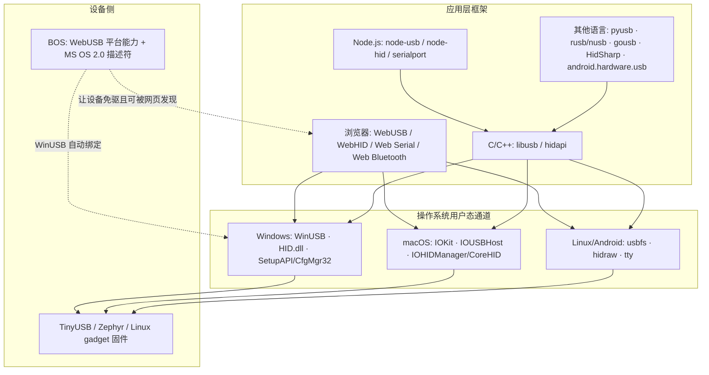

# 框架与 API · 分枝索引

> 🌿 知识树位置: 枝干[框架与API] → 导航页
> 树干: [四种传输类型](../10-树干-USB核心/06-四种传输类型.md) · 相邻枝干: [主机侧与实现](../60-枝干-主机侧与实现/00-索引.md)

本枝干回答一个问题：**"我手里有一台 USB / HID / 串口 / BLE 外设，用哪门语言、哪个框架、走哪条系统通道去控制它？"** 60 号枝干讲的是 OS 栈与驱动本身；这里讲的是站在应用开发者的位置，**成熟框架如何把 USB 协议暴露成 API**——从浏览器里的 WebHID / WebUSB，到 Node.js、C/C++、Python、Rust、Go、.NET、Android，再回到固件侧"如何让设备天生对这些框架友好"。

## 每篇统一结构

每篇（或每个框架小节）都按同一骨架展开，便于横向对照：

| 小节 | 回答的问题 |
|---|---|
| 支持范围 | 能做哪些传输（控制/中断/批量/同步）、哪些设备类、哪些平台 |
| 架构与实现原理 | 从 API 一路向下到 OS 栈（Mermaid 图），每一层由谁实现 |
| 权限与安全模型 | 谁来授权、什么设备/报告被屏蔽、需要什么系统权限 |
| 平台差异 | Windows / macOS / Linux / Android / ChromeOS 的行为差别 |
| 局限与坑 | 真实项目里最容易踩的点 |
| 实战代码示例 | 最小可运行示例（均标注"示例"，API 名称以官方文档为准） |
| 参考来源 | 官方规范、官方文档与官方仓库链接 |

## 文件清单

| 文件 | 定位 | 关键产物 |
|---|---|---|
| [01-浏览器设备API总览与安全模型](01-浏览器设备API总览与安全模型.md) | WebUSB/WebHID/Web Serial/Web Bluetooth 的标准化状态、Chromium 实现架构、权限模型、Electron/扩展/Android | 四 API 对照表、Chromium 分层图、各浏览器立场 |
| [02-WebUSB详解](02-WebUSB详解.md) | WebUSB API、受保护接口类、黑名单、各 OS 后端 | 枚举/控制/批量完整示例 |
| [03-WebHID详解](03-WebHID详解.md) | WebHID API、HID 黑名单（键鼠/FIDO）、报告 ID 语义、平台差异 | 特性报告读写示例 |
| [04-WebSerial与WebBluetooth](04-WebSerial与WebBluetooth.md) | 串口与 BLE GATT 的浏览器接口、GATT 黑名单（含 HID 服务） | 流式串口读写、GATT 读写示例 |
| [05-网页配置器案例-WebHID与VIA](05-网页配置器案例-WebHID与VIA.md) | 厂商如何做浏览器版外设配置器：厂商自定义 Usage Page、特性报告协议设计；VIA/QMK 实例 | 配置协议设计清单、固件侧报告描述符模板 |
| [06-Nodejs生态-node-usb-node-hid-serialport](06-Nodejs生态-node-usb-node-hid-serialport.md) | node-usb（libusb + WebUSB 兼容 API）、node-hid（hidapi）、serialport、N-API 预编译、Electron | 热插拔/读写示例、Electron 打包要点 |
| [07-C与C++-libusb与hidapi](07-C与C++-libusb与hidapi.md) | libusb 架构/后端/热插拔/异步、hidapi 后端 | 异步批量、特性报告示例 |
| [08-操作系统原生API-Windows-macOS-Linux](08-操作系统原生API-Windows-macOS-Linux.md) | WinUSB、SetupAPI/CfgMgr32、HID.dll、WinRT；IOKit/IOUSBHost/CoreHID；usbfs/hidraw | 三平台 HID 特性报告原生写法 |
| [09-多语言绑定-Python-Rust-Go-dotNET-Android](09-多语言绑定-Python-Rust-Go-dotNET-Android.md) | pyusb/hid/pyserial、rusb/nusb/hidapi-rs、gousb、LibUsbDotNet/HidSharp/Device.Net、android.hardware.usb、Qt、Flutter/RN | 各语言最小示例 |
| [10-设备端框架与WebUSB固件桥接](10-设备端框架与WebUSB固件桥接.md) | TinyUSB / Zephyr / Linux gadget 简述；BOS + WebUSB 平台能力 + MS OS 2.0 让设备"即插即用于浏览器和 WinUSB" | 完整 BOS/MS OS 2.0 字节布局与固件回调 |
| [11-框架横向对比与选型指南](11-框架横向对比与选型指南.md) | 语言/传输/平台/异步/热插拔/驱动需求/许可证 大表 + 场景化选型 | 决策树 |
| [12-实战案例-外设控制七例](12-实战案例-外设控制七例.md) | 7 个端到端案例：WebHID 改 DPI、WebUSB+WinUSB 自动装驱、node-hid 守护进程、libusb 吞吐测试、HID.dll vs WebHID、pyusb 读描述符、Electron 选型 | 每例含现象→原理→代码→验证 |

## 阅读顺序建议

- **做外设配置客户端（键鼠/耳机/灯效）**：01 → 03 → 05 → 12（案例 1、5、7）→ 11
- **做自定义批量设备（采集、刷机、调试器）**：01 → 02 → 10 → 07 → 12（案例 2、4）
- **只想挑一个库**：直接看 [11-框架横向对比与选型指南](11-框架横向对比与选型指南.md)

## 一张图看懂本枝干

## 相关节点

- 设备侧免驱机制原文: [WebUSB 与厂商自定义类](../20-枝干-设备类协议/其他设备类/06-WebUSB与厂商自定义类.md)
- HID 协议本体: [HID 概述](../20-枝干-设备类协议/HID-人机接口设备/00-HID概述与定位.md) · [报告描述符](../20-枝干-设备类协议/HID-人机接口设备/02-报告描述符与Item编码.md)
- OS 栈与驱动: [操作系统USB支持](../60-枝干-主机侧与实现/02-操作系统USB支持.md) · [Windows 驱动开发](../60-枝干-主机侧与实现/08-WindowsUSB驱动开发.md) · [macOS 与 Linux 主机开发](../60-枝干-主机侧与实现/09-macOS与Linux主机开发.md)
- libusb 编程模型: [libusb 与用户态访问](../60-枝干-主机侧与实现/04-libusb与用户态访问.md) · [实战 libusb](../60-枝干-主机侧与实现/06-实战-libusb主机程序.md)
- BLE 侧: [ATT 与 GATT](../50-枝干-无线关联/BLE-低功耗蓝牙/04-ATT与GATT.md) · [HOGP](../50-枝干-无线关联/BLE-低功耗蓝牙/07-HOGP-HIDoverGATT.md)
