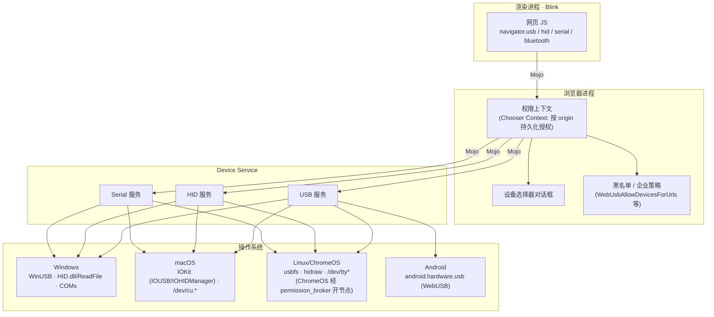

# 浏览器设备 API 总览与安全模型

> 🌿 知识树位置: 枝干[框架与API] → 分枝[浏览器] → 总览
> ⬆️ 返回: [框架与 API · 分枝索引](00-索引.md)

浏览器里有四个直接操作外设的 API：**WebUSB、WebHID、Web Serial、Web Bluetooth**。它们共享同一套设计：只在安全上下文可用、必须由用户手势触发选择器、按来源（origin）授予单设备权限、由浏览器维护黑名单。本篇讲四者的共性，单个 API 的细节见 [02](02-WebUSB详解.md)、[03](03-WebHID详解.md)、[04](04-WebSerial与WebBluetooth.md)。

## 一、支持范围与标准化状态

| API | 入口 | 设备范围 | 传输能力 | 规范现状（2026-11 核对） |
|---|---|---|---|---|
| WebUSB | `navigator.usb` | 非受保护接口类的 USB 设备（典型是 0xFF 厂商类） | 控制、中断、批量、同步 | WICG Draft Community Group Report（2026-06-05 版）；`wicg.github.io/webusb` 已重定向到 `usb.spec.whatwg.org` |
| WebHID | `navigator.hid` | HID 设备（USB 与蓝牙 HID），按顶层集合过滤 | 输入/输出/特性报告 | **WHATWG Living Standard**（`hid.spec.whatwg.org`，2026-11-14 更新） |
| Web Serial | `navigator.serial` | 系统串口、USB 转串口（CDC-ACM/桥芯片）、蓝牙 RFCOMM 串口 | 字节流（Streams API） | **WHATWG Living Standard**（`serial.spec.whatwg.org`，2026-11-17 更新） |
| Web Bluetooth | `navigator.bluetooth` | BLE 外设的 GATT 服务 | GATT 读/写/通知 | Web Bluetooth CG Draft Community Group Report（2026-06-03 版）；旧地址已重定向到 `bluetooth.spec.whatwg.org` |

> ⚠️ 2026 年这四份规范正在从 W3C 社区组迁往 WHATWG：WebHID 与 Web Serial 已是 WHATWG Living Standard；WebUSB 与 Web Bluetooth 的 WHATWG 地址目前仍呈现 CG 报告内容。引用时以规范页顶部的状态行为准。

### 各浏览器立场

| 浏览器 | WebUSB | WebHID | Web Serial | Web Bluetooth | 依据 |
|---|---|---|---|---|---|
| Chrome / Edge / Opera（Chromium 桌面） | ✅ 61+ | ✅ 89+ | ✅ 89+ | ✅（Linux 需实验开关） | Chrome 文档、Web Bluetooth implementation-status |
| Chrome for Android | ✅ | ❌ | ✅ 蓝牙 RFCOMM 自 138；有线串口自 148 起（依赖 Android 系统串口 API，首批仅限部分设备） | ✅ | Chrome 138 / 148 发布说明、blink-dev PSA |
| Firefox | ❌（Mozilla 立场 negative） | ❌（negative） | Mozilla 立场为 positive，但限定"由附加组件授权（Add-On Gated）" | ❌（negative） | mozilla/standards-positions |
| Safari / WebKit | ❌（oppose） | ❌（oppose） | ❌（oppose） | ❌（oppose） | WebKit/standards-positions |

结论：**面向终端用户发布网页版外设工具，等价于"只支持 Chromium 系浏览器"**。要覆盖 Safari/Firefox 用户只能走原生客户端或 Electron（自带 Chromium）。

## 二、架构与实现原理（Chromium）

Chromium 把设备访问拆成三层进程：渲染进程里的 Blink 只持有 JS 对象；浏览器进程做权限与选择器 UI；独立的 **Device Service**（`services/device/`）才真正调用操作系统 API。三层之间走 Mojo IPC。



关键推论：

1. **浏览器没有自己的 USB 驱动**。WebUSB 在 Windows 上只能打开已绑定 WinUSB 的接口；WebHID 只能打开 OS HID 栈已经枚举出来的 HID 设备；Web Serial 只能打开 OS 已经创建的串口节点。设备能否被网页访问，首先取决于**设备在 OS 侧绑到了什么驱动**——这就是 [10 篇](10-设备端框架与WebUSB固件桥接.md) 里 MS OS 2.0 描述符的意义。
2. **蓝牙走另一条线**：Web Bluetooth 由 `device/bluetooth/` 封装各平台蓝牙栈（Windows 的 WinRT 蓝牙 API、macOS 的 CoreBluetooth、Linux 的 BlueZ、Android 的 BluetoothAdapter），不经过 USB/HID 服务。

## 三、权限与安全模型

四个 API 遵循同一组约束（以下均出自各自规范的算法步骤）：

| 约束 | 规范表述 / 行为 | 工程含义 |
|---|---|---|
| 安全上下文 | 接口带 `[SecureContext]` | 只能在 `https://` 或 `http://localhost` 下用 |
| 用户激活 | `requestDevice()` / `requestPort()` 要求全局对象具有 *transient activation*，否则以 `SecurityError` 拒绝 | 只能在点击等事件处理函数里调用，不能页面加载时自动弹 |
| 选择器 | 浏览器弹出设备列表，由用户勾选；页面只拿到被选中的那一个 | 页面无法枚举"系统里有哪些设备" |
| 持久授权 | `getDevices()` / `getPorts()` 返回本 origin 已授权设备；`forget()` 撤销 | 二次访问可免弹窗自动重连 |
| 权限策略 | 策略控制特性名分别为 `usb`（另有 `usb-unrestricted`）、`hid`、`serial`、`bluetooth`，默认 allowlist 为 `'self'` | 跨域 iframe 需显式 `allow="hid"` 等 |
| 黑名单 | WebUSB：接口类黑名单 + 设备黑名单；WebHID：报告级黑名单；Web Bluetooth：GATT UUID 黑名单 | 键鼠、FIDO 安全密钥、HID over GATT 服务等无法被网页直接访问 |
| Worker | WebHID：DedicatedWorker、ServiceWorker、Window；WebUSB：Worker、Window；Web Serial：DedicatedWorker、Window | 可在 Worker 里做收发，但 `requestDevice()` 只能在 Window 中调用 |

### 受保护资源一览

- **WebUSB 受保护接口类**（规范 §6.4）：0x01 Audio、0x03 HID、0x08 Mass Storage、0x09 Hub、0x0B Smart Card、0x0E Video、0x10 Audio/Video、0xE0 Wireless Controller。对这些接口 `claimInterface()` 会被拒绝（除非文档被允许使用 `usb-unrestricted` 特性）。
- **WebHID 黑名单**（`hid.spec.whatwg.org/blocklist.txt`）：Usage Page 0xF1D0（FIDO）整页；Generic Desktop 的 Mouse(0x02)、Keyboard(0x06)、Keypad(0x07)、System Control(0x80) 顶层集合；以及个别厂商规则。规则未写 `reportType` 即对输入、输出、特性报告**全部**生效。Chrome 文档另称 Chrome 自身还维护一份"受保护 Usage"清单（如通用键盘、鼠标），以 Chromium 源码为准。
- **Web Bluetooth GATT 黑名单**（WebBluetoothCG/registries `gatt_blocklist.txt`）：整服务屏蔽 0x1812（HID Service，防止网页成为键盘记录器）与 0xFFFD（FIDO）等；0x2A25 序列号字符串特征被屏蔽；0x2A02、0x2902（CCCD）、0x2903 只屏蔽写。

### 企业策略

Chrome 企业策略可以对指定 URL 预授权设备，跳过选择器，例如 `WebUsbAllowDevicesForUrls`、`WebHidAllowDevicesForUrls`、`SerialAllowUsbDevicesForUrls`（Chrome 138 发布说明列出了 `DefaultSerialGuardSetting`、`SerialAllowAllPortsForUrls`、`SerialAskForUrls`、`SerialBlockedForUrls` 等串口策略）。适合产线、门店、Kiosk 场景。

## 四、平台差异

| 平台 | WebUSB | WebHID | Web Serial |
|---|---|---|---|
| Windows | 接口必须绑定 WinUSB（或由 MS OS 描述符自动绑定）；复合设备的单个功能也可 | 通过 HID 类驱动；键鼠集合被 OS 独占 | 打开 `COMx` |
| macOS | 内核驱动已占用的接口无法 claim | IOHIDManager；部分设备需"输入监控"隐私授权 | `/dev/cu.*` |
| Linux | 需要 udev 规则给普通用户 usbfs 节点读写权限 | 需要 hidraw 节点读写权限（udev 规则） | 用户需在 `dialout` 组或有对应 udev 规则 |
| ChromeOS | permission_broker 代为打开节点 | 同左 | 同左 |
| Android | ✅（经 Android USB Host API） | ❌ | 见上表 |

## 五、Electron 与 Chrome 扩展

**Electron** 自带 Chromium，因此四个 API 都可用，但没有浏览器的选择器 UI，需要主进程接管（Electron 官方文档 *Device Access*）：

- `session` 上的 `select-hid-device` / `select-usb-device` / `select-serial-port` / `select-bluetooth-device`（后者在 `webContents` 上）事件：由应用自己选设备并回调 `callback(deviceId)`；
- `ses.setDevicePermissionHandler(handler)`：给已知设备默认授权（免 `requestDevice`）；
- `ses.setPermissionCheckHandler(handler)`：按 origin 打开或关闭 `hid` / `usb` / `serial` 权限；
- `ses.setUSBProtectedClassesHandler(handler)`：放行默认受保护的 USB 类；
- 命令行开关 `disable-hid-blocklist` / `disable-usb-blocklist` / `disable-serial-blocklist`：关闭 Chromium 黑名单。**这意味着 Electron 应用可以访问网页无法访问的鼠标/键盘顶层集合**——对外设配置客户端非常关键，见 [12 篇案例 7](12-实战案例-外设控制七例.md)。

**Chrome 扩展**：规范把 WebUSB、WebHID 暴露在 ServiceWorker 中，Chrome 扩展可以在扩展 Service Worker 里使用已授权设备做后台收发；旧的 Chrome Apps 专有接口 `chrome.usb` / `chrome.hid` 随 Chrome Apps 一起淘汰，新项目不要再用。

## 六、局限与坑

- **兼容性**：只有 Chromium 系可用；Safari、Firefox 都明确反对。
- **无法打开"系统已占用"的东西**：WebUSB 不能 claim 已被内核类驱动绑走的接口；WebHID 读不到被黑名单命中的集合；鼠标的 DPI 配置如果放在 Mouse 集合里，网页永远拿不到——固件要把配置通道放到**厂商自定义 Usage Page 的独立顶层集合**。
- **权限是"每 origin 每设备"**：换域名、换端口（开发时的 `localhost:3000` vs `localhost:5173`）都要重新授权。
- **没有后台常驻**：页面关闭即断开；需要常驻的守护功能（如按应用切换灯效）仍需原生进程。
- **选择器 UI 不可定制**：只能用 `filters` 缩小列表，无法自定义文案。

## 七、实战代码示例（示例：特性检测与通用授权流程）

```html
<!-- 示例：四个 API 的特性检测 + 用户手势内请求设备 -->
<button id="pick">连接设备</button>
<script type="module">
const support = {
  usb: 'usb' in navigator,
  hid: 'hid' in navigator,
  serial: 'serial' in navigator,
  bluetooth: 'bluetooth' in navigator,
};
console.log('API 支持情况', support);

// 页面加载时：只能拿"之前授权过"的设备，不会弹窗
const known = support.hid ? await navigator.hid.getDevices() : [];
console.log('已授权 HID 设备', known.map(d => d.productName));

document.getElementById('pick').addEventListener('click', async () => {
  // 必须在点击处理函数里调用（transient activation）
  const [dev] = await navigator.hid.requestDevice({
    filters: [{ usagePage: 0xff00 }],   // 只列出含厂商自定义集合的设备
  });
  if (!dev) return;                      // 用户取消
  await dev.open();
  console.log('已打开', dev.productName, dev.collections);
});

navigator.hid?.addEventListener('disconnect', e => console.log('拔出', e.device.productName));
</script>
```

## 参考来源

- WebUSB：<https://wicg.github.io/webusb/>（重定向至 <https://usb.spec.whatwg.org/>）；USB 黑名单 <https://raw.githubusercontent.com/WICG/webusb/main/blocklist.txt>
- WebHID：<https://hid.spec.whatwg.org/>；HID 黑名单 <https://hid.spec.whatwg.org/blocklist.txt>
- Web Serial：<https://serial.spec.whatwg.org/>
- Web Bluetooth：<https://webbluetoothcg.github.io/web-bluetooth/>；实现状态 <https://github.com/WebBluetoothCG/web-bluetooth/blob/main/implementation-status.md>；GATT 黑名单 <https://github.com/WebBluetoothCG/registries/blob/master/gatt_blocklist.txt>
- Chrome 文档：<https://developer.chrome.com/docs/capabilities/usb> · <https://developer.chrome.com/docs/capabilities/hid> · <https://developer.chrome.com/docs/capabilities/serial>
- Chrome 发布说明：<https://developer.chrome.com/release-notes/138>（Android 蓝牙串口）· <https://developer.chrome.com/release-notes/148>（Android Web Serial）
- 浏览器立场：<https://github.com/mozilla/standards-positions> · <https://github.com/WebKit/standards-positions>
- Electron 设备访问：<https://www.electronjs.org/docs/latest/tutorial/devices>

## 相关节点

- [02-WebUSB详解](02-WebUSB详解.md) · [03-WebHID详解](03-WebHID详解.md) · [04-WebSerial与WebBluetooth](04-WebSerial与WebBluetooth.md)
- 设备侧声明: [WebUSB 与厂商自定义类](../20-枝干-设备类协议/其他设备类/06-WebUSB与厂商自定义类.md)
- 安全背景: [USB 安全与 BadUSB](../70-枝干-调试测试与安全/04-USB安全与BadUSB.md)
