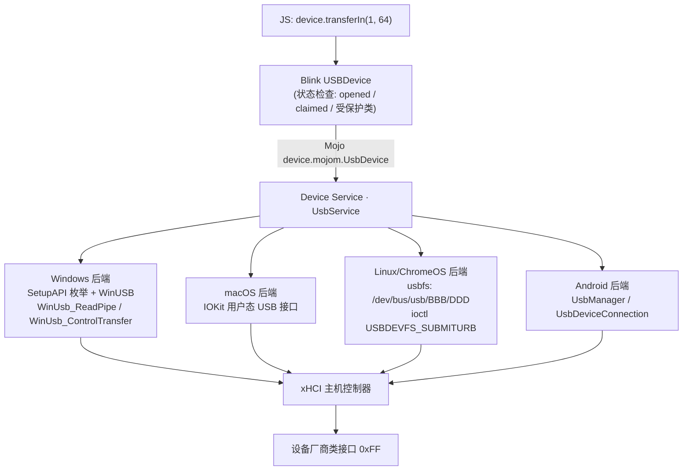

# WebUSB 详解：浏览器里的 libusb

> 🌿 知识树位置: 枝干[框架与API] → 分枝[浏览器] → 叶[WebUSB]
> ⬆️ 返回: [浏览器设备 API 总览与安全模型](01-浏览器设备API总览与安全模型.md)

WebUSB 把"打开设备 → 选配置 → 认领接口 → 收发端点"这一套 libusb 式模型原样搬进 JavaScript。设备侧的 BOS 声明（落地页、平台能力）见 [WebUSB 与厂商自定义类](../20-枝干-设备类协议/其他设备类/06-WebUSB与厂商自定义类.md) 和 [10 篇](10-设备端框架与WebUSB固件桥接.md)，本篇专讲主机侧 API 与实现。

## 一、支持范围

| 项 | 支持情况 |
|---|---|
| 传输类型 | 控制（`controlTransferIn/Out`）、批量与中断（`transferIn/Out`，按端点类型自动区分）、同步（`isochronousTransferIn/Out`） |
| 设备 | 任何**未落入受保护接口类**、且不在 USB 黑名单中的设备；最常见是 0xFF 厂商类接口 |
| 浏览器 | Chromium 桌面版 + Chrome for Android；Firefox、Safari 不支持 |
| 上下文 | Window、Worker（规范 `[Exposed=(Worker, Window)]`），`requestDevice()` 仅限 Window |

### API 面（规范 IDL 摘要）

| 对象 | 成员 |
|---|---|
| `navigator.usb` | `getDevices()`、`requestDevice({filters, exclusionFilters})`、`connect` / `disconnect` 事件 |
| `USBDeviceFilter` | `vendorId`、`productId`、`classCode`、`subclassCode`、`protocolCode`、`serialNumber` |
| `USBDevice` | 描述符字段（`vendorId`、`productId`、`deviceClass`、`usbVersionMajor`…、`configurations`）；`open()`、`close()`、`forget()`、`selectConfiguration()`、`claimInterface()`、`releaseInterface()`、`selectAlternateInterface()`、`controlTransferIn()`、`controlTransferOut()`、`clearHalt()`、`transferIn()`、`transferOut()`、`isochronousTransferIn()`、`isochronousTransferOut()`、`reset()` |
| `USBControlTransferParameters` | `requestType`（`"standard"`/`"class"`/`"vendor"`）、`recipient`（`"device"`/`"interface"`/`"endpoint"`/`"other"`）、`request`、`value`、`index` |
| 结果 | `USBInTransferResult { data, status }`，`status` ∈ `"ok"` / `"stall"` / `"babble"` |

`requestType` + `recipient` + 方向，合起来就是 SETUP 包的 `bmRequestType`（见 [枚举流程与标准请求](../10-树干-USB核心/08-枚举流程与标准请求.md)）；`request`/`value`/`index` 对应 `bRequest`/`wValue`/`wIndex`，`wLength` 由 `controlTransferIn(setup, length)` 的 `length` 或 OUT 数据长度给出。

## 二、架构与实现原理



要点：

1. **Windows**：浏览器不装驱动，只打开已绑 **WinUSB** 的设备接口。设备若声明了 MS OS 2.0 兼容 ID `WINUSB`，Windows 8.1 起会自动绑定，用户零操作；否则会被识别为"未知设备"，需要 Zadig 之类工具手动换绑——对终端用户不可接受。
2. **Linux**：直接读写 usbfs 节点，默认只有 root 可写，需 udev 规则（如 `TAG+="uaccess"` 或 `MODE="0660", GROUP="plugdev"`）；若接口已被内核驱动（如 `cdc_acm`）绑定，claim 会失败。
3. **macOS**：内核驱动已经匹配的接口（HID、音频、大容量存储等）无法 claim；厂商类接口没有内核驱动匹配，可直接用。
4. **黑名单检查发生在两处**：选择器列设备前（USB 设备黑名单，按 VID/PID/bcdDevice 屏蔽）、`claimInterface()` 时（受保护接口类）。

## 三、权限与安全模型

- 用户手势 + 选择器 + 每 origin 持久授权（共性见 [01 篇](01-浏览器设备API总览与安全模型.md)）。
- **受保护接口类**：0x01 Audio、0x03 HID、0x08 Mass Storage、0x09 Hub、0x0B Smart Card、0x0E Video、0x10 Audio/Video、0xE0 Wireless Controller。规范的理由是这些类已有更高层、隐私更好的 API（WebHID、Web Audio、`getUserMedia`、WebAuthn 等）。复合设备中只有受保护的那个接口不可 claim，其余厂商类接口照常可用。
- **USB 黑名单**：`WICG/webusb` 仓库的 `blocklist.txt`，按 VID、PID、bcdDevice 上限匹配，主要屏蔽会被固件改写的安全密钥类设备。
- **落地页**：设备 BOS 中的 WebUSB 平台能力可声明 `iLandingPage`；规范只说 UA **MAY** 在设备接入时建议用户访问该 URL。早期规范里的"允许来源（allowed origins）"白名单已删除，`bRequest`/`wIndex` 编码 1 现为保留值，只剩 `GET_URL = 2`。

## 四、平台差异

| 平台 | 设备可见条件 | 典型失败 |
|---|---|---|
| Windows | 接口绑定 WinUSB | 选择器里看得到、`open()` 报 `SecurityError`/`NetworkError`：多半没绑 WinUSB 或被其他进程独占 |
| macOS | 接口无内核驱动 | `claimInterface()` 失败：接口被系统类驱动占用 |
| Linux | usbfs 节点可写，接口未被内核驱动占用 | `open()` 报 Access denied：缺 udev 规则 |
| Android | 经系统 USB 权限对话框 | 设备需要 OTG 供电；同步传输依赖底层支持 |

## 五、局限与坑

- **WebUSB 不是 WebHID 的替代**：HID 接口是受保护类，WebUSB 碰不到；要么用 WebHID，要么在固件里额外加一个 0xFF 接口。
- **`transferIn(length)` 的 length 应为端点 `wMaxPacketSize` 的整数倍**，否则对端发满包时会出现 `babble`（数据溢出）。
- **短包与 ZLP**：批量 OUT 发送整包倍数长度的数据时，是否补零长度包由主机栈决定，协议层最好自带长度字段。
- **吞吐**：每次 `transferIn` 都是一次 Mojo 往返，想跑满高速批量带宽要**同时挂多个 `transferIn` Promise**（相当于 libusb 的多 URB 排队），见 [12 篇案例 4](12-实战案例-外设控制七例.md) 的对照。
- **`reset()` 会触发重新枚举**，部分平台上设备对象随后失效，需要监听 `connect` 重新获取。
- **独占**：同一接口同一时刻只能被一个进程 claim；浏览器标签页和本机原生工具会互相抢。

## 六、实战代码示例

```javascript
// 示例：WebUSB 枚举 → 打开 → 读设备描述符（标准请求）→ 厂商请求 → 批量收发
// 运行环境：https 或 localhost 页面，在按钮 click 回调中调用 main()
async function main() {
  const device = await navigator.usb.requestDevice({
    filters: [{ vendorId: 0xcafe }],          // 示例 VID，替换为你的设备
  });
  await device.open();
  if (device.configuration === null) await device.selectConfiguration(1);

  // 1) 标准请求 GET_DESCRIPTOR(DEVICE)：bmRequestType=0x80, bRequest=6, wValue=0x0100
  const dd = await device.controlTransferIn(
    { requestType: 'standard', recipient: 'device', request: 0x06, value: 0x0100, index: 0 },
    18,
  );
  console.log('bcdUSB=', dd.data.getUint16(2, true).toString(16), 'idVendor=', dd.data.getUint16(8, true).toString(16));

  // 2) 找到第一个厂商类接口并认领
  const iface = device.configuration.interfaces.find(
    i => i.alternate.interfaceClass === 0xff);
  await device.claimInterface(iface.interfaceNumber);
  const epOut = iface.alternate.endpoints.find(e => e.direction === 'out' && e.type === 'bulk');
  const epIn  = iface.alternate.endpoints.find(e => e.direction === 'in'  && e.type === 'bulk');

  // 3) 厂商控制请求（固件自定义 bRequest=0x01）
  await device.controlTransferOut(
    { requestType: 'vendor', recipient: 'interface', request: 0x01, value: 0, index: iface.interfaceNumber },
    new Uint8Array([0xaa]),
  );

  // 4) 批量回环
  await device.transferOut(epOut.endpointNumber, new TextEncoder().encode('ping'));
  const r = await device.transferIn(epIn.endpointNumber, epIn.packetSize);
  console.log(r.status, new TextDecoder().decode(r.data));

  await device.releaseInterface(iface.interfaceNumber);
  await device.close();
}
```

注意 `endpointNumber` 是**不带方向位**的端点号（1 而不是 0x81），方向由调用 `transferIn`/`transferOut` 决定——这与 libusb 传 `0x81` 的习惯不同，是移植代码时最常见的错误。

## 参考来源

- WebUSB 规范：<https://wicg.github.io/webusb/>（§4 设备要求、§6 设备使用、§7 黑名单、§8.1 权限策略）
- USB 黑名单：<https://github.com/WICG/webusb/blob/main/blocklist.txt>
- Chrome 文档 *Access USB Devices on the Web*：<https://developer.chrome.com/docs/capabilities/usb>
- Microsoft OS 2.0 描述符：<https://learn.microsoft.com/windows-hardware/drivers/usbcon/microsoft-os-2-0-descriptors-specification>
- WinUSB 自动安装：<https://learn.microsoft.com/windows-hardware/drivers/usbcon/automatic-installation-of-winusb>

## 相关节点

- 固件侧: [10-设备端框架与WebUSB固件桥接](10-设备端框架与WebUSB固件桥接.md) · [WebUSB 与厂商自定义类](../20-枝干-设备类协议/其他设备类/06-WebUSB与厂商自定义类.md)
- 对照: [07-C与C++-libusb与hidapi](07-C与C++-libusb与hidapi.md)（WebUSB 与 libusb 的 API 一一对应）
- Node 侧同构 API: [06-Nodejs生态-node-usb-node-hid-serialport](06-Nodejs生态-node-usb-node-hid-serialport.md)
