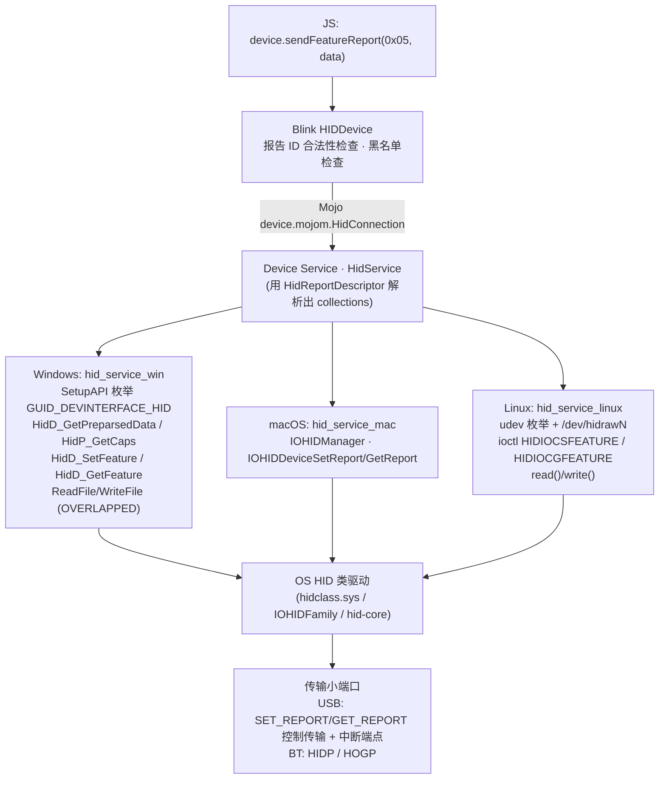

# WebHID 详解：报告级访问与黑名单

> 🌿 知识树位置: 枝干[框架与API] → 分枝[浏览器] → 叶[WebHID]
> ⬆️ 返回: [浏览器设备 API 总览与安全模型](01-浏览器设备API总览与安全模型.md)

WebHID 让网页以**报告（report）**为单位与 HID 设备通信：收输入报告、发输出报告、读写特性报告。它不碰端点，也不碰描述符请求——这些都由操作系统的 HID 类驱动完成。对做键鼠、耳机、手柄配置客户端的人来说，它是"把驱动助手搬进浏览器"的标准路径。HID 协议本体见 [HID 概述](../20-枝干-设备类协议/HID-人机接口设备/00-HID概述与定位.md)。

## 一、支持范围

| 项 | 支持情况 |
|---|---|
| 设备 | OS 已枚举的 HID 设备，USB HID 与蓝牙 HID（经典 HID 与 HOGP，由 OS 蓝牙栈转成 HID 设备）都可以 |
| 报告类型 | 输入（`inputreport` 事件）、输出（`sendReport`）、特性（`sendFeatureReport` / `receiveFeatureReport`） |
| 元数据 | `collections`：解析后的报告描述符树（Usage Page、Usage、集合类型、各报告的字段 `HIDReportItem`） |
| 浏览器 | Chromium 桌面版 89 起；**Android 版不支持** |
| 上下文 | Window、DedicatedWorker、ServiceWorker（规范 `[Exposed=(DedicatedWorker, ServiceWorker, Window)]`），`requestDevice()` 仅限 Window |
| 规范状态 | WHATWG Living Standard：<https://hid.spec.whatwg.org/> |

### API 面（规范 IDL 摘要）

```text
navigator.hid
  getDevices() → Promise<sequence<HIDDevice>>
  requestDevice({ filters: [HIDDeviceFilter], exclusionFilters?: [HIDDeviceFilter] })
  事件: connect / disconnect  (HIDConnectionEvent.device)

HIDDeviceFilter { vendorId, productId, usagePage, usage }

HIDDevice
  opened, vendorId, productId, productName, collections
  open() / close() / forget()
  sendReport(reportId, data)                // 输出报告
  sendFeatureReport(reportId, data)         // 特性报告 SET
  receiveFeatureReport(reportId) → DataView // 特性报告 GET
  事件: inputreport  (HIDInputReportEvent { device, reportId, data: DataView })
```

## 二、架构与实现原理



原理要点：

1. **特性报告走控制传输**：`sendFeatureReport` 最终变成 USB 的 `SET_REPORT(Feature)` 类请求，`receiveFeatureReport` 变成 `GET_REPORT(Feature)`（类请求编码见 [HID 传输与类特定请求](../20-枝干-设备类协议/HID-人机接口设备/04-传输与类特定请求.md)）；输入报告来自中断 IN 端点；输出报告在有中断 OUT 端点时走端点，否则 OS 用 `SET_REPORT(Output)`。
2. **`collections` 是浏览器自己解析的**：Chromium 读取报告描述符并解析成 `HIDCollectionInfo`。设备在 Windows 上按顶层集合（TLC）被拆成多个设备接口，Chromium 会把同一 HID 接口的这些 TLC 合回一个 `HIDDevice`，所以网页看到的是"一个设备、多个集合"。
3. **黑名单粒度是"报告"**：规范 §15 定义"blocked report"——按 VID、PID、报告 ID、报告类型、所在顶层集合的 Usage Page/Usage 匹配。被命中的报告调用时以 `NotAllowedError` 拒绝；只要设备还有其他未命中的集合，设备本身照样能被选择和打开。

## 三、权限与安全模型

规范黑名单（`https://hid.spec.whatwg.org/blocklist.txt`）当前规则：

| 规则 | 作用 |
|---|---|
| `{usagePage:0xF1D0}` | 屏蔽 FIDO/U2F 安全密钥，交给 WebAuthn |
| `{usagePage:0x0001, usage:0x0002}` | Generic Desktop / Mouse 顶层集合 |
| `{usagePage:0x0001, usage:0x0006}` | Generic Desktop / Keyboard |
| `{usagePage:0x0001, usage:0x0007}` | Generic Desktop / Keypad |
| `{usagePage:0x0001, usage:0x0080}` | Generic Desktop / System Control |
| `{vendor:0x0b0e, usagePage:0xff00, reportId:0x05, reportType:"output"}` | Jabra 个别专有功能 |
| `{vendor:0x1d50, product:0x60fc}` | OnlyKey 全部 |

**规则未写 `reportType` 时，输入、输出、特性报告一并屏蔽**。直接后果：如果鼠标把 DPI/回报率配置做成 Mouse 集合里的特性报告，网页**一律拿不到**。可行做法是在报告描述符里**单独开一个厂商自定义 Usage Page（0xFF00–0xFFFF）的顶层集合**承载配置报告——这正是 QMK/VIA 用 0xFF60 的原因，见 [05 篇](05-网页配置器案例-WebHID与VIA.md)。

Chrome 文档另说明：Chrome 会检查每个顶层集合的 Usage，若属于受保护 Usage（如通用键盘、鼠标），网站不能收发该集合里定义的任何报告；FIDO 设备也被屏蔽。Electron 应用可用 `disable-hid-blocklist` 开关关掉这一层（见 [01 篇](01-浏览器设备API总览与安全模型.md)）。

## 四、报告 ID 语义（移植时最容易错）

规范规定（§7.4 / §7.6）：

- 设备**不使用**报告 ID 时，`reportId` 必须传 0；使用报告 ID 时，0 是保留值，不能用。传错会以 `TypeError` 拒绝。
- `sendReport` / `sendFeatureReport` 的 `data` **不含**报告 ID 字节，报告 ID 单独作为第一个参数。
- `receiveFeatureReport` 返回的 `DataView` 是"OS 返回的原样数据"：规范注明**如果设备使用报告 ID，第一个字节可能就是报告 ID**。解析时要先判断 `view.getUint8(0) === reportId` 再决定偏移。
- `inputreport` 事件的 `data` 不含报告 ID，报告 ID 在 `event.reportId`。

对照原生库（详见 [12 篇案例 5](12-实战案例-外设控制七例.md)）：HID.dll 与 hidapi 的缓冲区**第 0 字节就是报告 ID**（无报告 ID 时填 0），长度要多 1。

## 五、平台差异

| 平台 | 行为 |
|---|---|
| Windows | 键盘、鼠标 TLC 被系统独占打开，原生程序也只能以零访问权限打开它们；其余 TLC 共享访问。HID 报告长度按 `HidP_GetCaps` 的 `FeatureReportByteLength` 等补齐 |
| macOS | 走 IOHIDManager；部分键盘类设备需要用户在"隐私与安全性 → 输入监控"中授权浏览器 |
| Linux | 访问 `/dev/hidrawN`，默认 root-only，需要 udev 规则；hidraw 不独占，多个进程都能读到同一份输入报告 |
| ChromeOS | permission_broker 代开 hidraw 节点 |
| 蓝牙 HID | 经 OS 蓝牙栈呈现为 HID 设备，WebHID 照常可用；但同一设备的 GATT HID 服务在 Web Bluetooth 里被屏蔽 |

## 六、局限与坑

- **没有 Android 支持**；移动端只能用 Web Bluetooth（且 HID 服务被屏蔽）或原生 App。
- **不能发任意控制请求**：想读字符串描述符、做 DFU 切换等非 HID 请求，WebHID 做不到，需要 WebUSB 的厂商接口。
- **报告长度固定**：报告描述符里声明多长就得发多长，短了 OS 会补零或报错，长了直接失败。
- **特性报告的往返延迟**：每次 GET/SET 都是一次控制传输，若固件在 SET 之后才准备 GET 的数据，记得在协议里加"忙"位或轮询，不要假设同步完成。
- **多 TLC 设备选择器只显示一次**：`filters` 用 `usagePage` 过滤即可让选择器只列出带厂商集合的设备，避免用户选错同名的"键盘"条目。

## 七、实战代码示例

```javascript
// 示例：WebHID 打开厂商配置集合，读写特性报告，监听输入报告
// 假设固件在 Usage Page 0xFF00 / Usage 0x01 的顶层集合中定义了 Report ID 0x05 的 64 字节特性报告
const VENDOR_PAGE = 0xff00;

export async function connect() {                      // 在 click 回调中调用
  const [device] = await navigator.hid.requestDevice({
    filters: [{ vendorId: 0x1532, usagePage: VENDOR_PAGE }], // 示例 VID
  });
  if (!device) throw new Error('用户取消');
  if (!device.opened) await device.open();

  // 从 collections 里确认特性报告存在，避免硬编码报告 ID
  const cfg = device.collections.find(c => c.usagePage === VENDOR_PAGE);
  console.log('feature report ids =', cfg.featureReports.map(r => r.reportId));

  device.addEventListener('inputreport', e => {
    console.log(`IN id=${e.reportId}`, new Uint8Array(e.data.buffer));
  });
  return device;
}

export async function getFeature(device, reportId) {
  const view = await device.receiveFeatureReport(reportId);
  let bytes = new Uint8Array(view.buffer, view.byteOffset, view.byteLength);
  if (bytes[0] === reportId) bytes = bytes.subarray(1);  // 规范: 首字节可能是报告 ID
  return bytes;
}

export async function setFeature(device, reportId, payload /* Uint8Array, 不含报告 ID */) {
  await device.sendFeatureReport(reportId, payload);
}
```

## 参考来源

- WebHID 规范：<https://hid.spec.whatwg.org/>（§6 HID 接口、§7 HIDDevice、§15 黑名单、§16.1 权限策略）
- HID 黑名单：<https://hid.spec.whatwg.org/blocklist.txt>
- Chrome 文档 *Connecting to uncommon HID devices*：<https://developer.chrome.com/docs/capabilities/hid>
- USB HID 1.11 规范与 HID Usage Tables：<https://www.usb.org/hid>
- Linux hidraw：<https://docs.kernel.org/hid/hidraw.html>

## 相关节点

- [05-网页配置器案例-WebHID与VIA](05-网页配置器案例-WebHID与VIA.md) · [12-实战案例-外设控制七例](12-实战案例-外设控制七例.md)
- HID 协议: [报告描述符与 Item 编码](../20-枝干-设备类协议/HID-人机接口设备/02-报告描述符与Item编码.md) · [Usage 体系与集合](../20-枝干-设备类协议/HID-人机接口设备/03-Usage体系与集合.md) · [鼠标详解](../20-枝干-设备类协议/HID-人机接口设备/06-鼠标详解.md)
- 原生对照: [08-操作系统原生API-Windows-macOS-Linux](08-操作系统原生API-Windows-macOS-Linux.md)
