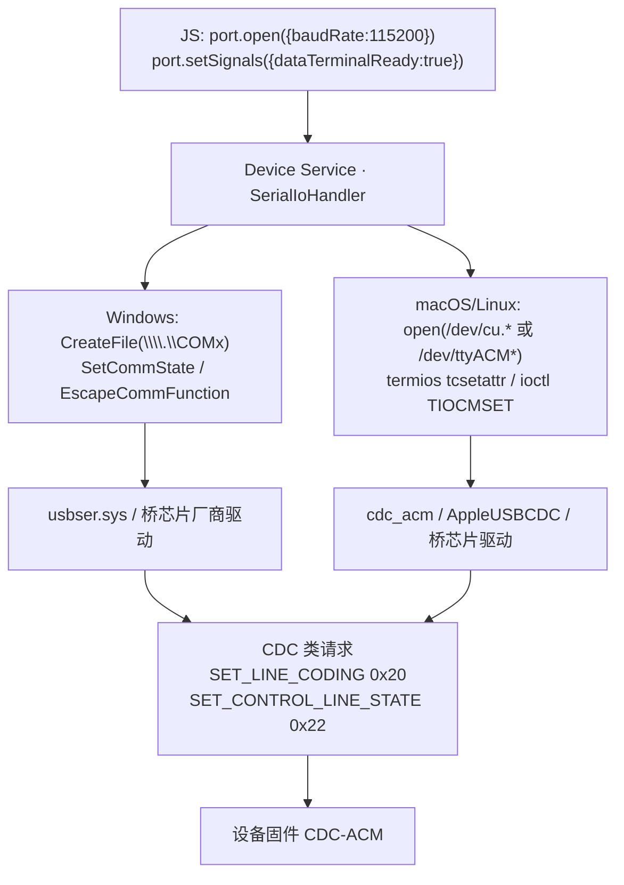
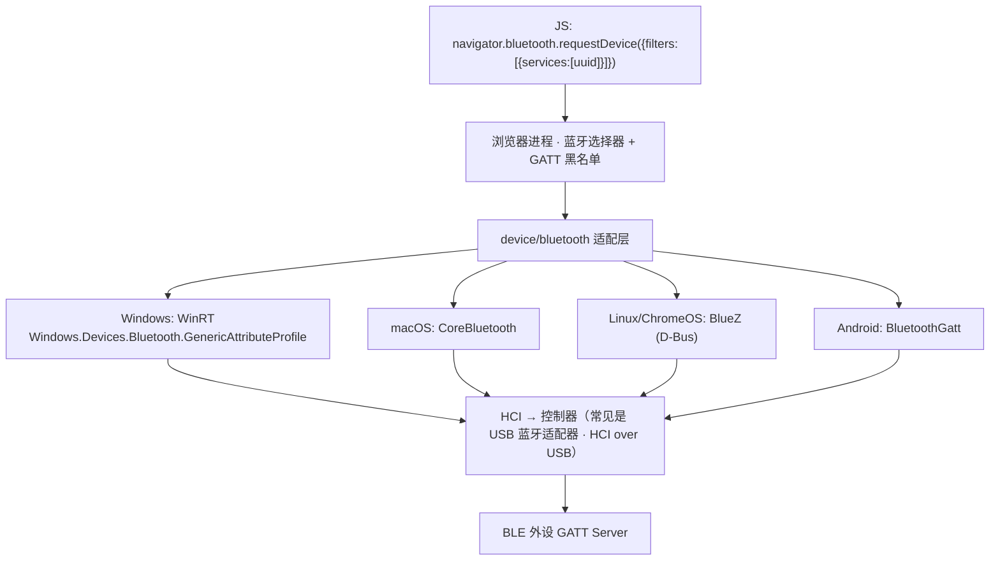

# Web Serial 与 Web Bluetooth

> 🌿 知识树位置: 枝干[框架与API] → 分枝[浏览器] → 叶[串口与 BLE]
> ⬆️ 返回: [浏览器设备 API 总览与安全模型](01-浏览器设备API总览与安全模型.md)

这两个 API 不直接操作 USB 协议，但与 USB 外设开发关系密切：Web Serial 是 **CDC-ACM 虚拟串口**和 USB 转串口桥芯片的浏览器入口；Web Bluetooth 是 **BLE GATT** 的浏览器入口，常用来给无线外设做网页版配置。

## 第一部分 · Web Serial

### 一、支持范围

| 项 | 支持情况 |
|---|---|
| 端口 | OS 已创建的串口：主板 UART、CDC-ACM 设备、FTDI/CH34x/CP210x 等桥芯片、蓝牙 RFCOMM 串口 |
| 能力 | 字节流读写（WHATWG Streams）、波特率/数据位/停止位/校验/流控、DTR/RTS/BREAK 输出信号、DCD/CTS/RI/DSR 输入信号 |
| 浏览器 | Chromium 桌面版 89 起；Chrome for Android：蓝牙 RFCOMM 自 138、有线串口自 148（依赖 Android 系统串口 API，首批仅部分设备） |
| 上下文 | Window、DedicatedWorker |
| 规范 | WHATWG Living Standard：<https://serial.spec.whatwg.org/> |

API 面（规范 IDL 摘要）：`navigator.serial.requestPort({filters, allowedBluetoothServiceClassIds})`、`getPorts()`；`SerialPortFilter { usbVendorId, usbProductId, bluetoothServiceClassId }`；`SerialPort.open({ baudRate, dataBits=8, stopBits=1, parity="none", bufferSize=255, flowControl="none" })`（只有 `baudRate` 必填）、`readable` / `writable`、`setSignals({dataTerminalReady, requestToSend, break})`、`getSignals()`、`getInfo()`、`close()`、`forget()`。

### 二、架构与实现原理



`open()` 里的波特率等参数，经 OS 串口驱动变成 CDC 的 `SET_LINE_CODING`；`setSignals({dataTerminalReady})` 变成 `SET_CONTROL_LINE_STATE`（请求编码见 [CDC-ACM](../20-枝干-设备类协议/CDC-通信设备类/01-虚拟串口ACM.md)）。固件常把 DTR 置位当作"主机已打开串口"的信号，TinyUSB 的 `webusb_serial` 示例也模拟了这一点。

### 三、权限与安全模型

用户手势 + 选择器 + 每 origin 授权，权限策略特性名 `serial`。Chromium 维护串口黑名单（Electron 可用 `disable-serial-blocklist` 关闭）。蓝牙串口：标准 SPP 之外的自定义 RFCOMM 服务类 ID 必须列入 `allowedBluetoothServiceClassIds` 才会出现在选择器中。

### 四、平台差异与坑

- **macOS 用 `/dev/cu.*`** 而不是 `/dev/tty.*`（后者打开时会等待 DCD）。
- **Linux 权限**：用户需加入 `dialout`（发行版不同组名不同）或配置 udev 规则。
- **ModemManager**：部分 Linux 发行版的 ModemManager 会在 CDC-ACM 设备插入时主动探测发 AT 命令，干扰自定义协议；可用 udev 属性 `ID_MM_DEVICE_IGNORE=1` 排除。
- **流式读取必须持续消费**：`readable` 不读会触发背压，`bufferSize` 满后丢数据；关闭端口前必须 `reader.cancel()` 并释放锁，否则 `close()` 报错。
- **USB 断开**：`readable` 会以错误结束，需要监听 `disconnect` 并重开。

### 五、示例代码

```javascript
// 示例：Web Serial 行协议读写（在 click 回调中调用）
const port = await navigator.serial.requestPort({ filters: [{ usbVendorId: 0x2e8a }] }); // 示例 VID
await port.open({ baudRate: 115200 });
await port.setSignals({ dataTerminalReady: true });   // 固件据此判断"已连接"

const writer = port.writable.getWriter();
await writer.write(new TextEncoder().encode('version\r\n'));
writer.releaseLock();

const reader = port.readable.pipeThrough(new TextDecoderStream()).getReader();
let buf = '';
while (true) {
  const { value, done } = await reader.read();
  if (done) break;
  buf += value;
  const lines = buf.split('\n'); buf = lines.pop();
  for (const line of lines) console.log('RX:', line.trim());
}
```

## 第二部分 · Web Bluetooth

### 一、支持范围

| 项 | 支持情况 |
|---|---|
| 角色 | 网页作为 **GATT Client（Central）**，连接 BLE 外设 |
| 能力 | 扫描选择、连接、发现服务/特征/描述符、读、写（有响应/无响应）、通知/指示 |
| 平台 | Chrome 在 Android、ChromeOS、macOS、Windows（需 Windows 10 1703+）上无需开关；**Linux 仅部分实现，需开启实验开关** |
| 规范 | Web Bluetooth CG Draft Community Group Report：<https://webbluetoothcg.github.io/web-bluetooth/> |

经典蓝牙（BR/EDR）配置文件不在范围内；`getDevices()`、`watchAdvertisements()` 仍在实验开关后面（见 implementation-status）。

### 二、架构与实现原理



USB 与 BLE 在这里交汇：PC 上的蓝牙控制器多数就是一个 USB 蓝牙控制器类设备（0xE0/0x01/0x01），见 [蓝牙控制器类 HCI over USB](../20-枝干-设备类协议/其他设备类/05-蓝牙控制器类-HCIoverUSB.md)。

### 三、权限与安全模型

- 必须在 `filters` 或 `optionalServices` 里**列出要访问的服务 UUID**，未列出的服务在连接后也拿不到。
- **GATT 黑名单**（WebBluetoothCG/registries `gatt_blocklist.txt`）：
  - 整服务屏蔽：`0x1812` **HID Service**（理由原文："Direct access to HID devices like keyboards would let web pages become keyloggers"）、`0xFFFD`（FIDO）等；
  - 特征屏蔽：`0x2A25` 序列号字符串、`0x2A03`；
  - 只屏蔽写：`0x2A02`、`0x2902`（CCCD，由浏览器自己写）、`0x2903`。
- 推论：**HOGP 键鼠的配置不能经 HID 服务做**，固件要额外开一个厂商自定义 128 位 UUID 服务承载配置特征（HOGP 见 [HOGP](../50-枝干-无线关联/BLE-低功耗蓝牙/07-HOGP-HIDoverGATT.md)）。

### 四、平台差异与坑

- Linux 桌面版默认不可用；面向 Linux 用户的产品不能只依赖 Web Bluetooth。
- 部分 GATT 操作不能并行，需要在应用层串行化写入。
- 设备已被 OS 作为 HID 外设配对时，同一连接上的厂商服务仍可访问（HID 服务本身被屏蔽）。
- 写特征有长度上限（受 ATT_MTU 约束），大数据需分包，见 [ATT 与 GATT](../50-枝干-无线关联/BLE-低功耗蓝牙/04-ATT与GATT.md)。

### 五、示例代码

```javascript
// 示例：Web Bluetooth 连接厂商配置服务，写命令并订阅通知
const SVC = '0000ff00-0000-1000-8000-00805f9b34fb';   // 示例：替换为你的 128 位厂商服务 UUID
const CMD = '0000ff01-0000-1000-8000-00805f9b34fb';
const EVT = '0000ff02-0000-1000-8000-00805f9b34fb';

const device = await navigator.bluetooth.requestDevice({
  filters: [{ namePrefix: 'MyMouse' }],
  optionalServices: [SVC],          // 不列出就无权访问
});
const server = await device.gatt.connect();
const svc = await server.getPrimaryService(SVC);
const evt = await svc.getCharacteristic(EVT);
await evt.startNotifications();
evt.addEventListener('characteristicvaluechanged', e =>
  console.log('通知', new Uint8Array(e.target.value.buffer)));
const cmd = await svc.getCharacteristic(CMD);
await cmd.writeValueWithResponse(new Uint8Array([0x01, 0x20, 0x03])); // 示例命令
device.addEventListener('gattserverdisconnected', () => console.log('断开'));
```

## 参考来源

- Web Serial：<https://serial.spec.whatwg.org/> · Chrome 文档 <https://developer.chrome.com/docs/capabilities/serial>
- Chrome 发布说明：<https://developer.chrome.com/release-notes/138> · <https://developer.chrome.com/release-notes/148>
- Web Bluetooth：<https://webbluetoothcg.github.io/web-bluetooth/> · 实现状态 <https://github.com/WebBluetoothCG/web-bluetooth/blob/main/implementation-status.md> · GATT 黑名单 <https://github.com/WebBluetoothCG/registries/blob/master/gatt_blocklist.txt>
- USB CDC 1.2 与 PSTN 子类规范：<https://www.usb.org/document-library/class-definitions-communication-devices-12>
- Bluetooth Core 规范（GATT）：<https://www.bluetooth.com/specifications/specs/core-specification/>

## 相关节点

- [CDC-ACM 虚拟串口](../20-枝干-设备类协议/CDC-通信设备类/01-虚拟串口ACM.md) · [CDC 请求与通知全表](../20-枝干-设备类协议/CDC-通信设备类/03-CDC规范级-请求与通知全表.md)
- [ATT 与 GATT](../50-枝干-无线关联/BLE-低功耗蓝牙/04-ATT与GATT.md) · [标准 UUID 全表](../50-枝干-无线关联/BLE-低功耗蓝牙/16-标准UUID全表.md)
- Node 侧串口: [06-Nodejs生态-node-usb-node-hid-serialport](06-Nodejs生态-node-usb-node-hid-serialport.md)
