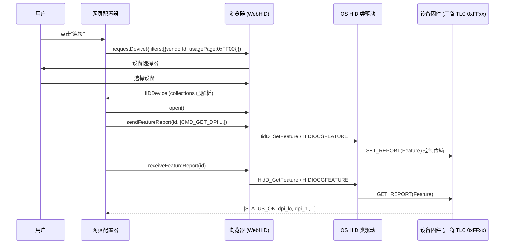

# 网页配置器案例：WebHID 外设配置与 VIA/QMK

> 🌿 知识树位置: 枝干[框架与API] → 分枝[浏览器] → 叶[配置器设计]
> ⬆️ 返回: [WebHID 详解](03-WebHID详解.md)

越来越多的键盘、鼠标、耳机厂商把"驱动助手"做成网页：插上设备，打开网址，点"连接"即可改键、调 DPI、刷灯效、升级固件。本篇拆解这类**浏览器版外设配置器**的设计方法，并以开源的 **QMK Raw HID + VIA** 作为可验证的实例。

## 一、支持范围：网页配置器能做什么

| 能力 | 可行性 | 实现通道 |
|---|---|---|
| 读写配置（DPI 档位、回报率、按键映射、灯效） | ✅ | WebHID 厂商集合的特性报告或输入/输出报告 |
| 实时状态（电量、当前 DPI、按键测试） | ✅ | 输入报告（`inputreport` 事件） |
| 固件升级 | ✅ 条件 | 进入 DFU/Bootloader 后用 WebUSB（厂商接口或 DFU 类）或 WebHID（HID Bootloader）完成 |
| 无线接收器 + 设备配对 | ✅ 条件 | 接收器暴露厂商 HID 集合，协议内转发到无线端 |
| 后台常驻、按前台应用切换配置 | ❌ | 网页关闭即断开，只能把配置写进设备板载存储 |
| 访问鼠标/键盘集合本身的报告 | ❌ | 被 WebHID 黑名单屏蔽 |

## 二、架构与实现原理



### 设计要点 1：配置通道放在独立的厂商顶层集合

报告描述符中，键鼠功能集合（Generic Desktop / Mouse）和配置集合**必须分开成不同的顶层集合**（可以在同一接口内，也可以是单独接口）。配置集合用 Usage Page 0xFF00–0xFFFF（HID Usage Tables 规定的厂商自定义区间）。这样：

- WebHID 黑名单只命中 Mouse 集合，配置集合可用；
- Windows 不会把配置集合当成系统鼠标独占，原生工具和网页都能共享打开；
- `requestDevice` 用 `usagePage` 过滤，选择器只列出可配置的设备。

### 设计要点 2：特性报告 vs 输入/输出报告

| 方案 | 优点 | 缺点 | 代表 |
|---|---|---|---|
| **特性报告**（SET/GET_REPORT Feature，走控制端点） | 请求-响应天然配对；不需要额外中断端点；不会与输入流混在一起 | 每次往返是一次控制传输；固件要在 GET 前准备好数据 | 多数商用鼠标/耳机配置协议 |
| **输出 + 输入报告**（中断 OUT/IN 端点） | 吞吐高、可设备主动上报 | 请求和响应要靠协议字段配对；输入流里混杂事件 | QMK Raw HID / VIA |

### 设计要点 3：协议帧格式建议

```text
示例：64 字节特性报告（Report ID 0x05）
Byte 0      : Report ID（仅原生 API 缓冲区中出现；WebHID 单独传参）
Byte 1      : 事务 ID（主机递增，设备原样回显，用于丢包/错序检测）
Byte 2      : 命令类（0x01=系统 0x02=DPI 0x03=灯效 ...）
Byte 3      : 命令 ID
Byte 4      : 状态（主机发 0x00；设备回 0x01=忙 0x02=成功 0x03=失败 0x04=不支持）
Byte 5      : 负载长度 N
Byte 6..6+N : 负载
最后 1 字节  : 校验（XOR 或 CRC8）
```

这正是很多厂商私有协议的共同形态："请求-忙-完成"三态 + 事务 ID + 校验。固件在收到 SET 后若需耗时操作（写 Flash），GET 先回"忙"，主机轮询直到"成功"。

## 三、实例：QMK Raw HID 与 VIA

QMK 固件开启 `RAW_ENABLE = yes` 后，会增加一个独立的 HID 接口（QMK 文档：默认 Usage Page **0xFF60**、Usage **0x61**，可用 `RAW_USAGE_PAGE`/`RAW_USAGE_ID` 修改）。QMK 源码 `tmk_core/protocol/usb_descriptor.c` 中该接口的报告描述符为：一个 Application 集合，内含 Usage 0x62 的 32 字节**输入**报告与 Usage 0x63 的 32 字节**输出**报告，**不带报告 ID**，接口有一对中断端点。QMK 文档明确：所有报告双向都固定 `RAW_EPSIZE`（当前 32）字节。

**VIA**（usevia.app）就是在这个 Raw HID 通道上跑的网页配置器：网页经 WebHID 打开 0xFF60/0x61 集合，按 VIA 协议收发 32 字节报文。QMK `quantum/via.h` 定义了命令表，例如：

| 命令 | 值 |
|---|---|
| `id_get_protocol_version` | 0x01 |
| `id_get_keyboard_value` / `id_set_keyboard_value` | 0x02 / 0x03 |
| `id_dynamic_keymap_get_keycode` / `set_keycode` | 0x04 / 0x05 |
| `id_custom_set_value` / `get_value` / `save` | 0x07 / 0x08 / 0x09 |
| `id_bootloader_jump` | 0x0B |
| `id_unhandled` | 0xFF |

（当前源码中 `VIA_PROTOCOL_VERSION` 为 0x000D。）

## 四、权限与安全模型

- 网页只能访问用户在选择器中选中的那台设备的非黑名单集合；
- 每个 origin 单独授权：厂商把配置器部署在固定域名，用户只需首次授权；
- **固件侧也要防御**：网页上任意脚本只要拿到授权就能发命令，`bootloader_jump`、写序列号等危险命令应要求物理确认（按键组合）或签名校验，详见 [USB 安全与 BadUSB](../70-枝干-调试测试与安全/04-USB安全与BadUSB.md)。

## 五、平台差异

| 平台 | 注意事项 |
|---|---|
| Windows | 厂商集合可被多个进程共享打开：网页配置器和厂商原生客户端同时运行时会**互相抢应答**，协议里的事务 ID 能识别出"不是我的回包" |
| macOS | 部分输入集合需要"输入监控"授权；厂商集合一般无需 |
| Linux | 需要 hidraw udev 规则；VIA 等项目在其文档中提供示例规则 |
| Android / iOS | 无 WebHID，网页配置器不可用 |

## 六、局限与坑

- **同一接口多 TLC 时报告 ID 必须全局唯一**：报告 ID 是接口级命名空间，配置报告 ID 不能和鼠标输入报告 ID 重复。
- **报告长度**：USB 全速中断端点最大 64 字节，特性报告可更长（走控制传输分多包），但 Windows 会严格按描述符长度校验缓冲区。
- **无线接收器**：接收器与设备之间是私有射频协议，网页只能和接收器的厂商集合通信，协议里要带"目标设备"字段。
- **固件升级**要切换到 Bootloader 模式，设备会以新的 VID/PID 重新枚举，网页需要**再次**调用 `requestDevice`（新设备没有授权）。

## 七、实战代码：固件侧模板与网页侧调用

固件侧（示例，HID 报告描述符片段：鼠标 TLC + 厂商配置 TLC，共用一个接口）：

```c
// 示例：同一 HID 接口中两个顶层集合；报告 ID 0x01 鼠标输入，0x05 厂商特性
static const uint8_t hid_report_desc[] = {
  0x05, 0x01,        // Usage Page (Generic Desktop)
  0x09, 0x02,        // Usage (Mouse)            ← 被 WebHID 黑名单命中
  0xA1, 0x01,        // Collection (Application)
  0x85, 0x01,        //   Report ID (1)
  0x09, 0x01,        //   Usage (Pointer)
  0xA1, 0x00,        //   Collection (Physical)
  0x05, 0x09, 0x19, 0x01, 0x29, 0x05, 0x15, 0x00, 0x25, 0x01,
  0x95, 0x05, 0x75, 0x01, 0x81, 0x02,             // 5 个按键
  0x95, 0x01, 0x75, 0x03, 0x81, 0x01,             // 填充
  0x05, 0x01, 0x09, 0x30, 0x09, 0x31, 0x16, 0x01, 0x80, 0x26, 0xFF, 0x7F,
  0x75, 0x10, 0x95, 0x02, 0x81, 0x06,             // X/Y 16 位相对量
  0xC0,              //   End Collection
  0xC0,              // End Collection

  0x06, 0x00, 0xFF,  // Usage Page (Vendor Defined 0xFF00)  ← 配置通道
  0x09, 0x01,        // Usage (0x01)
  0xA1, 0x01,        // Collection (Application)
  0x85, 0x05,        //   Report ID (5)
  0x09, 0x02,        //   Usage (0x02)
  0x15, 0x00, 0x26, 0xFF, 0x00,
  0x75, 0x08, 0x96, 0x3F, 0x00,                   //   Report Size 8, Report Count 63
  0xB1, 0x02,        //   Feature (Data,Var,Abs)   → 63 字节负载 + 1 字节报告 ID = 64
  0xC0               // End Collection
};
```

网页侧：完整的 DPI 读写流程见 [12 篇案例 1](12-实战案例-外设控制七例.md)。

## 参考来源

- QMK Raw HID 文档：<https://docs.qmk.fm/features/rawhid>
- QMK 源码（报告描述符与 VIA 命令表）：<https://github.com/qmk/qmk_firmware/blob/master/tmk_core/protocol/usb_descriptor.c> · <https://github.com/qmk/qmk_firmware/blob/master/quantum/via.h>
- VIA 项目：<https://github.com/the-via/app>
- WebHID 规范与黑名单：<https://hid.spec.whatwg.org/> · <https://hid.spec.whatwg.org/blocklist.txt>
- HID Usage Tables（厂商自定义 Usage Page 0xFF00–0xFFFF）：<https://www.usb.org/hid>

## 相关节点

- [03-WebHID详解](03-WebHID详解.md) · [12-实战案例-外设控制七例](12-实战案例-外设控制七例.md)
- HID 报告设计: [实战完整报告描述符](../20-枝干-设备类协议/HID-人机接口设备/11-实战完整报告描述符.md) · [鼠标详解](../20-枝干-设备类协议/HID-人机接口设备/06-鼠标详解.md)
- 固件升级: [DFU 固件升级](../20-枝干-设备类协议/其他设备类/01-DFU固件升级.md)
