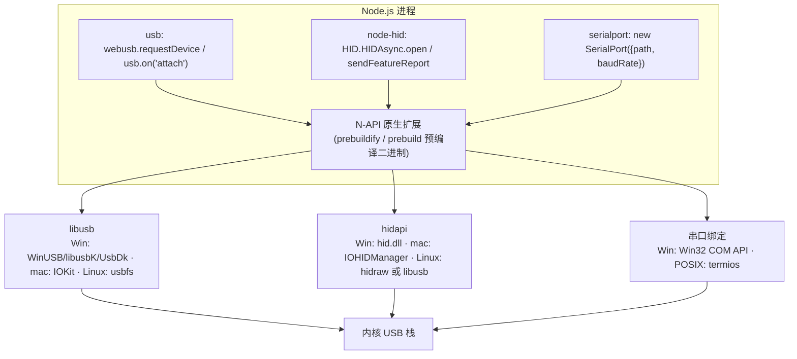

# Node.js 生态：node-usb、node-hid 与 serialport

> 🌿 知识树位置: 枝干[框架与API] → 分枝[Node.js] → 叶
> ⬆️ 返回: [框架与 API · 分枝索引](00-索引.md)

Node.js 里操作 USB 外设有三个事实标准包：**`usb`（node-usb）**、**`node-hid`**、**`serialport`**。它们都是 N-API 原生扩展，分别包装 libusb、hidapi 和各平台串口 API。在 Electron 里，它们还要和 Chromium 自带的 WebUSB/WebHID/Web Serial 做取舍。

## 一、支持范围

| 包 | 底层 | 能力 | 许可证 |
|---|---|---|---|
| `usb`（node-usb/node-usb） | 内置 libusb | 控制/中断/批量（含异步轮询）、热插拔 `attach`/`detach`、**WebUSB 兼容 API**（`webusb`、`WebUSB`、`WebUSBDevice`） | MIT（编译产物包含 libusb，受 LGPL 约束） |
| `node-hid`（node-hid/node-hid） | 内置 hidapi | 枚举、输入/输出/特性报告；同步 `HID.HID` 与异步 `HID.HIDAsync` 两套 API | MIT 或 X11 |
| `serialport`（serialport/node-serialport） | 各平台串口 API | 端口枚举、读写、流控、解析器（`ReadlineParser` 等） | MIT |

## 二、架构与实现原理



- **N-API** 让同一份二进制兼容多个 Node/Electron 版本（node-hid README："since node-hid is now based on NAPI"），`usb` 用 `prebuildify` 打包预编译产物，正常情况下 `npm install` 不需要本地编译。
- **事件循环集成**：node-usb 的异步传输与热插拔由 libusb 事件线程驱动，回调回到 JS 主线程；node-hid 的 `HIDAsync` 把所有读写放在工作队列里按顺序执行。
- **`usb` 包的 WebUSB 兼容层**意味着同一套 `requestDevice → open → claimInterface → transferIn` 代码可以在浏览器和 Node 里复用；`getWebUsb()` 在浏览器中返回 `navigator.usb`，在 Node 中返回内置实现。

## 三、权限与安全模型

Node 进程拥有当前用户的全部 OS 权限，没有浏览器的选择器和黑名单：

- **Windows**：libusb 需要设备绑定 WinUSB（或 libusbK/UsbDk）；node-usb README 提示遇到 `LIBUSB_ERROR_NOT_SUPPORTED` 多半是缺 WinUSB 驱动，可用 Zadig 安装或调用 `usb.useUsbDkBackend()`。
- **Linux**：usbfs 与 hidraw 节点都需要 udev 规则；node-hid 在 Linux 上可用 `HID.setDriverType('hidraw' | 'libusb')` 选择后端（默认 hidraw）。
- **macOS**：键盘类设备受隐私授权约束；node-hid 支持 `{ nonExclusive: true }` 以非独占方式打开（macOS 专用选项）。
- node-hid README 明确：**键盘、鼠标以及工作在键盘模式的扫码枪、RFID 读卡器等由 OS 独占，node-hid 无法读取**。

## 四、平台差异

| 场景 | Windows | macOS | Linux |
|---|---|---|---|
| node-usb 打开厂商设备 | 需要 WinUSB | 直接可用 | 需 udev 规则；内核驱动占用时自动 detach（WebUSB API 在非 Windows 平台默认开启 `setAutoDetachKernelDriver`） |
| node-hid 后端 | hid.dll | IOHIDManager | hidraw（默认）/ libusb |
| 热插拔 | `usb.on('attach')`（node-usb 自带实现） | 同左 | 同左 |
| serialport 路径 | `COM3` | `/dev/tty.usbmodem*` / `/dev/cu.*` | `/dev/ttyACM0` / `/dev/ttyUSB0` |

## 五、局限与坑

- **node-hid 没有热插拔事件**。README 专门警告：反复调用 `HID.devices()` / `HID.devicesAsync()` 轮询会触发 USB（甚至蓝牙）枚举，拖慢正在通信的设备；推荐用 node-usb 的 `attach`/`detach` 做热插拔检测，再用 node-hid 打开。见 [12 篇案例 3](12-实战案例-外设控制七例.md)。
- **报告 ID 字节**：`write()` 和 `sendFeatureReport()` 的数组首字节必须是报告 ID（不用报告 ID 时填 0x00），数组比报告长 1；返回值是"写入字节数 + 1"。`getFeatureReport(reportId, length)` 的 `length` 也要算上报告 ID 字节。
- **`device.read()` 与 `on('data')` 互斥**：注册了 `data` 监听后再调用 `read()` 会失败。
- **打包**：webpack/Vite 打包 Electron 时要把 `node-hid`、`usb`、`serialport` 设为 external（node-hid README 给出 `externals: { "node-hid": 'commonjs node-hid' }`），并让原生 `.node` 文件进入 asar 解包目录。
- **Electron 版本跳跃**：虽然 N-API 跨版本兼容，但 prebuild 产物缺失时会回退到 node-gyp 本地编译，CI 镜像需装好编译工具链和 Linux 的 libudev 开发包。
- **线程**：node-hid 在多 worker_thread 中使用同步 API 会相互等待（内部加锁）。

## 六、Electron：WebHID 还是 node-hid？

| 维度 | Electron + WebHID（渲染进程） | Electron + node-hid（主进程/工具进程） |
|---|---|---|
| 依赖 | 无原生模块 | 原生 `.node`，需按平台/架构打包 |
| 黑名单 | 默认继承 Chromium 黑名单，可 `disable-hid-blocklist` 关闭 | 无黑名单，但 OS 独占规则仍然生效 |
| 设备选择 | 必须处理 `select-hid-device` 或 `setDevicePermissionHandler` | 直接按 VID/PID/Usage 打开 |
| 热插拔 | `navigator.hid` 的 `connect`/`disconnect` 事件 | 需配合 node-usb |
| 网页复用 | 同一套代码可直接部署为网页版 | 不能 |
| 底层可控性 | 只能做报告级操作 | 可拿到路径、接口号、`hid_get_report_descriptor` 原始描述符 |

决策细节和代码见 [12 篇案例 7](12-实战案例-外设控制七例.md)。

## 七、实战代码示例

```javascript
// 示例：node-usb（WebUSB 兼容 API）——Node 中跑与浏览器同构的代码
import { WebUSB } from 'usb';

const webusb = new WebUSB({ allowAllDevices: true });  // Node 端无选择器，直接列出全部
const devices = await webusb.getDevices();
const dev = devices.find(d => d.vendorId === 0xcafe);  // 示例 VID
await dev.open();
await dev.selectConfiguration(1);
await dev.claimInterface(0);
const r = await dev.controlTransferIn(
  { requestType: 'standard', recipient: 'device', request: 0x06, value: 0x0100, index: 0 }, 18);
console.log('device descriptor', Buffer.from(r.data.buffer));
await dev.close();
```

```javascript
// 示例：node-hid 异步 API——按 Usage Page 找厂商集合并读写特性报告
import HID from 'node-hid';

const list = await HID.devicesAsync();
const info = list.find(d => d.vendorId === 0x1532 && d.usagePage === 0xff00); // 示例 VID
const dev = await HID.HIDAsync.open(info.path);
await dev.sendFeatureReport([0x05, 0x01, 0x02, 0x01, 0x00, 0x00]); // 首字节=报告 ID
const buf = await dev.getFeatureReport(0x05, 64);                    // 长度含报告 ID
console.log(buf);
dev.on('data', d => console.log('input', d));
dev.on('error', e => console.error(e));
```

```javascript
// 示例：serialport 行协议
import { SerialPort, ReadlineParser } from 'serialport';

const ports = await SerialPort.list();
const p = ports.find(x => x.vendorId?.toLowerCase() === '2e8a'); // 示例 VID（字符串形式）
const port = new SerialPort({ path: p.path, baudRate: 115200 });
const parser = port.pipe(new ReadlineParser({ delimiter: '\n' }));
parser.on('data', line => console.log('RX', line));
port.write('version\r\n');
```

## 参考来源

- node-usb：<https://github.com/node-usb/node-usb>（README：WebUSB 兼容 API、`usb.on('attach')`、`useUsbDkBackend()`、prebuildify）
- node-hid：<https://github.com/node-hid/node-hid>（README：`HIDAsync`、报告 ID 首字节、热插拔建议、OS 独占设备）
- serialport：<https://serialport.io/docs/> · <https://github.com/serialport/node-serialport>
- Node-API：<https://nodejs.org/api/n-api.html>
- Electron 设备访问与原生模块：<https://www.electronjs.org/docs/latest/tutorial/devices> · <https://www.electronjs.org/docs/latest/tutorial/using-native-node-modules>

## 相关节点

- 底层库: [07-C与C++-libusb与hidapi](07-C与C++-libusb与hidapi.md)
- 浏览器同构 API: [02-WebUSB详解](02-WebUSB详解.md) · [03-WebHID详解](03-WebHID详解.md)
- 选型: [11-框架横向对比与选型指南](11-框架横向对比与选型指南.md)
