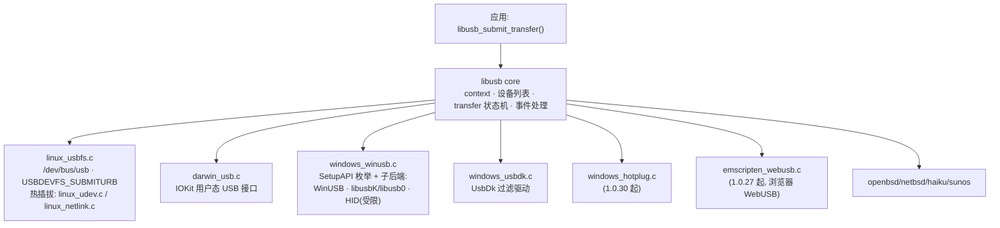
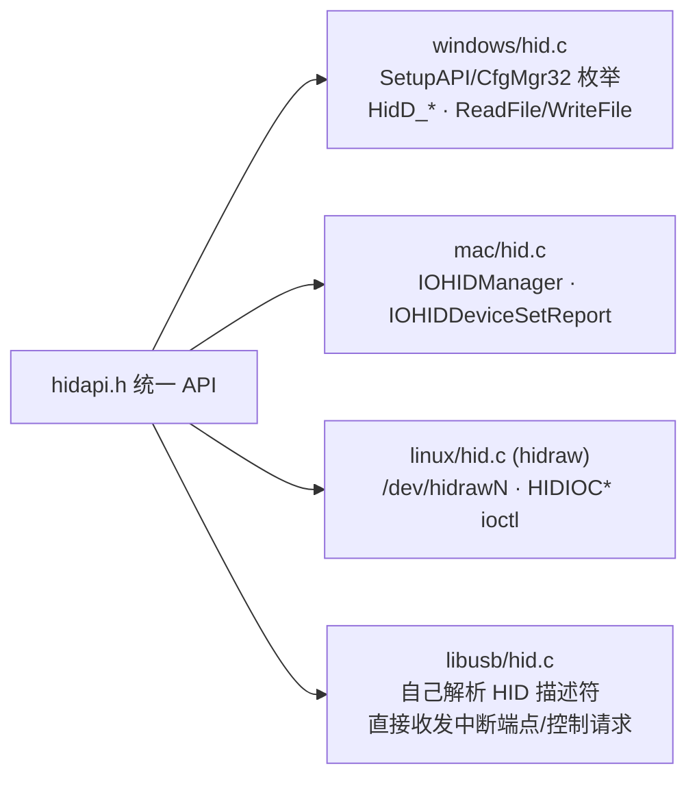

# C 与 C++：libusb 与 hidapi 的架构和后端

> 🌿 知识树位置: 枝干[框架与API] → 分枝[C/C++] → 叶
> ⬆️ 返回: [框架与 API · 分枝索引](00-索引.md)

几乎所有高层语言的 USB/HID 绑定，最终都落到两个 C 库上：**libusb**（通用 USB 用户态访问）和 **hidapi**（HID 报告级访问）。libusb 的基础编程模型已在 [libusb 与用户态访问](../60-枝干-主机侧与实现/04-libusb与用户态访问.md) 和 [实战 libusb](../60-枝干-主机侧与实现/06-实战-libusb主机程序.md) 中给出，本篇聚焦**架构、OS 后端、热插拔与版本演进**，以及 hidapi。

## 第一部分 · libusb

### 一、支持范围

| 项 | 内容 |
|---|---|
| 传输 | 控制、批量、中断、同步（同步传输在 Windows 后端的支持取决于驱动） |
| API | 同步 API（`libusb_control_transfer` / `libusb_bulk_transfer` / `libusb_interrupt_transfer`）与异步 API（`libusb_alloc_transfer` → `libusb_fill_*_transfer` → `libusb_submit_transfer` → `libusb_handle_events*`） |
| 平台 | Linux、Android、macOS、Windows、OpenBSD、NetBSD、Haiku、SunOS，以及 Emscripten（WebAssembly + WebUSB） |
| 许可证 | LGPL-2.1 |

### 二、架构与实现原理



要点：

1. **Windows 上 libusb 不是驱动**，而是根据设备当前绑定的驱动选子后端：WinUSB（首选，系统自带）、libusbK/libusb0（第三方驱动）、HID（只能做有限的报告访问）。**UsbDk** 是另一条路：装一个过滤驱动后可以在不换绑原驱动的情况下临时接管设备，用 `LIBUSB_OPTION_USE_USBDK` 启用。
2. **Linux 上**每个 transfer 被拆成一个或多个 URB，经 `USBDEVFS_SUBMITURB` 提交给内核，完成后由 libusb 事件处理收割（`USBDEVFS_REAPURBNDELAY`）。
3. **WebAssembly 后端**（1.0.27 起）让 C 代码用 Emscripten 编译后在浏览器里通过 WebUSB 运行——原有 libusb 工具可以"移植进网页"。

### 三、版本演进（来自官方 ChangeLog）

| 版本 | 日期 | 与应用开发相关的变化 |
|---|---|---|
| 1.0.27 | 2024-01-31 | 新增 `libusb_init_context`（取代 `libusb_init`）、`libusb_get_platform_descriptor`（读 BOS 平台能力）、WebAssembly + WebUSB 后端 |
| 1.0.28 | 2025-03-18 | 新增 SuperSpeedPlus 能力描述符 API，支持报告 USB 3.2 Gen2x2 速度 |
| 1.0.29 | 2025-06-01 | 修复 macOS 枚举超时回归 |
| 1.0.30 | 2026-05-17 | **Windows 热插拔支持**；WinUSB 后端支持 RAW_IO；适配 macOS 26；新增 `libusb_get_device_string()`（无需打开设备读字符串） |
| 1.0.31 | 未发布（ChangeLog 开发中条目） | Windows 新选项 `LIBUSB_OPTION_WINDOWS_EXCLUSIVE_CLAIM`；新增 `libusb_get_config_string()` / `libusb_get_interface_string()` |

> 旧资料里"libusb 热插拔不支持 Windows"的说法自 1.0.30 起已不成立；可用 `libusb_has_capability(LIBUSB_CAP_HAS_HOTPLUG)` 在运行时判断。

### 四、权限与安全模型

- **Linux**：usbfs 节点权限由 udev 决定；访问被内核驱动占用的接口需要 `libusb_detach_kernel_driver()` 或 `libusb_set_auto_detach_kernel_driver()`。
- **Windows**：WinUSB 设备同一时刻只能被一个进程打开（libusb 头文件注释："WinUSB permits a single open of the device"）；在 1.0.30 及以前，libusbK 驱动下 `claim_interface` 只在进程内生效，1.0.31 的 `LIBUSB_OPTION_WINDOWS_EXCLUSIVE_CLAIM` 才把认领下推到驱动层；HID 设备由 Windows 设计为多应用共享，该选项对 HID 返回 `LIBUSB_ERROR_NOT_SUPPORTED`。
- **macOS**：内核驱动已匹配的接口需要卸载驱动或使用特权（如 DriverKit 授权）才可认领。

### 五、局限与坑

- **事件处理线程**：异步 API 必须有线程调用 `libusb_handle_events_timeout_completed()`；多线程下用 `completed` 标志避免竞争。
- **吞吐靠排队**：高速批量要同时挂多个 transfer（如 8–32 个，每个 16–64 KiB），单个同步 `libusb_bulk_transfer` 循环在每次完成后都有空窗，见 [12 篇案例 4](12-实战案例-外设控制七例.md)。
- **超时后的数据**：同步传输超时返回时可能已经传了部分数据，看 `transferred` 输出参数。
- **复合设备在 Windows**：每个功能可以分别绑定不同驱动；libusb 只能访问绑定了 WinUSB/libusbK 的那几个接口。

## 第二部分 · hidapi

### 一、支持范围

| 项 | 内容 |
|---|---|
| 能力 | 枚举（含 Usage Page/Usage）、打开、`hid_write`（输出报告）、`hid_read`/`hid_read_timeout`（输入报告）、`hid_send_feature_report`/`hid_get_feature_report`、`hid_send_output_report`、`hid_get_input_report`、`hid_get_report_descriptor` |
| 设备 | USB 与蓝牙 HID（Windows、macOS、Linux hidraw 后端均支持蓝牙 HID） |
| 后端 | Windows（hid.dll）、macOS（IOHIDManager）、Linux/FreeBSD hidraw、NetBSD uhid、libusb（Linux/BSD 等类 Unix） |
| 版本 | 主线 `HID_API_VERSION` 0.16.0（`hidapi.h`） |
| 许可证 | 三选一：GPLv3、BSD、原始 HIDAPI 许可（见 LICENSE.txt） |

### 二、架构与实现原理



Linux 上有两个后端：**hidraw** 走内核 HID 栈（支持蓝牙、不会抢内核驱动），**libusb** 后端绕过内核 HID 驱动直接操作 USB（需要 detach `usbhid`，不支持蓝牙）。链接时二选一：`libhidapi-hidraw` 或 `libhidapi-libusb`。

### 三、局限与坑

- **报告 ID 首字节**：`hid_write`、`hid_send_feature_report` 的缓冲区第 0 字节是报告 ID（无报告 ID 时为 0），`length` 要包括这 1 字节；`hid_get_feature_report` 调用前要把 `data[0]` 设为报告 ID。
- **主线没有热插拔 API**：需要自己用 OS 通知（Windows `CM_Register_Notification`、Linux udev monitor、macOS IOHIDManager 回调）或 libusb 热插拔补齐。
- **线程安全**：hidapi 本身不保证线程安全，同一设备句柄不要多线程并发读写（node-hid 等上层绑定自己加锁）。
- **Windows 输出报告**：`hid_write` 在 Windows 上走 `WriteFile`，设备没有中断 OUT 端点时由 HID 类驱动转成 `SET_REPORT(Output)`。

## 第三部分 · 实战代码示例

```c
/* 示例：libusb 1.0.27+ 初始化 + 热插拔（1.0.30 起 Windows 也支持）
 * 编译: cc hotplug.c $(pkg-config --cflags --libs libusb-1.0) */
#include <libusb.h>
#include <stdio.h>

static int LIBUSB_CALL on_hotplug(libusb_context *ctx, libusb_device *dev,
                                  libusb_hotplug_event ev, void *user) {
  struct libusb_device_descriptor d;
  libusb_get_device_descriptor(dev, &d);
  printf("%s %04x:%04x\n", ev == LIBUSB_HOTPLUG_EVENT_DEVICE_ARRIVED ? "ARRIVED" : "LEFT",
         d.idVendor, d.idProduct);
  return 0;                                   /* 返回 0 表示继续接收事件 */
}

int main(void) {
  libusb_context *ctx = NULL;
  if (libusb_init_context(&ctx, NULL, 0) != LIBUSB_SUCCESS) return 1;
  if (!libusb_has_capability(LIBUSB_CAP_HAS_HOTPLUG)) { puts("no hotplug"); return 1; }
  libusb_hotplug_callback_handle h;
  libusb_hotplug_register_callback(ctx,
      LIBUSB_HOTPLUG_EVENT_DEVICE_ARRIVED | LIBUSB_HOTPLUG_EVENT_DEVICE_LEFT,
      LIBUSB_HOTPLUG_ENUMERATE, LIBUSB_HOTPLUG_MATCH_ANY, LIBUSB_HOTPLUG_MATCH_ANY,
      LIBUSB_HOTPLUG_MATCH_ANY, on_hotplug, NULL, &h);
  for (;;) libusb_handle_events(ctx);         /* 事件循环 */
}
```

```c
/* 示例：hidapi 按 Usage Page 打开厂商集合，读写特性报告 */
#include <hidapi.h>
#include <stdio.h>
#include <string.h>

int main(void) {
  hid_init();
  struct hid_device_info *all = hid_enumerate(0x1532, 0x0000), *it; /* 示例 VID；PID=0 表示任意 */
  hid_device *dev = NULL;
  for (it = all; it; it = it->next)
    if (it->usage_page == 0xFF00) { dev = hid_open_path(it->path); break; }
  hid_free_enumeration(all);
  if (!dev) { puts("not found"); return 1; }

  unsigned char buf[65] = {0};
  buf[0] = 0x05;                     /* 报告 ID */
  buf[1] = 0x01; buf[2] = 0x02;      /* 示例命令 */
  if (hid_send_feature_report(dev, buf, sizeof buf) < 0) fwprintf(stderr, L"%ls\n", hid_error(dev));

  memset(buf, 0, sizeof buf); buf[0] = 0x05;
  int n = hid_get_feature_report(dev, buf, sizeof buf);  /* 返回字节数含报告 ID */
  printf("got %d bytes\n", n);

  unsigned char desc[HID_API_MAX_REPORT_DESCRIPTOR_SIZE];
  int dl = hid_get_report_descriptor(dev, desc, sizeof desc);
  printf("report descriptor %d bytes\n", dl);
  hid_close(dev); hid_exit();
}
```

## 参考来源

- libusb 官网与 API 文档：<https://libusb.info/> · <https://libusb.sourceforge.io/api-1.0/>
- libusb 源码与 ChangeLog：<https://github.com/libusb/libusb> · <https://github.com/libusb/libusb/blob/master/ChangeLog>
- libusb Windows 说明：<https://github.com/libusb/libusb/wiki/Windows>
- hidapi：<https://github.com/libusb/hidapi>（README 后端说明、`hidapi/hidapi.h`）
- Linux usbfs：<https://docs.kernel.org/driver-api/usb/usb.html> · hidraw：<https://docs.kernel.org/hid/hidraw.html>

## 相关节点

- [libusb 与用户态访问](../60-枝干-主机侧与实现/04-libusb与用户态访问.md) · [实战 libusb 主机程序](../60-枝干-主机侧与实现/06-实战-libusb主机程序.md)
- [08-操作系统原生API-Windows-macOS-Linux](08-操作系统原生API-Windows-macOS-Linux.md)（hidapi 各后端调用的原生 API）
- [09-多语言绑定-Python-Rust-Go-dotNET-Android](09-多语言绑定-Python-Rust-Go-dotNET-Android.md)
