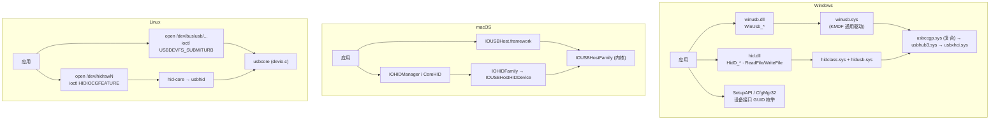

# 操作系统原生 USB/HID API：Windows、macOS、Linux

> 🌿 知识树位置: 枝干[框架与API] → 分枝[原生 API] → 叶
> ⬆️ 返回: [框架与 API · 分枝索引](00-索引.md)

所有框架最终都调用这些原生 API。弄清楚它们，就能解释"为什么 WebHID 和 HID.dll 行为不同""为什么 libusb 在 Windows 要换驱动"。驱动开发（KMDF/UMDF/DriverKit/内核模块）见 [Windows 驱动开发](../60-枝干-主机侧与实现/08-WindowsUSB驱动开发.md) 与 [macOS 与 Linux 主机开发](../60-枝干-主机侧与实现/09-macOS与Linux主机开发.md)；本篇只讲**应用层可直接调用、无需写驱动**的接口。

## 一、支持范围总览

| 平台 | 通用 USB（厂商类） | HID 报告级 | 设备枚举与通知 |
|---|---|---|---|
| Windows（Win32） | **WinUSB**（`winusb.dll`：`WinUsb_Initialize`、`WinUsb_ControlTransfer`、`WinUsb_ReadPipe`、`WinUsb_WritePipe`…） | **HID.dll**（`HidD_*` / `HidP_*`）+ `CreateFile`/`ReadFile`/`WriteFile` | **SetupAPI**（`SetupDiGetClassDevs`…）、**CfgMgr32**（`CM_Get_Device_Interface_List`、`CM_Register_Notification`） |
| Windows（WinRT） | `Windows.Devices.Usb`（`UsbDevice`） | `Windows.Devices.HumanInterfaceDevice`（`HidDevice`） | `Windows.Devices.Enumeration`（`DeviceInformation`、`DeviceWatcher`） |
| macOS | **IOUSBHost** 框架（macOS 10.15+：`IOUSBHostDevice`、`IOUSBHostInterface`、`IOUSBHostPipe`）；旧 IOKit `IOUSBLib` | **IOHIDManager / IOHIDDevice**（IOKit）；**CoreHID**（macOS 15+：`HIDDeviceManager`、`HIDDeviceClient`、`HIDVirtualDevice`） | IOKit 匹配通知（`IOServiceAddMatchingNotification`） |
| Linux | **usbfs**：`/dev/bus/usb/BBB/DDD` + `USBDEVFS_*` ioctl | **hidraw**：`/dev/hidrawN` + `HIDIOC*` ioctl | **udev**（libudev / netlink） |

## 二、架构与实现原理



### Windows 要点

1. **两步枚举**：先用 `SetupDiGetClassDevs(&GUID_DEVINTERFACE_HID 或自定义 DeviceInterfaceGUID, …, DIGCF_PRESENT | DIGCF_DEVICEINTERFACE)` 或 `CM_Get_Device_Interface_List` 拿到设备接口路径，再 `CreateFile` 打开。HID 接口 GUID 也可用 `HidD_GetHidGuid` 获取；WinUSB 设备的 GUID 来自 INF 或 MS OS 描述符写入的 `DeviceInterfaceGUIDs` 注册表值。
2. **HID 按顶层集合拆分**：Windows HID 类驱动为每个 TLC 创建一个独立的设备接口（路径里带 `&col01`、`&col02`…）。原生程序看到的是"多个 HID 设备"，WebHID 看到的是"一个设备多个 collections"。
3. **键鼠独占**：系统以独占方式打开键盘、鼠标 TLC，应用只能以零访问权限（`dwDesiredAccess = 0`）打开它们做属性查询（`HidD_GetAttributes` 等），无法 `ReadFile`。
4. **报告缓冲区**：`HidP_GetCaps` 返回的 `InputReportByteLength`、`OutputReportByteLength`、`FeatureReportByteLength` 都**包含报告 ID 字节**；`HidD_GetFeature`/`HidD_SetFeature` 的缓冲区必须是这个长度，第 0 字节放报告 ID（不用报告 ID 时为 0）。
5. **热插拔**：Win32 用 `CM_Register_Notification`（推荐）或窗口消息 `WM_DEVICECHANGE` + `RegisterDeviceNotification`；WinRT 用 `DeviceWatcher`。
6. **WinRT 的限制**：打包应用（UWP/MSIX）访问 HID 需要在清单里用 `humaninterfacedevice` 设备能力声明 VID/PID 与 Usage Page；访问 USB 需要 `usb` 设备能力，且设备须绑定 WinUSB。

### macOS 要点

1. **IOUSBHost**（Apple 文档："Create host-mode user space drivers for USB devices"）：`IOUSBHostDevice` 负责认领设备、选配置、发设备请求；`IOUSBHostInterface` 访问接口；`IOUSBHostPipe` 负责控制/批量/中断/同步 I/O 与 Streams。该框架还包含 `IOUSBHostCIController`、`IOUSBHostCIDevice`、`IOUSBHostCIEndpoint` 等控制器接口类（与虚拟 USB 研究方向相关，细节以 Apple 文档为准）。
2. **IOHIDManager**：按匹配字典（VID/PID/UsagePage/Usage）枚举，`IOHIDDeviceSetReport` / `IOHIDDeviceGetReport` 读写报告；`IOHIDDeviceOpen` 传 `kIOHIDOptionsTypeSeizeDevice` 可独占。
3. **CoreHID**（macOS 15+，Swift）：`HIDDeviceManager` 发现设备，`HIDDeviceClient` 收发报告（`dispatchSetReportRequest(type:id:data:timeout:)`、`dispatchGetReportRequest(type:id:timeout:)`、`monitorNotifications(reportIDsToMonitor:elementsToMonitor:)`），并可用 `HIDVirtualDevice` **在用户态创建虚拟 HID 设备**——无需写驱动即可模拟键鼠手柄做测试。
4. **隐私**：读取键盘类输入需要用户授权"输入监控"（TCC）。

### Linux 要点

1. **usbfs**：`USBDEVFS_CONTROL`（同步控制传输）、`USBDEVFS_BULK`、`USBDEVFS_SUBMITURB`/`USBDEVFS_REAPURBNDELAY`（异步 URB）、`USBDEVFS_CLAIMINTERFACE`、`USBDEVFS_DISCONNECT`（解绑内核驱动）。libusb 的 Linux 后端就是它的封装。
2. **hidraw**：`read()` 拿输入报告（带报告 ID 首字节，若设备使用报告 ID）、`write()` 发输出报告；`HIDIOCGRDESCSIZE` / `HIDIOCGRDESC` 读报告描述符；`HIDIOCGRAWINFO` 读总线类型与 VID/PID；`HIDIOCSFEATURE(len)` / `HIDIOCGFEATURE(len)` 读写特性报告。
3. **权限**：udev 规则，例如 `SUBSYSTEM=="hidraw", ATTRS{idVendor}=="1532", TAG+="uaccess"`。
4. **虚拟设备**：`uhid`（用户态 HID 设备）与 `uinput`；USB 层面用 gadget（见 [Linux Gadget 与 usbip](../60-枝干-主机侧与实现/07-实战-LinuxGadget与usbip.md)）。

## 三、权限与安全模型对照

| 平台 | 普通用户能否直接打开厂商 USB 设备 | 能否读键盘输入报告 | 用户态创建虚拟 HID |
|---|---|---|---|
| Windows | 能，前提是设备绑定 WinUSB | 不能（系统独占） | 需要驱动（如 VHF 框架，属驱动开发范畴） |
| macOS | 能（无内核驱动匹配的接口） | 需"输入监控"授权 | 能（CoreHID `HIDVirtualDevice`，macOS 15+） |
| Linux | 需 udev 规则 | hidraw 可读（有权限即可，不独占） | 能（`/dev/uhid`，需权限） |

## 四、局限与坑

- **Windows Overlapped I/O**：HID 读必须用重叠 I/O 或独立线程，否则 `ReadFile` 阻塞到下一个输入报告；关闭句柄前要 `CancelIoEx`。
- **WinUSB 单开**：同一设备只能被一个进程 `WinUsb_Initialize`；调试工具和应用会互相抢。
- **`WinUsb_ReadPipe` 的长度**：读缓冲区不是 `MaximumPacketSize` 整数倍时，设备发满包会出错；可设置 `ALLOW_PARTIAL_READS`、`RAW_IO` 等管道策略（`WinUsb_SetPipePolicy`）。
- **macOS 内核驱动占用**：HID、音频、大容量存储接口被系统驱动匹配，IOUSBHost 无法直接认领。
- **Linux hidraw 报告 ID**：hidraw 的读写数据都带报告 ID 首字节（设备使用报告 ID 时），与 WebHID 的 `inputreport.data` 不同。

## 五、实战代码示例

```c
/* 示例：Windows HID.dll 读写特性报告（MSVC: link hid.lib setupapi.lib） */
#include <windows.h>
#include <setupapi.h>
#include <hidsdi.h>
#include <hidpi.h>
#include <stdio.h>

int main(void) {
  GUID hidGuid; HidD_GetHidGuid(&hidGuid);
  HDEVINFO set = SetupDiGetClassDevsW(&hidGuid, NULL, NULL, DIGCF_PRESENT | DIGCF_DEVICEINTERFACE);
  SP_DEVICE_INTERFACE_DATA ifd = { sizeof ifd };
  for (DWORD i = 0; SetupDiEnumDeviceInterfaces(set, NULL, &hidGuid, i, &ifd); ++i) {
    DWORD need = 0;
    SetupDiGetDeviceInterfaceDetailW(set, &ifd, NULL, 0, &need, NULL);
    PSP_DEVICE_INTERFACE_DETAIL_DATA_W det = malloc(need);
    det->cbSize = sizeof *det;
    if (!SetupDiGetDeviceInterfaceDetailW(set, &ifd, det, need, NULL, NULL)) { free(det); continue; }
    HANDLE h = CreateFileW(det->DevicePath, GENERIC_READ | GENERIC_WRITE,
                           FILE_SHARE_READ | FILE_SHARE_WRITE, NULL, OPEN_EXISTING, 0, NULL);
    free(det);
    if (h == INVALID_HANDLE_VALUE) continue;          /* 键鼠 TLC 会在这里失败 */
    HIDD_ATTRIBUTES a = { sizeof a };
    PHIDP_PREPARSED_DATA pp; HIDP_CAPS caps;
    if (HidD_GetAttributes(h, &a) && a.VendorID == 0x1532 &&          /* 示例 VID */
        HidD_GetPreparsedData(h, &pp)) {
      HidP_GetCaps(pp, &caps);
      if (caps.UsagePage == 0xFF00 && caps.FeatureReportByteLength) {
        BYTE buf[256] = {0};
        buf[0] = 0x05;                                  /* 报告 ID 放第 0 字节 */
        buf[1] = 0x01;                                  /* 示例命令 */
        HidD_SetFeature(h, buf, caps.FeatureReportByteLength);
        ZeroMemory(buf, sizeof buf); buf[0] = 0x05;
        if (HidD_GetFeature(h, buf, caps.FeatureReportByteLength))
          printf("feature[1]=%02X len=%u\n", buf[1], caps.FeatureReportByteLength);
      }
      HidD_FreePreparsedData(pp);
    }
    CloseHandle(h);
  }
  SetupDiDestroyDeviceInfoList(set);
}
```

```c
/* 示例：Linux hidraw 读写特性报告与报告描述符 */
#include <fcntl.h>
#include <linux/hidraw.h>
#include <stdio.h>
#include <sys/ioctl.h>
#include <unistd.h>

int main(int argc, char **argv) {
  int fd = open(argc > 1 ? argv[1] : "/dev/hidraw0", O_RDWR);
  if (fd < 0) { perror("open"); return 1; }
  struct hidraw_devinfo info; ioctl(fd, HIDIOCGRAWINFO, &info);
  printf("bus=%u vid=%04hx pid=%04hx\n", info.bustype, info.vendor, info.product);

  int size = 0; ioctl(fd, HIDIOCGRDESCSIZE, &size);
  struct hidraw_report_descriptor rd = { .size = size };
  ioctl(fd, HIDIOCGRDESC, &rd);
  printf("report descriptor %d bytes, first item %02x\n", size, rd.value[0]);

  unsigned char buf[65] = { 0x05, 0x01 };                 /* [报告 ID, 命令...] */
  if (ioctl(fd, HIDIOCSFEATURE(sizeof buf), buf) < 0) perror("SFEATURE");
  buf[0] = 0x05;
  int n = ioctl(fd, HIDIOCGFEATURE(sizeof buf), buf);     /* 返回长度含报告 ID */
  printf("GFEATURE %d bytes\n", n);
  close(fd);
}
```

```swift
// 示例：macOS 15+ CoreHID 发现厂商集合并读写特性报告（签名取自 Apple CoreHID 文档）
import CoreHID

let manager = HIDDeviceManager()
let criteria = HIDDeviceManager.DeviceMatchingCriteria(
  primaryUsage: HIDUsage(page: 0xFF00, usage: 0x01))       // 厂商自定义集合
for try await note in await manager.monitorNotifications(matchingCriteria: [criteria]) {
  guard case .deviceMatched(let ref) = note,
        let client = HIDDeviceClient(deviceReference: ref) else { continue }
  let id = HIDReportID(rawValue: 5)                         // 报告 ID 单独传参
  try await client.dispatchSetReportRequest(type: .feature, id: id,
                                            data: Data([0x01, 0x02]), timeout: nil)
  let reply = try await client.dispatchGetReportRequest(type: .feature, id: id, timeout: nil)
  print("feature:", reply as NSData)
}
```

## 参考来源

- WinUSB：<https://learn.microsoft.com/windows-hardware/drivers/usbcon/using-winusb-api-to-communicate-with-a-usb-device> · <https://learn.microsoft.com/windows/win32/api/winusb/>
- HID 客户端（HidD/HidP、TLC、独占规则）：<https://learn.microsoft.com/windows-hardware/drivers/hid/introduction-to-hid-concepts> · <https://learn.microsoft.com/windows-hardware/drivers/hid/top-level-collections> · <https://learn.microsoft.com/windows-hardware/drivers/hid/keyboard-and-mouse-hid-client-drivers>
- CfgMgr32 通知：<https://learn.microsoft.com/windows/win32/api/cfgmgr32/nf-cfgmgr32-cm_register_notification>
- WinRT：<https://learn.microsoft.com/uwp/api/windows.devices.humaninterfacedevice> · <https://learn.microsoft.com/uwp/api/windows.devices.usb> · HID 设备能力 <https://learn.microsoft.com/uwp/schemas/appxpackage/how-to-specify-device-capabilities-for-hid>
- Apple：IOUSBHost <https://developer.apple.com/documentation/iousbhost> · CoreHID <https://developer.apple.com/documentation/corehid> · IOKit HID <https://developer.apple.com/documentation/iokit>
- Linux：hidraw <https://docs.kernel.org/hid/hidraw.html> · uhid <https://docs.kernel.org/hid/uhid.html> · USB 主机侧 API（usbfs）<https://docs.kernel.org/driver-api/usb/usb.html>

## 相关节点

- [操作系统 USB 支持](../60-枝干-主机侧与实现/02-操作系统USB支持.md) · [Windows USB 驱动开发](../60-枝干-主机侧与实现/08-WindowsUSB驱动开发.md) · [macOS 与 Linux 主机开发](../60-枝干-主机侧与实现/09-macOS与Linux主机开发.md)
- 差异实测: [12-实战案例-外设控制七例](12-实战案例-外设控制七例.md)（案例 5）
