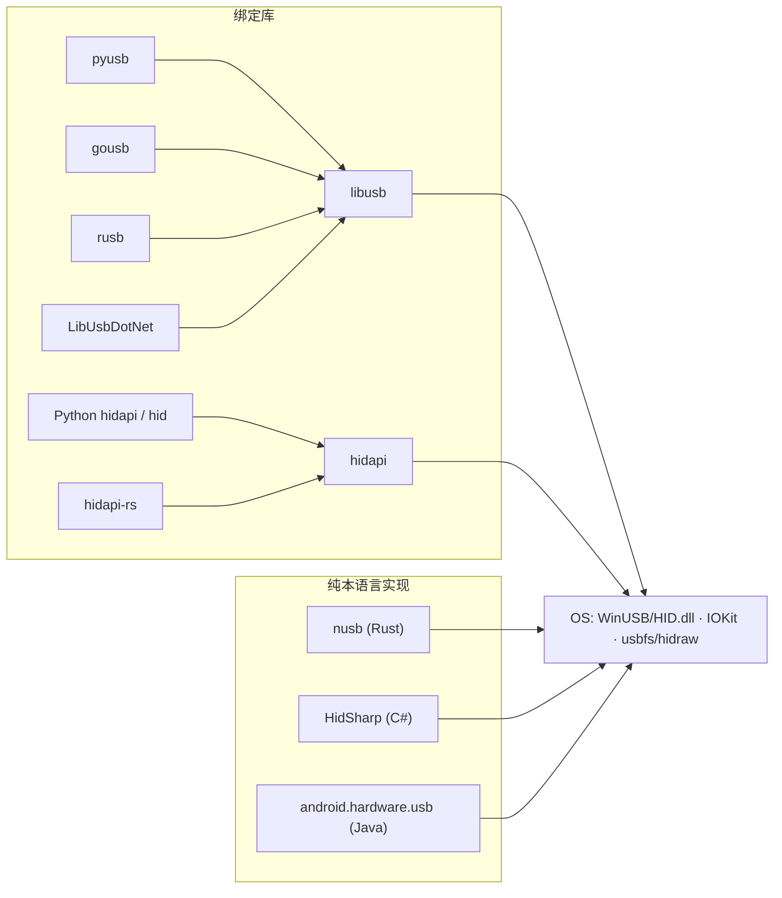

# 多语言绑定：Python、Rust、Go、.NET、Android 与跨平台框架

> 🌿 知识树位置: 枝干[框架与API] → 分枝[多语言] → 叶
> ⬆️ 返回: [框架与 API · 分枝索引](00-索引.md)

各语言的 USB/HID 库大多是 libusb、hidapi 或 OS 原生 API 的绑定。认清"它底下是谁"，就能预判它的平台限制、驱动要求和许可证。少数库（如 Rust 的 nusb、.NET 的 HidSharp）是直接调用 OS API 的纯本语言实现。

## 一、支持范围与底层一览

| 语言 | 库 | 底层 | 传输 | 许可证 |
|---|---|---|---|---|
| Python | **pyusb**（`usb.core`） | 可插拔后端：libusb 1.0 / libusb 0.1 / OpenUSB | 控制/批量/中断/同步（取决于后端） | BSD-3-Clause |
| Python | **hidapi**（PyPI 包名 `hidapi`，cython-hidapi，`import hid`，`hid.device()`） | 内置 hidapi | HID 报告 | 三选一（GPLv3 / BSD / HIDAPI 原始许可） |
| Python | **hid**（PyPI 包名 `hid`，ctypes 封装，`import hid`，`hid.Device`） | 系统已安装的 hidapi 动态库 | HID 报告 | 见项目仓库 |
| Python | **pyserial**（`serial.Serial`） | OS 串口 API | 串口 | BSD-3-Clause |
| Rust | **rusb** | libusb（`libusb1-sys`） | 控制/批量/中断，热插拔 | MIT |
| Rust | **nusb** | **纯 Rust**，直接调用 OS API，另支持 WebUSB | 控制/批量/中断；异步优先，不依赖特定运行时 | Apache-2.0 或 MIT |
| Rust | **hidapi**（hidapi-rs） | hidapi | HID 报告 | MIT |
| Go | **gousb**（google/gousb） | libusb（cgo） | 控制/批量/中断/同步 | Apache-2.0 |
| .NET | **LibUsbDotNet** | libusb | 控制/批量/中断 | LGPL-3.0 |
| .NET | **HidSharp** | 纯 C#，各平台原生 HID API | HID 报告、串口 | Apache-2.0 |
| .NET | **Device.Net**（含 Hid.Net / Usb.Net） | 各平台原生 API（Windows/Android/UWP 等） | HID / USB | MIT |
| .NET | `System.IO.Ports`（官方） | OS 串口 API | 串口 | MIT（.NET 运行时） |
| Java/Kotlin | **android.hardware.usb**（官方 SDK） | Android 内核 usbfs | 控制/批量/中断（无同步传输 API） | Android SDK |
| C++/Qt | **QtSerialPort**（官方模块） | OS 串口 API | 串口 | Qt 许可 |
| Dart/JS | Flutter、React Native | 无官方 USB 模块，依赖社区插件包装平台 API | 视插件 | 视插件 |

**Qt 没有官方 USB 模块**：Qt 官方只提供 Qt Serial Port 与 Qt Bluetooth；做 USB/HID 需要直接用 libusb/hidapi 或社区项目。**Flutter / React Native** 同样没有官方 USB 支持，社区插件多半只覆盖 Android（经 `android.hardware.usb`）或串口，选型前要核对平台矩阵与维护状态。

## 二、架构与实现原理



- **绑定库**继承底层 C 库的全部特性与限制：例如 pyusb、gousb、rusb 在 Windows 上同样需要设备绑定 WinUSB。
- **nusb** 的 README 写明与 rusb/libusb 的区别：纯 Rust、无 libusb 依赖；异步优先但不要求特定异步运行时；没有 context 对象，打开第一个设备时启动一个全局事件循环线程；是更薄的 OS API 封装。
- **Android** 的 USB Host API 由系统服务管控：应用先经 `UsbManager.requestPermission()` 获得用户授权，再 `openDevice()` 拿到 `UsbDeviceConnection`；底层是内核 usbfs。

## 三、权限与安全模型

| 平台/库 | 权限来源 |
|---|---|
| 桌面绑定库 | 与 libusb/hidapi 相同：Windows 驱动绑定、Linux udev、macOS 内核驱动占用与隐私授权 |
| Android | 运行时用户授权对话框；或在清单中为 `android.hardware.usb.action.USB_DEVICE_ATTACHED` 意图配置 `device_filter.xml`，插入设备时由用户选择默认应用；需要设备支持 `android.hardware.usb.host` 特性 |
| Android 上的 HID 设备 | 内核 `usbhid` 已绑定；`claimInterface(intf, true)` 的 `force=true` 会断开内核驱动后认领 |

## 四、平台差异与坑

- **Python 的两个 `hid` 包同名不同 API**：`pip install hidapi` 得到 cython-hidapi（`hid.device()` 小写类，先构造再 `open(vid, pid)`）；`pip install hid` 得到 ctypes 版（`hid.Device(vid, pid)` 或 `hid.Device(path=...)`，需要系统装好 hidapi 动态库）。QMK 文档示例使用后者，并提醒不要误装名字相近的 `pyhidapi`。
- **pyusb 后端缺失**：Windows 上找不到 libusb DLL 会报 `NoBackendError`，需要把 `libusb-1.0.dll` 放到 PATH 或用 `usb.backend.libusb1.get_backend(find_library=...)` 指定。
- **gousb 依赖 cgo**：交叉编译需要目标平台的 libusb 与 C 工具链。
- **Android 没有同步传输**：`UsbDeviceConnection` 只有 `controlTransfer`、`bulkTransfer`（中断端点也用它）与异步 `UsbRequest`；音视频类设备需要 NDK 自行操作 usbfs 文件描述符（`getFileDescriptor()` 可交给 libusb 的 `libusb_wrap_sys_device`）。
- **HidSharp** 的 `GetFeature`/`SetFeature` 缓冲区同样以报告 ID 为首字节，长度用 `GetMaxFeatureReportLength()`。

## 五、实战代码示例

```python
# 示例：pyusb 读取设备描述符与字符串（标准请求）
import usb.core, usb.util

dev = usb.core.find(idVendor=0xcafe, idProduct=0x4000)   # 示例 VID/PID
if dev is None:
    raise SystemExit("not found")
# bmRequestType=0x80 (IN|Standard|Device), bRequest=6 GET_DESCRIPTOR, wValue=(DEVICE<<8)|0
raw = dev.ctrl_transfer(0x80, 0x06, 0x0100, 0x0000, 18)
print("bLength", raw[0], "bcdUSB %04x" % (raw[2] | raw[3] << 8))
print("product:", usb.util.get_string(dev, dev.iProduct))
```

```python
# 示例：PyPI 包 hidapi（cython-hidapi）读写特性报告
import hid
h = hid.device()
h.open(0x1532, 0x0001)                       # 示例 VID/PID
h.send_feature_report([0x05, 0x01, 0x02])    # 首字节=报告 ID
print(h.get_feature_report(0x05, 65))        # 长度含报告 ID
h.close()
```

```rust
// 示例：nusb 0.2.x 控制传输（改编自 nusb 官方 examples/control.rs）
use std::time::Duration;
use nusb::{transfer::{ControlIn, ControlType, Recipient}, MaybeFuture};

fn main() {
    let info = nusb::list_devices().wait().unwrap()
        .find(|d| d.vendor_id() == 0xcafe)            // 示例 VID
        .expect("device not connected");
    let device = info.open().wait().unwrap();
    // Windows 需要先认领接口，再在 Interface 上发控制请求
    let interface = device.claim_interface(0).wait().unwrap();
    let data = interface.control_in(ControlIn {
        control_type: ControlType::Vendor, recipient: Recipient::Interface,
        request: 0x01, value: 0, index: 0, length: 64,
    }, Duration::from_millis(100)).wait();
    println!("{data:?}");
}
```

```go
// 示例：gousb 发送厂商控制请求
package main

import ("fmt"; "log"; "github.com/google/gousb")

func main() {
	ctx := gousb.NewContext()
	defer ctx.Close()
	dev, err := ctx.OpenDeviceWithVIDPID(0xcafe, 0x4000) // 示例 VID/PID
	if err != nil || dev == nil { log.Fatal("open failed: ", err) }
	defer dev.Close()
	buf := make([]byte, 64)
	// rType 0xC0 = IN | Vendor | Device
	n, err := dev.Control(0xC0, 0x01, 0, 0, buf)
	fmt.Println(n, err, buf[:n])
}
```

```csharp
// 示例：HidSharp 读写特性报告
using HidSharp;
var dev = DeviceList.Local.GetHidDevices(0x1532)            // 示例 VID
            .First(d => d.GetMaxFeatureReportLength() > 0);
if (dev.TryOpen(out HidStream s)) using (s) {
    var buf = new byte[dev.GetMaxFeatureReportLength()];
    buf[0] = 0x05; buf[1] = 0x01;                            // [报告 ID, 命令]
    s.SetFeature(buf);
    Array.Clear(buf); buf[0] = 0x05;
    s.GetFeature(buf);
    Console.WriteLine(BitConverter.ToString(buf));
}
```

```kotlin
// 示例：Android USB Host 控制传输（需在 Activity 中、已获得权限）
val mgr = getSystemService(Context.USB_SERVICE) as UsbManager
val dev = mgr.deviceList.values.first { it.vendorId == 0xcafe }   // 示例 VID
if (!mgr.hasPermission(dev)) {
    val pi = PendingIntent.getBroadcast(this, 0, Intent("com.example.USB_PERMISSION"),
                                        PendingIntent.FLAG_IMMUTABLE)
    mgr.requestPermission(dev, pi); return
}
val conn = mgr.openDevice(dev)
val buf = ByteArray(18)
// requestType 0x80, GET_DESCRIPTOR(DEVICE)
val n = conn.controlTransfer(0x80, 0x06, 0x0100, 0, buf, buf.size, 1000)
Log.i("usb", "read $n bytes, bcdUSB=%04x".format((buf[3].toInt() and 0xff shl 8) or (buf[2].toInt() and 0xff)))
conn.close()
```

## 参考来源

- pyusb：<https://github.com/pyusb/pyusb>（教程 `docs/tutorial.rst`）· cython-hidapi：<https://github.com/trezor/cython-hidapi> · hid（ctypes）：<https://github.com/apmorton/pyhidapi> · pyserial：<https://pyserial.readthedocs.io/>
- rusb：<https://github.com/a1ien/rusb> · nusb：<https://github.com/kevinmehall/nusb>（`examples/`）· hidapi-rs：<https://github.com/ruabmbua/hidapi-rs>
- gousb：<https://github.com/google/gousb> · <https://pkg.go.dev/github.com/google/gousb>
- LibUsbDotNet：<https://github.com/LibUsbDotNet/LibUsbDotNet> · HidSharp：<https://github.com/IntergatedCircuits/HidSharp> · Device.Net：<https://github.com/MelbourneDeveloper/Device.Net> · System.IO.Ports：<https://learn.microsoft.com/dotnet/api/system.io.ports.serialport>
- Android USB Host：<https://developer.android.com/develop/connectivity/usb/host> · <https://developer.android.com/reference/android/hardware/usb/UsbDeviceConnection>
- Qt Serial Port：<https://doc.qt.io/qt-6/qtserialport-index.html>
- QMK Raw HID（Python `hid` 示例）：<https://docs.qmk.fm/features/rawhid>

## 相关节点

- 底层: [07-C与C++-libusb与hidapi](07-C与C++-libusb与hidapi.md) · [08-操作系统原生API-Windows-macOS-Linux](08-操作系统原生API-Windows-macOS-Linux.md)
- 选型: [11-框架横向对比与选型指南](11-框架横向对比与选型指南.md)
- Python 案例: [12-实战案例-外设控制七例](12-实战案例-外设控制七例.md)（案例 6）
