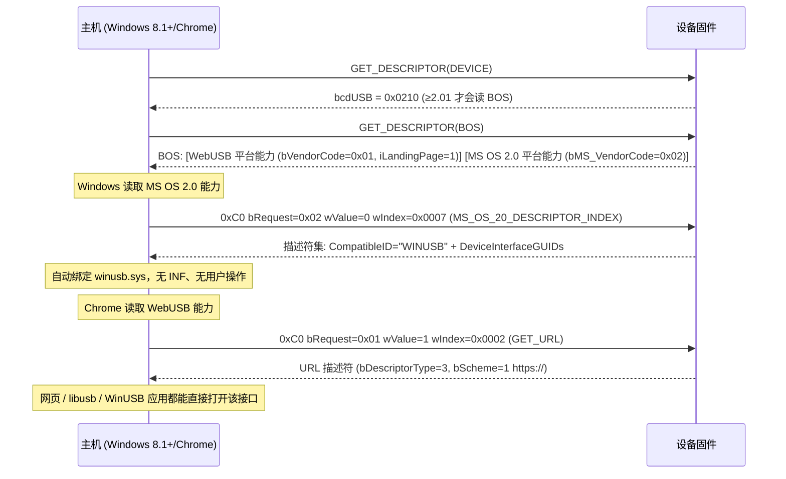

# 设备端框架与 WebUSB 固件桥接

> 🌿 知识树位置: 枝干[框架与API] → 分枝[设备侧] → 叶
> ⬆️ 返回: [框架与 API · 分枝索引](00-索引.md)

主机侧框架能不能"即插即用"，很大程度由**固件**决定：设备是否声明了 WebUSB 平台能力、是否带 MS OS 2.0 描述符让 Windows 自动绑定 WinUSB、HID 配置集合是否放在厂商 Usage Page 里。本篇先简述三种设备侧框架，再给出把固件与网页、WinUSB 打通的完整描述符。

## 一、设备侧框架速览

| 框架 | 定位 | WebUSB / MS OS 2.0 支持 | 详细页面 |
|---|---|---|---|
| **TinyUSB** | MCU 上的跨芯片 USB 设备/主机栈 | 提供 `TUD_BOS_WEBUSB_DESCRIPTOR`、`TUD_BOS_MS_OS_20_DESCRIPTOR` 宏与 `webusb_serial` 官方示例 | [实战 TinyUSB 设备固件](../60-枝干-主机侧与实现/05-实战-TinyUSB设备固件.md) |
| **Zephyr USB device_next**（新设备栈，UDC API） | RTOS 内置设备栈 | 官方 `samples/subsys/usb/webusb` 示例：BOS + MS OS 2.0 + WebUSB，用 `usbd_add_descriptor()` 注册厂商请求描述符 | [设备端固件栈](../60-枝干-主机侧与实现/03-设备端固件栈.md) |
| **Linux USB Gadget（configfs）** | Linux 设备侧（SoC 作为 USB 设备） | `os_desc/`（内核 3.16 起，MS OS 1.0 风格 OS String 扩展）；`webusb/`（**内核 6.3 起**，属性 `use`、`bcdVersion`、`bVendorCode`、`landingPage`） | [实战 Linux Gadget 与 usbip](../60-枝干-主机侧与实现/07-实战-LinuxGadget与usbip.md) |

## 二、架构与实现原理：一台设备如何同时服务网页、WinUSB 和原生库



关键条件：

1. **`bcdUSB` 至少 0x0201**（常用 0x0210），主机才会请求 BOS 描述符（BOS 机制见 [描述符详解](../10-树干-USB核心/07-描述符详解.md)）。
2. **两个平台能力各用各的厂商请求码**：WebUSB 的 `bVendorCode` 与 MS OS 2.0 的 `bMS_VendorCode` 可以相同也可以不同，但固件要按 `wIndex` 区分：WebUSB `GET_URL` 的 `wIndex = 2`；MS OS 2.0 描述符集的 `wIndex = 7`。
3. **Windows 只在首次见到某个 VID/PID/bcdDevice 组合时查询 OS 描述符**，结果缓存在注册表 `HKLM\SYSTEM\CurrentControlSet\Control\usbflags\VVVVPPPPRRRR`；迭代固件时改了描述符却不生效，要么递增 `bcdDevice`，要么删除该键后重插。

## 三、字节级描述符

### 3.1 BOS（两个平台能力，共 57 字节）

```text
示例：BOS 描述符
05 0F 39 00 02                         ; bLength=5, BOS, wTotalLength=0x0039, bNumDeviceCaps=2

; WebUSB Platform Capability（24 字节，WebUSB 规范 §4.1）
18 10 05 00                            ; bLength=24, DEVICE CAPABILITY, PLATFORM, bReserved
38 B6 08 34 A9 09 A0 47 8B FD A0 76 88 15 B6 65   ; UUID {3408B638-09A9-47A0-8BFD-A0768815B665}（GUID 小端字节序）
00 01                                  ; bcdVersion = 0x0100
01                                     ; bVendorCode = 0x01
01                                     ; iLandingPage = 1（0 表示无落地页）

; Microsoft OS 2.0 Platform Capability（28 字节）
1C 10 05 00                            ; bLength=28, DEVICE CAPABILITY, PLATFORM, bReserved
DF 60 DD D8 89 45 C7 4C 9C D2 65 9D 9E 64 8A 9F   ; UUID {D8DD60DF-4589-4CC7-9CD2-659D9E648A9F}
00 00 03 06                            ; dwWindowsVersion = 0x06030000（Windows 8.1）
A2 00                                  ; wMSOSDescriptorSetTotalLength = 0x00A2 (162)
02                                     ; bMS_VendorCode = 0x02
00                                     ; bAltEnumCode = 0
```

### 3.2 MS OS 2.0 描述符集（单功能、非复合设备，162 字节）

```text
示例：MS OS 2.0 描述符集
0A 00 00 00 00 00 03 06 A2 00          ; 集合头: wLength=10, MS_OS_20_SET_HEADER_DESCRIPTOR(0x00), Win8.1, wTotalLength=162
14 00 03 00 57 49 4E 55 53 42 00 00    ; 兼容 ID: wLength=20, MS_OS_20_FEATURE_COMPATBLE_ID(0x03), "WINUSB\0\0"
00 00 00 00 00 00 00 00                ;          SubCompatibleID 全 0
84 00 04 00 07 00 2A 00                ; 注册表属性: wLength=132, MS_OS_20_FEATURE_REG_PROPERTY(0x04),
                                       ;   wPropertyDataType=7 (REG_MULTI_SZ), wPropertyNameLength=42
44 00 65 00 76 00 69 00 63 00 65 00 49 00 6E 00 74 00 65 00 72 00
66 00 61 00 63 00 65 00 47 00 55 00 49 00 44 00 73 00 00 00   ; L"DeviceInterfaceGUIDs\0"
50 00                                  ; wPropertyDataLength = 80
; L"{xxxxxxxx-xxxx-xxxx-xxxx-xxxxxxxxxxxx}\0\0"（38 字符 + 2 个结束符 = 40 个 UTF-16 = 80 字节，GUID 自行生成）
```

复合设备要在集合头之后插入**配置子集头**（`MS_OS_20_SUBSET_HEADER_CONFIGURATION`，0x01）与**功能子集头**（`MS_OS_20_SUBSET_HEADER_FUNCTION`，0x02，`bFirstInterface` 指向厂商接口），兼容 ID 与注册表属性放进功能子集；TinyUSB `webusb_serial` 示例（CDC + 厂商接口）就是这种布局，总长 0xB2。

### 3.3 URL 描述符

```text
示例：URL 描述符（WebUSB 规范 §4.3.1）
13 03 01 65 78 61 6D 70 6C 65 2E 63 6F 6D 2F 63 66 67 2F
│  │  │  └─ "example.com/cfg/"（UTF-8，不含方案前缀）
│  │  └─ bScheme: 0x00=http://  0x01=https://  0xFF=URL 字段即完整 URL
│  └─ bDescriptorType = WEBUSB_URL (3)
└─ bLength = 3 + URL 字节数
```

## 四、固件回调（TinyUSB 风格，示例）

```c
/* 示例：处理 WebUSB GET_URL 与 MS OS 2.0 描述符集请求（基于 TinyUSB device API） */
#include "tusb.h"

enum { VENDOR_REQUEST_WEBUSB = 0x01, VENDOR_REQUEST_MICROSOFT = 0x02 };
#define WEBUSB_REQUEST_GET_URL      2   /* WebUSB 规范: GET_URL */
#define MS_OS_20_DESCRIPTOR_INDEX   7

extern uint8_t const desc_ms_os_20[];   /* 3.2 节的 162 字节 */
static const tusb_desc_webusb_url_t desc_url = {
  .bLength = 3 + sizeof("example.com/cfg/") - 1,
  .bDescriptorType = 3,                 /* WEBUSB_URL */
  .bScheme = 1,                         /* https:// */
  .url = "example.com/cfg/"
};

bool tud_vendor_control_xfer_cb(uint8_t rhport, uint8_t stage, tusb_control_request_t const *req) {
  if (stage != CONTROL_STAGE_SETUP) return true;
  if (req->bmRequestType_bit.type != TUSB_REQ_TYPE_VENDOR) return false;

  switch (req->bRequest) {
    case VENDOR_REQUEST_WEBUSB:
      if (req->wIndex == WEBUSB_REQUEST_GET_URL && req->wValue == 1)
        return tud_control_xfer(rhport, req, (void *)(uintptr_t)&desc_url, desc_url.bLength);
      return false;                     /* 其他索引 → STALL */
    case VENDOR_REQUEST_MICROSOFT:
      if (req->wIndex == MS_OS_20_DESCRIPTOR_INDEX) {
        uint16_t total; memcpy(&total, desc_ms_os_20 + 8, 2);
        return tud_control_xfer(rhport, req, (void *)(uintptr_t)desc_ms_os_20, total);
      }
      return false;
    default:
      return false;
  }
}
```

Linux gadget 的等价配置（configfs，示例）：

```bash
# 示例：Linux 6.3+ gadget 启用 WebUSB 落地页；os_desc 提供 MS OS 1.0 风格的 OS String
G=/sys/kernel/config/usb_gadget/g1
echo 0x0210 > $G/bcdUSB
echo 1      > $G/webusb/use
echo 0x0100 > $G/webusb/bcdVersion
echo 0x01   > $G/webusb/bVendorCode
echo "https://example.com/cfg/" > $G/webusb/landingPage
echo 1      > $G/os_desc/use
echo 0x02   > $G/os_desc/b_vendor_code
echo MSFT100 > $G/os_desc/qw_sign
```

## 五、权限与安全模型（设备侧视角）

- 固件声明 WebUSB 能力**不等于**授权网页访问：浏览器仍要求用户在选择器中选中设备；落地页只是 UA "可以"提示的链接。
- 接口类决定浏览器可达性：WebUSB 只能访问非受保护类接口（典型 0xFF），WebHID 只能访问非黑名单集合。**需要被网页访问的功能，固件设计时就要放在正确的类/集合里**。
- 危险命令（进入 Bootloader、写序列号、关闭写保护）应要求物理确认，不要只靠主机侧权限。

## 六、平台差异

| 平台 | WebUSB 平台能力 | MS OS 2.0 | 备注 |
|---|---|---|---|
| Windows 8.1+ | Chrome 读取 | 系统读取并自动绑定 WinUSB | MS OS 1.0（0xEE 字符串）作为老系统回退 |
| macOS | Chrome 读取 | 忽略 | 厂商接口无内核驱动，可直接访问 |
| Linux | Chrome 读取 | 忽略 | 仍需 udev 规则 |
| Android | Chrome 读取 | 忽略 | 经系统 USB 权限对话框 |

## 七、局限与坑

- **`bcdUSB = 0x0200` 时主机不读 BOS**：最常见的"WinUSB 没自动装上"原因。
- **注册表缓存**：见第二节第 3 点。
- **复合设备漏写功能子集**：Windows 会把 WINUSB 兼容 ID 套到整个设备上，导致 CDC/HID 接口驱动丢失。
- **GUID 字节序**：UUID 在描述符中按 GUID 的小端结构存放（前三段字节反序），直接按字符串顺序写会导致能力无法识别。
- **长度字段**：`wMSOSDescriptorSetTotalLength` 必须与描述符集实际长度及集合头 `wTotalLength` 一致，否则 Windows 静默放弃。

## 参考来源

- WebUSB 规范 §4（设备要求、平台能力、GET_URL、URL 描述符）：<https://wicg.github.io/webusb/>
- Microsoft OS 2.0 描述符规范：<https://learn.microsoft.com/windows-hardware/drivers/usbcon/microsoft-os-2-0-descriptors-specification>
- Microsoft OS 描述符查询与缓存（usbflags/osvc）：<https://learn.microsoft.com/windows-hardware/drivers/usbcon/microsoft-defined-usb-descriptors> · <https://learn.microsoft.com/windows-hardware/drivers/usbcon/usb-device-specific-registry-settings>
- WinUSB 自动安装：<https://learn.microsoft.com/windows-hardware/drivers/usbcon/automatic-installation-of-winusb>
- TinyUSB `webusb_serial` 示例：<https://github.com/hathach/tinyusb/tree/master/examples/device/webusb_serial>
- Zephyr WebUSB 示例：<https://github.com/zephyrproject-rtos/zephyr/tree/main/samples/subsys/usb/webusb>
- Linux configfs gadget ABI（`os_desc`、`webusb`）：<https://www.kernel.org/doc/Documentation/ABI/testing/configfs-usb-gadget>

## 相关节点

- [WebUSB 与厂商自定义类](../20-枝干-设备类协议/其他设备类/06-WebUSB与厂商自定义类.md)（MS OS 1.0/2.0 机制原理）
- [02-WebUSB详解](02-WebUSB详解.md) · [12-实战案例-外设控制七例](12-实战案例-外设控制七例.md)（案例 2）
- [描述符详解](../10-树干-USB核心/07-描述符详解.md) · [枚举流程与标准请求](../10-树干-USB核心/08-枚举流程与标准请求.md)
