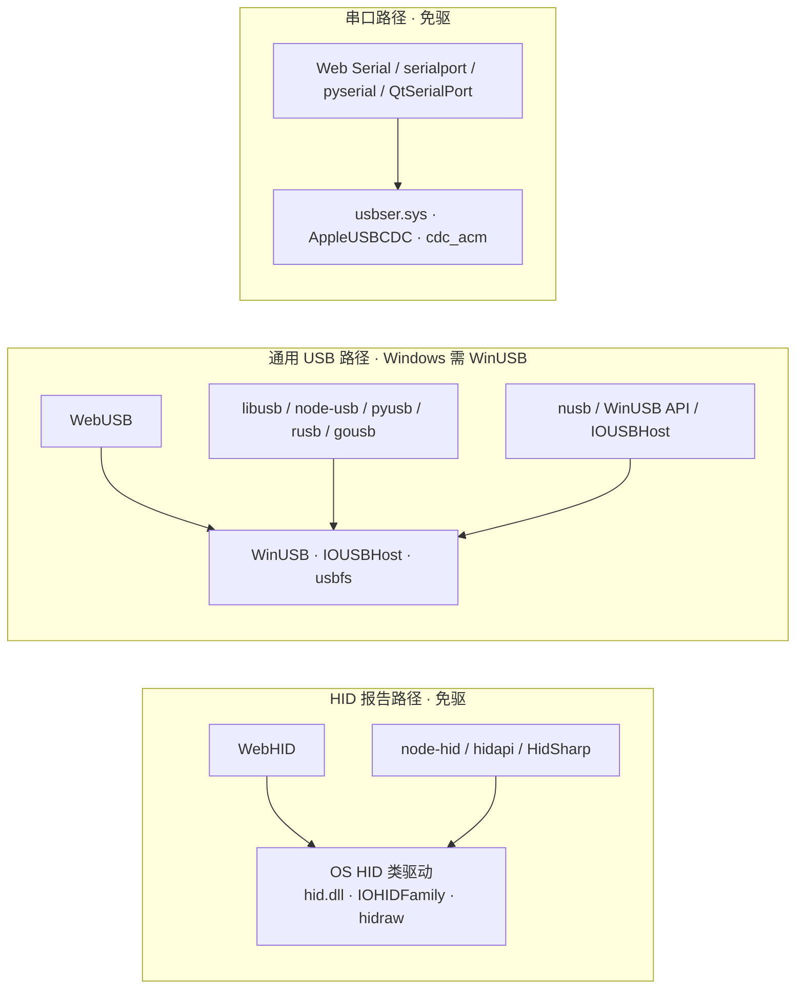
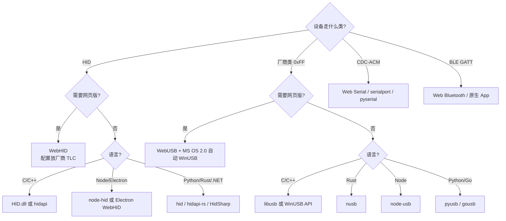

# USB 框架横向对比与选型指南

> 🌿 知识树位置: 枝干[框架与API] → 汇总
> ⬆️ 返回: [框架与 API · 分枝索引](00-索引.md)

本篇把前面各篇的结论压成一张大表和一棵决策树。表中"需要驱动？"指 **Windows 上**是否需要设备绑定非系统默认驱动（macOS/Linux 一般只涉及权限，不涉及驱动安装）。

## 一、横向对比大表

| 框架 | 语言 | HID 报告 | 控制 | 批量/中断 | 同步 | 平台 | 异步 | 热插拔 | Windows 需要驱动？ | 许可证 |
|---|---|---|---|---|---|---|---|---|---|---|
| WebHID | JS（浏览器） | ✅ | ❌ | ❌（报告级） | ❌ | Chromium 桌面（Win/mac/Linux/ChromeOS） | Promise | `connect`/`disconnect` | 否 | 浏览器内置 |
| WebUSB | JS（浏览器） | ❌（HID 是受保护类） | ✅ | ✅ | ✅ | Chromium 桌面 + Android | Promise | ✅ | **是**：WinUSB（MS OS 2.0 可自动） | 浏览器内置 |
| Web Serial | JS（浏览器） | — | — | 字节流 | — | Chromium 桌面；Android（RFCOMM 138+，有线 148+） | Streams | ✅ | 否（usbser.sys 系统自带） | 浏览器内置 |
| Web Bluetooth | JS（浏览器） | ❌（HID 服务被屏蔽） | — | GATT | — | Chromium（Linux 需开关） | Promise | 断开事件 | 否 | 浏览器内置 |
| node-usb（`usb`） | Node.js | ❌ | ✅ | ✅ | ✅ | Win/mac/Linux | 回调/Promise | `attach`/`detach` | 是（WinUSB/libusbK/UsbDk） | MIT（含 LGPL 的 libusb） |
| node-hid | Node.js | ✅ | ❌ | ❌ | ❌ | Win/mac/Linux | `HIDAsync` | ❌（配合 node-usb） | 否 | MIT 或 X11 |
| serialport | Node.js | — | — | 字节流 | — | Win/mac/Linux | 流/事件 | ❌（轮询 `list()`） | 否 | MIT |
| libusb | C | 有限 | ✅ | ✅ | ✅ | Win/mac/Linux/Android/BSD/WASM | ✅ | ✅（Windows 自 1.0.30） | 是 | LGPL-2.1 |
| hidapi | C | ✅ | ❌ | ❌ | ❌ | Win/mac/Linux/BSD | ❌（阻塞/超时读） | ❌ | 否 | GPLv3 / BSD / 原始许可 三选一 |
| WinUSB API | C/C++ | ❌ | ✅ | ✅ | ✅ | Windows | Overlapped | CfgMgr32 | 是（WinUSB） | 系统 API |
| HID.dll | C/C++ | ✅ | ❌ | ❌ | ❌ | Windows | Overlapped | CfgMgr32 | 否 | 系统 API |
| WinRT `HidDevice`/`UsbDevice` | C#/C++/WinRT | ✅ / ❌ | ❌ / ✅ | ❌ / ✅ | ❌ / ✅ | Windows | async | `DeviceWatcher` | 否 / 是 | 系统 API |
| IOUSBHost | Swift/ObjC | ❌ | ✅ | ✅ | ✅ | macOS 10.15+ | ✅ | IOKit 通知 | — | 系统 API |
| IOHIDManager / CoreHID | C / Swift | ✅ | ❌ | ❌ | ❌ | macOS（CoreHID 15+） | 回调 / async | ✅ | — | 系统 API |
| usbfs / hidraw | C | ✅（hidraw） | ✅ | ✅ | ✅ | Linux/Android | URB | udev | — | 内核 ABI |
| pyusb | Python | ❌ | ✅ | ✅ | 视后端 | Win/mac/Linux | ❌ | ❌ | 是 | BSD-3 |
| hidapi（cython）/ hid | Python | ✅ | ❌ | ❌ | ❌ | Win/mac/Linux | ❌ | ❌ | 否 | 三选一 / 见仓库 |
| pyserial | Python | — | — | 字节流 | — | Win/mac/Linux | ❌ | ❌ | 否 | BSD-3 |
| rusb | Rust | ❌ | ✅ | ✅ | ❌ | Win/mac/Linux | 有限 | ✅ | 是 | MIT |
| nusb | Rust | ❌ | ✅ | ✅ | ❌ | Win/mac/Linux/WebUSB | ✅（异步优先） | ✅ | 是 | Apache-2.0 / MIT |
| hidapi-rs | Rust | ✅ | ❌ | ❌ | ❌ | Win/mac/Linux | ❌ | ❌ | 否 | MIT |
| gousb | Go | ❌ | ✅ | ✅ | ✅ | Win/mac/Linux（cgo） | goroutine | ❌ | 是 | Apache-2.0 |
| LibUsbDotNet | C# | ❌ | ✅ | ✅ | 有限 | Win/mac/Linux | ✅ | 视版本 | 是 | LGPL-3.0 |
| HidSharp | C# | ✅ | ❌ | ❌ | ❌ | Win/mac/Linux | Stream | `DeviceList.Changed` | 否 | Apache-2.0 |
| android.hardware.usb | Java/Kotlin | ❌（需自行解析） | ✅ | ✅ | ❌ | Android | `UsbRequest` | 广播 | — | Android SDK |

> 表中"✅/❌"按各项目官方文档与源码 API 判定；"有限"表示 API 存在但功能或平台覆盖不完整。同步传输一栏在 Windows 上普遍依赖 WinUSB 的同步支持（Windows 8.1 起）。

## 二、架构对照：三条主路径

## 三、选型指南（按你的场景）

### 场景 A：外设配置客户端（鼠标/键盘/耳机，Windows 为主，对标 Synapse 类产品）

- **首选**：固件把配置通道放在**厂商 Usage Page 的独立 HID 顶层集合**，主机侧用 HID 报告级 API。
- **桌面客户端**：C++ 直接 HID.dll（与现有 Windows 代码最一致）或 hidapi（跨平台）；Electron 客户端用 node-hid 或 WebHID。
- **网页版配置器**：WebHID；同一套前端代码可以塞进 Electron 复用（见 [12 篇案例 7](12-实战案例-外设控制七例.md)）。
- **避免**：把配置报告放在 Mouse/Keyboard 集合里——WebHID 用不了，Windows 原生程序也会被独占规则卡住。

### 场景 B：自定义高吞吐设备（采集卡、逻辑分析仪、刷机器）

- 固件：厂商类接口 + 批量端点 + MS OS 2.0（WINUSB 兼容 ID）。
- 主机：libusb（C/C++）或 nusb（Rust）做原生；WebUSB 做免安装网页工具；吞吐要求高时用异步多 transfer 排队（[案例 4](12-实战案例-外设控制七例.md)）。

### 场景 C：调试串口、AT 命令、日志

- 固件：CDC-ACM（全平台免驱）。
- 主机：Web Serial（网页工具）、serialport（Node）、pyserial（脚本）、QtSerialPort（Qt 桌面）。

### 场景 D：BLE 外设配置

- 固件：厂商自定义 128 位 UUID 的 GATT 服务（HID 服务会被 Web Bluetooth 屏蔽）。
- 主机：Web Bluetooth（注意 Linux 桌面默认不可用）、原生 App（Android/iOS）。

### 场景 E：虚拟 USB / 驱动研究

- 设备侧模拟：Linux gadget（configfs、FunctionFS、Raw Gadget）、macOS CoreHID `HIDVirtualDevice`、Linux `uhid`。
- 主机侧测试：libusb + pyusb 写自动化用例；usbip 做远程透传。见 [Linux Gadget 与 usbip](../60-枝干-主机侧与实现/07-实战-LinuxGadget与usbip.md)。

### 决策树

## 四、局限与坑（选型层面）

- **"跨平台"往往止于桌面三件套**：Android 只有 WebUSB/Web Serial/Web Bluetooth（浏览器）或 `android.hardware.usb`（原生）；iOS 没有通用 USB 访问 API（外设需走 MFi 等苹果体系）。
- **许可证**：静态链接 libusb（LGPL）的闭源商业软件需提供可重新链接的方式，通常选择动态链接；hidapi 选 BSD 许可即可规避。
- **驱动安装体验**：任何需要 Zadig 的方案都不适合面向消费者发布，必须在固件里用 MS OS 2.0 解决。

## 参考来源

- 各框架官方文档与仓库见 [06](06-Nodejs生态-node-usb-node-hid-serialport.md)、[07](07-C与C++-libusb与hidapi.md)、[08](08-操作系统原生API-Windows-macOS-Linux.md)、[09](09-多语言绑定-Python-Rust-Go-dotNET-Android.md) 各篇"参考来源"。
- 浏览器 API 规范见 [01 篇](01-浏览器设备API总览与安全模型.md)。
- WinUSB 同步传输支持：<https://learn.microsoft.com/windows-hardware/drivers/usbcon/getting-set-up-to-use-windows-devices-usb>

## 相关节点

- [00-索引](00-索引.md) · [12-实战案例-外设控制七例](12-实战案例-外设控制七例.md)
- [WebUSB 与厂商自定义类](../20-枝干-设备类协议/其他设备类/06-WebUSB与厂商自定义类.md)（免驱方案对比）
