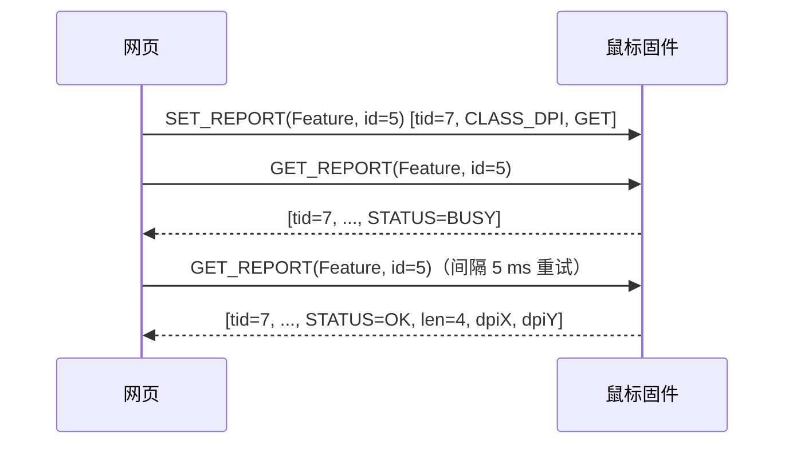

# 实战案例：外设控制框架七例

> 🌿 知识树位置: 枝干[框架与API] → 实战
> ⬆️ 返回: [框架与 API · 分枝索引](00-索引.md)

七个端到端案例，每例按"目标 → 原理 → 代码 → 验证 → 坑"展开。所有代码均为**示例**：VID/PID、报告 ID、命令码是虚构的，API 名称按各项目官方文档核对过；放到真实设备上前要换成你的固件协议。

| # | 案例 | 涉及框架 | 关键知识点 |
|---|---|---|---|
| 1 | WebHID 读写鼠标 DPI | WebHID | 厂商 TLC、特性报告、忙状态轮询 |
| 2 | WebUSB 设备零驱动上线 | 固件 + WebUSB | BOS、MS OS 2.0、WinUSB 自动安装、注册表缓存 |
| 3 | node-hid 热插拔重连守护进程 | node-usb + node-hid | 热插拔事件、重试退避、Windows 枚举延迟 |
| 4 | libusb 异步批量吞吐测试 | libusb | 多 transfer 排队、事件循环、带宽上限 |
| 5 | HID.dll 与 WebHID 行为差异 | Win32 HID + WebHID | TLC 拆分、独占、报告 ID 字节、黑名单 |
| 6 | pyusb 读取全部描述符 | pyusb | 标准请求、配置描述符两段读取、LANGID |
| 7 | Electron 选 WebHID 还是 node-hid | Electron | 权限处理器、黑名单开关、打包 |

---

## 案例 1：WebHID 读写鼠标 DPI（特性报告）

**目标**：网页上显示鼠标当前 DPI 档位，并允许修改。

**原理**：配置报告放在厂商自定义顶层集合（Usage Page 0xFF00，报告 ID 0x05，63 字节负载，描述符模板见 [05 篇](05-网页配置器案例-WebHID与VIA.md)）。主机 `sendFeatureReport` → `SET_REPORT(Feature)`，再 `receiveFeatureReport` → `GET_REPORT(Feature)` 取回结果。固件写 Flash 期间对 GET 回"忙"。



```javascript
// 示例：案例 1 —— WebHID DPI 读写（协议帧格式见 05 篇“设计要点 3”）
const RID = 0x05, LEN = 63;
const CLASS_DPI = 0x02, CMD_GET = 0x01, CMD_SET = 0x02;
const ST_BUSY = 0x01, ST_OK = 0x02;
let tid = 0;

function frame(cls, cmd, payload = []) {
  const f = new Uint8Array(LEN);           // 不含报告 ID
  f[0] = (tid = (tid + 1) & 0xff);
  f[1] = cls; f[2] = cmd; f[3] = 0; f[4] = payload.length;
  f.set(payload, 5);
  f[LEN - 1] = f.slice(0, LEN - 1).reduce((a, b) => a ^ b, 0);   // XOR 校验
  return f;
}

async function transact(dev, req, tries = 50) {
  await dev.sendFeatureReport(RID, req);
  for (let i = 0; i < tries; i++) {
    const v = await dev.receiveFeatureReport(RID);
    let b = new Uint8Array(v.buffer, v.byteOffset, v.byteLength);
    if (b.length === LEN + 1 && b[0] === RID) b = b.subarray(1);   // 平台可能带报告 ID
    if (b[0] !== req[0]) continue;                                  // 不是本事务（被别的进程抢了）
    if (b[3] === ST_BUSY) { await new Promise(r => setTimeout(r, 5)); continue; }
    if (b[3] !== ST_OK) throw new Error(`device status ${b[3]}`);
    return b.subarray(5, 5 + b[4]);
  }
  throw new Error('timeout');
}

export async function readDpi(dev) {
  const p = await transact(dev, frame(CLASS_DPI, CMD_GET));
  return { x: p[0] | p[1] << 8, y: p[2] | p[3] << 8 };
}
export async function writeDpi(dev, x, y) {
  await transact(dev, frame(CLASS_DPI, CMD_SET, [x & 0xff, x >> 8, y & 0xff, y >> 8]));
}
```

**验证**：Chrome 打开 `chrome://device-log` 可看到 HID 设备连接与错误日志；硬件侧用协议分析仪确认 SETUP 包为 `21 09 05 03 …`（`bmRequestType=0x21`，`SET_REPORT=0x09`，`wValue` 高字节 3=Feature、低字节=报告 ID 5），见 [HID 传输与类特定请求](../20-枝干-设备类协议/HID-人机接口设备/04-传输与类特定请求.md)。

**坑**：报告 ID 0x05 不能与鼠标输入报告 ID 冲突；若 DPI 报告误放在 Mouse 集合内，`sendFeatureReport` 直接以 `NotAllowedError` 拒绝。

---

## 案例 2：WebUSB 设备零驱动上线（MS OS 2.0 自动装 WinUSB）

**目标**：自研设备在 Windows 上插入后无需任何驱动安装，Chrome 打开网页即可通信。

**原理**：设备 `bcdUSB=0x0210`，BOS 中同时声明 WebUSB 与 MS OS 2.0 平台能力；Windows 8.1+ 读取 MS OS 2.0 描述符集中的兼容 ID `WINUSB`，自动绑定 `winusb.sys`，并按注册表属性写入 `DeviceInterfaceGUIDs`。完整字节布局见 [10 篇](10-设备端框架与WebUSB固件桥接.md)。

**步骤与验证**：

1. 烧录固件，插入设备。
2. 设备管理器中设备应出现在"通用串行总线设备"下，驱动为 WinUSB；若显示为"其他设备/未知设备"，检查第 5 步。
3. PowerShell 确认驱动与接口 GUID（示例）：

```powershell
# 示例：查看已连接设备的服务名与 DeviceInterfaceGUIDs
Get-PnpDevice -PresentOnly | Where-Object InstanceId -like 'USB\VID_CAFE&PID_4000*' |
  ForEach-Object {
    $_ | Select-Object FriendlyName, InstanceId, Service
    Get-ItemProperty "HKLM:\SYSTEM\CurrentControlSet\Enum\$($_.InstanceId)\Device Parameters" `
      -Name DeviceInterfaceGUIDs -ErrorAction SilentlyContinue
  }
```

4. 网页端运行 [02 篇](02-WebUSB详解.md) 的示例：`requestDevice` 选择器中出现设备，`open()`、`claimInterface()` 成功。
5. **描述符改了却不生效**：删除 `HKLM\SYSTEM\CurrentControlSet\Control\usbflags\CAFE4000xxxx`（xxxx 为 bcdDevice）后重插，或递增 `bcdDevice`。

**坑**：`bcdUSB` 写成 0x0200 时 Windows 不读 BOS；复合设备漏写功能子集会把整个设备绑成 WinUSB；UUID 字节序写反会让两个能力都失效。

---

## 案例 3：node-hid 热插拔 + 自动重连守护进程

**目标**：后台进程常驻，设备插入自动打开，拔出自动清理，重插后恢复。

**原理**：node-hid 没有热插拔事件，且其 README 明确反对轮询 `HID.devices()`；用 node-usb 的 `usb.on('attach'|'detach')`（基于 OS 通知）触发，再用 node-hid 打开 HID 路径。Windows 上 USB 设备 `attach` 后 HID 子设备接口创建有延迟，需要重试。

```javascript
// 示例：案例 3 —— 热插拔驱动的 HID 守护进程
import { usb } from 'usb';
import HID from 'node-hid';

const VID = 0x1532, USAGE_PAGE = 0xff00;          // 示例值
let dev = null, opening = false;

async function tryOpen(retries = 10) {
  if (dev || opening) return;
  opening = true;
  try {
    for (let i = 0; i < retries; i++) {
      const info = (await HID.devicesAsync()).find(
        d => d.vendorId === VID && d.usagePage === USAGE_PAGE);
      if (info) {
        dev = await HID.HIDAsync.open(info.path);
        dev.on('data', buf => console.log('input', buf.toString('hex')));
        dev.on('error', err => { console.warn('device error', err.message); cleanup(); });
        console.log('opened', info.product);
        return;
      }
      await new Promise(r => setTimeout(r, 100 * 2 ** Math.min(i, 4)));  // 退避：100ms→1.6s
    }
    console.warn('HID interface not found after attach');
  } finally { opening = false; }
}

function cleanup() {
  if (!dev) return;
  try { dev.close(); } catch {}
  dev = null;
}

usb.on('attach', d => { if (d.deviceDescriptor.idVendor === VID) tryOpen(); });
usb.on('detach', d => { if (d.deviceDescriptor.idVendor === VID) cleanup(); });
tryOpen(1);                                        // 启动时设备可能已插着
process.on('SIGINT', () => { cleanup(); usb.unrefHotplugEvents(); process.exit(0); });
```

**验证**：反复插拔 20 次，日志应严格交替出现 `opened` 与清理；同时用另一进程持续通信，确认守护进程没有因枚举拖慢它。

**坑**：只按 VID 过滤会被同厂商的其他设备触发，生产代码应同时比对 PID；`detach` 回调里访问已断开设备的字符串描述符会失败，只用 `deviceDescriptor` 字段。

---

## 案例 4：libusb 异步批量吞吐测试

**目标**：测出高速（480 Mb/s）批量 IN 端点的实际吞吐，并说明为什么同步循环跑不满。

**原理**：USB 2.0 高速批量的理论单端点上限是每微帧 13 个 512 字节事务，即 53.248 MB/s（推导见 [总线带宽与调度计算](../10-树干-USB核心/13-总线带宽与调度计算.md)）。主机控制器只有在**队列里一直有待处理的请求**时才能每个微帧都调度事务；同步 `libusb_bulk_transfer` 每次返回到下一次提交之间队列为空，总线空转。异步 API 同时挂 N 个 transfer，完成一个立即重提交，队列始终不空。

```c
/* 示例：案例 4 —— libusb 异步批量 IN 吞吐测试
 * cc bulkbench.c -O2 $(pkg-config --cflags --libs libusb-1.0) -o bulkbench
 * 设备需持续从 EP 0x81 发数据（如固件循环发送计数器） */
#include <libusb.h>
#include <stdio.h>
#include <stdlib.h>
#include <time.h>

#define VID 0xcafe
#define PID 0x4000
#define EP_IN 0x81
#define NXFER 16              /* 同时在途的 transfer 数 */
#define XLEN (64 * 1024)      /* 每个 transfer 64 KiB，为 512 的整数倍 */

static volatile long long total = 0;
static volatile int running = 1, errors = 0;

static void LIBUSB_CALL cb(struct libusb_transfer *t) {
  if (t->status == LIBUSB_TRANSFER_COMPLETED) total += t->actual_length;
  else errors++;
  if (running && libusb_submit_transfer(t) == 0) return;   /* 立即重提交，保持队列满 */
  t->user_data = NULL;                                     /* 标记已停止 */
}

static double now(void) { struct timespec ts; clock_gettime(CLOCK_MONOTONIC, &ts); return ts.tv_sec + ts.tv_nsec / 1e9; }

int main(void) {
  libusb_context *ctx; libusb_init_context(&ctx, NULL, 0);
  libusb_device_handle *h = libusb_open_device_with_vid_pid(ctx, VID, PID);
  if (!h) { fprintf(stderr, "open failed\n"); return 1; }
  libusb_set_auto_detach_kernel_driver(h, 1);
  if (libusb_claim_interface(h, 0)) { fprintf(stderr, "claim failed\n"); return 1; }

  struct libusb_transfer *x[NXFER];
  for (int i = 0; i < NXFER; i++) {
    x[i] = libusb_alloc_transfer(0);
    libusb_fill_bulk_transfer(x[i], h, EP_IN, malloc(XLEN), XLEN, cb, (void *)1, 1000);
    libusb_submit_transfer(x[i]);
  }
  double t0 = now(), last = t0; long long lastb = 0;
  while (now() - t0 < 10.0) {                               /* 测 10 秒 */
    struct timeval tv = { 0, 100000 };
    libusb_handle_events_timeout_completed(ctx, &tv, NULL);
    if (now() - last >= 1.0) {
      printf("%.2f MB/s (errors=%d)\n", (total - lastb) / (now() - last) / 1e6, errors);
      last = now(); lastb = total;
    }
  }
  running = 0;
  for (int i = 0; i < NXFER; i++) libusb_cancel_transfer(x[i]);
  for (int pending = 1; pending; ) {                        /* 等所有回调收尾 */
    struct timeval tv = { 0, 100000 };
    libusb_handle_events_timeout_completed(ctx, &tv, NULL);
    pending = 0; for (int i = 0; i < NXFER; i++) if (x[i]->user_data) pending = 1;
  }
  for (int i = 0; i < NXFER; i++) { free(x[i]->buffer); libusb_free_transfer(x[i]); }
  libusb_release_interface(h, 0); libusb_close(h); libusb_exit(ctx);
  printf("avg %.2f MB/s\n", total / 10.0 / 1e6);
}
```

**验证方法**：依次把 `NXFER` 设为 1、2、4、8、16 记录结果，再对比同步循环版本，画出"在途请求数–吞吐"曲线；曲线会在某个 N 之后趋平，平台值就是该主机控制器 + 固件组合的实际上限。设备端若用 FIFO 双缓冲不足，瓶颈会转到固件（分析仪上可看到大量 NAK）。

**坑**：`XLEN` 不是 `wMaxPacketSize` 整数倍时，最后一包是短包会提前结束传输；回调里不要做耗时工作（会拖慢事件线程）；Windows 上需要设备绑定 WinUSB。WebUSB 版的同理做法是同时挂多个 `transferIn()` Promise。

---

## 案例 5：Windows HID.dll 与 WebHID 的行为差异

**目标**：同一个 C++ 客户端里的协议代码迁移到 WebHID 时，搞清楚哪些地方必须改。

| 维度 | Win32 HID.dll + CreateFile | WebHID（Chrome on Windows） |
|---|---|---|
| 设备粒度 | **每个顶层集合一个设备接口路径**（`…&col01`、`…&col02`） | 一个 `HIDDevice`，`collections[]` 列出全部顶层集合 |
| 键鼠集合 | 系统独占，`GENERIC_READ/WRITE` 打开失败；只能零访问权限打开查询属性 | 被黑名单命中，所有报告 `NotAllowedError`；设备仍可因其他集合被选中 |
| 报告 ID | 缓冲区第 0 字节是报告 ID（无则填 0） | 报告 ID 是独立参数；`receiveFeatureReport` 返回数据首字节**可能**是报告 ID |
| 缓冲区长度 | 必须等于 `HidP_GetCaps` 的 `*ReportByteLength`（含报告 ID 字节） | 传负载长度即可，浏览器按描述符补齐 |
| 输入报告 | `ReadFile` 从 HID 类驱动环形缓冲读取，可用 `HidD_SetNumInputBuffers` 调大，读慢会丢最旧报告 | `inputreport` 事件推送；页面处理慢同样可能丢 |
| 多进程共享 | 非键鼠集合可多个进程同时打开（`FILE_SHARE_READ \| FILE_SHARE_WRITE`），输入报告各自收到一份 | 与原生进程共享同一机制；网页与原生客户端同时运行会互相"抢"特性报告应答 |
| 授权 | 无（当前用户即可） | 用户手势 + 选择器 + 每 origin 授权 |
| 描述符 | 只能拿预解析数据（`HidD_GetPreparsedData`），拿不到原始报告描述符 | 拿解析后的 `collections` 树，拿不到原始字节 |

**迁移清单**：

1. 把"按路径找 `&col02`"改为"在 `device.collections` 中按 `usagePage/usage` 找"。
2. 删除所有"第 0 字节填报告 ID、长度 +1"的逻辑，改为 `sendFeatureReport(id, payload)`。
3. 读特性报告后先判断首字节是否等于报告 ID。
4. 在协议里加事务 ID，防止与原生客户端同时运行时错配应答。
5. 若配置报告在键鼠集合里，WebHID 无解——要么改固件，要么改用 Electron + `disable-hid-blocklist`（案例 7）。

---

## 案例 6：Python pyusb 读取全部描述符

**目标**：不依赖 `lsusb -v` 或 USBTreeView，用脚本读出设备、配置、接口、端点、BOS 与字符串描述符的原始字节。

**原理**：全部是标准 `GET_DESCRIPTOR`（`bmRequestType=0x80`、`bRequest=0x06`、`wValue=类型<<8|索引`）。配置描述符要**读两次**：先读 9 字节拿 `wTotalLength`，再按总长读完整集合；字符串描述符先读索引 0 拿 LANGID 列表（见 [描述符详解](../10-树干-USB核心/07-描述符详解.md)）。

```python
# 示例：案例 6 —— pyusb 读取原始描述符（需 libusb 后端；Linux 需权限，Windows 需 WinUSB）
import struct, usb.core

DEV, CONF, STR, BOS = 1, 2, 3, 15
dev = usb.core.find(idVendor=0xcafe, idProduct=0x4000)      # 示例 VID/PID
assert dev is not None, "device not found"

def get_desc(dtype, index=0, length=255, langid=0):
    return bytes(dev.ctrl_transfer(0x80, 0x06, (dtype << 8) | index, langid, length))

d = get_desc(DEV, length=18)
bcdUSB, = struct.unpack_from('<H', d, 2)
print(f"DEVICE  bcdUSB={bcdUSB:04x} class={d[4]:02x} mps0={d[7]} "
      f"vid={struct.unpack_from('<H', d, 8)[0]:04x} pid={struct.unpack_from('<H', d, 10)[0]:04x} "
      f"configs={d[17]}")

hdr = get_desc(CONF, 0, 9)                                  # 第一次：只读 9 字节
total, = struct.unpack_from('<H', hdr, 2)
cfg = get_desc(CONF, 0, total)                              # 第二次：读完整集合
i = 0
while i < len(cfg):                                         # 逐个子描述符遍历
    blen, btype = cfg[i], cfg[i + 1]
    name = {2: 'CONFIG', 4: 'INTERFACE', 5: 'ENDPOINT', 11: 'IAD', 0x21: 'HID/CS'}.get(btype, hex(btype))
    print(f"  {name:<9} {cfg[i:i + blen].hex(' ')}")
    i += blen

if bcdUSB >= 0x0201:                                        # 只有 2.01+ 才应有 BOS
    bh = get_desc(BOS, 0, 5)
    print("BOS", get_desc(BOS, 0, struct.unpack_from('<H', bh, 2)[0]).hex(' '))

langs = get_desc(STR, 0)
langid, = struct.unpack_from('<H', langs, 2)                # 通常 0x0409
for idx, label in ((d[14], 'Manufacturer'), (d[15], 'Product'), (d[16], 'Serial')):
    if idx:
        s = get_desc(STR, idx, langid=langid)
        print(f"{label}: {s[2:s[0]].decode('utf-16-le')}")
```

**验证**：与 `lsusb -v -d cafe:4000`（Linux）或 USBTreeView（Windows）逐字节对比。

**坑**：Windows 上如果设备是 HID 等系统驱动设备，pyusb（libusb 后端）打不开——这是驱动绑定问题而非代码问题；读描述符可改用 USBTreeView 或在 Linux 上做。

---

## 案例 7：Electron 应用选 WebHID 还是 node-hid

**目标**：为外设配置客户端（Electron）选择 HID 访问方式，并给出可落地的主进程代码。

**判断标准**：

| 需求 | 选 WebHID（渲染进程） | 选 node-hid（主进程/工具进程） |
|---|---|---|
| 同一套前端同时发布网页版 | ✅ | ❌ |
| 不想维护原生模块的多平台多架构预编译 | ✅ | ❌ |
| 需要访问键鼠集合（被 Chromium 黑名单屏蔽） | ✅ 但需 `disable-hid-blocklist` | ✅（仍受 OS 独占限制） |
| 需要原始报告描述符、设备路径、接口号 | ❌ | ✅（`hid_get_report_descriptor`） |
| 后台常驻、窗口关闭仍通信 | ❌（需隐藏窗口保活） | ✅ |
| 安全边界（渲染进程不直接碰设备） | 需配合 `contextIsolation` 与权限处理器 | ✅ 天然在主进程 |

**推荐**：以 WebHID 为主（与网页版共用协议层），把权限交给主进程的处理器静默授权已知 VID；只有在需要原始描述符或后台常驻时，再引入 node-hid 工具进程。

```javascript
// 示例：案例 7 —— Electron 主进程为 WebHID 静默授权已知设备（API 见 Electron 官方 Device Access 文档）
const { app, BrowserWindow } = require('electron/main');
const KNOWN_VID = 0x1532;                                  // 示例 VID

// 如确需访问被 Chromium 屏蔽的集合（如 Mouse TLC），才打开下一行，并评估安全影响
// app.commandLine.appendSwitch('disable-hid-blocklist');

app.whenReady().then(() => {
  const win = new BrowserWindow({ webPreferences: { contextIsolation: true } });
  const ses = win.webContents.session;

  ses.setPermissionCheckHandler((wc, permission) => permission === 'hid');
  ses.setDevicePermissionHandler(details =>
    details.deviceType === 'hid' && details.device.vendorId === KNOWN_VID);

  // 渲染进程调用 navigator.hid.requestDevice() 时，不弹选择器而由应用决定
  ses.on('select-hid-device', (event, details, callback) => {
    event.preventDefault();
    const pick = details.deviceList.find(d => d.vendorId === KNOWN_VID);
    callback(pick ? pick.deviceId : '');                   // 空字符串 = 取消
  });

  win.loadFile('index.html');                              // 渲染进程复用 05/案例 1 的 WebHID 代码
});
```

**验证**：渲染进程中 `await navigator.hid.getDevices()` 在首次启动即返回已知设备（由 `setDevicePermissionHandler` 授权），无需用户点击。

**坑**：`select-hid-device` 期间的 `hid-device-added/removed` 事件只在回调前触发，不能当作通用热插拔监听（Electron 文档原文说明）；通用热插拔请在渲染进程用 `navigator.hid` 的 `connect`/`disconnect`。打包时若同时引入 node-hid，要按 [06 篇](06-Nodejs生态-node-usb-node-hid-serialport.md) 处理 external 与 asar 解包。

## 参考来源

- WebHID：<https://hid.spec.whatwg.org/> · WebUSB：<https://wicg.github.io/webusb/>
- Microsoft OS 2.0 描述符与 usbflags：<https://learn.microsoft.com/windows-hardware/drivers/usbcon/microsoft-os-2-0-descriptors-specification> · <https://learn.microsoft.com/windows-hardware/drivers/usbcon/usb-device-specific-registry-settings>
- Windows HID 客户端：<https://learn.microsoft.com/windows-hardware/drivers/hid/top-level-collections> · <https://learn.microsoft.com/windows-hardware/drivers/hid/keyboard-and-mouse-hid-client-drivers>
- node-usb：<https://github.com/node-usb/node-usb> · node-hid：<https://github.com/node-hid/node-hid>
- libusb API：<https://libusb.sourceforge.io/api-1.0/> · pyusb：<https://github.com/pyusb/pyusb>
- Electron Device Access：<https://www.electronjs.org/docs/latest/tutorial/devices>
- USB 2.0 规范第 5 章（批量带宽）与第 9 章（标准请求）：<https://www.usb.org/document-library/usb-20-specification>

## 相关节点

- [03-WebHID详解](03-WebHID详解.md) · [05-网页配置器案例-WebHID与VIA](05-网页配置器案例-WebHID与VIA.md) · [10-设备端框架与WebUSB固件桥接](10-设备端框架与WebUSB固件桥接.md)
- [协议分析仪与抓包](../70-枝干-调试测试与安全/01-协议分析仪与抓包.md)（验证每个案例的总线行为）
- [枚举失败排查手册](../70-枝干-调试测试与安全/02-枚举失败排查手册.md)
