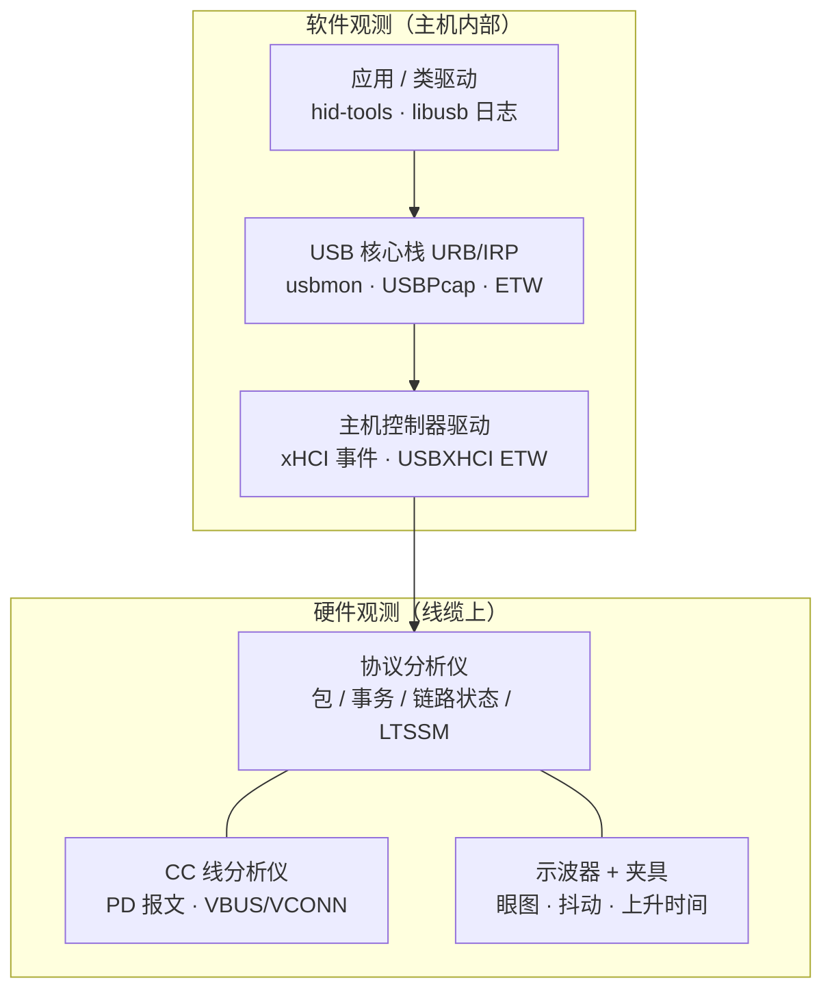

# 工具与分析仪 · 分枝索引

> 🌿 知识树位置: 树干 → 枝干[调试测试与安全] → 分枝[工具与分析仪] → 导航页
> ⬆️ 父节点: [调试测试与安全 · 分枝索引](../00-索引.md) · 入门篇: [协议分析仪与抓包](../01-协议分析仪与抓包.md)

本分枝回答三个问题：**每类 USB 工具到底在哪一层"看"总线**、**商用/开源分析仪各自能看到什么、看不到什么**、**真实故障该拿哪件工具、怎么抓、trace 里看什么**。入门篇 [01-协议分析仪与抓包](../01-协议分析仪与抓包.md) 讲 usbmon/USBPcap 的基本用法；本分枝在它之上把原理、仪器、软件和 10 个实战案例展开。

## 写作约定

- **事实来源**：规范条款引用 USB 2.0（含 LPM ECN）、USB 3.2 Rev 1.1、USB PD R3.3、Bluetooth Core / HOGP v1.1 原文；仪器参数只引用厂商产品页、数据手册或用户手册；软件行为引用官方文档或源码（Linux 内核、Wireshark、Microsoft Learn）。每页末尾列出来源。
- **价格**：只写厂商官网公开标价并注明查阅时间（2026-11）；未公开标价的一律写"需询价"，不估算。
- **示例 trace**：案例里的 trace 都标注为 🧪 **示例**——按真实工具的字段格式构造，用来教"看哪一列、看什么模式"，数值不是某台设备的实测记录。
- **待核实**：查不到官方出处的细节标"待核实"，不当结论使用。

## 观测层次总图

越往下越接近物理真相、成本越高。**纪律：先软件后硬件**——绝大多数枚举/驱动问题软件抓包就能定位；只有"软件看不见"的现象（SOF、NAK、Chirp、LPM、CRC、链路训练、电气）才需要硬件，见 [01-USB抓包原理与观测分层](01-USB抓包原理与观测分层.md) 的可见性矩阵。

## 文件清单

### 原理与仪器

| 文件 | 定位 | 关键产物 |
|---|---|---|
| [01-USB抓包原理与观测分层](01-USB抓包原理与观测分层.md) | 软件/硬件/电气三层各自的捕获点与盲区 | 可见性矩阵、分析仪内部架构图 |
| [02-商用USB协议分析仪详解](02-商用USB协议分析仪详解.md) | Total Phase Beagle、Teledyne LeCroy Mercury/Advisor/Voyager、Ellisys Explorer | 各型号官方参数表、软件生态 |
| [03-PD与Type-C分析仪及电气测试仪器](03-PD与Type-C分析仪及电气测试仪器.md) | CC/PD 抓包、VBUS 追踪、示波器电气合规 | PD 分析仪参数、电气测试链 |
| [04-开源与低成本分析工具](04-开源与低成本分析工具.md) | Cynthion/Packetry、OpenVizsla、Facedancer、sigrok、Twinkie、BLE 嗅探器 | 开源方案能力边界 |
| [05-分析仪对比与选型指南](05-分析仪对比与选型指南.md) | 全型号横向对比 + 按工作场景选型 | 对比总表、选型决策树 |

### 软件工具

| 文件 | 定位 | 关键产物 |
|---|---|---|
| [06-软件抓包工具实操](06-软件抓包工具实操.md) | Wireshark 解析器、usbmon、USBPcap、Windows USB ETW、macOS XHC 抓包、Bus Hound、hid-tools | 抓包命令与过滤器速查 |
| [07-设备信息与枚举查看工具](07-设备信息与枚举查看工具.md) | USBView、UsbTreeView、pnputil、lsusb/sysfs、ioreg、USB3CV | "设备现在什么状态"一表查 |
| [08-测试仿真与虚拟化工具](08-测试仿真与虚拟化工具.md) | dummy_hcd、ConfigFS gadget、Raw Gadget/syzkaller、Windows UDE、USB/IP、QEMU pcap、MUTT、Facedancer | 测试与虚拟 USB 工具链 |

### 实战案例（症状 → 选工具 → 抓 → 读 → 根因 → 修 → 验证）

| 文件 | 故障 | 主力工具 |
|---|---|---|
| [10-案例-枚举失败与bMaxPacketSize0](10-案例-枚举失败与bMaxPacketSize0.md) | 描述符只回 8 字节：EP0 硬件包长与 bMaxPacketSize0 不符 | usbmon + USB 2.0 分析仪 |
| [11-案例-高速握手失败回落全速](11-案例-高速握手失败回落全速.md) | HS 设备只跑 12 Mbps | 硬件分析仪（Chirp 可见） |
| [12-案例-8000Hz鼠标回报率与抖动](12-案例-8000Hz鼠标回报率与抖动.md) | 8 kHz 回报率验证、抖动分析 | HS 分析仪 + usbmon 统计 |
| [13-案例-Windows代码43与描述符请求失败](13-案例-Windows代码43与描述符请求失败.md) | 代码 43：bcdUSB 0x0210 但 BOS 请求 STALL | USB ETW + 分析仪 + UsbTreeView |
| [14-案例-USB3链路训练与Recovery循环](14-案例-USB3链路训练与Recovery循环.md) | SS 设备反复断连、降级到 USB 2.0 | SS 分析仪（LTSSM 视图） |
| [15-案例-PD契约协商失败](15-案例-PD契约协商失败.md) | Request 迟发 → Hard Reset 无限循环 | PD 分析仪 + VBUS 追踪 + 固件 GPIO |
| [16-案例-BLE-HOGP配对与ReportMap](16-案例-BLE-HOGP配对与ReportMap.md) | BLE 键盘配对后无输入：Report Map 超 512 字节被截断 | btmon（HCI）+ nRF Sniffer |
| [17-案例-同步音频欠载](17-案例-同步音频欠载.md) | UAC2 异步播放周期爆音：HS 反馈值用了 FS 格式 | usbmon 反馈端点 + USBPcap |
| [18-案例-选择性挂起与LPM唤醒](18-案例-选择性挂起与LPM唤醒.md) | 挂起唤醒后首键丢失、LPM 兼容 | 硬件分析仪 + sysfs power 控制 |
| [19-案例-线缆信号完整性与CRC错误](19-案例-线缆信号完整性与CRC错误.md) | 换线就好、偶发 -71/-84 | 分析仪错误统计 + 示波器 |

## 阅读顺序建议

- **只想尽快抓到包**：06 → 案例 10/13（软件就能解决的一类）。
- **准备买分析仪**：01 → 05（先看可见性矩阵再看对比表，避免买了也看不到想看的东西）→ 02/03/04 查具体型号。
- **HID 高回报率外设（键鼠）**：01 → 12 → 18 → 19。
- **虚拟 USB / 驱动研究**：04 → 08 → [tech-doc 06 Linux 虚拟 USB](../../tech-doc/06-linux-virtual-usb.md)。

## 相关节点

- 父枝干: [调试测试与安全索引](../00-索引.md) · [枚举失败排查手册](../02-枚举失败排查手册.md) · [合规测试实操](../05-合规测试实操.md)
- 树干对照: [包格式与事务](../../10-树干-USB核心/05-包格式与事务.md) · [四种传输类型](../../10-树干-USB核心/06-四种传输类型.md) · [描述符详解](../../10-树干-USB核心/07-描述符详解.md) · [枚举流程与标准请求](../../10-树干-USB核心/08-枚举流程与标准请求.md)
- 技能包: [usb-capture-analysis](../../skills/usb-capture-analysis/SKILL.md) · [usb-enum-troubleshoot](../../skills/usb-enum-troubleshoot/SKILL.md)
