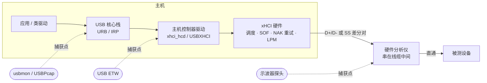
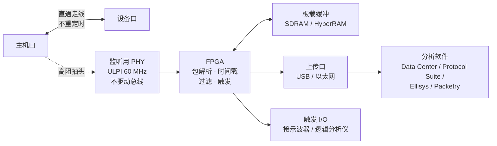
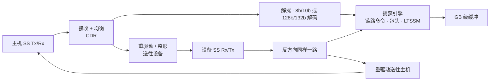

# USB 抓包原理与观测分层

> 🌿 知识树位置: 树干 → 枝干[调试测试与安全] → 分枝[工具与分析仪] → 叶[观测原理]
> ⬆️ 父节点: [00-工具与分析仪索引.md](00-工具与分析仪索引.md)

一句话：**捕获点决定可见性**。工具"抓不到"某个现象，通常不是工具坏了，而是那个现象根本不经过它的捕获点。买分析仪、选工具之前先把这张可见性矩阵看懂。

## 1. 原理

### 1.1 软件捕获：挂在主机栈里

| 工具 | 捕获点（官方描述） | 记录的单位 |
|---|---|---|
| Linux **usbmon** | 内核文档："usbmon 报告外设驱动向主机控制器驱动（HCD）发出的请求"；HCD 有 bug 时 trace 不一定与总线事务精确对应 | URB 的 submit（`S`）/ complete（`C`）/ error（`E`）事件 |
| Windows **USBPcap** | 官方"Capture limitations"：抓的是在 FDO 与 PDO 之间传递、装在 IRP 里的 URB | 每个 IRP 两条记录（下行、完成） |
| Windows **USB ETW** | USB 驱动栈自身埋点：USBXHCI（xHCI 命令与完成码）、UCX（端点/流的打开关闭与 I/O）、USBHUB3（端口状态变化、枚举阶段、设备电源状态） | 事件；`FullDataBusTrace` 时控制/批量/中断最多记录 4 KB 载荷，**同步传输的数据从不记录** |
| macOS **XHC20 接口** | Wireshark Wiki：High Sierra 起可在 `XHC20` 接口抓 USB；Catalina 及以后"显然需要关闭 SIP" | URB 级（`LINKTYPE_USB_DARWIN`） |

三者共同点：看到的是**传输（transfer）的请求与完成**，不是总线上的包。USB 2.0 规范第 10 章把这一层叫 IRP；第 8 章的包（token/data/handshake）软件看不到——Wireshark Wiki 原话："The individual packets as described in USB 2.0 Specification Chapter 8 are not possible to capture with software sniffers."

### 1.2 为什么软件看不见总线级事件

这些事件由**主机控制器硬件或 PHY 自主完成**，根本不产生 URB：

| 现象 | 谁在处理 | 软件能看到的间接信号 |
|---|---|---|
| SOF（FS 每 1 ms、HS 每 125 µs 微帧） | 主机控制器硬件按调度产生 | 看不到；同步传输的帧号字段间接反映 |
| NAK 重试 | 控制器按调度表自动重发 IN/OUT token，直到 ACK 或出错 | URB 迟迟不完成（usbmon 的 S 与 C 间隔很长） |
| 三次出错重试 | 控制器内部计数，耗尽才报错 | Linux `-EPROTO`/`-EILSEQ`/`-ETIME`，xHCI 完成码 USB Transaction Error |
| HS Chirp（K / KJKJKJ） | 端口复位期间 PHY 与 hub 端口完成 | 只能看到最终速度（`lsusb -t` 的 480M/12M） |
| Suspend/Resume、LPM L1 | Hub 端口 / xHCI 硬件 LPM | ETW Power 事件、sysfs 电源状态 |
| CRC5/CRC16、位填充错误 | PHY/SIE 丢弃坏包后触发重试 | 只有重试耗尽时才变成 URB 错误 |
| 分裂事务（SSPLIT/CSPLIT） | HS hub 的 TT 与主机控制器 | 看不到 |
| USB 3.x LTSSM、LFPS、链路命令（LGOOD/LCRD） | 端口链路层硬件 | ETW/USBHUB3 端口状态（如进入 SS.Inactive）|
| CC 线 PD 报文、VBUS 电压 | Type-C 端口控制器（TCPC）/PD 控制器 | Linux TCPM 日志、UCSI 状态（只反映结果） |
| 眼图、抖动、上升时间 | 模拟域 | 无 |

USBPcap 官方明确列出它看不到：总线状态（Suspended、Reset、High Speed Detection Handshake）、PID、Split 事务、总线状态时长与包的线上传输时间、传输速度；并且**看不到完整枚举——只看得到设备分到地址之后的控制传输**。在 Linux + xHCI 上同理：`SET_ADDRESS` 由 xHCI 的 Address Device 命令完成，不经过 URB，所以 usbmon 里也没有这条请求。

### 1.3 时间戳的含义不同

- **usbmon/USBPcap 时间戳**是内核/驱动**处理到该事件**的时刻，包含中断延迟和 xHCI 中断节流（interrupter moderation）的影响，适合看"毫秒级趋势"，不适合测 125 µs 级抖动。
- **硬件分析仪时间戳**是包出现在线上的时刻。USB 2.0 分析仪普遍是 16.67 ns 分辨率（Beagle USB 480、Ellisys USB Explorer 200/350 均写 16.67/16.7 ns），正好是 60 MHz 时钟周期——USB 2.0 收发器常用的 ULPI 接口就工作在 60 MHz；USB 3.x 部分标称更细（Beagle USB 5000 v2：2 ns；Ellisys EX350：400 ps）。

## 2. 架构图

### 2.1 观测点在系统中的位置



### 2.2 USB 2.0 被动式分析仪内部



要点：

- **高阻抽头 + 不驱动**：Teledyne LeCroy 对 Mercury 的描述是"作为纯 sniffer，不对信号重定时，也不显著衰减主机与设备之间的幅度"。被动式的代价是对走线、线长敏感，分析仪本身仍是信道的一部分。
- **FPGA 做实时解码与过滤**：硬件过滤（丢弃 NAK、SOF、空闲）决定能录多久。Beagle USB 480 有"基于硬件的包抑制"；Ellisys EX350 手册的过滤项"Drop repetitive items"会丢掉 USB 3.x 链路轮询命令和 USB 2.0 NAK 事务。
- **缓冲 + 流式上传**：板载缓冲吸收突发，之后流到 PC 内存。Total Phase 技术支持的说明：Data Center 把数据持续流进 PC RAM，可用约 80% RAM；不支持直接流到硬盘，长时间录制要用 Beagle API 自己写落盘程序。
- **触发**：预触发阶段板载内存是环形缓冲，只保留最近的记录；触发条件满足后才下载并继续录。

### 2.3 USB 3.x 分析仪：不能只"听"



5/10/20 Gbps 的差分信号无法用 USB 2.0 那种简单抽头监听，分析仪要对两个方向分别接收、恢复时钟、解扰解码，再把信号送往对端。厂商说法各异：Ellisys EX350 写"非侵入式信号整形、自适应均衡、可配置去加重与摆幅"；Beagle USB 5000 v2 写自动处理数据加扰、扩频时钟（SSC）、极性反转与接收端检测（Rx.Detect）；LeCroy Advisor T3 写"智能端接检测模式"以无缝捕获带内复位与热插拔。

由此带来三条工程后果：

1. **分析仪是信道的一部分**：它会改变插损和均衡条件。链路刚好处在边缘时，接上分析仪可能"治好"或"引出"问题。M4x 手册特别要求 40 Gbps 必须用随机附带的短、低损耗线缆。
2. **重定时器（retimer）会切分链路**：USB 3.2 规范为 retimer 单独定义了训练行为（本库缓存了相关 ECN）。分析仪只看得到它所在的那一段；retimer 另一侧的训练失败要把分析仪挪过去才能看到。
3. **必须能看 LTSSM**：Polling、U0、Recovery、U1/U2/U3、eSS.Inactive 等状态与 LFPS 是 SS 故障的主战场（案例见 [14-案例-USB3链路训练与Recovery循环](14-案例-USB3链路训练与Recovery循环.md)）。Data Center 有 LTSSM 图形视图；Advisor T3 可按有序集（U0、SKP 等）、包类型、包头字段触发。

### 2.4 协议 vs 电气

协议分析仪告诉你"包对不对"，**示波器告诉你"信号好不好"**。USB 2.0 电气合规靠被测设备进入 `TEST_MODE`（`SET_FEATURE(TEST_MODE)`，Test_Packet 等选择子）后，用示波器 + 测试夹具测眼图模板、上升时间、抖动；USB 3.x 用 Compliance Mode 发送合规码型。细节与实操见 [合规测试实操](../05-合规测试实操.md) 和 [TestMode 与调试模式](../../10-树干-USB核心/12-TestMode与调试模式.md)，仪器见 [03-PD与Type-C分析仪及电气测试仪器](03-PD与Type-C分析仪及电气测试仪器.md)。

## 3. 可见性矩阵（选工具前先查这张表）

| 想看的东西 | usbmon | USBPcap | USB ETW | USB2 协议分析仪 | USB3 协议分析仪 | 示波器 |
|---|---|---|---|---|---|---|
| 完成传输的载荷、描述符 | ✅ | ✅ | ✅（≤4 KB；同步不记数据） | ✅ | ✅ | — |
| 地址分配前的枚举请求 | 部分（xHCI 无 SET_ADDRESS） | ❌ | ✅ 枚举阶段事件 | ✅ | ✅ | — |
| NAK 次数与节奏 | ❌ | ❌ | ❌ | ✅ | ✅（NRDY/ERDY） | — |
| SOF / 微帧边界 | ❌ | ❌ | ❌ | ✅ | ✅（ITP） | — |
| 复位、Chirp 时长 | ❌ | ❌ | 端口事件 | ✅ | ✅（USB2 侧） | ✅ 波形 |
| Suspend/Resume/LPM | ❌ | ❌ | Power 关键字 | ✅ | ✅ U1/U2/U3 | ✅ |
| CRC / 位填充错误 | 仅重试耗尽后的错误码 | 同左 | HWVerify* 关键字 | ✅ | ✅ | 根因在此 |
| LTSSM / LFPS | ❌ | ❌ | 端口链路状态 | — | ✅ | ✅ LFPS 波形 |
| PD 报文（CC） | ❌（TCPM 日志另说） | ❌ | ❌ | 仅带 PD 选件的型号 | 同左 | 可看 BMC 波形 |
| 眼图 / 抖动 | ❌ | ❌ | ❌ | ❌ | ❌ | ✅ |

## 4. 适用场景

- **软件抓包**：描述符错误、类请求失败、驱动发错请求、应用层吞吐、上位机（如外设配置客户端）发出的 Feature/Output Report 与厂商控制请求是否正确。零成本，可远程采集。
- **硬件协议分析仪**：时序（回报率、抖动、响应延迟）、总线级异常（NAK 风暴、STALL 时机、复位/Chirp、挂起唤醒）、主机无法枚举时的"设备到底回了什么"、多主机/多 OS 对比。
- **示波器**：硬件分析仪报 CRC、Chirp 失败、链路反复 Recovery 后，需要看波形质量和电源。

## 5. 局限

- 软件抓包会**改变时序**（额外拷贝、日志开销），临界竞态可能被掩盖或放大，关键结论要用硬件复测。
- 硬件分析仪串在中间，本身改变信道；SS 速率下要用厂商随附线缆，并注意 retimer 切分链路。
- 分析仪的"类解码"是厂商软件的解释，遇到厂商自定义协议仍要自己解码（Beagle API、Ellisys/LeCroy 导出 CSV、Packetry/Wireshark 读 pcap 后写脚本）。
- 隐私：HID 键击、存储数据、摄像头帧都原样入包，分享 trace 前要清洗。

## 6. 实战案例：同一次枚举，三种视角

> 🧪 **示例 trace**：以下三段为同一类场景按各工具的真实字段格式构造的教学示例，数值非实测。

**(a) usbmon 文本格式（`/sys/kernel/debug/usb/usbmon/3u`）**

```text
ffff8881 3049872631 S Ci:3:007:0 s 80 06 0100 0000 0012 18 <
ffff8881 3049873015 C Ci:3:007:0 0 18 = 12010002 00000040 09120100 00010102 0301
ffff8881 3049873120 S Ci:3:007:0 s 80 06 0200 0000 0009 9 <
ffff8881 3049873402 C Ci:3:007:0 0 9 = 09023b00 020100a0 32
```

读法（字段定义见内核 usbmon 文档"Raw text data format"）：`S`/`C` 是提交/完成；`Ci:3:007:0` 是控制 IN、总线 3、设备 7、端点 0；`s 80 06 0100 0000 0012` 是 SETUP 包 bmRequestType/bRequest/wValue/wIndex/wLength；返回的 `09120100` 即 VID 0x1209（pid.codes 开源 VID）、PID 0x0001；完成行的 `0` 是状态，`18` 是实际长度。注意：**第一行之前没有 SET_ADDRESS**（xHCI 由 Address Device 命令完成），也看不到任何 NAK。

**(b) 硬件分析仪事务视图（Data Center / Ellisys 风格的列）**

```text
#    时间(相对)        方向  事务                        结果
120  +0.000 000 000   SETUP  ADDR 7 EP0  80 06 00 01 00 00 12 00   ACK
121  +0.000 000 950   IN     ADDR 7 EP0                            NAK
122  +0.000 001 900   IN     ADDR 7 EP0                            NAK
...  (共 37 个 NAK，约 35 µs)
159  +0.000 036 200   IN     ADDR 7 EP0  DATA1 18 字节             ACK
160  +0.000 036 900   OUT    ADDR 7 EP0  DATA1 0 字节（状态阶段）  ACK
```

同一个请求，硬件视角多出了：**每个 IN token、37 个 NAK、精确到 ns 级的间隔、DATA0/1 PID**。设备固件准备描述符花了 35 µs——软件层只能看到一个"0.38 ms 完成"的总时长（其中混着驱动调度延迟）。

**(c) Windows ETW（USBHUB3，WPA/解析后）**

```text
USBHUB3  Enumeration  Port 3  Start of first device descriptor request
USBHUB3  Enumeration  Port 3  Device descriptor request completed  Status=STATUS_SUCCESS  bMaxPacketSize0=64
USBXHCI  Command      Address Device  CompletionCode=Success  SlotId=5
```

上面三行的事件文字是示意，实际事件名以 WPA 中 Microsoft-Windows-USB-USBHUB3 / USBXHCI provider 的事件清单为准。ETW 能补上 USBPcap 看不到的**枚举阶段与 xHCI 命令完成码**，是 Windows 上排查"设备描述符请求失败"的首选（见 [13-案例-Windows代码43与描述符请求失败](13-案例-Windows代码43与描述符请求失败.md)）。

## 参考来源

- Linux 内核文档 usbmon：<https://www.kernel.org/doc/html/latest/usb/usbmon.html>（捕获点、文本格式、二进制 API）
- Wireshark Wiki CaptureSetup/USB：<https://wiki.wireshark.org/CaptureSetup/USB>（软件只抓 URB、macOS XHC20 与 SIP、OpenVizsla 32 MiB）
- USBPcap Capture limitations：<https://desowin.org/usbpcap/capture_limitations.html>（看不到的总线元素、只见地址分配后的控制传输）
- Microsoft Learn：Overview of USB Event Tracing for Windows <https://learn.microsoft.com/en-us/windows-hardware/drivers/usbcon/usb-event-tracing-for-windows>；How to Capture a USB Event Trace With Logman <https://learn.microsoft.com/en-us/windows-hardware/drivers/usbcon/how-to-capture-a-usb-event-trace>（关键字表、4 KB 与同步数据不记录）
- Linux 内核 `drivers/usb/core/hub.c`（xHCI 地址分配走 `address_device`）与 `Documentation/driver-api/usb/error-codes.rst`
- Total Phase：Beagle USB 480 产品页（16.7 ns、64 MB、硬件包抑制）、Beagle USB 5000 v2 数据手册（2 ns、加扰/SSC/极性/接收端检测）、技术博客"How Does the Beagle USB 5000 v2 Store Data Beyond Its Internal Buffer"（环形缓冲、80% RAM、无直接落盘）
- Teledyne LeCroy：Mercury T2C/T2P 产品页（不重定时）、Advisor T3 产品页（有序集触发、端接检测）、Voyager M4x 手册（低损耗线缆要求）
- Ellisys：USB Explorer 200 / 350 Technical Data（16.67 ns、400 ps、自适应均衡）
- USB 2.0 规范 第 8、10 章；USB 3.2 Rev 1.1 第 7 章（LTSSM）
