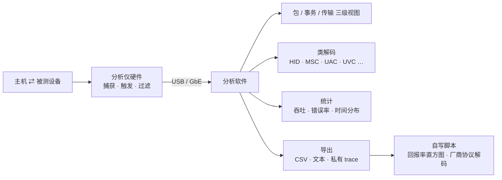

# 商用 USB 协议分析仪详解

> 🌿 知识树位置: 树干 → 枝干[调试测试与安全] → 分枝[工具与分析仪] → 叶[商用分析仪]
> ⬆️ 父节点: [00-工具与分析仪索引.md](00-工具与分析仪索引.md) · 原理: [01-USB抓包原理与观测分层](01-USB抓包原理与观测分层.md)

三家主流厂商：**Total Phase**（Beagle 系列，性价比与 API 见长）、**Teledyne LeCroy**（Mercury / Advisor / Voyager，CATC Trace 视图是行业事实标准，覆盖到 USB4 与合规测试）、**Ellisys**（Explorer / Tracker，同步捕获 USB + PD + VBUS + 逻辑信号）。下表参数全部摘自厂商产品页、数据手册或用户手册（2026-11 查阅）；厂商未公开的项写"未公开"。

## 1. 原理：三家的共同骨架与差异

共同骨架见 [01 §2.2/§2.3](01-USB抓包原理与观测分层.md)：直通 + 监听 PHY（USB 2.0）或双向收发整形（USB 3.x）→ FPGA 解码/时间戳/过滤/触发 → 板载缓冲 → 上传 PC。差异主要在四处：

| 维度 | Total Phase | Teledyne LeCroy | Ellisys |
|---|---|---|---|
| 分析软件 | Data Center（免费，Win/Linux/macOS） | USB Protocol Suite（CATC Trace 视图；当前手册列出的主机系统为 64 位 Windows） | Ellisys USB Analysis 软件（Win10+、Linux、macOS；免费全功能 Viewer） |
| 二次开发 | Beagle Software API（多语言、跨平台，可自写落盘/解码） | 自动化 API / 脚本（随 Protocol Suite） | Remote API 自动化（Type-C Tracker 页面写明） |
| 产品线顶端 | USB 3.0 5 Gbps（Beagle USB 5000 v2） | USB4 40 Gbps / TBT3/4（Voyager M4x 及更高型号） | USB 3.2 Gen 2 10 Gbps + PD（EX350） |
| 主动能力 | 纯分析 | Voyager 系列带 Exerciser（流量发生）与合规套件 | EX350 带 Generator（模拟主机/设备/Sink/Source）与 Examiner（合规） |

## 2. 架构图：从被测链路到结论



## 3. Total Phase Beagle 系列

| 型号 | 速率 | 时间分辨率 | 板载缓冲 | 触发 / I/O | 官网标价（2026-11） |
|---|---|---|---|---|---|
| **Beagle USB 12** | LS / FS | 21 ns | 无大缓冲，数据经 HS 链路直接流到 PC（"Capture traces to >25 GB"） | 产品页未列硬件触发 | US$495（TP320221） |
| **Beagle USB 480** | LS / FS / HS | 16.67 ns | 64 MB | 4 路数字输入 + 4 路数字输出（Mini-DIN 9，3.3 V）；硬件包抑制；Chirp K/J 检测；挂起/恢复检测 | US$1,295（TP320510，页面标注 Limited Availability） |
| **Beagle USB 5000 v2 Standard** | SS 5 Gbps + USB 2.0 同时 | USB3 2 ns / USB2 16.7 ns | USB3 2 GB + USB2 128 MB | 见 Ultimate | 未在本次查阅中确认 |
| **Beagle USB 5000 v2 Ultimate** | 同上 | 同上 | USB3 4 GB + USB2 128 MB；SuperSpeed 上传链路 | SMA 触发 1 入 1 出（USB3）、Mini-DIN 9（USB2）、HDMI 跨分析仪同步；Complex Match 复杂触发 | US$6,000（TP322610） |

**Data Center 要点**（数据手册/官方博客）：实时显示、搜索、过滤；LTSSM 图形视图；描述符与类级解码；自动速率检测；抓取文件保存为二进制 `.tdc`，可 File → Export 导出 CSV（官方提醒取消"仅导出可见记录"），也有命令行批量导出。5000 v2 的底层错误检测包括非法 PID、CRC 错、超时、帧序号错、状态转移错。

**适用**：单人/小团队的 FS/HS 外设调试主力；需要把分析仪接进自动化测试（API 成熟）；Linux/macOS 主机上也要跑分析软件。
**局限**：最高只到 5 Gbps（无 Gen 2、无 USB4）；无 PD 抓包（Total Phase 的 USB Power Delivery Analyzer 已停产，官方推荐替代为 Infineon CY4500 EZ-PD Protocol Analyzer）；Data Center 不能直接流式落盘。

## 4. Teledyne LeCroy

| 型号 | 协议 / 速率 | 录制内存 | 关键能力 |
|---|---|---|---|
| **Mercury T2C** | USB 1.0/1.1/2.0（1.2–480 Mb/s）+ PD 2.0/3.0（BMC，选件 USB-MCPD-M02-A） | 256 MB + spool-to-disk | Type-C 口；高阻非重定时探头；序列触发（Standard 最多 4 状态、Advanced 7 状态，各 2 条序列）；硬件过滤；实时统计；兼容 Alt Mode 直通 |
| **Mercury T2P** | 同 T2C | 512 MB | 增加 Power Tracker（VBUS 与 CC 电压图形） |
| **Advisor T3** | USB 2.0 + USB 3.2 Gen 1x1（5 Gb/s） | 产品页写 2 GB；v10.50 用户手册规格表写 1 GB 或 4 GB（口径不一，以订货配置为准） | 按总线状态、有序集（U0、SKP 等）、包类型、包头字段（End of Burst、Packets Pending）触发；实时丢弃 SKP/空闲/训练序列；spool-to-disk；智能端接检测 |
| **Voyager M310** | USB 2.0 + USB 3.2 Gen 2x1（10 Gb/s） | 16 GB | 分析 + Exerciser；SMA 外触发入/出；GbE 上传；M310C/M310P 等衍生型号带 Type-C/PD |
| **Voyager M4x** | USB4 40/20 Gb/s、USB 3.2 至 20 Gb/s（x2）、USB 2.0、PD（CC）、TBT3/TBT4 | 32 GB | 一路分析 + 一路 Exerciser；DP Alt Mode AUX；合规套件：Type-C 功能、PD（SPR）、USB 3.2 Gen1/Gen2 及 x2 链路层、USB4 |

**USB Protocol Suite / CATC Trace**：把一次录制按"包 → 事务 → 传输 → 类"逐层折叠展示，彩色字段格是 CATC 风格的标志。录制文件扩展名为 `.usb`（默认 `data.usb`，双通道为 `data_0.usb`/`data_1.usb`）；可 File → Save As → Save Range 截取包号区间，File → Export 导出文本或包/事务/表格 CSV。Traffic Summary 与实时统计（RTS）给出按端点的吞吐与错误率。

**适用**：需要 USB 3.2 Gen 2、USB4/TBT、PD + USB 同屏、带流量发生器做异常注入、或要做 USB-IF 链路层/PD 合规预测试的团队。
**局限**：分析软件当前只列 Windows 64 位；高端型号体积大、需交流供电；价格厂商未公开（官网商城只列部分选件），需询价。

## 5. Ellisys

| 型号 | 协议 / 速率 | 缓冲 | 关键能力 |
|---|---|---|---|
| **USB Explorer 200** | LS / FS / HS | 32 MB FIFO，数据连续上传 | 16.67 ns 时间戳；检测位填充、CRC5、CRC16 错误；测量 Reset、Suspend、Keep Alive、High Speed Handshake 等总线状态；BNC 触发口；硬件触发（Professional 版）；可导出 XML/文本/raw；有 SDK 与免费 Viewer |
| **USB Explorer 350** | USB 3.2 x1 Gen 1/Gen 2、USB 2.0、PD 3.0（Baseband）、VBUS（EPR 硬件 0–54 V、±5 A）、16 路逻辑 | 产品页未公开容量 | 同步捕获 USB2/USB3/PD/VBUS/逻辑；USB3 时间分辨率 400 ps；自适应均衡、可配去加重与摆幅；Generator 模拟主机/设备/Sink/Source（含错误注入）；Examiner 合规；Type-C 需适配板与定制线 |
| **Type-C Tracker** | PD 3.1、Type-C 电压状态、USB 2.0 LS/FS/HS、DP Alt Mode 与 AUX、TBT3/USB4 边带、HDMI Alt Mode，另带 TCPCI/I²C/UART/SPI/SWD | 未公开 | 口袋尺寸总线供电；高速差分对无源直通（"典型可通过 20 Gbps 或更高"）；5 ns 时间分辨率；测 VBUS（至 55 V）、SBU、CC、VCONN；EPR 支持 |
| **USB Tracker 110** | USB 2.0（低成本旧型号） | — | Ellisys 称仍在售（含教育价）；本库未取得完整规格表 |

**适用**：同时调 USB 数据和供电/Type-C 的产品（扩展坞、显示器、带 PD 的外设）；想用一台仪器既抓包又做主机/设备仿真；跨平台分析软件。
**局限**：EX350 仅 x1（无 Gen 2x2/USB4）；内存容量未公开；价格未公开，需询价。

## 6. 适用场景速配

| 你的问题 | 最低够用的商用型号 |
|---|---|
| FS/LS 设备（键盘、简单 HID、CDC） | Beagle USB 12 |
| HS 外设（8 kHz 鼠标、UAC2 声卡、HS HID 配置通道） | Beagle USB 480 / Ellisys EX200 / Mercury T2 |
| 同时看 Type-C/PD 与 USB 2.0 | Mercury T2C/T2P（PD 选件）、Ellisys Type-C Tracker |
| SS 5 Gbps 设备 | Beagle USB 5000 v2、Advisor T3 |
| SS 10 Gbps / 需要发异常流量 | Voyager M310、Ellisys EX350 |
| USB4 / TBT / 链路层合规 | Voyager M4x 及以上 |

## 7. 局限（共性）

- 都是**闭源硬件 + 私有 trace 格式**，跨厂商交换 trace 要靠 CSV/文本导出。
- "类解码"不认识厂商自定义的 HID 报告或 vendor request，需要自己在导出数据上写解码。
- 分析仪接入改变信道（尤其 SS），出问题时先确认"不接分析仪是否同样复现"。

## 8. 实战案例：用 HS 分析仪抓配置客户端的 HID Feature Report

场景：Windows 上的外设配置客户端（灯效、DPI 设置）调用 `HidD_SetFeature`，设备偶尔不生效。软件层 USBPcap 显示请求都成功完成，怀疑设备在处理期间丢了数据或时序有问题。

**步骤**

1. 拓扑：主机 → Beagle USB 480（或同级）→ 被测鼠标；分析仪上传口接**另一台**电脑（Wireshark Wiki 也建议捕获主机与被测主机分开，避免抓包负载影响被测系统）。
2. 硬件过滤：抑制 SOF 与 NAK（否则 HS 下 8000 个/秒的 SOF 会迅速填满缓冲）。
3. 触发条件：SETUP 包数据 = `21 09 xx 03 ...`（bmRequestType 0x21 类请求·接口·主机到设备；bRequest 0x09 SET_REPORT；wValue 高字节 0x03 = Feature 报告，见 HID 1.11 §7.2）。
4. 打开 Data Center 的 USB 类解码，复现问题。

> 🧪 **示例 trace**（事务级，教学构造）

```text
#     时间          事务                                              结果
2041  12.400 115    SETUP  ADDR 3 EP0  21 09 05 03 01 00 41 00          ACK    ← SET_REPORT Feature ID=5, wLength=65
2042  12.400 118    OUT    ADDR 3 EP0  DATA1 64 字节                     ACK
2043  12.400 121    OUT    ADDR 3 EP0  DATA0 1 字节                      NAK
2044  12.400 124    PING   ADDR 3 EP0                                    NAK    ← HS 控制/批量 OUT 走 PING 流控
...   (PING/NAK × 811，约 1.9 ms)
2856  12.402 057    PING   ADDR 3 EP0                                    ACK
2857  12.402 060    OUT    ADDR 3 EP0  DATA0 1 字节                      ACK
2858  12.402 066    IN     ADDR 3 EP0  DATA1 0 字节（状态阶段）          ACK
2859  12.402 190    SETUP  ADDR 3 EP0  21 09 05 03 01 00 41 00          ACK    ← 客户端立刻发下一条
2860  12.402 193    OUT    ADDR 3 EP0  DATA1 64 字节                     ACK
2861  12.402 196    OUT    ADDR 3 EP0  DATA0 1 字节                      ACK    ← 第二条没有 NAK，很快完成
```

**分析**：第一条请求的最后 1 字节被 NAK 了 1.9 ms（HS 下主机改发 PING 探询，直到设备 ACK 才重发数据，见 USB 2.0 §8.5.1；软件层完全看不到这些 PING）——设备在写 Flash/EEPROM 期间不收数据，这是允许的；但第二条紧跟着到达时设备**直接 ACK 了**，说明固件在"忙"状态下把新数据收进了同一个缓冲，覆盖了尚未提交的第一条。软件层只能看到两条都"成功"。
**根因与修复**：固件在处理 Feature 报告期间应对 EP0 OUT 持续 NAK（或在状态阶段才 ACK），直到上一条处理完；客户端侧可在两次写之间读回（GET_REPORT）校验。
**验证**：同一触发条件下重放 1000 次，统计每条 SET_REPORT 后是否都有完整的 NAK 窗口 + 读回一致。

## 参考来源

- Total Phase：Beagle USB 12 <https://www.totalphase.com/products/beagle-usb12/>、Beagle USB 480 <https://www.totalphase.com/products/beagle-usb480/>、Beagle USB 5000 v2 Ultimate <https://www.totalphase.com/products/beagle-usb5000-v2-ultimate/> 及数据手册 <https://www.totalphase.com/media/datasheet/TP_Beagle_USB_5000_SuperSpeed_Protocol_Analyzer-Datasheet.pdf>；缓冲说明博客 <https://www.totalphase.com/blog/2020/08/how-does-the-beagle-usb-5000-v2-protocol-analyzer-store-data-beyond-its-internal-buffer/>；保存与导出 <https://www.totalphase.com/blog/2022/05/data-center-software-series-saving-exporting-captures/>；PD 分析仪停产公告 <https://www.totalphase.com/products/usb-power-delivery-analyzer/>
- Teledyne LeCroy：Mercury T2C/T2P <https://www.teledynelecroy.com/protocolanalyzer/usb/usb-mercury-t2c-t2p> 与数据手册 <https://cdn.teledynelecroy.com/files/pdf/mercury-t2c-datasheet.pdf>；Advisor T3 <https://www.teledynelecroy.com/protocolanalyzer/usb-advisor-t3> 与手册规格 <https://manuals.teledynelecroy.com/usb-protocol-suite-manuals/v10.50/advisor-t3-specifications>；Voyager M310 手册 <https://manuals.teledynelecroy.com/usb-protocol-suite-manuals/v10.50/voyager-m310-analyzer>；Voyager M4x <https://www.teledynelecroy.com/protocolanalyzer/usb-voyager-m4x> 与手册 <https://manuals.teledynelecroy.com/usb-protocol-suite-manuals/v10.50/voyager-m4x-analyzer>；录制选项（`.usb` 文件）<https://manuals.teledynelecroy.com/usb-protocol-suite-manuals/v10.50/general-tab>；CSV 导出 <https://manuals.teledynelecroy.com/usb-protocol-suite-manuals/v10.50/exports-to-csv>
- Ellisys：USB Explorer 200 <https://www.ellisys.com/products/usbex200/technical.php>；USB Explorer 350 <https://ellisys.com/products/usbex350/technical.php> 与宣传册；Type-C Tracker <https://ellisys.com/products/ctr1/technical.php>
- HID 1.11 §7.2（SET_REPORT/GET_REPORT 与报告类型编码）
