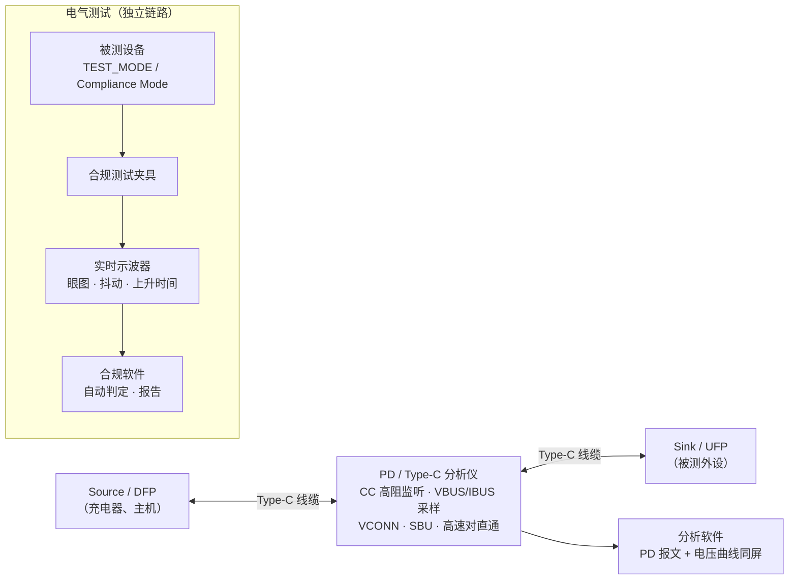

# PD 与 Type-C 分析仪及电气测试仪器

> 🌿 知识树位置: 树干 → 枝干[调试测试与安全] → 分枝[工具与分析仪] → 叶[CC/PD 与电气]
> ⬆️ 父节点: [00-工具与分析仪索引.md](00-工具与分析仪索引.md) · 协议背景: [USB PD 协议](../../30-枝干-接口与供电/04-USBPD协议.md) · [Type-C 状态机与 CC 时序](../../30-枝干-接口与供电/09-TypeC规范级-状态机与CC时序.md)

USB 数据分析仪看 D+/D− 与 SS 差分对；**供电与 Type-C 的协商发生在 CC 线上**，电气质量问题则只有示波器看得到。这一页覆盖这两类"数据分析仪看不到"的仪器。

## 1. 原理

### 1.1 CC 线上要抓什么

| 层 | 内容 | 规范依据 |
|---|---|---|
| 电阻/电压态 | Rp/Rd/Ra 决定的 CC 电压、Attach/Detach、方向（CC1/CC2） | Type-C 规范 第 4 章 |
| PD 物理层 | BMC 编码，fBitRate **270 / 300 / 330 kbps**（min/nom/max） | PD R3.3 Table 5.9 |
| PD 链路层 | 4b5b、SOP/SOP′/SOP″ 起始序列、CRC-32、GoodCRC（tReceive 0.9–1.1 ms 内应答） | PD R3.3 第 5、6 章；Table 7.10 |
| PD 策略层 | Source_Capabilities → Request → Accept → PS_RDY；Reject/Wait；Soft/Hard Reset；VDM、Alt Mode 进入 | PD R3.3 第 6、8、9 章 |
| 电源 | VBUS 电压/电流随契约变化、VCONN | PD R3.3 第 7 章 |

PD 分析仪的核心价值是把**报文与 VBUS/CC 电压放在同一时间轴**上：例如 PS_RDY 发出时 VBUS 是否已经到达新电压、Hard Reset 后 VBUS 是否按规定跌落再恢复。

### 1.2 电气测试的链路

协议正确不代表信号合格。USB 2.0 HS 眼图、上升/下降时间、Chirp 幅度，USB 3.x 发送端眼图、抖动与接收端容限，都要用**示波器 + 合规夹具 + 合规软件**测。被测设备先进入测试模式：USB 2.0 通过 `SET_FEATURE(TEST_MODE)` 发送 Test_Packet 等码型；USB 3.x 进入 LTSSM 的 Compliance Mode 发送合规码型（见 [合规测试实操](../05-合规测试实操.md)）。

## 2. 架构图



## 3. PD / Type-C 分析仪

| 型号 | PD 能力（厂商原文） | 同时能看的 | 备注 |
|---|---|---|---|
| **Ellisys Type-C Tracker** | PD 3.1、VDM、Type-C 电压态；EPR | USB 2.0 LS/FS/HS、DP Alt Mode 与 AUX、TBT3/USB4 边带、HDMI Alt Mode、TCPCI/I²C/UART/SPI/SWD、16 路逻辑 | 口袋尺寸、总线供电；测 VBUS（至 55 V）、SBU、CC、VCONN；高速对无源直通 |
| **Ellisys USB Explorer 350** | PD 3.0（Baseband）；Type-C CC 需定制线 | USB 3.2 x1 Gen1/Gen2、USB 2.0、VBUS（EPR 硬件 0–54 V、±5 A）、逻辑 | Generator 可模拟 Sink/Source/DRP、e-marker 线缆 |
| **Teledyne LeCroy Mercury T2C / T2P** | PD 2.0/3.0 BMC（选件）：报文类型、Source/Sink 能力、角色互换、VCONN、Hard/Cable Reset、Alt Mode 进入/退出 | USB 2.0 | T2P 增加 Power Tracker（VBUS 与 CC 电压图形）；附 100 W 双向线缆 |
| **Teledyne LeCroy Voyager M310C/M310P、M4x** | CC（PD）报文；M4x 合规套件含 PD（SPR）与 Type-C 功能验证；PD Exerciser | USB 3.2 / USB4 | 见 [02-商用USB协议分析仪详解](02-商用USB协议分析仪详解.md) |
| **Total Phase USB Power Delivery Analyzer** | — | — | **已停产**；官方推荐替代为 Infineon CY4500 EZ-PD Protocol Analyzer |
| **Infineon CY4500 EZ-PD Protocol Analyzer** | Total Phase 称其功能与原 PD 分析仪相当 | — | 本库未逐项核对其规格，选购前以 Infineon 官网为准 |
| **Twinkie（Chromium OS）** | CC1/CC2 嗅探、可注入 PD 报文、可呈现 Rd/Rp/Ra；监测 VBUS/VCONN | — | 开源，见 [04-开源与低成本分析工具](04-开源与低成本分析工具.md) |

**适用**：充电协商失败、快充不触发、显示器/扩展坞 Alt Mode 进不去、角色互换（PR_Swap/DR_Swap）异常、e-marker 线缆识别。
**局限**：PD 分析仪看不到 TCPC/PD 控制器内部的策略决策（为什么选了某个 PDO），要结合固件日志或 Linux TCPM 日志；EPR（>20 V）需要硬件明确支持 EPR，旧硬件 VBUS 量程只到 25 V（Ellisys EX350 页面注明 pre-EPR 硬件最高 25 V）。

## 4. 电气测试仪器（示波器 + 合规软件）

| 测试对象 | 官方工具链示例 | 要点 |
|---|---|---|
| USB 2.0 发送端（眼图、上升/下降时间、Chirp） | Keysight **D9010USBC** USB 2.0 合规测试软件 + Infiniium 示波器 + E2649B 夹具 | 软件自动配置示波器、做眼图模板与时序项并出报告 |
| USB 3.2 Gen1/Gen2 发送端 | Keysight **D9020USBC** USB 3.2 合规测试软件 + U7242A 夹具 | Keysight MOI 给出的示波器带宽要求随速率提高（Gen 2 比 Gen 1 更高），以最新 MOI 为准 |
| USB-IF 官方协议/电气工具 | USB-IF 合规工具（USBCV、HSETT 等） | 见 [合规测试实操](../05-合规测试实操.md) |

Tektronix、Teledyne LeCroy 的示波器同样提供 USB 合规测试选件，型号与夹具以各自官网当期资料为准。**协议分析仪不能替代示波器**：分析仪只报告"CRC 错/训练失败"这类结果，不告诉你是幅度不足、抖动过大还是阻抗失配。

## 5. 适用场景与局限小结

- PD 问题先上 PD 分析仪；只有当报文看起来合规、但 VBUS 行为异常时，再用示波器/电子负载看电源瞬态。
- 电气测试需要被测设备支持测试模式；产品固件若屏蔽了 `TEST_MODE`，要准备专门的测试固件。
- 夹具和示波器带宽是硬门槛，"拿普通探头点 D+/D−"只能看低速/全速的粗波形，测不了 HS 眼图。

## 6. 实战案例：65 W 充电器给笔记本只协商到 5 V

> 🧪 **示例 trace**（Ellisys/LeCroy 风格的 PD 报文列表，教学构造）

```text
时间(ms)   SOP   方向       报文                         关键字段                                 VBUS(V)
0.000      SOP   SRC→SNK    Source_Capabilities          PDO1 5V/3A  PDO2 9V/3A  PDO3 15V/3A  PDO4 20V/3.25A   5.02
0.950      SOP   SNK→SRC    GoodCRC                                                                5.02
8.400      SOP   SNK→SRC    Request                      ObjPos=4  OpCurrent=3.25A  MaxCurrent=3.25A  5.02
9.300      SOP   SRC→SNK    GoodCRC                                                                5.02
11.100     SOP   SRC→SNK    Reject                                                                 5.02
...        （Sink 回到等待；随后每次重发 Request 都得到 Reject）
```

**读法**：时序本身合规——Sink 在 tReceiverResponse（≤15 ms，PD R3.3 Table 7.10）内发出 Request，Source 也在该时限内回应。Request 选的是第 4 个 PDO（20 V/3.25 A），电流也没超过该 PDO 的最大值，Source 却回 Reject。把分析仪挪到 Source 与 e-marker 线缆之间看 SOP′：

```text
时间(ms)   SOP    方向        报文                        关键字段
-120.0     SOP'   SRC→CABLE   Discover_Identity (REQ)
-119.1     SOP'   —           （无 GoodCRC，重试 nRetryCount 次后放弃）
```

**根因**：线缆没有 e-marker（或 e-marker 不应答 SOP′ Discover Identity），Source 只能按 3 A 线缆处理，但它的 Source_Capabilities 仍然广播了 3.25 A 的 PDO4——Request 合规，却被 Source 自己的线缆限流策略拒绝。这是 Source 固件的能力广播与线缆能力不一致。
**修复**：Source 在识别不到 5 A 线缆时，Source_Capabilities 中各 PDO 的最大电流应不超过 3 A（Type-C/PD 对无 e-marker 线缆的电流限制见 PD R3.3 第 4、6 章）；或者换用带 e-marker 的 5 A 线缆。
**验证**：同一拓扑重抓，确认 Source_Capabilities 的 PDO4 变为 20 V/3 A，Request → Accept → PS_RDY 完整，PS_RDY 时刻 VBUS 已稳定在 20 V 附近。

更完整的 PD 失败模式（Request 超时触发 Hard Reset，以及为何 HardResetCounter 不会耗尽而形成循环）见 [15-案例-PD契约协商失败](15-案例-PD契约协商失败.md)。

## 参考来源

- USB PD R3.3 V1.0（2026-10）：Table 5.9 BMC Common Requirements（fBitRate）、Table 7.10（tReceive）、§9.2.3.3 PE_SRC_Send_Capabilities
- Ellisys Type-C Tracker Technical Data <https://ellisys.com/products/ctr1/technical.php>；USB Explorer 350 Technical Data <https://ellisys.com/products/usbex350/technical.php>
- Teledyne LeCroy Mercury T2C/T2P <https://www.teledynelecroy.com/protocolanalyzer/usb/usb-mercury-t2c-t2p>；Voyager M4x <https://www.teledynelecroy.com/protocolanalyzer/usb-voyager-m4x>；PD Exerciser 支持型号 <https://manuals.teledynelecroy.com/usb-protocol-suite-manuals/v10.50/traffic-generation-usb-3-2-usb4-and-pd-exerciser>
- Total Phase USB PD Analyzer 停产公告 <https://www.totalphase.com/products/usb-power-delivery-analyzer/>
- Chromium OS Twinkie <https://www.chromium.org/chromium-os/developer-library/guides/hardware-schematics/twinkie/>
- Keysight D9010USBC <https://www.keysight.com/us/en/product/D9010USBC/usb-2-0-compliance-test-software.html>；D9020USBC <https://www.keysight.com/us/en/lib/software-detail/instrument-firmware-software/d9020usbc-usb-32-compliance-test-software-and-30day-trial-license-2524182.html>
