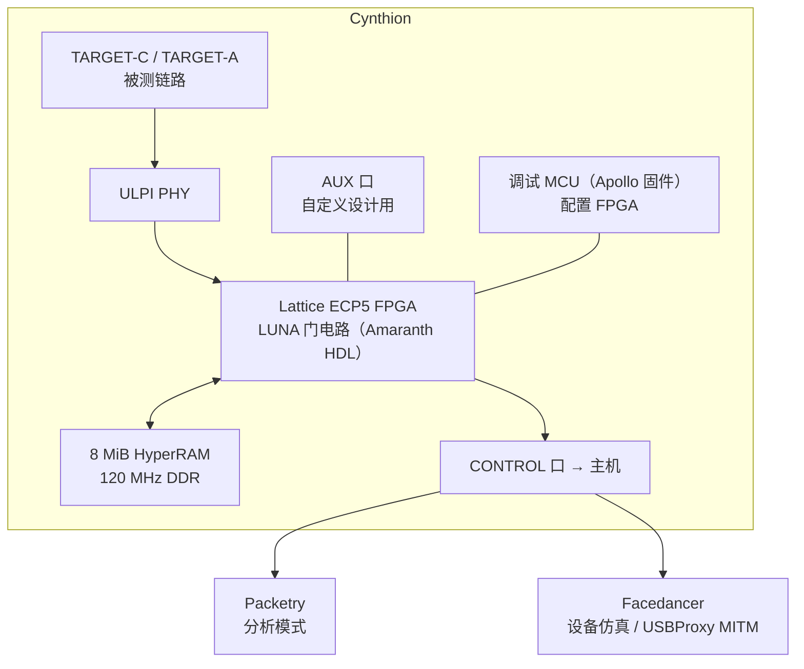

# 开源与低成本 USB/BLE 分析工具

> 🌿 知识树位置: 树干 → 枝干[调试测试与安全] → 分枝[工具与分析仪] → 叶[开源工具]
> ⬆️ 父节点: [00-工具与分析仪索引.md](00-工具与分析仪索引.md) · 虚拟 USB 背景: [tech-doc 06 Linux 虚拟 USB](../../tech-doc/06-linux-virtual-usb.md)

开源工具的价值不只是便宜：**硬件、门电路（gateware）、主机软件全部可改**，能做商用分析仪做不了的事——在 FPGA 里改协议行为、做中间人（MITM）篡改、自动化模糊测试。这正是虚拟 USB、驱动与固件研究需要的。

## 1. 原理：三种开源路线

| 路线 | 代表 | 做法 | 速率上限 |
|---|---|---|---|
| FPGA + ULPI PHY 被动嗅探 | Cynthion（LUNA 门电路）、OpenVizsla、ataradov usb-sniffer | 与商用 USB 2.0 分析仪同构：PHY 监听 → FPGA 解包 → 主机软件 | HS 480 Mbps |
| 可编程 USB 设备 / 中间人 | Facedancer（配 Cynthion、GreatFET One 等）、USBProxy | 板子作为真实 USB 设备连到被测主机，行为由 Python 控制；或夹在主机与真设备之间转发并改写 | 取决于板卡（Cynthion 可 HS） |
| 逻辑分析仪 + 软件解码 | sigrok/PulseView + 通用逻辑分析仪 | 对 D+/D− 采样，软件解 NRZI/位填充/包 | **仅 LS/FS**（解码器只实现这两种信令） |

## 2. 架构图



## 3. 工具逐个看

### 3.1 Cynthion + Packetry（Great Scott Gadgets）

- **是什么**：官方定义为"全能 USB 构建、测试、监视与实验工具"，基于 FPGA；出厂即可做 LS/FS/HS（USB 2.0）协议分析，配开源软件 Packetry；配合 LUNA 门电路与 Facedancer 库，可以创建或篡改**真实**的 USB 设备。
- **硬件**：Lattice ECP5 FPGA；8 MiB HyperRAM 作捕获缓冲（GSG 说明：多数目标设备可直接流式上传到主机，只有带宽很高的目标才需要板载缓冲；RAM 以 120 MHz DDR 运行，名义 1920 Mbit/s，满足半双工 RAM 承载 480 Mbit/s 双倍读写的需要）。端口：CONTROL（主机控制）、AUX（自定义设计）、TARGET-C 与共用的 TARGET-A（抓包与 Facedancer 仿真）。设计文件（KiCad）、原理图、BOM 全部开源。
- **Packetry**：Rust + GTK 4 编写，跨 Linux/macOS/Windows；可加载 `LINKTYPE_USB_2_0` 链路类型的 `.pcap`（tcpdump 链路类型表中编号 288）。
- **适用**：HS 外设时序分析的低成本方案；虚拟 USB / 主机栈研究（同一块板既能抓又能仿真）。
- **局限**：只到 USB 2.0；LUNA 对 SuperSpeed 设备仅"实验性"支持；高级触发等功能成熟度不及商用（以当期 Packetry 文档为准）。

### 3.2 OpenVizsla

- FT2232H + FPGA 的 USB 2.0 嗅探器（ov_ftdi 仓库），开源硬件；Wireshark Wiki：板载 32 MiB SDRAM，高负载 HS 总线时有用；`ovextcap` 可把它接入 Wireshark 接口列表。
- 主机软件 `ovctl.py sniff <ls|fs|hs>`，**需要事先知道速率**；可存为 pcap（链路类型 288，Wireshark 3.2.0+ 可看）。
- 项目 README（截至 2019-10）：硬件与门电路自 2014 年底未再改动，主机软件"相当基础"，不做包到传输的聚合；板子供货有限。
- **适用**：已有板子的研究者；**局限**：维护停滞、买不到。

### 3.3 Low-cost USB Sniffer（ataradov/usb-sniffer）

- LS/FS/HS，命令行或 Wireshark 插件（extcap）两种用法，输出标准 PcapNG。
- 硬件：Cypress CY7C68013A + Lattice LCMXO2 FPGA + Microchip USB3343 PHY，作者给出 BOM 低于 50 美元；KiCad 设计开源。Wireshark Wiki 注明它**没有板载 RAM**。
- **适用**：自己焊板子、预算极低；**局限**：无缓冲，突发高负载时可能丢数据；需要 Wireshark 4.x 才能解出载荷。

### 3.4 Facedancer / GreatFET / USBProxy

- Facedancer 3.0（Python 包 `facedancer`）：让"遥控 USB 控制器"板子模拟任意 USB 设备，控制粒度细到可以制造各种违规行为，用于仿真与主机侧模糊测试；新代码库支持 MITM（替代原 USBProxy 项目），可在你无法控制目标系统软件时做协议分析与实时改包。
- 3.0 是重写，不兼容旧脚本；旧版用 `pip install "facedancer<=3"`。
- 支持的板卡包括 Cynthion、GreatFET One 等（以 Facedancer 文档为准）。

### 3.5 sigrok / PulseView + 逻辑分析仪

- libsigrokdecode 的 `usb_signalling` → `usb_packet` → `usb_request` 三级解码器**只支持低速 1.5 Mb/s 与全速 12 Mb/s**；HS 480 Mb/s 采用电流模式差分信令，这些解码器不处理。
- 适合：LS/FS 设备（老式键盘、部分 HID、MCU 的 FS 口）的线级观察；看复位、挂起/唤醒的时长；和其他总线（SPI/I²C/UART）在同一时间轴对齐。

### 3.6 Twinkie（Chromium OS USB-PD 嗅探器）

- 基于 Chromium OS EC 的透明 Type-C PD 嗅探器：抓 CC1/CC2、监测 VBUS/VCONN，还能注入 PD 报文、呈现 Rd/Rp/Ra 电阻。
- 固件在 `chromiumos/platform/ec` 的 `board/twinkie`；数据经厂商自定义 bulk IN 端点上送，每 64 字节记录含 4 字节头（序号/通道/时间戳）+ 60 字节 CC 采样。
- 官方用法：`sigrok-cli -d chromium-twinkie --continuous -o test.sr`，再用 PulseView 解码。

### 3.7 BLE 嗅探器（简述）

| 工具 | 能力 | 局限 |
|---|---|---|
| Nordic **nRF Sniffer for Bluetooth LE**（nRF52840 Dongle 等） | 作为 Wireshark 接口抓广播与连接 | 一次只能跟随**一个**连接；必须抓到 CONNECT_IND 才能跟随，错过就要重连再抓 |
| Ellisys **Bluetooth Tracker** | 宽带并发捕获全部 40 个 BLE 信道；另含 Wi-Fi、频谱、HCI、逻辑信号 | 商用，需询价 |
| Teledyne LeCroy **Frontline X240** | 基于 SDR，覆盖 BLE、BR/EDR、Wi-Fi、802.15.4 | 商用，需询价 |

HOGP 场景的完整用法见 [16-案例-BLE-HOGP配对与ReportMap](16-案例-BLE-HOGP配对与ReportMap.md)。

## 4. 适用场景

- **虚拟 USB / 驱动研究**：Cynthion 一块板同时满足"抓包看主机行为"和"仿真设备喂给主机"；配合 Linux 的 Raw Gadget + dummy_hcd（见 [08-测试仿真与虚拟化工具](08-测试仿真与虚拟化工具.md)）可以在无硬件的环境下先把逻辑跑通。
- **主机栈健壮性**：用 Facedancer 构造畸形描述符（错的 bLength、超长 wTotalLength、非法 bMaxPacketSize0）测试驱动/OS 的容错。
- **控制客户端的厂商请求验证**：用 Facedancer 模拟设备，记录配置客户端发来的每一条 vendor request，不依赖真实硬件。

## 5. 局限

- 无 USB 3.x 开源嗅探硬件（Wireshark Wiki："目前没有支持 Wireshark 的 USB 3.x 捕获硬件"）。
- 开源工具的触发、过滤、统计远不如商用软件，大数据量分析要自己写脚本处理 pcap。
- 自制板（usb-sniffer、OpenVizsla）的信号完整性取决于做工，可能引入它自己的问题。

## 6. 实战案例：用 Facedancer 模拟设备，记录配置客户端的厂商请求

场景：在没有样机的情况下，验证上位机配置客户端发给鼠标的厂商控制请求格式是否符合固件协议文档。

**步骤**

1. Cynthion 的 CONTROL 口接开发机，TARGET-C 接被测主机（运行配置客户端的 Windows 机）。
2. 安装：`pip install facedancer`；以官方 `examples/minimal.py` 为模板。
3. 把 VID/PID 改成客户端识别的样机值（仅限自家产品的测试环境），实现两个 vendor request 处理器：IN 请求返回固件版本，OUT 请求打印收到的 `wValue/wIndex/data`。

```python
# 摘自 facedancer examples/minimal.py（Facedancer 3.x），删减注释
@vendor_request_handler(number=1, direction=USBDirection.IN)
@to_device
def my_in_vendor_request_handler(self: USBDevice, request: USBControlRequest):
    request.reply(b"device on control endpoint")

@vendor_request_handler(number=2, direction=USBDirection.OUT)
@to_device
def my_out_vendor_request_handler(self: USBDevice, request: USBControlRequest):
    logging.info(f"device received {request.index} {request.value} {bytes(request.data)} on control endpoint")
    request.ack()
```

4. 在客户端里点"保存 DPI"，观察日志。

> 🧪 **示例日志**（教学构造）

```text
INFO  device received 0 1600 b'\x01\x40\x06\x40\x06' on control endpoint
INFO  device received 0 3200 b'\x01\x80\x0c\x80\x0c' on control endpoint
```

**分析**：`wValue` 直接放了 DPI 十进制值，数据段是"档位号 + X/Y DPI（小端 16 位）"。对照固件协议文档，若约定数据段 X/Y 为大端，就能在没有硬件的阶段发现客户端的字节序 bug。
**验证**：修客户端后重跑，同时在 Packetry（Cynthion 切到分析模式）或 Wireshark 中确认 SETUP 与 DATA 字节和文档逐字节一致。

## 参考来源

- Great Scott Gadgets Cynthion <https://greatscottgadgets.com/cynthion/>；Cynthion 文档（项目说明、设备概览）<https://cynthion.readthedocs.io/>；HyperRAM 说明 <https://www.greatscottgadgets.com/2022/02-09-hyperram-controller-for-usb-analysis/>；cynthion-hardware 仓库 <https://github.com/greatscottgadgets/cynthion-hardware>
- LUNA <https://github.com/greatscottgadgets/luna>；Packetry <https://github.com/greatscottgadgets/packetry>；Facedancer <https://github.com/greatscottgadgets/facedancer>（README 与 `examples/minimal.py`）
- OpenVizsla ov_ftdi README <https://github.com/openvizsla/ov_ftdi>；Wireshark Wiki CaptureSetup/USB <https://wiki.wireshark.org/CaptureSetup/USB>
- ataradov/usb-sniffer <https://github.com/ataradov/usb-sniffer>
- tcpdump 链路类型表 <https://www.tcpdump.org/linktypes.html>（USB_2_0 = 288 等）
- sigrok 协议解码器 <https://sigrok.org/wiki/Protocol_decoders>（usb_signalling / usb_packet / usb_request 仅 LS/FS）
- Chromium Twinkie <https://www.chromium.org/chromium-os/developer-library/guides/hardware-schematics/twinkie/>；`board/twinkie/sniffer.c`
- Nordic nRF Sniffer for Bluetooth LE <https://www.nordicsemi.com/Products/Development-tools/nRF-Sniffer-for-Bluetooth-LE>；Ellisys Bluetooth Tracker <https://www.ellisys.com/products/btr1/technical.php>；Frontline X240 <https://www.teledynelecroy.com/protocolanalyzer/frontline-x240>
