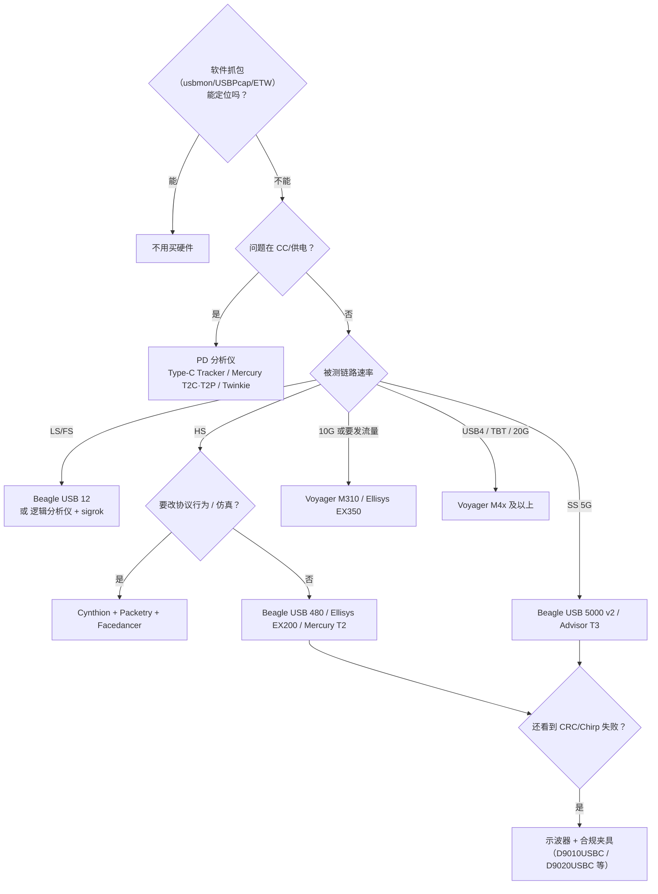

# USB 分析仪对比与选型指南

> 🌿 知识树位置: 树干 → 枝干[调试测试与安全] → 分枝[工具与分析仪] → 叶[对比与选型]
> ⬆️ 父节点: [00-工具与分析仪索引.md](00-工具与分析仪索引.md) · 明细: [02 商用](02-商用USB协议分析仪详解.md) · [03 PD/电气](03-PD与Type-C分析仪及电气测试仪器.md) · [04 开源](04-开源与低成本分析工具.md)

## 1. 原理：选型只看四个问题

1. **最高要看到哪一层？** URB（软件即可）→ 包/事务（USB 2.0 分析仪）→ 链路层/LTSSM（USB 3.x 分析仪）→ CC/PD（PD 分析仪）→ 波形（示波器）。对照 [01 的可见性矩阵](01-USB抓包原理与观测分层.md)。
2. **被测链路的最高速率？** 分析仪必须覆盖被测速率；SS 设备若只关心 USB 2.0 回退行为，USB 2.0 分析仪也能用。
3. **问题是偶发的吗？** 偶发问题要靠**硬件触发 + 大缓冲 + 硬件过滤**；连续问题流式录制即可。
4. **要不要主动注入？** 只看用分析仪；要发异常包/模拟对端，用带 Exerciser/Generator 的型号，或开源的 Facedancer。

## 2. 架构图：选型决策树

## 3. 对比总表

参数来源见 [02](02-商用USB协议分析仪详解.md)/[03](03-PD与Type-C分析仪及电气测试仪器.md)/[04](04-开源与低成本分析工具.md) 各页参考来源；"—"表示不支持，"未公开"表示厂商页面未给出。

| 型号 | USB 速率 | PD / Type-C | 触发 | 缓冲 / 存储 | 软件 | 开放性 | 公开标价（2026-11） | 典型用途 |
|---|---|---|---|---|---|---|---|---|
| Beagle USB 12 | LS/FS | — | 产品页未列 | 流式到 PC（产品页：">25 GB"） | Data Center（Win/Linux/macOS）+ API | 闭源硬件，免费软件与 API | US$495 | FS 设备、教学 |
| Beagle USB 480 | LS/FS/HS | — | 数字 I/O 4 入 4 出；硬件包抑制 | 64 MB + 流式 | 同上 | 同上 | US$1,295 | HS 外设调试主力 |
| Beagle USB 5000 v2 | SS 5G + USB2 | — | SMA 1 入 1 出、HDMI 跨分析仪同步；Complex Match（Ultimate） | USB3 2 GB（Std）/ 4 GB（Ult）+ USB2 128 MB | 同上（含 LTSSM 视图） | 同上 | Ultimate US$6,000 | SS 5G 设备 |
| LeCroy Mercury T2C / T2P | LS/FS/HS | PD 2.0/3.0 BMC（选件）；T2P 有 VBUS/CC 电压图 | 序列触发 4/7 状态 | 256 MB / 512 MB + spool-to-disk | Protocol Suite（Win x64） | 闭源 | 未公开 | USB2 + PD 同屏 |
| LeCroy Advisor T3 | USB2 + 5G | — | 按总线状态/有序集/包头字段触发；实时丢弃 SKP、空闲等 | 2 GB（产品页）/ 1 或 4 GB（手册） | 同上 | 闭源 | 未公开 | SS 5G 驱动/性能 |
| LeCroy Voyager M310 | USB2 + 10G | M310C/M310P 型号带 PD | SMA 外触发 | 16 GB | 同上 + Exerciser | 闭源 | 未公开 | 10G、异常注入 |
| LeCroy Voyager M4x | USB2 / 3.2 至 20G / USB4 40G / TBT3·4 | CC（PD）+ 合规套件 | 以手册为准 | 32 GB | 同上 + Exerciser + 合规 | 闭源 | 未公开 | USB4、合规预测试 |
| Ellisys USB Explorer 200 | LS/FS/HS | — | 硬件触发（Professional 版）；BNC | 32 MB FIFO + 流式 | Ellisys 软件 + SDK + 免费 Viewer | 闭源 | 未公开 | HS 外设 |
| Ellisys USB Explorer 350 | USB2 + 3.2 x1 Gen1/Gen2 | PD 3.0、VBUS/IBUS、逻辑 16 路 | 产品页未列具体触发规格 | 未公开 | 同上 + Generator/Examiner | 闭源 | 未公开 | USB3 + PD 产品 |
| Ellisys Type-C Tracker | USB2 LS/FS/HS（高速对直通） | PD 3.1、EPR、DP AUX、USB4 边带 | 产品页未列具体触发规格 | 未公开 | 同上，Remote API | 闭源 | 未公开 | Type-C/PD/Alt Mode |
| Cynthion + Packetry | LS/FS/HS | — | 以 Packetry 当期文档为准 | 8 MiB HyperRAM + 流式 | Packetry、Facedancer、LUNA | 硬件/门电路/软件全开源 | 未在本次查阅中确认（经销商销售） | 研究、仿真、MITM |
| OpenVizsla | LS/FS/HS（需预设速率） | — | 基本无 | 32 MiB SDRAM | ovctl、Wireshark extcap | 全开源 | 停产，难买 | 历史/研究 |
| ataradov usb-sniffer | LS/FS/HS | — | 无 | 无板载 RAM | Wireshark extcap | 全开源（BOM < US$50，作者估算） | 自制 | 极低预算 |
| 逻辑分析仪 + sigrok | 仅 LS/FS | — | 逻辑分析仪自带 | 逻辑分析仪内存 | PulseView | 软件开源 | 视逻辑分析仪 | 线级波形 + 多总线对齐 |
| Twinkie | — | CC 嗅探 + 注入 | — | 流式 | sigrok/PulseView | 全开源 | 自制/社区 | 低成本 PD |

**要点**：公开标价只有 Total Phase；LeCroy、Ellisys 需询价，本库不做估算。

## 4. 选型指南：按工作场景

### 4.1 外设配置客户端调试（HID Feature/Output Report、厂商控制请求）

- **第一选择：软件**。Windows 用 USBPcap 看请求与载荷、ETW 看失败阶段；Linux 用 usbmon。请求格式、字节序、长度、错误码 90% 在这一层解决。
- **需要硬件的信号**：请求"成功"但设备没生效、两条请求间隔太近出错、设备 NAK 时间过长——这些要看 NAK/PING 与精确间隔（见 [02 §8 案例](02-商用USB协议分析仪详解.md)）。HS 设备用 Beagle USB 480 / Ellisys EX200 / Mercury T2 级别足够。
- **无样机阶段**：Facedancer 模拟设备，记录客户端发出的每条请求（[04 §6](04-开源与低成本分析工具.md)）。

### 4.2 HID 高回报率鼠标（4 kHz / 8 kHz）

- 8 kHz 意味着 HS 中断端点 bInterval=1、每 125 µs 一个微帧（[四种传输类型](../../10-树干-USB核心/06-四种传输类型.md)）。验证"每个微帧都有 IN 且有数据/NAK"必须看线级：**HS 分析仪是必需品**，Beagle USB 480 的 16.67 ns 分辨率远高于需要。
- 软件时间戳（usbmon）只能做趋势统计，会被 xHCI 中断节流和调度延迟污染；做抖动结论要以硬件时间戳为准（[12-案例](12-案例-8000Hz鼠标回报率与抖动.md)）。
- 预算有限或想同时研究固件行为：Cynthion + Packetry。

### 4.3 虚拟 USB / 驱动 / 固件研究

- **零硬件起步**：Linux dummy_hcd + Raw Gadget / ConfigFS gadget + usbmon，主机与设备在同一内核里，usbmon 看得到全部 URB（[08](08-测试仿真与虚拟化工具.md)）。
- **接真主机**：Cynthion（抓 + 仿真一体）+ Facedancer；需要做 MITM 改包用 Facedancer 的 USBProxy 功能。
- **研究 USB 3.x 链路层**：开源工具覆盖不到，需要 Beagle USB 5000 v2 或 LeCroy/Ellisys 的 SS 分析仪。

### 4.4 Type-C / PD 产品

- Ellisys Type-C Tracker 或 Mercury T2P（PD + VBUS 同屏）；低成本先用 Twinkie。
- 同时要看 SS 数据与 PD：Ellisys EX350 / Voyager M310C·M310P / M4x。

## 5. 适用场景与局限小结

- **一台通用起步配置**：Beagle USB 480（或 EX200/T2）+ 示波器能覆盖 HID/UAC/CDC 类外设的绝大多数问题；有 Type-C 产品再加一台 PD 分析仪。
- **局限**：本表只反映厂商公开资料；同一型号常有多个软件授权档位（Standard/Advanced/Pro），触发与统计能力随授权变化，下单前要对照报价单。

## 6. 实战案例：一次"该不该买 SS 分析仪"的评估

> 🧪 **示例**（教学构造的评估记录）

- 现象：USB 3.2 Gen 1 采集卡在某台笔记本上每隔几分钟掉到 USB 2.0。
- 软件证据：Windows 设备管理器里设备重新出现在 USB 2.0 端口下；ETW（USBHUB3，Power/Default 关键字）里看到该端口的链路状态变化与重新枚举。Linux 侧 dmesg 显示设备以 `high-speed` 重新枚举。
- 判断：软件只能确定"SS 链路失败后回退"，看不到失败前是 Recovery 反复、U1/U2 退出失败还是 LFPS 不被识别——**这是 LTSSM 层问题，必须上 SS 分析仪**；同时准备示波器看 LFPS 与眼图。
- 最小可行采购：5 Gbps 设备 → Beagle USB 5000 v2 或 Advisor T3 即可；若未来要做 10 Gbps 产品再考虑 Voyager M310 / Ellisys EX350。
- 后续分析方法见 [14-案例-USB3链路训练与Recovery循环](14-案例-USB3链路训练与Recovery循环.md)。

## 参考来源

- 各型号参数与链接：见 [02](02-商用USB协议分析仪详解.md)、[03](03-PD与Type-C分析仪及电气测试仪器.md)、[04](04-开源与低成本分析工具.md) 的参考来源（Total Phase / Teledyne LeCroy / Ellisys 产品页与手册、GSG 文档、Wireshark Wiki）
- 价格：Total Phase 官网产品页（Beagle USB 12、Beagle USB 480、Beagle USB 5000 v2 Ultimate），2026-11 查阅
- USB 2.0 规范 §5.7.4、§9.6.6（HS 中断端点周期 2^(bInterval−1) × 125 µs）
