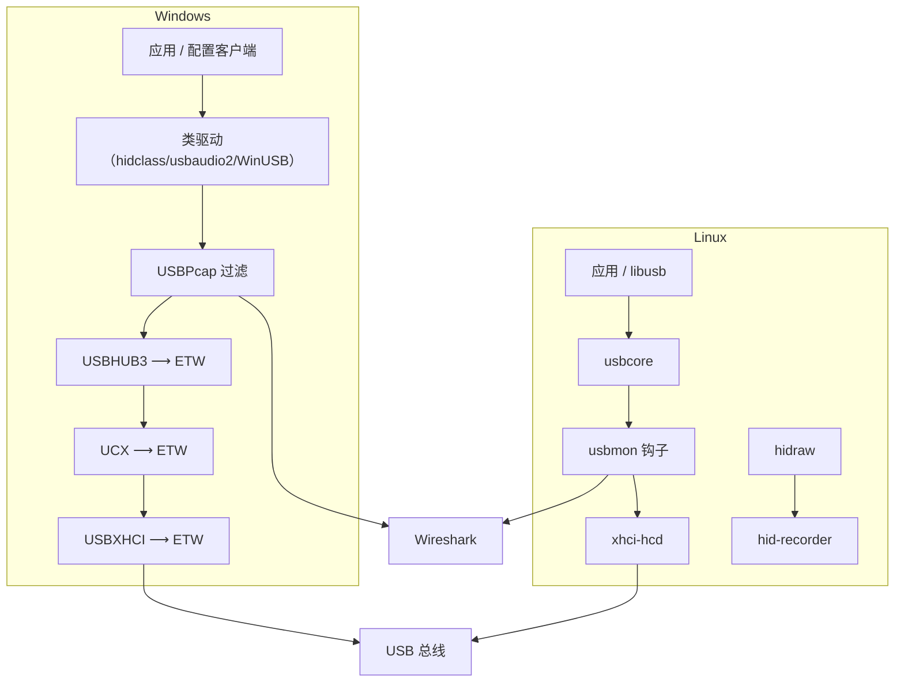

# 软件抓包工具实操：usbmon、USBPcap、ETW、Wireshark

> 🌿 知识树位置: 树干 → 枝干[调试测试与安全] → 分枝[工具与分析仪] → 叶[软件抓包]
> ⬆️ 父节点: [00-工具与分析仪索引.md](00-工具与分析仪索引.md) · 原理: [01-USB抓包原理与观测分层](01-USB抓包原理与观测分层.md) · 旧概览: [01-协议分析仪与抓包](../01-协议分析仪与抓包.md)

## 1. 原理

软件抓包都是在**主机 USB 栈的某一层挂钩子**，记录经过的 URB/IRP 及其完成状态。看到的是"软件请求了什么、硬件最后报告了什么"，看不到总线上的重试、NAK、SOF、Chirp 和电气事件（详见 [01 §1](01-USB抓包原理与观测分层.md)）。

| 工具 | 平台 | 挂钩位置 | 输出 |
|---|---|---|---|
| **usbmon** | Linux | USB core（HCD 层上方） | 文本（`/sys/kernel/debug/usb/usbmon/Nu`，已标注为不推荐）/ 二进制（字符设备，ABI 稳定）；Wireshark/tshark 接口 `usbmonN` |
| **USBPcap** | Windows 7/8/10 | 根集线器之上的过滤驱动 | pcap（LINKTYPE_USBPCAP 249），Wireshark extcap 或 USBPcapCMD |
| **USB ETW** | Windows 7 起 | USBXHCI / UCX / USBHUB3（及 USB 2.0 栈 USBPORT/USBHUB）事件提供程序 | `.etl`，WPA / Message Analyzer（已于 2019-11-25 退役）查看 |
| **XHC20 / XHC 接口** | macOS High Sierra 起 | 系统 USB 栈 | `sudo ifconfig XHC20 up` 后在 Wireshark 抓（LINKTYPE_USB_DARWIN 266）；Catalina 起据 Wireshark Wiki 需关闭 SIP |
| **Bus Hound**（Perisoft） | Windows | 设备栈过滤 | 自有界面，"Phase"列区分 CMD/IN/OUT 等阶段 |
| **hid-tools** | Linux | hidraw | `hid-recorder` 记录报告描述符与事件，`hid-replay` 经 UHID 回放 |
| USBlyzer | Windows | — | 官网已失效，第三方信息称末版 2.2（2016）；按停止维护对待（待核实） |

## 2. 架构图



## 3. 逐个实操

### 3.1 Linux usbmon

```bash
sudo modprobe usbmon
lsusb -t                                  # 找到设备所在总线号，例如 Bus 003
sudo tshark -i usbmon3 -w /tmp/dut.pcapng # 或在 Wireshark 选 usbmon3；usbmon0 = 所有总线
# 文本接口（快速看一眼）：
sudo cat /sys/kernel/debug/usb/usbmon/3u
```

文本行格式（内核文档 usbmon.rst）：`URB 标签 时间戳(µs) 事件(S/C/E) 地址字(如 Ci:3:005:0) 状态或 setup 字段 长度 数据`。地址字第一个字母表示类型与方向：C/Z/I/B = 控制/同步/中断/批量，i/o = IN/OUT。

**注意**：xHCI 的 SET_ADDRESS 由主控制器 Address Device 命令完成，usbmon 中看不到这条控制传输。

### 3.2 Windows USBPcap

```bat
:: 列出过滤控制设备（每个根集线器一个）
USBPcapCMD.exe
:: 捕获 USBPcap1 下的全部设备，写入文件
USBPcapCMD.exe -d \\.\USBPcap1 -A -o C:\cap\dut.pcap
```

源码中的长选项：`--device`、`--output`、`--snaplen`、`--bufferlen`、`--capture-from-all-devices`、`--capture-from-new-devices`、`--devices`、`--inject-descriptors`（向抓包补写已连接设备的描述符，方便 Wireshark 解码）。在 Wireshark 里直接选 USBPcap 接口最省事。

**看不到**：总线状态、PID、分裂事务、持续时间和速率；设备分配地址之前只看得到控制传输（见 Wireshark Wiki）。

### 3.3 Windows USB ETW（微软官方步骤）

```bat
logman create trace -n usbtrace -o %SystemRoot%\Tracing\usbtrace.etl -nb 128 640 -bs 128
logman update trace -n usbtrace -p Microsoft-Windows-USB-USBXHCI (Default,PartialDataBusTrace)
logman update trace -n usbtrace -p Microsoft-Windows-USB-UCX (Default,PartialDataBusTrace)
logman update trace -n usbtrace -p Microsoft-Windows-USB-USBHUB3 (Default,PartialDataBusTrace)
logman update trace -n usbtrace -p Microsoft-Windows-USB-USBPORT
logman update trace -n usbtrace -p Microsoft-Windows-USB-USBHUB
logman update trace -n usbtrace -p Microsoft-Windows-Kernel-IoTrace 0 2
logman start -n usbtrace
:: ……复现问题……
logman stop -n usbtrace
logman delete -n usbtrace
```

关键字含义：`Default`、`StateMachine`（集线器/端口状态机转移，定位"卡在哪一步"最有用）、`Power`、`IRP`、`HeadersBusTrace`/`PartialDataBusTrace`/`FullDataBusTrace`（后者每次最多 4 KB；同步传输数据从不记录）、`HWVerifyHost/Hub/Device`（硬件验证）。ETW 的独特价值：**能看到 Windows 判定失败的原因**（描述符校验失败、端口复位、链路状态变化），这是任何总线分析仪看不到的软件侧事实。

### 3.4 Wireshark 常用显示过滤器

| 目的 | 过滤器 |
|---|---|
| 只看某设备 | `usb.bus_id == 3 && usb.device_address == 5` |
| 只看控制传输 | `usb.transfer_type == 0x02` |
| 只看失败完成 | `usb.urb_status != 0`（Linux）/ `usb.usbd_status != 0`（Windows） |
| HID SET_REPORT | `usb.setup.bRequest == 9 && usb.bmRequestType == 0x21` |
| 描述符请求 | `usb.setup.bRequest == 6` |
| HID 报告数据 | `usbhid.data` |
| 同步帧状态异常 | `usb.iso.iso_status != 0` |

Wireshark 4.6 自带 usb、usbhid、usbms、usbaudio、usbvideo、usbccid、usbcom、usbdfu、usbhub、usbip、usbll（链路层，配 OpenVizsla/Cynthion 的 pcap）等解码器；**没有 USB-PD 解码器**。

### 3.5 hid-tools（Linux HID 专用）

```bash
pip install hid-tools            # 或从 gitlab.freedesktop.org/libevdev/hid-tools 安装
sudo hid-recorder /dev/hidraw3 > mouse.hid   # 记录报告描述符 + 每个输入报告
hid-decode mouse.hid                          # 人类可读的报告描述符
sudo hid-replay mouse.hid                     # 通过 /dev/uhid 回放成虚拟设备
```

这对"复现用户现场问题"非常实用：让用户录一份 `.hid` 文件，开发机上 `hid-replay` 就能得到一个行为完全相同的虚拟 HID 设备。

## 4. 适用场景

- 枚举/描述符/类请求错误、驱动返回错误码、应用层载荷格式——软件抓包足够。
- 与分析仪抓包对照，确认"软件发了，但总线上没出现/出现了多次"。
- 现场问题：让用户用 USBPcap 或 ETW 录制，开发远程分析。

## 5. 局限

- 看不到 NAK、重试、SOF、Chirp、LPM 令牌、链路层；时间戳是软件完成时间，含调度延迟（[01 §3](01-USB抓包原理与观测分层.md)）。
- USBPcap 会成为设备栈的一部分，极少数情况下改变时序；ETW `FullDataBusTrace` 数据量大，影响性能。
- macOS 新系统上抓包需要关闭 SIP，生产机上不现实。

## 6. 实战案例：同一个 SET_REPORT 失败，三种工具各看到什么

**现象**：配置客户端在 Windows 上写 Feature 报告偶发失败（HidD_SetFeature 返回 FALSE，GetLastError = ERROR_GEN_FAILURE 31）。

> 🧪 **示例抓包**（教学构造，字节与时间仅示意）

**USBPcap（Wireshark）**：

```text
No.  Time       Source  Dest   Info
812  4.102331   host    3.5.0  URB_CONTROL out  SET_REPORT Feature id=5 len=65
813  4.104987   3.5.0   host   URB_CONTROL out  [USBD_STATUS_STALL_PID 0xC0000004]
```

→ 结论 1：设备对这次控制传输回了 STALL。软件层面能确定是"设备拒绝"，但不知道是 SETUP 阶段还是数据/状态阶段。

**USB ETW（WPA 中的 USBXHCI 事件，名称示意）**：

```text
4.104951  USBXHCI  Transfer completion  Endpoint 0  CompletionCode=Stall Error
4.104960  UCX      URB completion       USBD_STATUS_STALL_PID
```

→ 结论 2：xHCI 从总线上收到了 STALL 握手，和驱动无关。

**Linux 下复现（usbmon 文本）**：

```text
ffff9a1c 1403551102 S Co:3:005:0 s 21 09 0305 0001 0041 65 = 05010203 ...
ffff9a1c 1403553760 C Co:3:005:0 -32 0
```

→ `-32` 即 `-EPIPE`（端点 STALL，见内核 error-codes.rst），且实际传输长度 0：数据阶段一个字节都没被接受——说明设备在**数据阶段第一个包**就 STALL 了。

**根因**：固件 Feature 报告 ID 5 的处理函数要求 `wLength == 64`（不含报告 ID 字节），客户端按 HID 规范发了 65 字节（报告 ID + 64 字节数据）。固件判断长度不符直接 STALL。
**修复**：固件按报告描述符计算长度时把报告 ID 字节计入（HID 1.11 §5.6：使用报告 ID 时数据首字节就是 ID）。
**验证**：usbmon 中该请求完成状态变为 `0` 且长度 65；Windows 下 HidD_SetFeature 1000 次循环无失败。

## 参考来源

- Linux 内核文档 usbmon <https://docs.kernel.org/usb/usbmon.html>；error-codes <https://docs.kernel.org/driver-api/usb/error-codes.html>
- USBPcap <https://desowin.org/usbpcap/>；USBPcapCMD 源码 <https://github.com/desowin/usbpcap/blob/master/USBPcapCMD/cmd.c>
- Microsoft Learn：USB 事件跟踪（ETW） <https://learn.microsoft.com/windows-hardware/drivers/usbcon/usb-event-tracing-for-windows>；Microsoft USB 博客 "USB 3.0 ETW Event Tracing"
- Wireshark Wiki CaptureSetup/USB <https://wiki.wireshark.org/CaptureSetup/USB>；显示过滤器字段参考 <https://www.wireshark.org/docs/dfref/u/usb.html>
- hid-tools <https://gitlab.freedesktop.org/libevdev/hid-tools>
- Bus Hound <https://perisoft.net/bushound/>
- HID 1.11 §5.6（Report ID）、§7.2（SET_REPORT）
