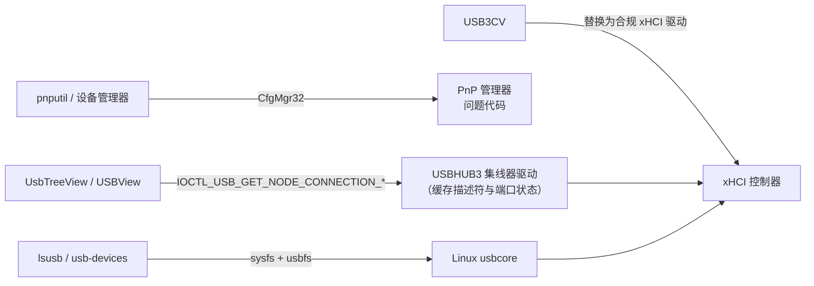

# 设备信息与枚举查看工具

> 🌿 知识树位置: 树干 → 枝干[调试测试与安全] → 分枝[工具与分析仪] → 叶[设备信息查看]
> ⬆️ 父节点: [00-工具与分析仪索引.md](00-工具与分析仪索引.md) · 概念: [枚举流程与标准请求](../../10-树干-USB核心/08-枚举流程与标准请求.md) · [描述符详解](../../10-树干-USB核心/07-描述符详解.md)

## 1. 原理

这类工具不抓包，而是**向主机栈查询当前状态**：已缓存的描述符、端口连接状态、协商速率、驱动与问题代码。Windows 上它们通过集线器驱动的 IOCTL（`IOCTL_USB_GET_NODE_CONNECTION_INFORMATION_EX`、`..._EX_V2`、`IOCTL_USB_GET_DESCRIPTOR_FROM_NODE_CONNECTION` 等，定义在 `usbioctl.h`）读取；Linux 上读 sysfs（`/sys/bus/usb/devices/`）和 usbfs/debugfs。

它是排障的**第一步**：在抓包前先确认"设备现在处于什么状态"。

| 工具 | 平台 | 能看到 | 备注 |
|---|---|---|---|
| **USBView** | Windows | 拓扑、描述符、连接状态、速率 | 随 Windows SDK 调试工具安装（`C:\Program Files (x86)\Windows Kits\10\Debuggers\x64`）；源码在 Windows-driver-samples；微软称其为"较旧"工具 |
| **USB Device Tree Viewer（UsbTreeView）** | Windows | USBView 的全部 + 设备管理器信息（子设备、盘符、COM 口）、更多描述符解码（含 Audio 2.0）、描述符十六进制、端口重启、Win8+ 扩展信息 | Uwe Sieber，基于 USBView 源码；2026-11 查阅时为 V4.8.0 |
| **pnputil / 设备管理器** | Windows | 问题代码（Code 10/28/43 等）、驱动包 | `pnputil /enum-devices /problem`（`/enum-devices` 自 Win10 1903 起提供） |
| **lsusb / usb-devices** | Linux | 拓扑（`lsusb -t` 含速率与驱动）、完整描述符（`lsusb -v`） | usbutils |
| **sysfs / udevadm** | Linux | 每个属性（`speed`、`bMaxPacketSize0`、`power/control`、`avoid_reset_quirk`） | `udevadm info -a /sys/bus/usb/devices/3-2` |
| **ioreg / system_profiler** | macOS | IOUSB 注册表树、速率、供电 | `ioreg -p IOUSB -l -w0`、`system_profiler SPUSBDataType` |
| **USB3CV** | Windows | USB-IF 官方 USB 3 集线器与设备框架（第 9 章）测试；附 xHCI 合规驱动 | 认证必过；需关闭 UAC；2026-11 页面版本 3.5.5.0 |

## 2. 架构图



## 3. 关键字段怎么读

- **ConnectionStatus**（`USB_CONNECTION_STATUS`）：`DeviceConnected`、`DeviceFailedEnumeration`、`DeviceGeneralFailure`、`DeviceCausedOvercurrent`、`DeviceNotEnoughPower`、`DeviceNotEnoughBandwidth`、`DeviceHubNestedTooDeeply` 等。`DeviceFailedEnumeration` 说明描述符阶段就失败了（看 [13-案例](13-案例-Windows代码43与描述符请求失败.md)）。
- **Speed / V2 Flags**：`USB_NODE_CONNECTION_INFORMATION_EX_V2` 的 `DeviceIsOperatingAtSuperSpeedOrHigher` 与 `DeviceIsSuperSpeedCapableOrHigher`（Win8 起）。"支持 SS 但运行在 HS"是线缆/端口/链路训练问题的直接信号。
- **Linux `speed`**：sysfs 中的 `1.5 / 12 / 480 / 5000 / 10000 / 20000`（单位 Mbps）。
- **问题代码**：Code 43 = `CM_PROB_FAILED_POST_START`（驱动报告设备故障）；Code 10 = `CM_PROB_FAILED_START`。

## 4. 适用场景

- 枚举失败后快速判断：到了哪一步（有没有拿到设备描述符、有没有地址）。
- 验证描述符改动：改完固件，UsbTreeView 的十六进制与解码对照一遍（尤其 UAC2、HID 报告描述符长度、BOS）。
- 认证前自测：USB3CV 跑第 9 章测试。

## 5. 局限

- 只能看**主机缓存的**结果，看不到失败过程；枚举失败的设备往往描述符字段为空。
- USB3CV 会替换主机控制器驱动，测试期间该控制器上的其他设备不可用；建议在专用测试机上用。
- 不同 OS 的缓存与重试策略不同：Windows 在后台重试失败的请求（UsbTreeView 也会），结果可能与第一次失败时不一致。

## 6. 实战案例：USB 3 采集卡只跑在 480 Mbps

> 🧪 **示例输出**（教学构造）

**Windows · UsbTreeView 端口信息片段**

```text
ConnectionStatus         : 0x01 (Device is connected)
Port Chain               : 2-4
Speed                    : 0x02 (High-Speed)
Device Speed             : Super-Speed capable
DeviceIsOperatingAtSuperSpeedOrHigher : no
DeviceIsSuperSpeedCapableOrHigher     : yes
bcdUSB                   : 0x0320
```

**Linux · 同一设备**

```text
$ lsusb -t
/:  Bus 003.Port 001: Dev 001, Class=root_hub, Driver=xhci_hcd/4p, 480M
    |__ Port 002: Dev 004, If 0, Class=Video, Driver=uvcvideo, 480M
$ dmesg | tail -3
usb 3-2: new high-speed USB device number 4 using xhci_hcd
usb 3-2: New USB device found, idVendor=1209, idProduct=0001, bcdDevice= 1.00
```

**分析**：设备 `bcdUSB=0x0320` 且声明支持 SS，但两个系统都只在 USB 2.0 根集线器（480M 总线）下看到它——SS 信号对上根本没有建立链路（SS 端口和 USB 2.0 端口在 xHCI 中是两套逻辑端口）。可能原因按概率：USB 2.0-only 线缆或 Type-C 线翻转后 SS 对不通；接口焊接/SS 对断线；设备 SS PHY 在 Rx.Detect 阶段没检测到远端终端。
**下一步工具**：换已知良好的 SS 线；仍失败则上 SS 分析仪看 Rx.Detect / Polling.LFPS（[14-案例](14-案例-USB3链路训练与Recovery循环.md)）。
**验证**：`lsusb -t` 中设备出现在 `5000M` 总线下；UsbTreeView `DeviceIsOperatingAtSuperSpeedOrHigher: yes`。

## 参考来源

- Microsoft Learn：USBView <https://learn.microsoft.com/windows-hardware/drivers/debugger/usbview>；源码 <https://github.com/microsoft/Windows-driver-samples/tree/main/usb/usbview>
- Microsoft Learn：`USB_NODE_CONNECTION_INFORMATION_EX_V2` <https://learn.microsoft.com/windows-hardware/drivers/ddi/usbioctl/ns-usbioctl-_usb_node_connection_information_ex_v2>；`USB_CONNECTION_STATUS` <https://learn.microsoft.com/windows-hardware/drivers/ddi/usbioctl/ne-usbioctl-_usb_connection_status>
- Microsoft Learn：设备管理器错误代码 <https://learn.microsoft.com/windows-hardware/drivers/install/device-manager-error-messages>；PnPUtil 命令 <https://learn.microsoft.com/windows-hardware/drivers/devtest/pnputil-command-syntax>
- Uwe Sieber, USB Device Tree Viewer <https://www.uwe-sieber.de/usbtreeview_e.html>
- USB-IF USB3CV <https://www.usb.org/document-library/usb3cv>
- usbutils <https://github.com/gregkh/usbutils>；Linux sysfs ABI `Documentation/ABI/testing/sysfs-bus-usb`
