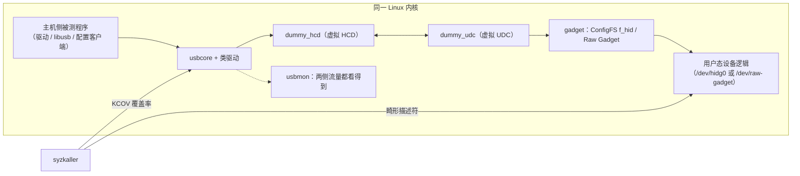

# 测试、仿真与虚拟化工具

> 🌿 知识树位置: 树干 → 枝干[调试测试与安全] → 分枝[工具与分析仪] → 叶[仿真与虚拟化]
> ⬆️ 父节点: [00-工具与分析仪索引.md](00-工具与分析仪索引.md) · 背景: [tech-doc 06 Linux 虚拟 USB](../../tech-doc/06-linux-virtual-usb.md) · [USB 安全与 BadUSB](../04-USB安全与BadUSB.md)

## 1. 原理

"仿真"工具让你**在没有对端硬件的情况下**，造出一个主机能看到的 USB 设备，或造出一个设备能看到的主机。按实现层次分：

| 层次 | 工具 | 做法 |
|---|---|---|
| 内核内回环 | Linux **dummy_hcd** | 一个虚拟主机控制器 + 一个虚拟设备控制器（UDC）在同一内核里背靠背相连，无需任何硬件 |
| 设备功能实现 | **ConfigFS gadget**（libcomposite，如 f_hid、f_uac2、f_ncm）、**GadgetFS**、**Raw Gadget** | 在 UDC 之上实现设备；Raw Gadget 把**每个**请求交给用户态，可返回任意（包括畸形）数据，内核文档明确它"仅用于调试，不应用于生产" |
| 主机侧模拟器 | Windows **UDE**（USB Device Emulation，UdeCx） | KMDF 客户端驱动模拟主机控制器与挂在上面的设备，Windows USB 栈把它当真设备枚举 |
| 网络转发 | **USB/IP** | 把 URB 封装进 TCP，远端主机看到的是一个"插在本机"的设备 |
| 虚拟机 | **QEMU** USB 设备 | 所有 QEMU USB 设备支持 `pcap=<文件>` 属性，输出 usbmon 兼容的 pcap |
| 外部硬件 | **Facedancer**（Cynthion、GreatFET One 等） | 真实 USB 线上的可编程设备，见 [04](04-开源与低成本分析工具.md) |
| 合规压力测试 | Microsoft **MUTT** 系列 | MUTT（FX2，HS/FS）、MUTT Pack（集线器 + FX2）、SuperMUTT（FX3，SS 含 bulk streams，无 LS）、SuperMUTT Pack、DR MUTT、Type-C ConnEx；配 MuttUtil 与 HLK 测试 |
| 模糊测试 | **syzkaller** USB fuzzing | Raw Gadget + dummy_hcd + KCOV（内核 5.7+），对主机驱动做覆盖率引导的模糊测试 |

## 2. 架构图



## 3. 适用场景

- **虚拟 USB 研究**：在 dummy_hcd 上用 Raw Gadget 实现任意设备，观察 Linux 主机栈每一步的反应（配 usbmon）。
- **配置客户端 / 上位机的 CI 测试**：用 f_hid 造一个与产品同描述符的虚拟 HID 设备，跑自动化测试，不占实物样机。
- **Windows 驱动测试**：UDE 在 Windows 上虚拟设备；MUTT 做压力与 HLK 测试。
- **安全**：syzkaller / Facedancer 对主机驱动做模糊测试（见 [04-USB安全与BadUSB](../04-USB安全与BadUSB.md)）。

## 4. 局限

- dummy_hcd 不模拟电气和时序：没有 NAK 时间、没有带宽竞争，**回报率/抖动类问题无法在这里复现**。
- UDC 驱动可能自己处理部分标准请求（Raw Gadget 文档提醒），看不到这些请求。
- USB/IP 增加网络延迟，同步传输（音频/视频）基本不可用。
- QEMU 透传（usb-host）看到的是 QEMU 视角，和物理总线时序不同。

## 5. 实战案例：用 dummy_hcd + f_hid 造一个虚拟鼠标，测试主机侧报告解析

目标：在 CI 里验证主机侧程序（如 hidraw 读取工具或游戏输入层）对"带符号 X/Y 位移"的解析，无需实物鼠标。

**步骤**（root；内核需 `CONFIG_USB_DUMMY_HCD`、`CONFIG_USB_CONFIGFS_F_HID`）

```bash
modprobe libcomposite
modprobe dummy_hcd
cd /sys/kernel/config/usb_gadget && mkdir g1 && cd g1
echo 0x1209 > idVendor            # pid.codes 测试 VID
echo 0x0001 > idProduct
mkdir strings/0x409 && echo "vmouse" > strings/0x409/product
mkdir configs/c.1
mkdir functions/hid.usb0
echo 1 > functions/hid.usb0/subclass        # Boot Interface
echo 2 > functions/hid.usb0/protocol        # Mouse
echo 3 > functions/hid.usb0/report_length
# HID 1.11 附录 B.2 引导鼠标报告描述符（50 字节）
printf '\x05\x01\x09\x02\xa1\x01\x09\x01\xa1\x00\x05\x09\x19\x01\x29\x03\x15\x00\x25\x01\x95\x03\x75\x01\x81\x02\x95\x01\x75\x05\x81\x01\x05\x01\x09\x30\x09\x31\x15\x81\x25\x7f\x75\x08\x95\x02\x81\x06\xc0\xc0' \
  > functions/hid.usb0/report_desc
ln -s functions/hid.usb0 configs/c.1/
ls /sys/class/udc                            # 例如 dummy_udc.0
echo dummy_udc.0 > UDC
# 发送：无按键，X=+10，Y=-1
printf '\x00\x0a\xff' > /dev/hidg0
```

> 🧪 **示例输出**（教学构造）

```text
$ dmesg | tail -2
usb 5-1: new high-speed USB device number 2 using dummy_hcd
input: vmouse as /devices/platform/dummy_hcd.0/usb5/5-1/5-1:1.0/0003:1209:0001.0004/input/input21
$ sudo cat /sys/kernel/debug/usb/usbmon/5u | grep Ii
ffff8f21 2210038190 S Ii:5:002:1 -115:1 3 <
ffff8f21 2210051244 C Ii:5:002:1 0:1 3 = 000aff
```

**分析**：usbmon 的 `Ii:5:002:1` 表示中断 IN、总线 5、地址 2、端点 1；完成状态 0、长度 3、数据 `00 0a ff`。若被测程序把 `0xff` 解成 +255 而不是 −1，就是把逻辑最小值 `15 81`（−127）忽略了、没做符号扩展的 bug。
**修复**：主机侧按报告描述符的 Logical Minimum 判断有符号性并做符号扩展。
**验证**：CI 脚本循环写入 −127…+127 的 X 值，比对被测程序输出；拆除 gadget：`echo "" > UDC` 后删除目录。

## 参考来源

- Linux 内核文档：Raw Gadget <https://docs.kernel.org/usb/raw-gadget.html>；ConfigFS gadget <https://docs.kernel.org/usb/gadget_configfs.html>；f_hid ABI `Documentation/ABI/testing/configfs-usb-gadget-hid`；HID gadget <https://docs.kernel.org/usb/gadget_hid.html>；USB/IP 协议 <https://docs.kernel.org/usb/usbip_protocol.html>
- syzkaller：External USB fuzzing for Linux kernel <https://github.com/google/syzkaller/blob/master/docs/linux/external_fuzzing_usb.md>
- Microsoft Learn：UDE 概述 <https://learn.microsoft.com/windows-hardware/drivers/usbcon/developing-windows-drivers-for-emulated-usb-host-controllers-and-devices>；编写 UDE 客户端驱动 <https://learn.microsoft.com/windows-hardware/drivers/usbcon/writing-a-ude-client-driver>
- Microsoft Learn：MUTT 设备 <https://learn.microsoft.com/windows-hardware/drivers/usbcon/microsoft-usb-test-tool--mutt--devices>
- QEMU 文档：USB emulation（`pcap=` 属性）<https://www.qemu.org/docs/master/system/devices/usb.html>
- HID 1.11 附录 B.2（Boot Mouse 报告描述符）；pid.codes 测试 PID <https://pid.codes/1209/0001/>
