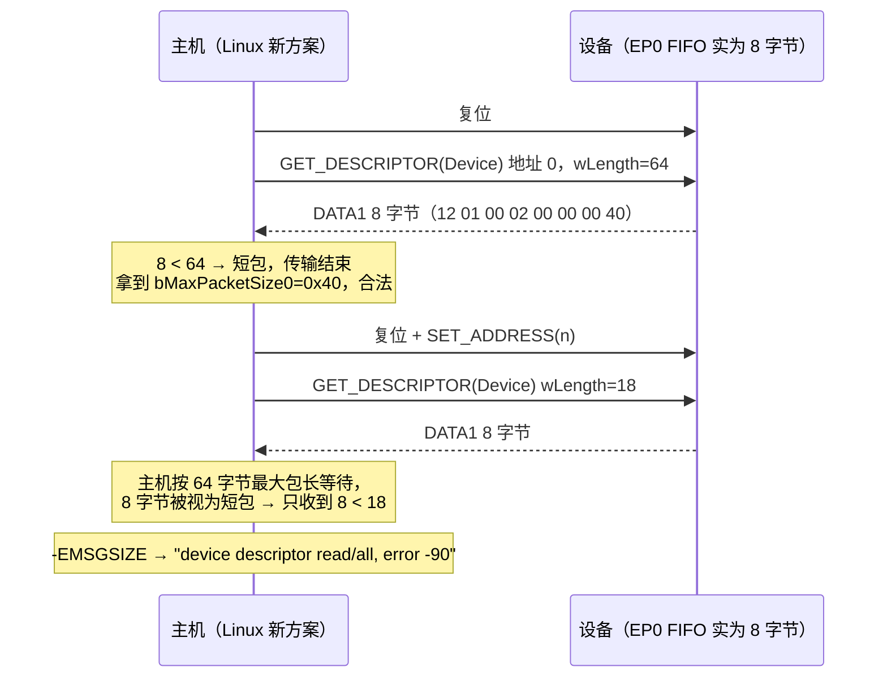

# 案例：枚举失败与 bMaxPacketSize0 不一致

> 🌿 知识树位置: 树干 → 枝干[调试测试与安全] → 分枝[工具与分析仪] → 叶[案例 10]
> ⬆️ 父节点: [00-工具与分析仪索引.md](00-工具与分析仪索引.md) · 概念: [枚举流程与标准请求](../../10-树干-USB核心/08-枚举流程与标准请求.md) · [描述符详解](../../10-树干-USB核心/07-描述符详解.md) · 手册: [枚举失败排查手册](../02-枚举失败排查手册.md)

## 1. 原理

主机在知道端点 0 最大包长之前，必须先"猜"一个值去读设备描述符：

- **Windows**（微软 USB 博客 "How does USB stack enumerate a device?"）：在地址 0 发第一个 GET_DESCRIPTOR(Device)，长度 64（低速设备 8）；只要回来至少 8 字节就忽略错误，从第 8 字节取 `bMaxPacketSize0`；之后 SET_ADDRESS，再读完整 18 字节并校验 `bLength ≥ 18`、`bDescriptorType == 1`；任何一步失败最多重试 3 次，否则报 Unknown Device。
- **Linux**（`drivers/usb/core/hub.c`）：新方案（`use_new_scheme`）同样先发 64 字节读（`GET_DESCRIPTOR_BUFSIZE 64`），`get_bMaxPacketSize0()` 只接受 8/16/32/64（以及 SS 的 9），且 `bDescriptorType` 必须为 1；FS/HS 若与初始猜测不同就改用描述符的值（HS 打印 `Using ep0 maxpacket: %d`），值非法则 `Invalid ep0 maxpacket: %d`；之后 `usb_get_device_descriptor()` 读 18 字节，**不足 18 字节返回 `-EMSGSIZE`**，打印 `device descriptor read/all, error %d`。

关键点：**主机按 `bMaxPacketSize0` 判断数据阶段是否结束**——收到短于最大包长的包（短包）即认为传输结束。

## 2. 架构图



## 3. 适用场景

- 新 MCU 移植 USB 协议栈、换 USB IP、换端点 FIFO 分配之后"完全不枚举"。
- 同一固件在一台主机好、另一台坏（主机第一次读取长度与重试策略不同）。

## 4. 局限

- 软件抓包（usbmon/USBPcap）只能看到"返回了 8 字节"，看不到设备实际发了几个包；需要协议分析仪确认**线上的每个 DATA 包长度**。
- 本案例只覆盖"描述符值与硬件不一致"；地址阶段失败（`device not accepting address`）通常是电气或复位后时序问题，见 [11](11-案例-高速握手失败回落全速.md) 与 [19](19-案例-线缆信号完整性与CRC错误.md)。

## 5. 实战案例

### 5.1 现象

FS 自定义 HID 设备，新板子换了 MCU 型号后插 Linux 不识别。

> 🧪 **示例日志**（教学构造）

```text
usb 1-3: new full-speed USB device number 7 using xhci_hcd
usb 1-3: device descriptor read/all, error -90
usb 1-3: new full-speed USB device number 8 using xhci_hcd
usb 1-3: device descriptor read/all, error -90
usb usb1-port3: unable to enumerate USB device
```

Windows：设备管理器出现"未知 USB 设备"，硬件 ID `USB\UNKNOWN`，设备 ID `USB\VID_0000&PID_0000`（微软案例研究所述的枚举失败表现）。

### 5.2 工具与理由

- 先用 **usbmon** 看主机实际请求了什么、收到多少字节（零成本）。
- 再用 **USB 2.0 协议分析仪**（Beagle USB 480 / Ellisys EX200 / Mercury T2，FS 设备用 Beagle USB 12 也行）确认线上包长——这是唯一能证明"设备发的是短包"的手段。

### 5.3 抓包设置

- usbmon：`sudo modprobe usbmon && sudo cat /sys/kernel/debug/usb/usbmon/1u`。注意 xHCI 下 SET_ADDRESS 由控制器的 Address Device 命令完成，usbmon 不显示。
- 分析仪：串在主机与设备之间，打开 SOF 过滤（FS 每 1 ms 一个 SOF），不过滤 NAK；触发条件 = 第一个 SETUP。

### 5.4 标注抓包

> 🧪 **示例**（usbmon 文本，教学构造）

```text
S Ci:1:000:0 s 80 06 0100 0000 0040 64 <     ← 地址 0，读设备描述符 64 字节
C Ci:1:000:0 0 8 = 12010002 00000040         ← 只回 8 字节：bMaxPacketSize0 = 0x40
S Ci:1:007:0 s 80 06 0100 0000 0012 18 <     ← SET_ADDRESS 后读 18 字节（SET_ADDRESS 本身不可见）
C Ci:1:007:0 0 8 = 12010002 00000040         ← 依然只有 8 字节 → -EMSGSIZE
```

> 🧪 **示例**（分析仪事务视图，教学构造）

```text
#   Time         Addr EP  Transaction
14  0.103 210 s  7    0   SETUP  80 06 00 01 00 00 12 00     ACK
15  0.103 236 s  7    0   IN  → DATA1  8 B  12 01 00 02 00 00 00 40   ACK
16  0.103 260 s  7    0   OUT → DATA1  0 B (状态阶段)            ACK
                              ▲ 设备只发了 1 个 8 字节包就停了
```

**解读**：设备描述符声明 EP0 最大包长 64，但每个 DATA 包只有 8 字节。在主机看来第一个 8 字节包就是短包，于是立即进入状态阶段——数据阶段永远只有 8 字节。

### 5.5 根因

新 MCU 的 USB 外设 EP0 缓冲大小寄存器默认 8 字节，移植时没改；协议栈的设备描述符模板仍写 `bMaxPacketSize0 = 64`。

### 5.6 修复

二选一，使两者一致：

1. 把 EP0 硬件缓冲配置为 64 字节（FS 推荐 64，可减少控制传输包数）；或
2. 把描述符改为 `bMaxPacketSize0 = 8`。

### 5.7 验证

- Linux：`dmesg` 出现 `New USB device found, idVendor=...`；`cat /sys/bus/usb/devices/1-3/bMaxPacketSize0` 为 64。
- 分析仪：GET_DESCRIPTOR(Device, 18) 的数据阶段为 1 个 18 字节包（< 64，短包正常结束）。
- 读配置描述符：`wTotalLength` 大于 64 的配置描述符应以多个 64 字节包 + 一个短包完成；若刚好是 64 的整数倍，看设备是否在需要时发零长度包。
- Windows：UsbTreeView 中 `bMaxPacketSize0: 0x40`，设备不再是 `USB\UNKNOWN`。

## 参考来源

- USB 2.0 规范 §5.5.3（控制传输数据阶段与短包）、§9.6.1（设备描述符 bMaxPacketSize0 只能为 8/16/32/64）
- Linux `drivers/usb/core/hub.c`（`get_bMaxPacketSize0`、`hub_port_init`、`GET_DESCRIPTOR_BUFSIZE`）；`drivers/usb/core/message.c`（`usb_get_device_descriptor` 返回 `-EMSGSIZE`）<https://github.com/torvalds/linux/tree/master/drivers/usb/core>
- Microsoft USB Blog：How does USB stack enumerate a device? <https://techcommunity.microsoft.com/blog/microsoftusbblog/how-does-usb-stack-enumerate-a-device/270685>
- Microsoft Learn：Case Study – Troubleshooting an Unknown USB Device <https://learn.microsoft.com/windows-hardware/drivers/usbcon/case-study--troubleshooting-an-unknown-usb-device-by-using-etw-and-netmon>
- Linux 内核文档 usbmon <https://docs.kernel.org/usb/usbmon.html>
