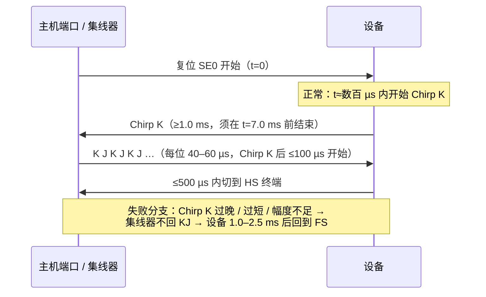

# 案例：高速握手（Chirp）失败回落全速

> 🌿 知识树位置: 树干 → 枝干[调试测试与安全] → 分枝[工具与分析仪] → 叶[案例 11]
> ⬆️ 父节点: [00-工具与分析仪索引.md](00-工具与分析仪索引.md) · 概念: [物理层与电气特性](../../10-树干-USB核心/03-物理层与电气特性.md) · [集线器与连接管理](../../10-树干-USB核心/09-集线器与连接管理.md) · 时序: [时序参数全表](../../90-附录/03-时序参数全表.md)

## 1. 原理

HS 设备总是先以 FS 身份连接（D+ 上拉），在**总线复位期间**通过 Chirp 握手升级到 HS（USB 2.0 §7.1.7.5）：

| 步骤 | 规范要求 |
|---|---|
| 设备检测到复位（SE0）后发 Chirp K | Chirp K 持续 **TUCH ≥ 1.0 ms**，且必须在复位开始后 **TUCHEND = 7.0 ms** 内结束 |
| 集线器检测 Chirp K | 至少 TFILT = 2.5 µs 才算有效；Chirp K 结束后 **TWTDCH ≤ 100 µs** 内开始交替 K-J |
| 集线器 K-J 序列 | 每个 Chirp 位 TDCHBIT = 40–60 µs |
| 设备确认 | 检测到至少 K-J-K-J-K-J 后，在 **TWTHS ≤ 500 µs** 内断开 D+ 上拉、接入 HS 终端 |
| 失败回退 | 设备 Chirp K 结束后若在 **TWTFS = 1.0–2.5 ms** 内没看到有效 K-J，则回到 FS 默认态 |
| 集线器侧 | 附录 C.1 下行端口状态机：计时器 T0 超过 TUCHEND 仍未检测到上行 Chirp，端口进入等待态，复位（TDRST）结束后进入**全速**使能态 |

只有能看到**总线状态与毫秒/微秒级持续时间**的工具才能判断哪一步失败：USB 2.0 硬件分析仪（Beagle USB 480 产品页写明支持 Chirp 检测；Ellisys EX200 测量 High Speed Handshake 等总线状态）或示波器。软件抓包只能看到结果：设备以 FS 枚举。

## 2. 架构图



## 3. 适用场景

- HS 设备偶发或固定以 FS 枚举（吞吐下降到 12 Mbps 级、8 kHz 鼠标退化为 1 kHz 上限）。
- 同一设备在某些主机/集线器/扩展坞上才回落。
- 冷启动回落、热插拔正常（典型的上电时序问题）。

## 4. 局限

- Chirp 是 USB 2.0 HS 特有；SS 链路问题见 [14](14-案例-USB3链路训练与Recovery循环.md)。
- 协议分析仪告诉你"Chirp 时序错了"，但幅度不足、终端阻抗不对等电气根因要用示波器（D9010USBC 等合规软件、或至少差分探头）确认。
- 分析仪自身的探头/直通也会给链路加负载；遇到"插上分析仪问题消失"，换示波器高阻探头复核。

## 5. 实战案例

### 5.1 现象

HS 游戏鼠标，冷启动（主机开机时已插着）约 30% 概率以 FS 工作；拔插后总是 HS。

> 🧪 **示例日志**（教学构造）

```text
[    2.913] usb 1-4: new full-speed USB device number 3 using xhci_hcd     ← 冷启动
[  514.220] usb 1-4: new high-speed USB device number 5 using xhci_hcd     ← 拔插后
```

### 5.2 工具与理由

**Beagle USB 480**（或 EX200/Mercury T2）：需要看复位期间的总线状态序列和持续时间；它的 4 路数字输入还能同时记录固件 GPIO，把"固件何时处理复位"放到同一时间轴上。

### 5.3 抓包设置

- 分析仪串接；**不要**过滤总线事件（Reset/Chirp/Suspend 都要保留）。
- 固件在 USB 复位中断入口拉高 GPIO-A，PHY 时钟稳定后拉高 GPIO-B，接分析仪数字输入 0/1。
- 主机断电 → 上电冷启动，开始捕获；重复 20 次，保存每次 trace。

### 5.4 标注抓包

> 🧪 **示例**（总线事件视图，教学构造；时间相对复位开始）

```text
Time        Event                      Duration    注释
0.000 ms    Reset (SE0)                  —
0.012 ms    DIN0 ↑ (复位中断入口)          —          固件 12 µs 后进入 ISR，正常
5.910 ms    DIN1 ↑ (PHY 时钟稳定)          —          ← PHY PLL 锁定用了近 6 ms
6.050 ms    Chirp K (device)            1.420 ms    结束于 7.470 ms > TUCHEND 7.0 ms ✗
            (no hub K-J chirps)                      集线器 T0 已过 TUCHEND，进入等待态，不回应
9.630 ms    D+ pull-up → FS idle J         —          设备在 TWTFS 窗口后回落 FS
… Reset 结束后 FS 枚举 …
```

对照拔插（正常）的一次：

```text
0.000 ms    Reset (SE0)
0.011 ms    DIN0 ↑
0.140 ms    DIN1 ↑                                   PHY 时钟本来就在跑
0.260 ms    Chirp K (device)            1.050 ms    结束于 1.310 ms ✓
1.352 ms    Chirp K-J ×N (hub)            每位 ~48 µs   TWTDCH ≈ 42 µs ✓
1.690 ms    Device → HS 终端                          ✓
```

### 5.5 根因

冷启动时固件为了省电把 PHY 放在低功耗模式，复位 ISR 里才去唤醒 PHY 并等待 PLL 锁定，导致 Chirp K 起始太晚，结束时间越过 TUCHEND（7.0 ms）。拔插时 PHY 已在运行，没有这段延迟。

### 5.6 修复

- 上电初始化阶段就让 PHY 时钟运行并锁定，再使能 D+ 上拉（连接）；
- 复位 ISR 中不做任何阻塞等待，Chirp 由 USB 控制器硬件自动完成的芯片，确认其自动 Chirp 功能已使能。

### 5.7 验证

- 分析仪：冷启动 50 次，统计 Chirp K 结束时间（全部 < 7.0 ms，留 ≥2 ms 余量）、集线器 K-J 出现、设备切 HS。
- 系统：`dmesg` 每次都是 `high-speed`；Windows 下 UsbTreeView `Speed: High-Speed`。
- 再在 2–3 种主机端口 / 集线器 / 扩展坞上重复。

## 参考来源

- USB 2.0 规范 §7.1.7.5（Reset Signaling、Chirp 时序 TUCH/TUCHEND/TFILT/TWTDCH/TDCHBIT/TWTHS/TWTFS），表 7-13 集线器事件时序、表 7-14 设备事件时序；附录 C.1 下行端口复位状态机（T0 超过 TUCHEND 的处理）
- Total Phase Beagle USB 480 产品页（Chirp K/J 检测、数字 I/O）<https://www.totalphase.com/products/beagle-usb480/>
- Ellisys USB Explorer 200 Technical Data（总线状态测量：Reset、Suspend、High Speed Handshake）<https://www.ellisys.com/products/usbex200/technical.php>
- Linux `drivers/usb/core/hub.c`（`new %s%s USB device number %d using %s` 速率打印）
