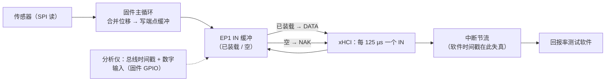

# 案例：8000 Hz 鼠标回报率不足与抖动

> 🌿 知识树位置: 树干 → 枝干[调试测试与安全] → 分枝[工具与分析仪] → 叶[案例 12]
> ⬆️ 父节点: [00-工具与分析仪索引.md](00-工具与分析仪索引.md) · 概念: [四种传输类型](../../10-树干-USB核心/06-四种传输类型.md) · [总线带宽与调度计算](../../10-树干-USB核心/13-总线带宽与调度计算.md) · [HID 鼠标详解](../../20-枝干-设备类协议/HID-人机接口设备/06-鼠标详解.md)

## 1. 原理

- **轮询周期**：HS 中断端点的周期 = 2^(bInterval−1) × 125 µs（USB 2.0 §9.6.6，bInterval 取 1–16）。8 kHz 需要 HS + `bInterval = 1`；FS 中断端点最小 1 ms，上限 1 kHz。常见配置错误：把 FS 的"1 ms"思路搬到 HS 描述符，写成 `bInterval = 4`，HS 下就是 2^3 × 125 µs = 1 ms（只有 1 kHz）。
- **主机每微帧发一个 IN 令牌**，设备有数据就回 DATA，没数据回 NAK（中断端点 NAK 不是错误，主机下一个周期再问）。**回报率 = 每秒 DATA 次数，不是 IN 次数**。
- **抖动的两种来源**：设备侧（某些微帧没准备好数据 → NAK → 间隔从 125 µs 变成 250 µs）；主机侧（xHCI 中断节流、软件调度把多个完成事件合并上报）。前者在总线上可见，后者只在软件时间戳里出现。Linux xHCI 驱动默认中断节流间隔 `imod_interval = 40000` ns（`xhci-pci.c`），软件看到的完成时间天然有这个量级的聚集。

## 2. 架构图



## 3. 适用场景

- 4 kHz / 8 kHz 产品的回报率验收、固件优化。
- 用户反馈"某主机上回报率不稳"——需要区分是设备侧 NAK 还是主机侧调度。

## 4. 局限

- 本案例的结论依赖**硬件时间戳**；只用回报率测试软件或 usbmon 时间戳，无法区分设备与主机原因。
- 分析仪只看得到总线；固件内部耗时要靠 GPIO 打点（Beagle USB 480 的数字输入、或逻辑分析仪同步）。

## 5. 实战案例

### 5.1 现象

HS 鼠标标称 8000 Hz，回报率测试软件显示 6,900–7,800 Hz 跳动；快速甩动时更低。

### 5.2 工具与理由

- **Beagle USB 480**：16.67 ns 时间戳精确测每个微帧的 IN/DATA/NAK；4 路数字输入把固件"传感器读开始/结束、端点装载"打点到同一时间轴。
- **usbmon / ETW** 作对照：证明软件侧的数据不能作为抖动结论。

### 5.3 抓包设置

1. 分析仪串接，**打开 SOF 过滤，关闭 NAK 过滤**（这里 NAK 正是要统计的对象）。
2. 固件：SPI 读开始拉高 DIN0、结束拉低；写端点缓冲时 DIN1 打一个脉冲。
3. 机械臂/手持匀速甩动 3 s，捕获。
4. 导出 CSV（Data Center：File → Export），用脚本统计 EP1 IN 事务结果。

### 5.4 标注抓包

先确认描述符（🧪 示例，`lsusb -v` 片段，教学构造）：

```text
      bEndpointAddress     0x81  EP 1 IN
      bmAttributes            3  Transfer Type Interrupt
      wMaxPacketSize     0x0008  1x 8 bytes
      bInterval               1              ← HS 下 125 µs，配置正确
```

> 🧪 **示例**（分析仪事务视图，教学构造）

```text
Time (µs)    Addr EP  Result       DIN0(SPI)  DIN1(load)   注释
1000.000     5    1   DATA0 8B ACK   ‾‾|__       ·
1125.000     5    1   DATA1 8B ACK   _|‾‾|_      ↑ 1118.3
1250.000     5    1   NAK            ‾‾‾‾‾‾                ← SPI 读还没完成
1375.000     5    1   DATA0 8B ACK   _|          ↑ 1268.9   ← 位移累积了 2 个周期
1500.000     5    1   DATA1 8B ACK   ...
```

> 🧪 **示例**（3 s 统计，教学构造）

```text
EP1 IN tokens     : 24,000   (8000/s，主机侧轮询正常)
DATA              : 21,706   (7,235/s)
NAK               :  2,294
NAK 与 SPI 读持续时间 > 118 µs 的微帧重合率 : 98.9 %
SPI 读持续时间    : 中位 61 µs，P99 143 µs（传感器在高速运动时多读一个寄存器块）
```

对照 usbmon：同一时段完成时间间隔直方图在 0–40 µs 与 ~250 µs 两处聚集——这是中断节流与合并上报造成的，不能据此计算抖动。

### 5.5 根因

固件采用"读传感器 → 组包 → 装载端点"的串行流程，高速运动时 SPI 读取超过一个微帧（125 µs），端点在主机 IN 到来时为空，只能回 NAK。主机侧轮询完全正常（每秒 8000 个 IN）。

### 5.6 修复

- **双缓冲 / 预装载**：SOF（微帧起始）中断里把"上一次已完成读取的累积位移"装进端点，传感器读取在后台 DMA 进行，不再与 IN 时机串行；
- 位移在固件中累加，NAK 期间不丢数据（本例已正确累加，所以只是回报率下降，没有丢位移）；
- 检查传感器 SPI 时钟与突发读长度，把 P99 读时间压到 < 100 µs。

### 5.7 验证

- 分析仪重测：3 s 内 DATA ≥ 23,950（≥ 99.8 %），NAK 仅出现在静止时（无新数据时固件可选择 NAK）；相邻 DATA 间隔分布集中在 125 µs。
- 主机侧：回报率软件读数稳定在 7,9xx–8,000；在 2 台不同 xHCI 主机上复测。

## 参考来源

- USB 2.0 规范 §5.7（中断传输）、§9.6.6（端点描述符 bInterval，HS 周期 2^(bInterval−1) × 125 µs）、§8.4.5（握手包 NAK）
- HID 1.11 §5.6（报告）、附录 B.2（引导鼠标）
- Linux `drivers/usb/host/xhci-pci.c`（`imod_interval = 40000`）、`xhci.c`（`xhci_set_interrupter_moderation`）<https://github.com/torvalds/linux/tree/master/drivers/usb/host>
- Total Phase Beagle USB 480 产品页（16.67 ns 时间分辨率、数字 I/O）<https://www.totalphase.com/products/beagle-usb480/>；Data Center CSV 导出说明（见 [02](02-商用USB协议分析仪详解.md) 参考来源）
