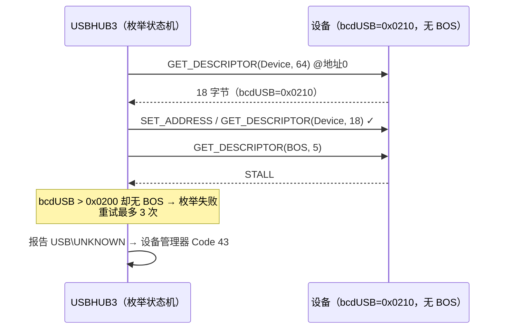

# 案例：Windows 代码 43 与 BOS 描述符请求失败

> 🌿 知识树位置: 树干 → 枝干[调试测试与安全] → 分枝[工具与分析仪] → 叶[案例 13]
> ⬆️ 父节点: [00-工具与分析仪索引.md](00-工具与分析仪索引.md) · 概念: [描述符详解](../../10-树干-USB核心/07-描述符详解.md) · [Windows USB 驱动开发](../../60-枝干-主机侧与实现/08-WindowsUSB驱动开发.md) · 手册: [枚举失败排查手册](../02-枚举失败排查手册.md)

## 1. 原理

- **Code 43** = `CM_PROB_FAILED_POST_START`（驱动报告设备故障）。微软案例研究：枚举失败时集线器驱动仍向 PnP 报告一个设备，设备 ID 为 `USB\VID_0000&PID_0000`，硬件 ID 与兼容 ID 为 `USB\UNKNOWN`；导致 Unknown Device 的事件包括 Set Address 失败、设备描述符请求失败、设备描述符校验失败、配置描述符请求失败、配置描述符校验失败；Windows 7 中这类设备显示 Code 43。（Code 28 表示枚举成功但找不到驱动。）
- **BOS**：设备描述符 `bcdUSB > 0x0200`（如 0x0201、0x0210）表示设备支持 BOS 描述符（USB 2.0 LPM ECN 引入）。微软 USB 博客说明：Windows 8.1 起（EHCI 上）以及 Windows 8/8.1 的 xHCI 栈，会对 `bcdUSB > 0x0200` 的设备请求 BOS；设备不支持（STALL 或返回错误）就以 Code 43 失败。博客给出的规避方法：在 `HKLM\SYSTEM\CurrentControlSet\Control\UsbFlags\vvvvpppprrrr` 下新建 DWORD `SkipBOSDescriptorQuery = 1`（vvvv/pppp/rrrr 为 VID/PID/bcdDevice 的十六进制）——**这是给已出货设备的补救，新设备应修描述符**。
- **ETW 是这类问题的首选工具**：它记录的是 Windows 集线器驱动**为什么**放弃，这是总线分析仪看不到的。

## 2. 架构图



## 3. 适用场景

- 设备在 Windows 上 Code 43、在 Linux/macOS 正常。
- 固件为了 LPM 或 WebUSB/MS OS 2.0（都依赖 BOS 平台能力）改了 bcdUSB 之后出问题。
- 一般化：任何"Windows 判定描述符非法"的问题，方法相同。

## 4. 局限

- 博客描述的是 Windows 8/8.1 行为，后续版本的具体判定以实测和 ETW 为准；本案例不推断 Windows 10/11 的内部实现。
- `SkipBOSDescriptorQuery` 只影响本机，且会让依赖 BOS 的功能（LPM、MS OS 2.0）失效。

## 5. 实战案例

### 5.1 现象

FS/HS 键盘新固件加入 MS OS 2.0 描述符支持的准备代码，`bcdUSB` 改成 0x0210，但 BOS 处理函数还没合入。Windows 11 测试机上显示"未知 USB 设备"，Code 43；Linux 正常工作：`hub_port_init()` 对 `bcdUSB ≥ 0x0201` 的设备调用 `usb_get_bos_descriptor()`，失败只打印 `unable to get BOS descriptor or descriptor too short`（notice 级），不阻止枚举（`drivers/usb/core/hub.c`、`config.c`）。

### 5.2 工具与理由

1. **USB ETW**（USBHUB3 StateMachine + Default 关键字）：看集线器驱动在哪一步、因为什么失败；
2. **USB 2.0 协议分析仪**：确认设备对 BOS 请求的实际回应（STALL 还是超时、还是返回了错误长度）；
3. **UsbTreeView**：查看 ConnectionStatus 与缓存的设备描述符。

### 5.3 抓包设置

- ETW：按 [06 §3.3](06-软件抓包工具实操.md) 的 logman 步骤开始会话，**先开始抓再插设备**（微软案例研究的做法），设备变成 Unknown 后停止；用 WPA 打开 `.etl`，按端口路径（Port path）筛选。
- 分析仪：触发条件 = SETUP 包 `80 06 00 0F`（GET_DESCRIPTOR，描述符类型 0x0F = BOS）。

### 5.4 标注抓包

> 🧪 **示例**（分析仪，教学构造）

```text
#   Addr EP  Transaction
21  4    0   SETUP 80 06 00 0F 00 00 05 00   ACK    ← GET_DESCRIPTOR(BOS), wLength=5
22  4    0   IN  → STALL                             ← 设备不认识描述符类型 0x0F
… 复位，重新枚举，重复 3 次 …
```

> 🧪 **示例**（ETW / WPA，事件名为示意）

```text
USBHUB3  Device  PortPath 0.0.0.0.0.4  GetBosDescriptor   status=STALL
USBHUB3  Device  PortPath 0.0.0.0.0.4  Enumeration failure: BOS descriptor query failed
USBHUB3  Device  PortPath 0.0.0.0.0.4  Reporting device as unknown (USB\UNKNOWN)
```

> 🧪 **示例**（UsbTreeView，教学构造）

```text
ConnectionStatus : 0x02 (DeviceFailedEnumeration)
bcdUSB           : 0x0210
Problem Code     : 43 (CM_PROB_FAILED_POST_START)
```

### 5.5 根因

`bcdUSB = 0x0210` 宣称支持 BOS，但固件对 GET_DESCRIPTOR(BOS) 回 STALL。Windows 把它当成描述符请求失败。

### 5.6 修复

二选一：

1. 恢复 `bcdUSB = 0x0200`（暂不需要 BOS 功能时）；
2. 实现 BOS：至少包含 BOS 头（5 字节：bLength=5, bDescriptorType=0x0F, wTotalLength, bNumDeviceCaps）+ USB 2.0 Extension 能力描述符（7 字节：bLength=7, 0x10, bDevCapabilityType=0x02, bmAttributes 中 bit1=LPM），以及计划中的 MS OS 2.0 平台能力描述符；`wTotalLength` 必须等于实际总长度，且两阶段读取（先 5 字节、再 wTotalLength）都要正确响应。

### 5.7 验证

- 分析仪：GET_DESCRIPTOR(BOS, 5) 返回 5 字节，随后 GET_DESCRIPTOR(BOS, wTotalLength) 返回完整内容。
- UsbTreeView：BOS 部分正确解码（USB 2.0 Extension、LPM 支持位）。
- ETW：无枚举失败事件；设备管理器无 Code 43。
- 回归：在 Windows 10/11、Linux、macOS 各插拔 20 次。

## 参考来源

- Microsoft USB Blog：Why does my USB device work on Windows 8.0 but fail on Windows 8.1 with code 43? <https://techcommunity.microsoft.com/blog/microsoftusbblog/why-does-my-usb-device-work-on-windows-8-0-but-fail-on-windows-8-1-with-code-43/270819>
- Microsoft Learn：Case Study – Troubleshooting an Unknown USB Device（ETW 抓取步骤、USB\UNKNOWN、Code 43/28）<https://learn.microsoft.com/windows-hardware/drivers/usbcon/case-study--troubleshooting-an-unknown-usb-device-by-using-etw-and-netmon>
- Microsoft Learn：设备管理器错误消息（Code 43）<https://learn.microsoft.com/windows-hardware/drivers/install/device-manager-error-messages>
- USB 2.0 LPM ECN（BOS、USB 2.0 Extension 描述符）；USB 3.2 规范 §9.6.2（BOS 描述符结构）
- Microsoft OS 2.0 Descriptors Specification <https://learn.microsoft.com/windows-hardware/drivers/usbcon/microsoft-os-2-0-descriptors-specification>
