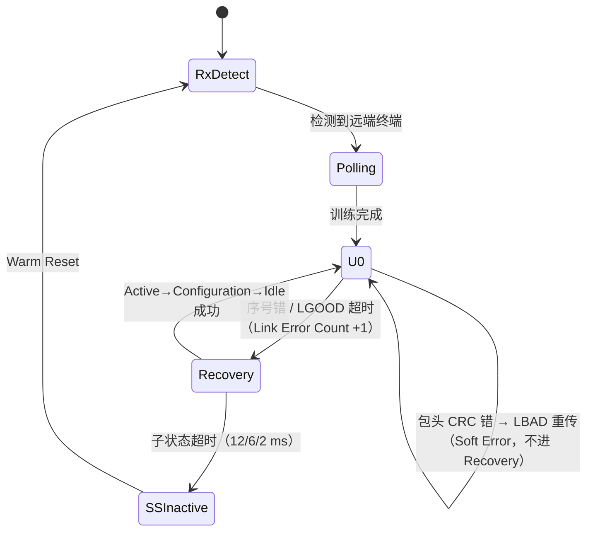

# 案例：USB 3 链路 Recovery 循环与回落 USB 2.0

> 🌿 知识树位置: 树干 → 枝干[调试测试与安全] → 分枝[工具与分析仪] → 叶[案例 14]
> ⬆️ 父节点: [00-工具与分析仪索引.md](00-工具与分析仪索引.md) · 概念: [USB3x 包格式与 LTSSM](../../40-枝干-高速演进/04-USB3x包格式与LTSSM.md) · [USB3x 规范级：包格式与定时器](../../40-枝干-高速演进/06-USB3x规范级-包格式与定时器.md)

## 1. 原理

SuperSpeed 链路由 LTSSM（链路训练与状态状态机）管理。与本案例相关的规范要点（USB 3.2 Rev 1.1）：

- **错误分类（表 7-11）**：包头 CRC 错误通过包头重传（LBAD → 重发）恢复，计入 Soft Error Count，**不进入 Recovery**；而包头序号错误、PENDING_HP_TIMER 超时未收到 LGOOD_n 等则让链路**进入 Recovery**，计入 Link Error Count。
- **Link Error Count（§7.3.3.1）**：每次"因错误从 U0 进入 Recovery"加 1；SS+ 端口最多计到 65,535 并饱和；PowerOn/Hot/Warm Reset 清零。主机侧在 xHCI 的 **PORTLI** 寄存器（xHCI 1.2 §5.4.10.1，bit 15:0）读取；外置集线器的端口用类请求 **GET_PORT_ERR_COUNT**（USB 3.2 §10.16.2.5）读取。
- **LTSSM 超时（表 7-12）**：tRecoveryActiveTimeout 12 ms、tRecoveryConfigurationTimeout 6 ms、tRecoveryIdleTimeout 2 ms；Recovery 子状态超时进入 **eSS.Inactive**，需要 Warm Reset 恢复。tPollingLFPSTimeout 360 ms、tPollingActiveTimeout 12 ms（x1）。
- Linux 集线器驱动多次复位仍无法使能端口时打印 `Cannot enable. Maybe the USB cable is bad?`（`hub.c`）。

## 2. 架构图



## 3. 适用场景

- USB 3 设备在大流量时断开再连接、或最终只以 USB 2.0 工作。
- 只在某些线缆/延长线/扩展坞上出现。
- 吞吐量远低于预期但不报错（频繁 Recovery 吃掉带宽）。

## 4. 局限

- 软件只能看到最终结果（断开、重新枚举、速率）和 Link Error Count；**看不到 LTSSM 状态序列与有序集**，必须用 SS 分析仪。
- SS 分析仪（双向重定时设计）本身会改变信道：插上分析仪后问题消失或加重都可能，要用示波器（D9020USBC 等合规方案）在不插分析仪的情况下复核眼图与 LFPS。
- 本库不覆盖 SS 物理层均衡参数的具体数值，以 PHY 芯片手册为准。

## 5. 实战案例

### 5.1 现象

USB 3.2 Gen 1 采集卡，用 2 m 线 + 1 m 延长线时，高码率采集约 5 分钟后中断，设备重新出现在 USB 2.0 下。

> 🧪 **示例日志**（教学构造）

```text
usb 4-2: USB disconnect, device number 3
usb usb4-port2: Cannot enable. Maybe the USB cable is bad?
usb 3-2: new high-speed USB device number 9 using xhci_hcd
```

### 5.2 工具与理由

- **SS 协议分析仪**（Beagle USB 5000 v2 有 LTSSM 图形视图；或 LeCroy Advisor T3，可按有序集触发、实时丢弃 SKP/空闲）：看 Recovery 的触发原因和子状态超时。
- **PORTLI / GET_PORT_ERR_COUNT**：零成本先量化 Link Error Count 的增长速度。
- **示波器 + 合规夹具**：确认信道插损/眼图（最终根因证据）。

### 5.3 抓包设置

1. 先读计数：每 10 s 读一次 PORTLI（或经外置集线器发 GET_PORT_ERR_COUNT：SETUP `A3 0D 00 00 <端口号> 00 02 00`，请求码 13 见规范表 10-8），记录增长曲线。
2. 分析仪串在设备与延长线之间；捕获过滤：丢弃 SKP、空闲符号；**保留**所有 LTSSM 转换、TS1/TS2、LFPS、链路命令（LGOOD/LBAD/LRTY）。
3. 触发：LTSSM 进入 Recovery 的第 N 次（例如 N=100），或进入 eSS.Inactive。

### 5.4 标注抓包

> 🧪 **示例**（Link Error Count 曲线，教学构造）

```text
t(s)   LinkErrCnt
0        0
60      41
120    118
240    502
290    -- 端口断开 --
```

> 🧪 **示例**（LTSSM 视图，教学构造，时间为相对值）

```text
Time          Dir  Event
0.000 000     ↓    HP Seq=12  (DPH+DPP 1024B)
0.000 000     ↑    LBAD                          ← 设备收到的包头 CRC 错：重传，不计 Link Error
0.000 001     ↓    LRTY + HP Seq=12              ← 重传成功
…
4.212 330     ↓    HP Seq=7
4.212 333     —    (PENDING_HP_TIMER 超时，无 LGOOD_7)
4.212 334     ↑↓   U0 → Recovery                 ← Link Error Count +1
4.212 336     ↑↓   Recovery.Active   TS1 ×N
4.212 351     ↑↓   Recovery.Configuration TS2 ×N
4.212 358     ↑↓   Recovery.Idle → U0             ← 一次正常 Recovery，约 24 µs
…
290.104 220   ↑↓   U0 → Recovery
290.104 222   ↑↓   Recovery.Active  （设备 TS1 识别失败）
290.116 222   ↑↓   tRecoveryActiveTimeout 12 ms → eSS.Inactive   ✗
290.180 000   ↓    Warm Reset (LFPS)
290.540 ...   ↑↓   Polling.LFPS 超时 360 ms → 端口放弃 SS
```

**解读**：前 290 s 是"错误 → Recovery → 成功恢复"的累积（每次约几十 µs，吞吐被蚕食）；最后一次 Recovery 中设备连 TS1 都无法可靠识别，子状态超时进入 eSS.Inactive，Warm Reset 后训练也失败，主机最终只在 USB 2.0 端口上看到设备。

### 5.5 根因

总信道（2 m 线 + 1 m 无源延长线 + 两个连接器）插损超出 Gen 1 预算，设备端接收在高温（设备温升 5 分钟后）下误码率上升；去掉延长线后问题消失。示波器在设备接收端测得眼图张开度不足（数值以合规软件报告为准）。

### 5.6 修复

- 产品侧：在说明书与包装中限定线缆长度，不支持无源延长线；
- 硬件侧（若需支持长线）：调整设备 PHY 的接收均衡/发送去加重参数（按 PHY 手册），或加转接驱动器（redriver）；
- 固件/驱动侧：大量 Recovery 时应能平滑处理，不要把短暂 Recovery 当作致命错误。

### 5.7 验证

- 标准线（≤ 2 m）高温环境下 8 小时满码率采集：Link Error Count 增长 < 规定阈值（团队自定，例如每小时 < 10），无 eSS.Inactive；
- 示波器合规测试（Rx 抖动容限、Tx 眼图）通过；
- 分析仪复测：无 Recovery.Active 超时事件。

## 参考来源

- USB 3.2 Revision 1.1 规范：§7.3.3.1 Link Error Count、表 7-11（错误类型与恢复方式）、表 7-12（LTSSM 状态转换超时）、§10.16.2.5 Get Port Error Count（bmRequestType 10100011B，wLength 2）、表 10-8（GET_PORT_ERR_COUNT = 13）
- xHCI 1.2 规范 §5.4.10.1 USB3 Protocol PORTLI（Link Error Count bit 15:0）
- Linux `drivers/usb/core/hub.c`（`Cannot enable. Maybe the USB cable is bad?`、warm reset 逻辑）
- Total Phase Beagle USB 5000 v2 <https://www.totalphase.com/products/beagle-usb5000-v2-ultimate/>；Teledyne LeCroy Advisor T3 手册规格（见 [02](02-商用USB协议分析仪详解.md)）
- Keysight D9020USBC USB 3.2 合规测试软件（见 [03](03-PD与Type-C分析仪及电气测试仪器.md)）
