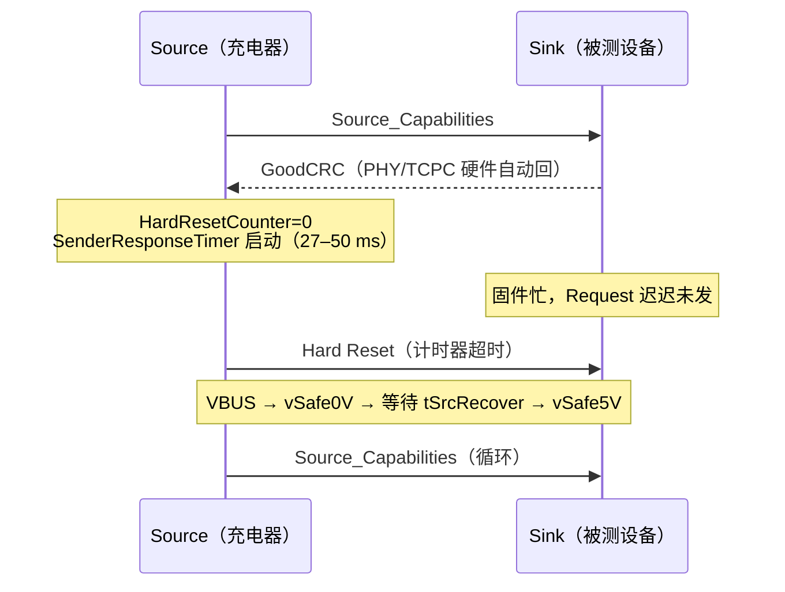

# 案例：PD 契约协商失败与 Hard Reset 循环

> 🌿 知识树位置: 树干 → 枝干[调试测试与安全] → 分枝[工具与分析仪] → 叶[案例 15]
> ⬆️ 父节点: [00-工具与分析仪索引.md](00-工具与分析仪索引.md) · 概念: [USB PD 协议](../../30-枝干-接口与供电/04-USBPD协议.md) · [PD 深入：状态机与消息](../../30-枝干-接口与供电/07-USBPD深入-状态机与消息全表.md) · 时序: [时序参数全表](../../90-附录/03-时序参数全表.md)

## 1. 原理

USB PD R3.3 V1.0（2026-10）中与本案例直接相关的条款：

| 条款 | 内容 |
|---|---|
| 表 7.10 tReceiverResponse | 接收方对需要回应的消息，**≤ 15 ms** 内开始发回应 |
| 表 7.10 tSenderResponse | 发送方等待回应的计时器 **27–50 ms**（给 15 ms 要求留余量） |
| §9.2.3.3 PE_SRC_Send_Capabilities | 收到 Source_Capabilities 的 GoodCRC 后：停 NoResponseTimer、**HardResetCounter 与 CapsCounter 清零**、启动 SenderResponseTimer；Sink 须在 tSenderResponse 内发 Request；**SenderResponseTimer 超时 → PE_SRC_Hard_Reset**（回到 USB 默认工作） |
| §9.2.3.3 续 | 仅当 NoResponseTimer 超时且 HardResetCounter > nHardResetCount（=2）时，才转 Discovery/Disabled（从未 PD 连接）或 ErrorRecovery（曾经 PD 连接） |
| §4.4 Hard Reset 电源响应 | Hard Reset 后 tPSHardReset（25–35 ms，表 7.10）开始降压，tSafe0V（≤ 650 ms，表 4.9）内降到 vSafe0V，等待 tSrcRecover（SPR 0.66–1.0 s，表 4.7），再在 tSrcTurnOn（≤ 275 ms，表 4.7）内恢复 vSafe5V |

**推论**：Sink 若"能回 GoodCRC、但 Request 发得太晚"，每次 Source_Capabilities 的 GoodCRC 都会把 HardResetCounter 清零——Source 会**无限循环** Hard Reset，表现为 VBUS 周期性掉电。

## 2. 架构图



## 3. 适用场景

- 设备插 PD 充电器后反复"断电—上电"，或拿不到高于 5 V 的电压。
- 同一设备在某些充电器上正常、某些不正常（各家 Source 的 tSenderResponse 取值不同，落在 27–50 ms 范围内）。

## 4. 局限

- CC 线 BMC 信号软件抓不到；必须用 PD 分析仪（Ellisys Type-C Tracker、Mercury T2C/T2P、Twinkie）或 TCPC 寄存器日志。
- 分析仪看到"Request 晚"，但"为什么晚"要靠固件打点（GPIO 或日志时间戳）。

## 5. 实战案例

### 5.1 现象

自研 USB-C 外设（PD Sink，MCU + 独立 TCPC，经 I²C 通信）在 A 品牌 65 W 充电器上每隔约 1.2 s 断电重启一次，在 B 品牌上正常。

### 5.2 工具与理由

- **PD 分析仪 + VBUS 测量**（Mercury T2P 的 Power Tracker 或 Type-C Tracker 的 VBUS 测量）：同一时间轴上看 PD 报文与 VBUS 掉电。
- 固件 GPIO：Source_Capabilities 中断进入、Request 写入 TCPC 两个点。

### 5.3 抓包设置

分析仪串在充电器与设备之间；捕获 SOP 报文（本例不涉及线缆 SOP′）；打开 VBUS 记录；触发条件 = Hard Reset。

### 5.4 标注抓包

> 🧪 **示例**（PD 分析仪，A 品牌充电器，教学构造；时间相对 Source_Capabilities 结束）

```text
Time(ms)    SOP  Dir      Message                         VBUS     注释
   0.00     SOP  SRC→SNK  Source_Capabilities (4 PDO)     5.04 V
   0.31     SOP  SNK→SRC  GoodCRC (MsgID 0)               5.04 V   TCPC 自动回，HardResetCounter 清零
  30.05     —    SRC→SNK  Hard Reset                      5.04 V   ← SenderResponseTimer 超时（此 Source 约 30 ms）
  62.4      —    —        VBUS 开始下降                   4.6 V    tPSHardReset 后
 180        —    —        VBUS < 0.8 V                             vSafe0V
 960        —    —        VBUS 恢复                       5.02 V   tSrcRecover 后
1150        SOP  SRC→SNK  Source_Capabilities             5.03 V   下一轮
```

> 🧪 **示例**（固件 GPIO，同一时间轴）

```text
   0.45 ms  GPIO_A ↑  进入 TCPC ALERT 处理（读取 Source_Capabilities）
  37.80 ms  GPIO_B ↑  Request 写入 TCPC TX 缓冲  ← 已在 Hard Reset 之后，作废
```

B 品牌充电器对照：它的 SenderResponseTimer 约 45 ms，Request 在 37.8 ms 发出——**刚好过关**，所以"看起来正常"，但同样违反 tReceiverResponse ≤ 15 ms。

### 5.5 根因

固件在 TCPC ALERT 处理中同步读完整个接收缓冲后，在同一主循环里执行了一次 Flash 写（保存上次协商结果），阻塞约 35 ms，Request 实际发出时间远超 tReceiverResponse。

### 5.6 修复

- PD 消息处理放在最高优先级任务里，Request 的构建不依赖任何阻塞操作；Flash 写挪到 PS_RDY 之后的空闲时段；
- 验收标准：GoodCRC 结束到 Request 开始 **≤ 15 ms**（不要以"某充电器能用"为准）。

### 5.7 验证

- 分析仪统计 200 次插拔：Request 延迟最大值 < 10 ms，无 Hard Reset；
- 在 3 个以上不同品牌 Source（包括 tSenderResponse 接近 27 ms 下限的）上复测；
- 加测 Soft_Reset、PR_Swap 等其他需要回应的消息，确认都满足 tReceiverResponse。

## 参考来源

- USB Power Delivery Specification R3.3 V1.0（2026-10-16）：表 7.10（tReceiverResponse、tSenderResponse、tPSHardReset 等）、表 7.12（nHardResetCount = 2）、§4.4（Response to Hard Resets）与表 4.7/4.9（tSrcRecover、tSrcTurnOn、tSafe0V）、§7.32.3（HardResetCounter）、§9.2.3.3（PE_SRC_Send_Capabilities）、§9.2.3.9（PE_SRC_Hard_Reset）
- Teledyne LeCroy Mercury T2C/T2P 产品页与数据手册；Ellisys Type-C Tracker Technical Data（见 [03](03-PD与Type-C分析仪及电气测试仪器.md)）
- 注：本库 [30-枝干/07](../../30-枝干-接口与供电/07-USBPD深入-状态机与消息全表.md) 、[08 消息全表](../../30-枝干-接口与供电/08-USBPD消息全表.md) 与 [90-附录/02 速查表](../../90-附录/02-速查表大全.md) 的 tSenderResponse 已按 R3.3 统一为 27–50 ms（旧版曾写 24~30 ms；[90-附录/03](../../90-附录/03-时序参数全表.md) 已是新值）
