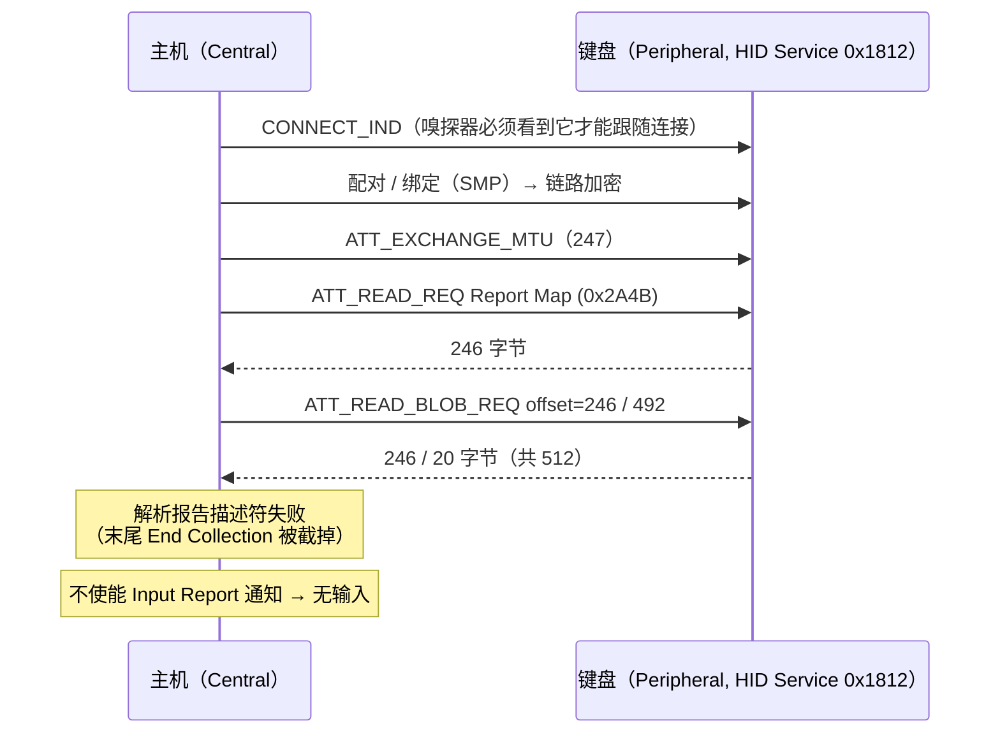

# 案例：BLE HOGP 键盘已配对但无输入（Report Map 超长）

> 🌿 知识树位置: 树干 → 枝干[调试测试与安全] → 分枝[工具与分析仪] → 叶[案例 16]
> ⬆️ 父节点: [00-工具与分析仪索引.md](00-工具与分析仪索引.md) · 概念: [HOGP](../../50-枝干-无线关联/BLE-低功耗蓝牙/07-HOGP-HIDoverGATT.md) · [ATT 与 GATT](../../50-枝干-无线关联/BLE-低功耗蓝牙/04-ATT与GATT.md) · [SMP 安全与配对](../../50-枝干-无线关联/BLE-低功耗蓝牙/06-SMP安全与配对.md) · [HID 跨传输](../../20-枝干-设备类协议/HID-人机接口设备/10-HID跨传输I2C与BLE.md)

## 1. 原理

- **HOGP v1.1 §7 安全要求**：HID 设备必须处于可绑定（Bondable）模式；HID Service 的特性**读、写、通知都要求加密链路**；主机必须执行绑定；重连后主机应尽早加密。
- **HID Service 1.1 §2.6.1**：Report Map 特性（UUID 0x2A4B）用 GATT 读特性值或读长特性值子过程读取，**长度上限 512 字节**；这与蓝牙核心规范 ATT 的属性值上限一致（Core 6.0 Vol 3 Part F §3.2.9："The maximum length of an attribute value shall be 512 octets"）。
- **读长特性值**：先 ATT_READ_REQ，返回最多 ATT_MTU−1 字节；不足则继续 ATT_READ_BLOB_REQ（带偏移）直到返回短于 ATT_MTU−1 的响应。
- 主机拿到 Report Map 后按 HID 报告描述符解析；Linux 的 `hid-core.c` 在集合不平衡时报 `unbalanced collection at end of report description`，解析失败则不会生成输入设备。

**工具分工**：主机侧 HCI 日志（Linux `btmon`）看到的是**已解密**的 ATT；空口嗅探（nRF Sniffer、Ellisys Bluetooth Tracker）看时序、信道、重传，但加密后需要密钥才能解出内容。

## 2. 架构图



## 3. 适用场景

- BLE HID 设备"已连接/已配对"但不能输入；或部分功能（多媒体键、厂商配置通道）不工作。
- 从 USB HID 移植报告描述符到 HOGP 时（USB 无 512 字节限制，wDescriptorLength 是 16 位）。

## 4. 局限

- nRF Sniffer 一次只跟随一个连接，必须抓到 CONNECT_IND；链路加密后要提供密钥（如 LE Secure Connections 的 LTK）才能解出 ATT 内容。Ellisys Bluetooth Tracker 宽带并发捕获 40 个信道，不用"跟随"，但同样需要密钥解密。
- Windows/macOS 的 HCI 日志获取方式各不相同，本页只给 Linux 的 btmon 做法。

## 5. 实战案例

### 5.1 现象

双模键盘新固件给 HOGP 加入了与 USB 版一致的厂商配置报告（64 字节 Feature 报告 ×2），Report Map 从 380 字节增至 540 字节。升级后：Windows/Linux 都显示已连接，但完全无法输入；USB 有线模式正常。

### 5.2 工具与理由

1. **Linux btmon**（主机侧 HCI 日志）：看已解密的 GATT 过程，确认 Report Map 实际读到的长度；
2. **nRF Sniffer**（nRF52840 Dongle）：确认空口没有异常断连、确认加密建立时间；
3. **hid-decode**（hid-tools）：把读到的字节当报告描述符解析，确认损坏位置。

### 5.3 抓包设置

```bash
sudo btmon -w hogp.btsnoop            # 先开始记录
bluetoothctl                          # remove <addr> 后重新 pair/connect，复现完整流程
# 嗅探：Wireshark 选 nRF Sniffer 接口，在广播阶段选定目标设备，再让主机发起连接
```

### 5.4 标注抓包

> 🧪 **示例**（btmon，教学构造，字段格式简化）

```text
< ACL  ATT: Exchange MTU Request (0x02)   Client RX MTU: 247
> ACL  ATT: Exchange MTU Response (0x03)  Server RX MTU: 247
< ACL  ATT: Read Request (0x0a)           Handle: 0x001c          ← Report Map 0x2A4B
> ACL  ATT: Read Response (0x0b)          len 246
< ACL  ATT: Read Blob Request (0x0c)      Handle: 0x001c  Offset: 246
> ACL  ATT: Read Blob Response (0x0d)     len 246
< ACL  ATT: Read Blob Request (0x0c)      Handle: 0x001c  Offset: 492
> ACL  ATT: Read Blob Response (0x0d)     len 20                  ← 总计 512，短响应 → 读结束
```

```text
$ dmesg | tail -2
hid-generic 0005:1209:0001.0007: unbalanced collection at end of report description
hid-generic 0005:1209:0001.0007: probe with driver hid-generic failed with error -22
```

（第二行为示意，具体错误文本以内核版本为准。）

> 🧪 **示例**（nRF Sniffer，教学构造）

```text
No.  Time      Info
 41  0.000000  CONNECT_IND
 57  0.211     LL_ENC_REQ / LL_ENC_RSP / LL_START_ENC_REQ    → 之后 ATT 为加密 PDU（未提供 LTK 时不可解）
...  无 LL_TERMINATE_IND，连接一直保持                         → 空口正常，问题在内容
```

### 5.5 根因

Report Map 540 字节超过 HID Service / ATT 的 512 字节上限；协议栈注册属性时按 512 截断（未报错），最后 28 字节（含第二个厂商 Feature 报告和末尾的 End Collection `C0`）丢失。主机解析失败，不使能 Input Report 通知，键盘无输入。

### 5.6 修复

- 压缩 Report Map：厂商配置报告改为 1 个，或用更紧凑的 Item 编码（合并相同 Report Size/Count 的主项、去掉重复的 Usage Page）；
- 或把厂商配置通道移出 HID Service，改用自定义 GATT 服务（不受 HID Report Map 限制）；
- 构建期加检查：Report Map 长度 > 512 直接编译失败。

### 5.7 验证

- btmon：Report Map 读取总长度 = 描述符实际长度（< 512）；随后主机写各 Input Report 的 CCCD（0x2902）为 `01 00`，出现 Handle Value Notification；
- `hid-decode` 解析无错误；Linux 生成输入设备，Windows/macOS 输入正常；
- 断开重连：主机尽早加密（HOGP §7），首个按键不丢。

## 参考来源

- Bluetooth SIG：HID over GATT Profile v1.1（2025-08-05）§7 Security requirements；HID Service v1.1 §2.6 / §2.6.1（Report Map ≤ 512 octets）
- Bluetooth Core Specification 6.0 Vol 3 Part F §3.2.9（属性值最大 512 octets）、§3.4.4（Read / Read Blob）
- Linux `drivers/hid/hid-core.c`（`unbalanced collection at end of report description`）<https://github.com/torvalds/linux/blob/master/drivers/hid/hid-core.c>
- BlueZ btmon <https://github.com/bluez/bluez>；hid-tools <https://gitlab.freedesktop.org/libevdev/hid-tools>
- Nordic nRF Sniffer for Bluetooth LE <https://www.nordicsemi.com/Products/Development-tools/nRF-Sniffer-for-Bluetooth-LE>；Ellisys Bluetooth Tracker <https://www.ellisys.com/products/btr1/technical.php>
