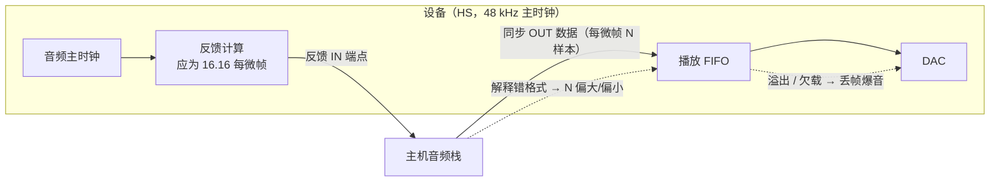

# 案例：UAC2 异步播放周期性爆音（反馈格式错误）

> 🌿 知识树位置: 树干 → 枝干[调试测试与安全] → 分枝[工具与分析仪] → 叶[案例 17]
> ⬆️ 父节点: [00-工具与分析仪索引.md](00-工具与分析仪索引.md) · 概念: [UAC 概述](../../20-枝干-设备类协议/Audio-UAC/00-UAC概述.md) · [UAC2 与 UAC3](../../20-枝干-设备类协议/Audio-UAC/02-UAC2与UAC3.md) · [四种传输类型](../../10-树干-USB核心/06-四种传输类型.md)

## 1. 原理

- **异步（Asynchronous）OUT 端点**：设备时钟是主时钟，主机按设备通过**反馈端点**报告的速率 Ff 发送样本（USB 2.0 §5.12.4.2）。
- **反馈格式由总线速度决定**（USB 2.0 §5.12.4.2 原文）：
  - **FS**：Ff 以"每帧样本数"表示，10.10 格式左对齐放入 3 字节，即 **10.14**；
  - **HS**：Ff 以"每微帧样本数"表示，12.13 格式放入 4 字节、小数点在第 2/3 字节之间，即 **16.16**（最高 4 位为 0）。
- 所以"UAC1 用 10.14、UAC2 用 16.16"只是常见情形的简化——**真正的决定因素是 FS/HS**（本库 [UAC 概述](../../20-枝干-设备类协议/Audio-UAC/00-UAC概述.md) 已按 USB 2.0 §5.12.4.2 改为按 FS/HS 区分的写法）。
- **Linux 的容错**：`sound/usb/endpoint.c` 注释写明"许多 HS 设备使用了错误的解释……必须自动检测"：第一次收到反馈值时左右移位直到落入标称值 −25 %～+50 % 范围，记住移位量（`freqshift`）。其他主机栈是否有同等容错，本库未查到公开说明——**这正是"Linux 正常、别的系统爆音"的典型来源**。

## 2. 架构图



## 3. 适用场景

- UAC2 声卡/耳机播放时周期性"咔哒"声，周期稳定（几秒到几十秒）。
- 只在部分主机/OS 上出现。
- 从 FS（UAC1）固件移植到 HS（UAC2）之后出现。

## 4. 局限

- 软件抓包能看到反馈端点的值和 OUT 包长度（usbmon 的同步帧描述），通常足够定位本类问题；若怀疑主机漏发微帧，需要 HS 分析仪确认每个微帧的实际包。
- `-EXDEV`（同步传输部分完成）等错误码在 usbmon 中按帧给出，要逐帧看。

## 5. 实战案例

### 5.1 现象

HS UAC2 耳机，48 kHz / 16 bit / 立体声播放，某主机上约每 3 s 一次爆音；Linux 正常。固件从旧 FS UAC1 产品移植。

### 5.2 工具与理由

- **usbmon（Linux）+ Wireshark usbaudio 解码**：同时看反馈端点 IN 数据与 OUT 包长度。即便 Linux 不爆音，也能读出设备**发出的原始反馈值**。
- **USBPcap（出问题的 Windows 主机）**：看该主机实际发出的 OUT 包长度。
- **HS 分析仪**（可选）：当软件与总线不一致时确认。

### 5.3 抓包设置

```bash
lsusb -v -d 1209:0001 | grep -A6 "bEndpointAddress.*IN" # 找反馈端点（Usage Type: Feedback）
sudo tshark -i usbmon2 -w uac2.pcapng                    # 播放一段 1 kHz 正弦 10 s
```

### 5.4 标注抓包

> 🧪 **示例**（端点描述符片段，教学构造）

```text
bEndpointAddress   0x01  EP 1 OUT   Isochronous, Asynchronous, Data   wMaxPacketSize 0x0020  bInterval 1
bEndpointAddress   0x81  EP 1 IN    Isochronous, None, Feedback        wMaxPacketSize 0x0004  bInterval 4
```

> 🧪 **示例**（反馈端点数据，usbmon，教学构造）

```text
C Zi:2:006:1 0:1:2210:0 1 0:0:3 3 = 00000c          ← 只有 3 字节：00 00 0C（小端）= 0x0C0000
```

**手工解码**：
- 按 FS 的 10.14 解释：0x0C0000 / 2^14 = **48.0 样本/帧**——这是 FS 时代的正确值；
- 按 HS 的 16.16 解释：0x0C0000 / 2^16 = **12.0 样本/微帧**（= 96 kHz）——偏大一倍；
- 正确的 HS 值应为 6.0 样本/微帧 = `0x00060000`，4 字节 `00 00 06 00`。

Linux 首次收到时，`f = 0x0C0000` 大于标称 `0x60000` 的 1.5 倍，右移一位后匹配，`freqshift = −1`，于是一切正常。

> 🧪 **示例**（出问题主机上 OUT 包长度统计，教学构造）

```text
OUT 包长度（字节）  出现次数（10 s）    说明
24                  71,400            6 样本 × 4 字节，标称
28                   8,600            7 样本 —— 主机按偏大的反馈持续多发
```

（示例中的主机把明显偏大的反馈钳位在允许的上限附近，于是表现为"持续多发少量样本"；不同主机栈的钳位与容错策略不同。）

设备 FIFO 被持续"喂多"，约每 3 s 溢出一次，固件丢弃一段样本 → 爆音。

### 5.5 根因

固件沿用 FS 的反馈实现：3 字节、10.14、按 1 ms 帧计数；HS 下应为 4 字节、16.16、按 125 µs 微帧计数。

### 5.6 修复

- HS 枚举时使用 16.16 每微帧格式、4 字节，反馈端点 wMaxPacketSize = 4；
- 反馈值由"设备时钟在 2^(bInterval−1) 个微帧内的样本计数"得出，并做平滑；
- 若同一固件也支持 FS 回落，按当前速度切换格式。

### 5.7 验证

- usbmon：反馈值 ≈ `00 00 06 00`（随时钟漂移在小数部分微调）；
- 问题主机上 OUT 包长度分布：24 字节为主、偶有 28/20 字节，长期平均等于 48,000 样本/s；
- 连续播放 1 小时无爆音；用环回录音做 THD+N / 丢样检测；Linux 下 `freqshift` 为 0（可用调试打印确认）。

## 参考来源

- USB 2.0 规范 §5.12.4.2（Feedback：FS 10.10→10.14 三字节、HS 12.13→16.16 四字节）
- USB Audio Class 2.0 规范（异步端点与反馈端点）
- Linux `sound/usb/endpoint.c`（反馈格式自动检测 `freqshift`，注释说明 HS 设备常见错误解释）<https://github.com/torvalds/linux/blob/master/sound/usb/endpoint.c>
- Linux 内核文档 error-codes（`-EXDEV` 同步传输部分完成）<https://docs.kernel.org/driver-api/usb/error-codes.html>
