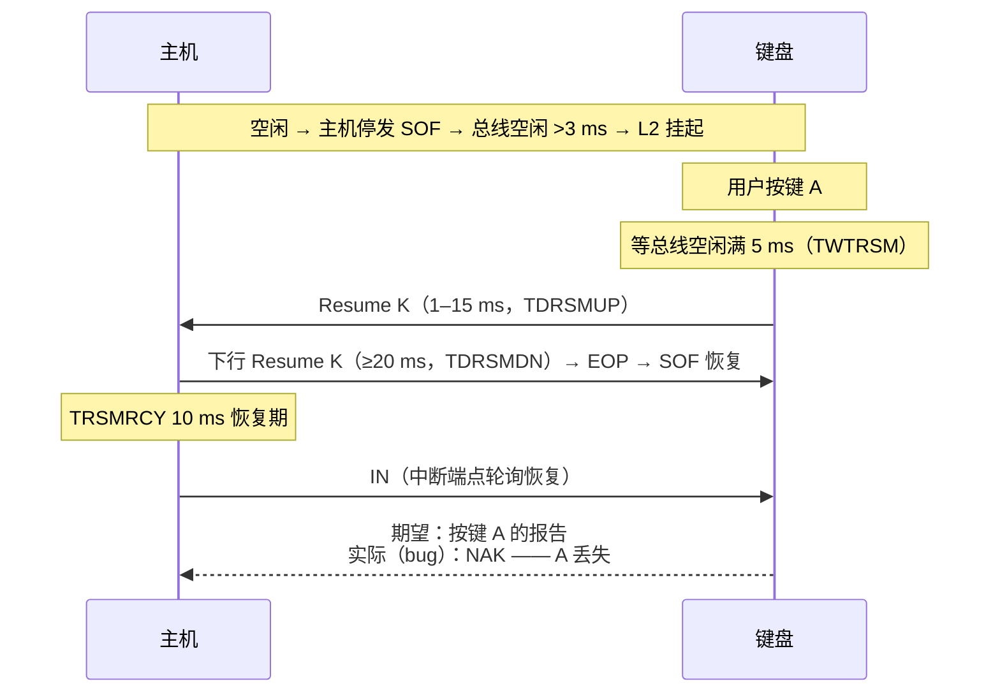

# 案例：选择性挂起后首个按键丢失与 LPM 唤醒问题

> 🌿 知识树位置: 树干 → 枝干[调试测试与安全] → 分枝[工具与分析仪] → 叶[案例 18]
> ⬆️ 父节点: [00-工具与分析仪索引.md](00-工具与分析仪索引.md) · 概念: [电源管理与挂起唤醒](../../10-树干-USB核心/10-电源管理与挂起唤醒.md) · 时序: [时序参数全表](../../90-附录/03-时序参数全表.md)

## 1. 原理

**USB 2.0 挂起/唤醒（§7.1.7.6、§7.1.7.7，表 7-13/7-14）**

| 事件 | 规范要求 |
|---|---|
| 进入挂起 | 总线空闲 > 3.0 ms 开始进入挂起；设备须在 10 ms 内降到挂起电流 |
| 远程唤醒前 | 设备须在总线空闲态持续 **TWTRSM = 5 ms** 后才可发起唤醒 |
| 设备驱动 Resume（K） | **TDRSMUP = 1–15 ms** |
| 主机/集线器下行 Resume | **TDRSMDN ≥ 20 ms** |
| 恢复时间 | 系统软件提供 **TRSMRCY = 10 ms** 恢复期，期间不向该设备发事务 |

**USB 2.0 LPM（L1）**：LPM ECN 引入的扩展令牌事务，携带 BESL（最早称 HIRD）与 bRemoteWake；设备以 ACK/NYET/STALL 回应。L1 进出是微秒级，比 L2（挂起）快得多。需要设备 `bcdUSB ≥ 0x0201` 且 BOS 中 USB 2.0 Extension 声明 LPM（见 [13](13-案例-Windows代码43与描述符请求失败.md)）。Linux 对处理不了 LPM 的设备有 `USB_QUIRK_NO_LPM`（`usbcore.quirks=VID:PID:k`），对不能正确恢复的设备有 `USB_QUIRK_RESET_RESUME`（`b`）。

**Linux 运行时挂起控制**：`/sys/bus/usb/devices/<dev>/power/control`（`on` / `auto`）、`power/autosuspend_delay_ms`、`power/wakeup`（内核文档 power-management.rst）。

## 2. 架构图



## 3. 适用场景

- 键盘/鼠标闲置后第一次按键或移动"没反应"（唤醒了，但事件丢了）。
- 开启 LPM 后偶发断连、或某些主机上 L1 退出失败。
- 设备在挂起期间耗电超标（挂起电流测量配合电源分析仪）。

## 4. 局限

- 软件抓包只看到"设备被挂起/恢复"的 PM 事件和恢复后的 URB；**看不到 Resume K 的时长、LPM 令牌与回应**，需要 USB 2.0 硬件分析仪（Ellisys EX200 测量 Suspend/Resume 等总线状态；Beagle USB 480 有挂起/恢复检测）。
- Wireshark 的 usbll 解码器能解出 LPM 字段（`usbll.lpm_besl`、`usbll.lpm_remote_wake` 等），但前提是 pcap 来自硬件嗅探器（Cynthion/OpenVizsla 等）。

## 5. 实战案例

### 5.1 现象

HS 游戏键盘，Linux 上 `power/control = auto` 或 Windows 选择性挂起生效时，闲置后按第一个键不出字（键盘被唤醒，第二个键起正常）。

### 5.2 工具与理由

- **USB 2.0 分析仪**：精确测量挂起→唤醒→首次 IN 的时间轴与设备回应；
- 固件 GPIO 打点：按键扫描检测到按键、报告写入端点缓冲；
- Linux 侧可用 `power/control` 强制复现（无需等待 Windows 的策略）。

### 5.3 抓包设置

```bash
echo auto > /sys/bus/usb/devices/1-4/power/control
echo 2000 > /sys/bus/usb/devices/1-4/power/autosuspend_delay_ms
cat /sys/bus/usb/devices/1-4/power/wakeup        # 应为 enabled
```

分析仪：不过滤总线事件；触发 = Resume（设备发起）；同时记录数字输入（GPIO）。

### 5.4 标注抓包

> 🧪 **示例**（总线事件 + 事务，教学构造；时间相对按键）

```text
Time        Event / Transaction                    注释
-2.100 s    Suspend（总线空闲 > 3 ms）
 0.000 ms   DIN0 ↑ 扫描检测到按键 A
 0.020 ms   DIN1 ↑ 报告写入 EP1 缓冲               ← 报告已准备好
 5.000 ms   Resume K（device）  2.0 ms             TWTRSM 5 ms 后发起，TDRSMUP 2.0 ms ✓
 7.000 ms   Resume K（host）   20.4 ms             TDRSMDN ≥ 20 ms ✓
27.400 ms   EOP → SOF 恢复
27.402 ms   DIN2 ↑ 固件"恢复"回调                   ← 回调里执行了 EP 缓冲 flush
37.600 ms   IN EP1 → NAK                           TRSMRCY 10 ms 后第一次轮询
45.900 ms   IN EP1 → DATA 'B'                      第二个键
```

### 5.5 根因

固件的"总线恢复"回调复用了"总线复位"的处理代码，清空了所有端点缓冲——把触发唤醒的那个按键报告也清掉了。

### 5.6 修复

- 恢复回调只恢复时钟/PHY，不清端点；端点 flush 只在总线复位与 SET_CONFIGURATION/SET_INTERFACE 时做；
- 唤醒期间到来的按键先入队列，恢复后按顺序上报；
- 若产品启用 LPM：确认 L1 退出路径同样不丢数据；遇到主机侧 LPM 兼容问题，可先用 `usbcore.quirks=1209:0001:k` 关闭 LPM 定位，再修固件。

### 5.7 验证

- 分析仪：唤醒后第一个 DATA 即为触发唤醒的按键（本例应为 'A'），且出现在 TRSMRCY 之后；
- 自动化：闲置 → 单键唤醒循环 500 次，首键丢失 0 次；
- 同时在 Windows（选择性挂起开启）复测；测挂起电流满足产品规格。

## 参考来源

- USB 2.0 规范 §7.1.7.6（Suspending）、§7.1.7.7（Resume）、表 7-13/7-14（TWTRSM、TDRSMUP、TDRSMDN、TRSMRCY）
- USB 2.0 Link Power Management ECN 与 LPM Errata（BESL 取代 HIRD）
- Linux 内核文档：Power Management for USB <https://docs.kernel.org/driver-api/usb/power-management.html>；kernel-parameters（`usbcore.quirks` 字母 b/k）<https://docs.kernel.org/admin-guide/kernel-parameters.html>
- Wireshark usbll 字段参考 <https://www.wireshark.org/docs/dfref/u/usbll.html>
- Ellisys USB Explorer 200 Technical Data；Total Phase Beagle USB 480 产品页（见 [02](02-商用USB协议分析仪详解.md)）
