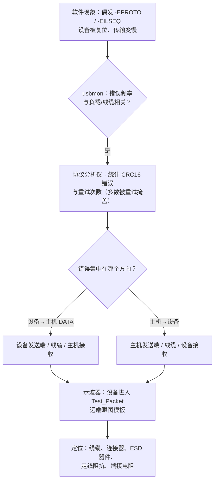

# 案例：线缆信号完整性与 CRC 错误、-EPROTO

> 🌿 知识树位置: 树干 → 枝干[调试测试与安全] → 分枝[工具与分析仪] → 叶[案例 19]
> ⬆️ 父节点: [00-工具与分析仪索引.md](00-工具与分析仪索引.md) · 概念: [物理层与电气特性](../../10-树干-USB核心/03-物理层与电气特性.md) · [错误处理与可靠性](../../10-树干-USB核心/11-错误处理与可靠性.md) · [TestMode 与调试模式](../../10-树干-USB核心/12-TestMode与调试模式.md)

## 1. 原理

- **三振出局**：USB 2.0 §5.3.2——非同步管道上某个包遇到**三次总线错误**，IRP 被终止、管道停止接收新 IRP。xHCI 用端点上下文中的 2 位 **CErr** 计数实现（xHCI 1.2 §4.10.2.7 Bus Error Counter，通常初始化为 3）。
- **错误类别**（USB 2.0 §8.7.1）：PID 校验错、CRC5/CRC16 错、位填充违规、超时（无回应）、babble 等。被主机重试成功的错误**对软件完全不可见**，只有用尽重试才报出来。
- **Linux 错误码**（error-codes.rst）：`-EPROTO`（位填充错、无回应等）、`-EILSEQ`（CRC 错）、`-ETIME`（无回应）、`-EOVERFLOW`（babble）；文档指出这些错误**通常意味着硬件、固件或线缆问题**。xHCI 驱动把 USB Transaction Error 完成码映射为 `-EPROTO`（`xhci-ring.c`）。
- **工具分工**：协议分析仪统计 CRC/位填充错误与重试（Ellisys EX200 写明检测 bitstuff、CRC5、CRC16 错误）；示波器 + Test Mode（Test_Packet）做眼图与合规（[05-合规测试实操](../05-合规测试实操.md)）。

## 2. 架构图



## 3. 适用场景

- 只有某些线缆/某些长度/某个 Hub 上才出现的偶发错误、掉线、吞吐下降。
- 量产中个别批次不良率高。
- 用户现场"换根线就好了"的问题，需要给出可量化的证据。

## 4. 局限

- 协议分析仪本身插入链路会改变信道（多一段线和连接器），可能让问题加重或消失；最终以示波器在不插分析仪时的测量为准。
- 眼图合规需要合规夹具与软件（如 Keysight D9010USBC），成本高；无此条件时只能做相对比较（好线 vs 坏线）。

## 5. 实战案例

### 5.1 现象

HS 设备（批量传输做固件升级）用随附 1.8 m 线时，升级偶发失败；换 1 m 线正常。

> 🧪 **示例日志**（教学构造）

```text
usb 1-2: usbfs: USBDEVFS_BULK failed ep 0x81 len 512 ret -71
usb 1-2: reset high-speed USB device number 6 using xhci_hcd
```

### 5.2 工具与理由

- **usbmon**：统计 `-71`（-EPROTO）出现频率，与线缆的相关性；
- **USB 2.0 分析仪**（EX200 / Beagle USB 480）：看见被重试掩盖的 CRC16 错误，确认方向；
- **示波器 + Test Mode**：眼图量化。

### 5.3 抓包设置

1. usbmon 下跑 100 次升级，统计每次的 `-71` 数量。
2. 分析仪：**不过滤**错误包；过滤 SOF；统计视图按"错误类型 × 方向"汇总。
3. 示波器：通过 SET_FEATURE(TEST_MODE, Test_Packet) 让设备持续发测试包（Test Mode 在设备上需固件支持），在主机端连接器处测眼图（1.8 m 线 vs 1 m 线）。

### 5.4 标注抓包

> 🧪 **示例**（usbmon，教学构造）

```text
S Bi:1:006:1 -115 512 <
C Bi:1:006:1 -71 0                 ← 第三次总线错误后才报出
```

> 🧪 **示例**（分析仪统计，教学构造；升级 1 次，约 4 MB）

```text
方向          事务数      CRC16 错   位填充错   超时   主机重试成功   最终失败
设备→主机 IN   8,412       57         5          0      59             1
主机→设备 OUT    211        0         0          0       0             0
```

> 🧪 **示例**（单次失败的事务序列）

```text
IN  EP1  DATA0 512B  CRC16 ✗        ← 主机丢弃，不 ACK
IN  EP1  DATA0 512B  CRC16 ✗        ← 重试 1
IN  EP1  DATA0 512B  bit-stuff ✗    ← 重试 2，CErr 用尽 → USB Transaction Error → -EPROTO
```

**解读**：错误只出现在设备→主机方向，且 98 % 被重试掩盖；软件只看到最终失败的那 1 次。

### 5.5 根因

示波器在主机端测得 1.8 m 线的眼图张开度明显小于 1 m 线，且设备侧 D+/D− 上的 ESD 保护器件电容偏大（器件选型），与长线插损叠加后接收端眼图余量不足。（具体眼图数值以合规软件报告为准。）

### 5.6 修复

- 更换为低电容的 USB 2.0 HS 专用 ESD 器件；
- 检查走线差分阻抗与等长；必要时调整 PHY 的 HS 发送幅度/预加重（按芯片手册）；
- 随附线缆换成合格的线规与屏蔽。

### 5.7 验证

- 示波器：新硬件 + 1.8 m 线在远端通过 HS 眼图模板（合规软件）；
- 分析仪：1 次升级的 CRC16 错误数降到 0（或稳定在极低水平）；
- usbmon：100 次升级无 `-71`；量产抽检加入"长线批量传输压力测试"。

## 参考来源

- USB 2.0 规范 §5.3.2（三次总线错误终止 IRP）、§8.7.1（Packet Error Categories）、§7.1.20（Test Mode）
- xHCI 1.2 规范 §4.10.2.7（Bus Error Counter / CErr）
- Linux 内核文档 USB Error Codes <https://docs.kernel.org/driver-api/usb/error-codes.html>；`drivers/usb/host/xhci-ring.c`（`COMP_USB_TRANSACTION_ERROR` → `-EPROTO`）
- Ellisys USB Explorer 200 Technical Data（bitstuff/CRC5/CRC16 错误检测）<https://www.ellisys.com/products/usbex200/technical.php>
- Keysight D9010USBC USB 2.0 合规测试软件（见 [03](03-PD与Type-C分析仪及电气测试仪器.md)）
