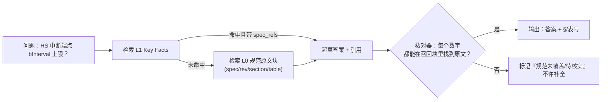

# 用 AI 读 USB 规范：RAG、引用纪律与幻觉陷阱

> 🌿 知识树位置: 树干 → 枝干[AI 时代的 USB] → A 篇 · 叶
> ⬆️ 返回: [00-索引](00-索引.md)

USB 规范是典型的"数字密集型"文档：字段偏移、位域、定时器上下限、编码值，一个数错了就是一台设备枚举不出来。大模型最擅长的恰恰是"写得像"，所以用 AI 读规范的核心不是"让它多读"，而是**让它的每个数字都能被追溯**。

## 一、为什么 USB 特别容易被模型写错

**【观点】** 下面四个特征叠加，使 USB/BLE 成为大模型幻觉的高发区：

1. **同名字段跨版本语义不同**。`bMaxPacketSize0` 在 USB 2.0 是字节数、在 SuperSpeed 是指数；`bInterval` 在全速中断端点是毫秒数、在高速是 2 的指数。训练语料里两种写法混在一起。
2. **营销命名反复改**。USB 3.0 → 3.1 Gen 1 → 3.2 Gen 1 → "USB 5Gbps"，网上文章大量把规范名和速率配错（本库把正确对照固化在 [graph/naming.yaml](../graph/naming.yaml)，并由 `tools/validate.sh` 第 9 项反向扫描错误绑定）。
3. **规范在演进，网文停在旧版**。PD、HUT、Bluetooth Core 每年都有新修订，模型的知识截止点和你手上的规范版本往往不是一个。
4. **大量规范需要登录或会员才能下载**，公开网页上流传的是二手转述，转述错误被模型当成"共识"学进去。

## 二、资料分层：先定裁判，再谈检索

**【事实】** 本库给 AI 的派生文库在 [ai-kb/README.md](../ai-kb/README.md) 中规定了冲突优先级：**官方规范 > 各主题「核心事实 Key Facts」> 清洗后的 USBTree 原文**。这条规则可以直接搬进你的系统提示词。

建议把可检索资料分成四层，检索时按层回退：

| 层 | 内容 | 本库对应 | 用途 |
|---|---|---|---|
| L0 | 规范原文（PDF 提取文本，带章节号/表号/页码） | [80-参考资料](../80-参考资料/README.md)（二进制不入库，`bash tools/spec_fetch.sh` 拉取） | 最终裁判 |
| L1 | 人工核对过的事实表 | [ai-kb/](../ai-kb/index.md) 各主题的 Key Facts、[速查表大全](../90-附录/02-速查表大全.md) | 高频查数 |
| L2 | 结构化讲解 | 10~90 正文、[tech-doc/](../tech-doc/README.md) | 解释"为什么" |
| L3 | 平台文档、源码 | Microsoft Learn、kernel.org、Apple Developer | 实现细节 |

**【事实】** 本站同时提供 `/llms.txt` 入口（源文件 [site/public/llms.txt](../site/public/llms.txt)），格式遵循 [llmstxt.org](https://llmstxt.org/) 提议：一个放在站点根目录的 Markdown 文件，列出给大模型读的精简入口与全量文本链接。

## 三、给规范做 RAG：切块与元数据

**【经验】** 规范 RAG 的质量 80% 取决于切块，而不是向量模型：

- **按章节和表格切，不按固定字数切**。一张表（如 USB 2.0 Table 9-8 设备描述符）必须整块入库；被切成两半的表格是"字段偏移错一位"的主要来源。
- **每块带上元数据**：`spec`（规范名）、`rev`（修订号与日期）、`section`、`table`、`page`。检索结果连同元数据一起喂给模型，答案才能引用到表号。
- **同一字段的多版本定义并列存放**。例如 `bMaxPacketSize0` 同时召回 USB 2.0 Table 9-8 和 USB 3.2 §9.6.1，让模型自己看到差异，而不是只召回一个。
- **中英术语双写**。中文提问"端点零最大包长"要能召回英文原文 `bMaxPacketSize0`；本库 [ai-kb/index.md](../ai-kb/index.md) 维护了中英术语对照，可以直接作为同义词表。

**【事实】** 本库 `ai-kb/` 的每个主题文件 frontmatter 含 `level`、`keywords`、`sources`（仓库路径与 GitHub URL）、`spec_refs`、`related`、`usbtree_commit`（见 [ai-kb/README.md](../ai-kb/README.md)），这正是一个现成的"带元数据切块"样例：`spec_refs` 给引用，`usbtree_commit` 给版本可追溯性。

## 四、引用纪律：五条硬规则

**【经验】** 写进系统提示词，并在评审时逐条检查：

1. **每个数字带出处**：规范名 + 修订号 + 章节/表号。没有出处的数字一律视为错误。
2. **允许说"不知道"**：召回内容里没有的，输出"规范未覆盖/待核实"，禁止"根据常识推断"。
3. **区分规范与实现**：Windows/Linux 的行为是平台文档，不是 USB-IF 规范，要分开标注（本库 [tech-doc/06](../tech-doc/06-linux-virtual-usb.md) 开头就做了这种区分）。
4. **版本号写死**："PD 规范规定……"不合格，"USB PD R3.2 V1.1 §6.6.x 规定……"才合格。
5. **二次核对用另一条路径**：让第二个模型（或同一模型的新会话）只拿召回原文去核对第一个答案，而不是让同一会话"再检查一遍"。

## 五、真实错例：本库自己修过的"像真的一样"的错误

下面每一条都在本库历史里出现过、并已按规范改正。它们是检验你的 RAG 管线的最佳回归用例——**把左列问题丢给你的助手，答错就说明检索或引用纪律有漏洞**。

| 问题 | 常见错误答案 | 正确答案与出处 | 本库修正提交 |
|---|---|---|---|
| `bMaxPacketSize0` 是不是 2^n 编码？ | "是唯一用 2^n 编码的字段" | USB 2.0 及更早是**字节数**（8/16/32/64，高速必须 64；USB 2.0 Table 9-8、§5.5.3）；只有 SuperSpeed 是指数，唯一合法值 09H = 512 字节（USB 3.2 §9.6.1） | `5202cf1` |
| 高速中断端点 `bInterval` 上限？ | "1~16 微帧，即 125 µs~256 ms" | 2^(bInterval−1) × 125 µs，bInterval 1~16，上限 **4.096 s**（USB 2.0 §9.6.6、§5.7.4） | `5202cf1` |
| 1000 Hz 鼠标怎么实现？ | "高速 bInterval=1 再加微帧内多事务" | 全速中断 bInterval=1 即 1 ms = 1000 Hz；高速 bInterval=1 是 8000 Hz，bInterval=4 才是 1000 Hz；高带宽多事务只加字节数且要求 bInterval=1（§5.7.4） | `5202cf1` |
| USB 2.0 有效速率为什么低于 480 Mbit/s？ | "8b/10b 编码损耗" | USB 2.0 用 **NRZI + 位填充**（§7.1.8、§7.1.9），没有块编码；8b/10b 从 USB 3.0 Gen 1 才开始 | `5202cf1` |
| BC 1.2 的 CDP 会不会短接 D+/D−？ | "会，和 DCP 一样" | 不会。短接 D+/D− 的是 DCP；CDP 不短接（BC 1.2 §1.4.4），额定电流见 Table 5-2 | `819e5db` |
| xHCI 规范要不要会员才能下载？ | "USB-IF 会员专享" | xHCI 1.2 / EHCI 1.0 是 Intel 公开下载（见 [80-参考资料](../80-参考资料/README.md)） | `819e5db` |
| HUT 里 Usage Page 0x11 是什么？ | 本库原先引用的 HUT 1.3 中 0x11 是保留值，模型常答"保留" | HUT 1.7 中 0x11 = SoC（见 [HID 规范级附录](../20-枝干-设备类协议/HID-人机接口设备/12-HID规范级附录.md)） | `819e5db` |
| BLE LLCP 最大 opcode 到多少？ | 停在 Core 5.x 的值 | Core 7.0 补到 0x4A（LL_CIS_UPDATE_RSP 等，见 [LLCP 控制过程全表](../50-枝干-无线关联/BLE-低功耗蓝牙/12-LLCP控制过程全表.md)） | `b930a3c` |
| USB 3.2 Gen 1 是多少速率？ | "10 Gbps" | 5 Gbps（营销名 USB 5Gbps）；对照见 [graph/naming.yaml](../graph/naming.yaml) | 由 validate 第 9 项常驻防守 |

**【观点】** 这张表说明了一个规律：**错误几乎都发生在"版本边界"上**——同一个字段在 2.0 和 3.x 的差异、同一份规范的新旧修订、同一个产品的新旧命名。给 RAG 管线做评测集时，优先收集这类边界问题。

## 六、一个可落地的问答流程

1. 先查 L1：`grep -rn "bInterval" ai-kb/` 或用 [usb-spec-lookup 技能](../skills/usb-spec-lookup/SKILL.md) 的四级检索策略；
2. L1 命中但没有 `spec_refs` 的，降级到 L0 规范原文核对；
3. 让模型按[提示词模板 T1](11-提示词模板与检查清单.md) 输出"结论 + 出处 + 未覆盖项"三段式；
4. 用另一个会话按模板 T2 做核对；
5. 发现规范与本库不一致时，以规范为准，并给本库提 PR（这就是上表那些提交的来历）。

## 相关节点

- [AI 生成与审查描述符](02-AI生成与审查描述符.md) · [提示词模板与检查清单](11-提示词模板与检查清单.md) · [本地模型 USB 助手工作流](13-本地模型USB助手工作流.md)
- 被修正的原文: [描述符详解](../10-树干-USB核心/07-描述符详解.md) · [四种传输类型](../10-树干-USB核心/06-四种传输类型.md) · [概述与版本演进](../10-树干-USB核心/01-概述与版本演进.md) · [BC1.2 与专有快充](../30-枝干-接口与供电/03-BC1.2与专有快充.md)
