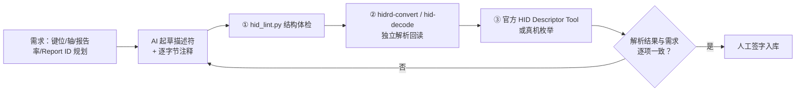

# AI 生成与审查描述符

> 🌿 知识树位置: 树干 → 枝干[AI 时代的 USB] → A 篇 · 叶
> ⬆️ 返回: [00-索引](00-索引.md) · 前置: [报告描述符与 Item 编码](../20-枝干-设备类协议/HID-人机接口设备/02-报告描述符与Item编码.md)

描述符是 AI 最"能写"、也最容易"写得像但错"的东西：格式规整、样例多，模型几秒钟就能吐出一整段 HID 报告描述符。正确的分工是——**AI 负责起草和解释，确定性工具负责判对错，人负责签字**。

## 一、分工原则



**【经验】** 第②步一定要用**与生成方无关**的解析器把字节"翻译回来"，再与需求对比。让同一个模型解释它自己写的字节，等于让考生自己批卷。

## 二、AI 写 HID 报告描述符的高频错误

以下每条都能在 HID 1.11 规范里找到依据，也是评审 AI 产物时要逐条过的点：

| # | 错误 | 为什么错（出处） | 怎么发现 |
|---|---|---|---|
| 1 | `25 FF` 想表达 Logical Maximum = 255 | 短条目数据按有符号数解释，1 字节 0xFF 是 −1；要写 `26 FF 00`（HID 1.11 §6.2.2.7 Logical Minimum/Maximum 说明，§5.8 数值格式） | lint 报 "Logical Min > Max" |
| 2 | 报告总位数不是 8 的倍数 | 报告按整字节传输；规范示例（HID 1.11 附录 E 引导鼠标）用 5 bit Constant 补齐 3 个按钮位 | lint 按报告求和 |
| 3 | 部分报告带 Report ID、部分不带 | 一旦使用 Report ID，所有报告都要带；Report ID 0 保留（HID 1.11 §6.2.2.7） | lint 检查混用与 0 |
| 4 | Collection / End Collection 不配平 | 解析器直接拒绝或解析错位（§6.2.2.4/§6.2.2.6） | lint 计层数 |
| 5 | 逻辑范围装不进 Report Size | 例如 0..2047 却只给 8 bit | lint 计算所需位数 |
| 6 | Usage 号凭记忆写 | Usage Page/ID 以 HUT 当前版为准，旧版保留值后来可能被分配（见[HID 规范级附录](../20-枝干-设备类协议/HID-人机接口设备/12-HID规范级附录.md)） | 对照 HUT，不能靠 lint |
| 7 | 引导协议键鼠写成报告协议格式 | 引导接口（bInterfaceSubClass=1）的报告格式在 HID 1.11 附录 B 固定，BIOS 只认这个格式 | 对照附录 B |
| 8 | Usage Minimum/Maximum 与 Report Count 不匹配 | 数量不一致时多出的字段没有 Usage，主机侧会忽略或错配 | hid-decode 回读 |

**【观点】** 第 6、7 条是 lint 发现不了的语义错误，也是 AI 最常犯的——它会给出一个"看起来合理"的 Usage 号。凡是 Usage，一律要求模型在注释里写出 HUT 版本和章节。

## 三、确定性工具链

| 工具 | 来源 | 平台 | 用途 |
|---|---|---|---|
| HID Descriptor Tool | USB-IF 官方，[usb.org 文档库](https://www.usb.org/document-library/hid-descriptor-tool) | Windows | 官方的报告描述符编辑与解析工具 |
| `hidrd-convert` | [DIGImend/hidrd](https://github.com/DIGImend/hidrd) | Linux/*nix | 在二进制、XML、规范示例格式、C 源码之间转换；可非交互地用于构建流程 |
| `hid-decode` / `hid-recorder` / `hid-replay` | [hid-tools](https://gitlab.freedesktop.org/libevdev/hid-tools)（freedesktop.org） | Linux | 把报告描述符翻译成可读形式；录制并回放 hidraw 事件 |
| `usbhid-dump` | [usbutils](https://github.com/gregkh/usbutils)（已并入） | Linux | 从真实设备导出报告描述符和报告流 |
| `lsusb -v` | usbutils | Linux | 标准描述符全量解码 |
| USBCV / USB3CV | USB-IF 合规工具 | Windows | Chapter 9 与类规范一致性测试（见[合规测试实操](../70-枝干-调试测试与安全/05-合规测试实操.md)） |

**【事实】** hid-tools README 给出的用法之一是直接解析 sysfs 中的报告描述符：`hid-decode /sys/class/input/event5/device/device/report_descriptor`；Linux 下每个 hidraw 设备也可以在 `/sys/class/hidraw/hidrawN/device/report_descriptor` 读到原始字节。

常用命令：

```bash
# 1) 从真机导出（Linux，需要 root；-e 可选 descriptor/stream/all）
sudo usbhid-dump -d 1532:0084 -e descriptor
# 2) AI 生成的二进制 → 规范示例格式，人眼逐行对照需求
hidrd-convert -i natv -o spec rdesc.bin
# 3) 用 hid-tools 再解析一遍（两个独立解析器结果要一致）
hid-decode rdesc.bin
```

## 四、`hid_lint.py`：给 AI 产物做第一道结构体检

下面这个脚本只做**结构**检查（配平、位数、Report ID、范围），不判断 Usage 语义。它故意写得短，便于你和 AI 一起审它本身。本文写作时已用 HID 1.11 附录 E 的引导鼠标描述符（50 字节）验证：输出 `Input: 24 bit = 3 字节`、无问题；删掉 5 bit 填充和一个 End Collection 后，正确报出两处错误。

```python
#!/usr/bin/env python3
"""hid_lint.py —— 报告描述符静态体检（只覆盖短条目；长条目 0xFE 直接报告）。
用法: python3 hid_lint.py 05 01 09 02 A1 01 ...   或   python3 hid_lint.py -f rdesc.bin
检查: 集合配平 / Push-Pop 配平 / 每个报告按 bit 求和是否整字节 / Report ID 不得为 0 且要么全用要么不用 /
      Logical Min ≤ Max / Logical 范围装得进 Report Size / Main 条目前是否已有 Usage Page。
依据: HID 1.11 §6.2.2（短条目格式、Main/Global/Local）、§6.2.2.7（Report ID 0 保留）；
      整字节填充是惯例写法，见 HID 1.11 附录 E 引导鼠标用 5 bit Constant 凑整。
"""
import sys
from collections import defaultdict

MAIN = {0x80: "Input", 0x90: "Output", 0xB0: "Feature"}


def items(buf):
    i = 0
    while i < len(buf):
        b = buf[i]
        if b == 0xFE:
            raise SystemExit(f"偏移 {i}: 长条目，本工具不处理")
        size = (0, 1, 2, 4)[b & 0x03]
        data = buf[i + 1:i + 1 + size]
        if len(data) < size:
            raise SystemExit(f"偏移 {i}: 条目数据被截断")
        u = int.from_bytes(data, "little") if size else 0
        s = int.from_bytes(data, "little", signed=True) if size else 0
        yield i, b & 0xFC, u, s
        i += 1 + size


def lint(buf):
    g = dict(page=None, size=None, count=None, rid=None, lmin=0, lmax=0)
    stack, depth, problems = [], 0, []
    bits = defaultdict(int)
    rid_used = rid_missing = False
    for off, tag, u, s in items(buf):
        if tag == 0x04: g["page"] = u
        elif tag == 0x14: g["lmin"] = s
        elif tag == 0x24: g["lmax"] = s
        elif tag == 0x74: g["size"] = u
        elif tag == 0x94: g["count"] = u
        elif tag == 0x84:
            if u == 0: problems.append(f"偏移 {off}: Report ID 不能为 0")
            g["rid"] = u
        elif tag == 0xA4: stack.append(dict(g))
        elif tag == 0xB4:
            if not stack: problems.append(f"偏移 {off}: Pop 多于 Push")
            else: g = stack.pop()
        elif tag == 0xA0: depth += 1
        elif tag == 0xC0:
            depth -= 1
            if depth < 0: problems.append(f"偏移 {off}: End Collection 多于 Collection")
        elif tag in MAIN:
            if g["page"] is None: problems.append(f"偏移 {off}: Main 条目前没有 Usage Page")
            if g["size"] is None or g["count"] is None:
                problems.append(f"偏移 {off}: 缺 Report Size/Count"); continue
            if g["rid"] is None: rid_missing = True
            else: rid_used = True
            bits[(MAIN[tag], g["rid"])] += g["size"] * g["count"]
            if not (u & 0x01):                      # Data（非 Constant）才检查数值范围
                lo, hi = g["lmin"], g["lmax"]
                if lo > hi: problems.append(f"偏移 {off}: Logical Min {lo} > Max {hi}（负数要按有符号编码）")
                need = max(hi.bit_length(), (-lo - 1).bit_length() + 1 if lo < 0 else 0)
                if lo < 0 and hi >= 0: need = max(need, hi.bit_length() + 1)
                if need > g["size"]: problems.append(f"偏移 {off}: 范围 {lo}..{hi} 需 {need} bit，Report Size 只有 {g['size']}")
    if depth: problems.append(f"Collection 未闭合（剩余 {depth} 层）")
    if stack: problems.append("Push 未 Pop")
    if rid_used and rid_missing: problems.append("部分 Main 条目带 Report ID、部分不带")
    for (kind, rid), n in sorted(bits.items(), key=lambda x: (x[0][0], x[0][1] or 0)):
        tag = f"{kind} ReportID={rid}" if rid is not None else kind
        note = "" if n % 8 == 0 else "  ← 不是整字节，建议补 Constant 填充"
        print(f"  {tag}: {n} bit = {n / 8:g} 字节{note}")
        if n % 8: problems.append(f"{tag} 共 {n} bit，不是整字节")
    return problems


if __name__ == "__main__":
    a = sys.argv[1:]
    data = open(a[1], "rb").read() if a[:1] == ["-f"] else bytes(int(x, 16) for x in a)
    p = lint(data)
    print("\n".join("✘ " + x for x in p) if p else "✔ 未发现结构问题（不代表语义正确，Usage 仍需对照 HUT）")
    sys.exit(1 if p else 0)
```

运行示例（HID 1.11 附录 E 引导鼠标）：

```bash
python3 hid_lint.py 05 01 09 02 A1 01 09 01 A1 00 05 09 19 01 29 03 15 00 25 01 \
  95 03 75 01 81 02 95 01 75 05 81 01 05 01 09 30 09 31 15 81 25 7F 75 08 95 02 81 06 C0 C0
#   Input: 24 bit = 3 字节
# ✔ 未发现结构问题（不代表语义正确，Usage 仍需对照 HUT）
```

**【经验】** 把它接进固件仓库的 CI：描述符以 `.bin` 或 C 数组形式存在时，CI 先抽出字节跑 lint，再跑 `hidrd-convert` 生成可读版本提交到 PR 里。评审者看可读版本，而不是看十六进制。

## 五、其他描述符：让 AI 起草，让规则校验

| 描述符 | AI 常见错误 | 校验依据 |
|---|---|---|
| 配置描述符 `wTotalLength` | 加漏了类特定描述符（UAC/UVC 尤其多） | 逐个累加 `bLength`；真机 `lsusb -v` 回读 |
| IAD（复合设备） | `bFirstInterface`/`bInterfaceCount` 与实际接口号不一致 | [描述符详解](../10-树干-USB核心/07-描述符详解.md) |
| 端点 `wMaxPacketSize` | 高速同步/中断端点忘了 bit12:11 的额外事务数 | USB 2.0 §9.6.6；[总线带宽与调度计算](../10-树干-USB核心/13-总线带宽与调度计算.md) |
| `bInterval` | 全速/高速语义混用 | 见 [01 幻觉陷阱表](01-用AI读USB规范-RAG与幻觉陷阱.md) |
| BOS / MS OS 2.0 | 平台能力 UUID、`wTotalLength`、厂商码对不上 | [WebUSB 与厂商自定义类](../20-枝干-设备类协议/其他设备类/06-WebUSB与厂商自定义类.md) |
| 字符串描述符 | 超长；非 UTF-16LE | `bLength` 最大 255，故字符串最多 (255−2)/2 = 126 个 UTF-16 码元【计算】 |

## 相关节点

- [实战完整报告描述符](../20-枝干-设备类协议/HID-人机接口设备/11-实战完整报告描述符.md) · [Usage 体系与集合](../20-枝干-设备类协议/HID-人机接口设备/03-Usage体系与集合.md)
- [用 AI 读 USB 规范](01-用AI读USB规范-RAG与幻觉陷阱.md) · [提示词模板 T3](11-提示词模板与检查清单.md)
