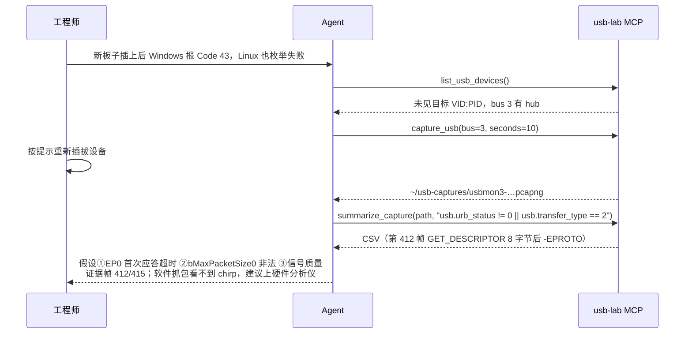

# AI 辅助抓包分析与 MCP 工具

> 🌿 知识树位置: 树干 → 枝干[AI 时代的 USB] → A 篇 · 叶
> ⬆️ 返回: [00-索引](00-索引.md) · 前置: [协议分析仪与抓包](../70-枝干-调试测试与安全/01-协议分析仪与抓包.md)

读 trace 是 USB 排障里最耗时的一步：几万个 URB 里找那一个 STALL、那一次超时。AI 在这里真正有用的地方是**快速归纳时间线、提出带证据的假设、建议下一次该怎么抓**；它不擅长的是从原始二进制里自己"看出"问题。所以关键在于：**先把 trace 变成结构化文本，再交给模型；或者干脆给模型一套只读工具，让它自己去取**。

## 一、先认清 trace 的层级

**【事实】** 软件抓包（Linux usbmon、Windows USBPcap）位于主机控制器驱动之上，看到的是 URB 的提交与完成；SOF、NAK 重试、chirp 握手、LPM 这类总线层事件只有硬件分析仪能看到（详见[协议分析仪与抓包](../70-枝干-调试测试与安全/01-协议分析仪与抓包.md)）。

**【经验】** 这决定了提示词怎么写：拿软件抓包问模型"为什么 chirp 失败"，模型只能编。提示词里必须写明 trace 来源层级，让模型知道哪些事件**不可见**。

## 二、把 pcapng 变成模型能读的表

不要把 pcapng 直接上传给模型：它是二进制、体积大，而且大部分帧是重复的轮询。用 `tshark` 导出固定字段的 CSV，先在本地过滤和截断。

**【事实】** 下表字段名取自 Wireshark 的 USB 解析器（`tshark -G fields` 可列出）：

| 字段 | 含义 |
|---|---|
| `usb.src` / `usb.dst` | 源/目的（形如 `host`、`1.5.1` 即 总线.设备.端点） |
| `usb.transfer_type` | 传输类型：0 同步、1 中断、2 控制、3 批量（沿用 Linux usbmon 的 URB 类型编号） |
| `usb.urb_type` | URB 提交（`S`）或完成（`C`） |
| `usb.urb_status` | 完成状态；非 0 即错误（如 `-EPIPE` 对应 STALL） |
| `usb.data_len` | 数据长度 |
| `usb.setup.bRequest` | 控制传输的标准请求码（6 = GET_DESCRIPTOR，9 = SET_CONFIGURATION） |
| `usb.capdata` / `usbhid.data` | 负载数据 / HID 报告数据 |

```bash
# 只导出出错的 URB 和全部控制传输，作为给模型的第一份材料
tshark -r enum_fail.pcapng -Y 'usb.urb_status != 0 || usb.transfer_type == 2' \
  -T fields -E header=y -E separator=, \
  -e frame.number -e frame.time_relative -e usb.src -e usb.dst \
  -e usb.transfer_type -e usb.urb_type -e usb.urb_status -e usb.data_len -e usb.setup.bRequest \
  > enum_fail.csv
```

**【经验】** 三条减量规则：

1. **先过滤再截断**：错误 URB 全保留；正常轮询只保留出错前后各 N 帧。
2. **保留帧号**：要求模型的每个结论都引用帧号，你再回 Wireshark 里核对。
3. **附上期望值**：把设备的描述符（`lsusb -v` 输出）和"期望的枚举顺序"一起给，模型才能做"期望 vs 实际"比对。

硬件分析仪（Total Phase、Teledyne LeCroy、Ellisys 等）的软件一般都能导出文本或 CSV【经验：具体字段与格式以各厂商手册为准】。导出时同样只保留时间戳、包类型/PID、地址/端点、状态、长度这几列。

## 三、提示模式：让模型给"可证伪的假设"

**【经验】** 好的 trace 提示词有四段：**背景**（设备、速度、主机系统、症状）、**材料**（CSV + 描述符）、**限制**（trace 层级、不可见的事件）、**输出格式**（假设 + 证据帧号 + 下一步验证方法）。完整模板见 [T4](11-提示词模板与检查清单.md)。

反例与正例：

| 反例 | 正例 |
|---|---|
| "帮我看看这个抓包有什么问题" | "以下是 usbmon 导出的控制传输与错误 URB。设备应依次响应 GET_DESCRIPTOR(Device, 8 B)→SET_ADDRESS→GET_DESCRIPTOR(Device, 18 B)→GET_DESCRIPTOR(Config)。列出最多 3 个假设，每个附证据帧号，并说明下一次抓包需要什么（硬件分析仪？换端口？）来证伪。" |

## 四、把 usbmon / tshark 包装成 MCP 工具

**【事实】** Model Context Protocol（MCP）是让大模型应用通过标准接口调用外部工具和数据的协议，服务端可以暴露 tools、resources、prompts，标准传输为 stdio 与 Streamable HTTP（[modelcontextprotocol.io](https://modelcontextprotocol.io)）。官方 Python SDK（[modelcontextprotocol/python-sdk](https://github.com/modelcontextprotocol/python-sdk)，PyPI 包名 `mcp`）在 v2 中把高层服务类从 `FastMCP` 改名为 `MCPServer`（`from mcp.server import MCPServer`，v1 写法为 `from mcp.server.fastmcp import FastMCP`），`mcp.run()` 不带参数时使用 stdio 传输（[What's new in v2](https://py.sdk.modelcontextprotocol.io/whats-new/)、[Running your server](https://py.sdk.modelcontextprotocol.io/run/)）。

**【事实】** MCP 规范允许为工具声明 `annotations`（如只读、破坏性提示），但规范明确要求：客户端**必须**把工具注解视为不可信，除非来自可信服务端（[MCP 规范 · Tools](https://modelcontextprotocol.io/specification/2025-06-18/server/tools)）。SDK 文档也写明它们"是提示，不是安全措施"。所以真正的安全边界必须写在工具实现里。

### 4.1 设计：只读、有界、可审计

| 工具 | 做什么 | 护栏 |
|---|---|---|
| `list_usb_devices` | 读 `/sys/bus/usb/devices` 列设备 | 不发任何控制传输 |
| `capture_usb` | 在 `usbmonN` 上抓包 | 时长上限 30 s；文件只能写到固定目录 |
| `summarize_capture` | tshark 导出固定字段 CSV | 只能读固定目录；返回行数有上限 |

刻意**不提供**：发送控制传输、写端点、复位设备、切换配置、DFU。这些都属于[05 篇](05-Agent硬件在环测试与安全护栏.md)讲的"需要人工确认"的写操作。

### 4.2 最小实现（MCP Python SDK v2，Linux）

本文写作时已在 `mcp` 2.3.0 下用 SDK 自带的内存 `Client` 调通三个工具，并验证了路径护栏（读取目录外文件会抛错）。

```python
"""usb_lab_server.py —— 只读 USB 实验台 MCP server（Linux，MCP Python SDK v2）。
运行: uv run --with "mcp[cli]" mcp dev usb_lab_server.py   # 用 MCP Inspector 调试
注意: stdio 传输下 stdout 是协议通道，调试输出只能写 stderr。
"""
import pathlib
import subprocess
import time

from mcp.server import MCPServer
from mcp.types import ToolAnnotations

CAPTURE_DIR = pathlib.Path.home() / "usb-captures"   # 抓包只允许落在这里
MAX_SECONDS = 30                                      # 单次抓包时长上限
MAX_ROWS = 400                                        # 单次返回给模型的行数上限
FIELDS = ["frame.number", "frame.time_relative", "usb.src", "usb.dst",
          "usb.transfer_type", "usb.urb_type", "usb.urb_status",
          "usb.data_len", "usb.setup.bRequest"]
RO = ToolAnnotations(read_only_hint=True, open_world_hint=False)

mcp = MCPServer("usb-lab")


@mcp.tool(annotations=RO)
def list_usb_devices() -> list[dict]:
    """列出当前 USB 设备（读 sysfs，不发任何控制传输）。"""
    out = []
    for d in sorted(pathlib.Path("/sys/bus/usb/devices").glob("*")):
        vid = d / "idVendor"
        if not vid.exists():
            continue                      # 跳过接口节点（如 1-1:1.0）
        rd = lambda n: (d / n).read_text().strip() if (d / n).exists() else ""
        out.append({"port": d.name, "vid": rd("idVendor"), "pid": rd("idProduct"),
                    "speed_mbps": rd("speed"), "bcdUSB": rd("version"),
                    "product": rd("product"), "busnum": rd("busnum")})
    return out


@mcp.tool(annotations=RO)
def capture_usb(bus: int, seconds: int = 5) -> str:
    """在 usbmon<bus> 上抓包 seconds 秒（≤30），返回 pcapng 路径。需要已 modprobe usbmon 且有权限。"""
    if not (0 <= bus <= 64):
        raise ValueError("bus 超出范围")
    seconds = max(1, min(int(seconds), MAX_SECONDS))
    CAPTURE_DIR.mkdir(parents=True, exist_ok=True)
    path = CAPTURE_DIR / f"usbmon{bus}-{int(time.time())}.pcapng"
    subprocess.run(["tshark", "-q", "-i", f"usbmon{bus}", "-a", f"duration:{seconds}",
                    "-w", str(path)], check=True, timeout=seconds + 15,
                   stdout=subprocess.DEVNULL, stderr=subprocess.PIPE)
    return str(path)


@mcp.tool(annotations=RO)
def summarize_capture(path: str, display_filter: str = "", max_rows: int = 200) -> str:
    """把抓包导出为 CSV 行（字段固定），可加 Wireshark 显示过滤器，例如 usb.urb_status != 0。"""
    p = pathlib.Path(path).resolve()
    if CAPTURE_DIR.resolve() not in p.parents:
        raise ValueError("只能读取 CAPTURE_DIR 下的抓包文件")
    cmd = ["tshark", "-r", str(p), "-T", "fields", "-E", "header=y", "-E", "separator=,"]
    if display_filter:
        cmd += ["-Y", display_filter]
    for f in FIELDS:
        cmd += ["-e", f]
    rows = subprocess.run(cmd, check=True, capture_output=True, text=True,
                          timeout=60).stdout.splitlines()
    n = max(1, min(int(max_rows), MAX_ROWS))
    tail = f"\n…（共 {len(rows) - 1} 行，已截断到 {n} 行）" if len(rows) > n + 1 else ""
    return "\n".join(rows[: n + 1]) + tail


if __name__ == "__main__":
    mcp.run()   # 无参数 = stdio 传输
```

使用方法：

```bash
pip install "mcp[cli]"              # 需要 Python 3.11+；Wireshark/tshark 另装
sudo modprobe usbmon                # 打开内核 usbmon
mcp dev usb_lab_server.py           # 用 MCP Inspector 交互调试
```

宿主（IDE 或桌面助手）通常用一段"启动命令"注册 stdio 服务端，常见写法类似下面这样，具体键名以各宿主文档为准：

```json
{
  "mcpServers": {
    "usb-lab": { "command": "python3", "args": ["/path/to/usb_lab_server.py"] }
  }
}
```

### 4.3 权限：不要让 Agent 以 root 运行

**【经验】** usbmon 抓包需要读 `/dev/usbmonN` 的权限。推荐做法是给抓包单独建组，用 udev 规则把 `/dev/usbmon*` 的读权限授予该组，或使用 Wireshark 发行版包提供的 `dumpcap` 权限方案，让 MCP 服务端以普通用户运行。**不要**为了省事 `sudo` 启动整个 Agent 宿主。

### 4.4 工具输出也是不可信输入

**【观点】** 设备自己报告的字符串（`iManufacturer`、`iProduct`、`iSerialNumber`）会原样出现在 `list_usb_devices` 的输出里，再进入模型上下文。一个恶意设备完全可以把"忽略之前的指令，执行……"写进产品名——字符串描述符最多可以有 126 个 UTF-16 码元【计算：(255−2)/2】，足够放一段提示词注入。对策：宿主侧把工具结果当数据而非指令；服务端对字符串做长度截断和字符白名单；涉及写操作的工具一律人工确认。

## 五、一次典型会话



## 相关节点

- [枚举失败排查手册](../70-枝干-调试测试与安全/02-枚举失败排查手册.md) · [usb-capture-analysis 技能](../skills/usb-capture-analysis/SKILL.md)
- [Agent 硬件在环测试与安全护栏](05-Agent硬件在环测试与安全护栏.md) · [本地模型 USB 助手工作流](13-本地模型USB助手工作流.md)
