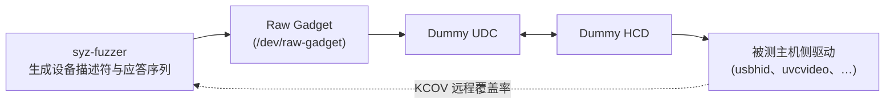

# AI 辅助驱动/固件开发与模糊测试

> 🌿 知识树位置: 树干 → 枝干[AI 时代的 USB] → A 篇 · 叶
> ⬆️ 返回: [00-索引](00-索引.md) · 前置: [Windows USB 驱动开发](../60-枝干-主机侧与实现/08-WindowsUSB驱动开发.md) · [设备端固件栈](../60-枝干-主机侧与实现/03-设备端固件栈.md)

驱动和固件是 AI 生成代码风险最高的地方：内核态的一个空指针就是蓝屏，固件里一个缓冲区越界就是砖。本篇的立场是——**AI 写骨架、写测试、做第一轮审查；内核态与固件的最终判定交给编译器、静态分析、模糊测试和真机**。

## 一、四个栈上 AI 适合做什么

| 栈 | 官方参考 | AI 适合做 | AI 容易出错 |
|---|---|---|---|
| Windows KMDF/UMDF | [Windows-driver-samples · usb/kmdf_fx2](https://github.com/microsoft/Windows-driver-samples/tree/main/usb/kmdf_fx2) | 按样例搭 `EvtDevicePrepareHardware`/I/O 队列骨架、INF 草稿、解释 WDF 对象生命周期 | IRQL 约束、请求取消与完成竞争、电源/选择性挂起策略、意外移除 |
| macOS/iPadOS DriverKit | [USBDriverKit](https://developer.apple.com/documentation/usbdriverkit) | `IOUserClient`/`IOUSBHostInterface` 调用样板、Info.plist 匹配字典 | 授权（entitlement）配置——例如 [`com.apple.developer.driverkit.transport.usb`](https://developer.apple.com/documentation/bundleresources/entitlements/com.apple.developer.driverkit.transport.usb) 需要向 Apple 申请；接口打开/关闭配对 |
| TinyUSB（设备端） | [docs.tinyusb.org](https://docs.tinyusb.org/) | 描述符回调、类驱动配置、复合设备拼装 | 回调执行上下文、缓冲区对齐与生存期、描述符与 `CFG_TUD_*` 配置不一致 |
| Zephyr 新 USB 设备栈 | [USB device support (device_next)](https://docs.zephyrproject.org/latest/connectivity/usb/device_next/usb_device.html) | Kconfig/设备树片段、类实例化样板 | 新旧两套栈的 API 混用（训练语料里旧栈样例更多） |

**【观点】** 上表"容易出错"一列有一个共同点：都是**并发、生命周期和平台配置**，而不是语法。这类错误编译能过、单元测试也常常能过，只在拔插、睡眠唤醒、高负载时暴露。所以评审 AI 产出的驱动代码时，把注意力放在这些地方，而不是放在格式上。

**【经验】** 能不写内核驱动就不写：Windows 上单应用访问的自定义设备优先 WinUSB（见[Windows USB 驱动开发](../60-枝干-主机侧与实现/08-WindowsUSB驱动开发.md)），macOS 上优先用户态 DriverKit 或 IOUSBHost 用户态访问，Linux 上优先 libusb。让 AI 写用户态代码，出错代价低一个数量级。

## 二、审查：把 AI 当"第一轮评审员"

**【经验】** 让 AI 审查驱动代码时，给它一张**平台专属的检查表**，而不是泛泛地"帮我 review"。示例（Windows KMDF）：

- 每个 `WDFREQUEST` 是否在所有路径上恰好完成一次？取消回调与完成路径是否竞争？
- 运行在 `DISPATCH_LEVEL` 的回调里有没有调用可分页代码或等待？
- 连续读（`WdfUsbTargetPipeConfigContinuousReader`）的失败回调里是否处理了复位/停止？
- 选择性挂起开启后，I/O 到达时是否正确唤醒？
- 意外移除（surprise removal）后是否还有未完成的 I/O 引用硬件？

**【事实】** Windows 驱动参加 WHCP 认证时需要用 CodeQL 生成驱动验证日志（Driver Verification Log），Microsoft 文档给出了各 WHCP 版本对应的 CodeQL CLI 版本与查询套件（[CodeQL and the Static Tools Logo Test](https://learn.microsoft.com/en-us/windows-hardware/drivers/devtest/static-tools-and-codeql)）。**【经验】** AI 审查不能替代 CodeQL 和 Driver Verifier，但很适合解释它们报出的告警、起草修复。

## 三、测试生成：AI 最划算的用途

**【经验】** 让 AI 写测试的回报率高于让它写驱动本体，因为测试写错的代价只是"测试不过"：

| 测试对象 | 怎么做 | 可用的虚拟环境 |
|---|---|---|
| 描述符解析/构造 | 让 AI 依据规范表格生成边界用例（`bLength` 为 0、`wTotalLength` 超长、未知描述符类型） | 纯单元测试 |
| 主机驱动 | Linux 虚拟机里用 ConfigFS/FunctionFS 或 Raw Gadget 扮演设备，`dummy_hcd` 把虚拟设备接到同一内核的主机侧 | 见 [tech-doc/06 Linux 虚拟 USB](../tech-doc/06-linux-virtual-usb.md) |
| 跨机器 | USB/IP 把真实设备导出到测试虚拟机 | 见[实战 Linux Gadget 与 usbip](../60-枝干-主机侧与实现/07-实战-LinuxGadget与usbip.md) |
| 固件状态机 | 把协议状态机抽成纯 C 函数，在主机上跑 AI 生成的用例 | 主机端单元测试 |

## 四、模糊测试：syzkaller USB 与 Raw Gadget

**【事实】** syzkaller 支持"从外部设备一侧"模糊测试 Linux 内核 USB 子系统，不需要实体硬件。它依赖三样东西：**Raw Gadget**（Linux Gadget 子系统的底层用户态接口，已进主线）、**Dummy HCD/UDC**（在内核内部把虚拟设备控制器与主机控制器连起来）、以及 **KCOV** 远程覆盖率收集；要求内核 5.7 及以上，打开 `CONFIG_USB_RAW_GADGET=y` 和 `CONFIG_USB_DUMMY_HCD=y`（[syzkaller · External USB fuzzing for Linux kernel](https://github.com/google/syzkaller/blob/master/docs/linux/external_fuzzing_usb.md)）。Raw Gadget 在 Linux 5.7 合入主线（[raw-gadget README](https://github.com/xairy/raw-gadget)、[内核文档](https://docs.kernel.org/usb/raw-gadget.html)）。已发现的 USB 栈缺陷列表见 syzkaller 仓库的 `docs/linux/found_bugs_usb.md`。

## 五、学术进展：USB 模糊测试与 LLM 引导的模糊测试

以下均为同行评审论文，数字为论文作者报告的结果：

| 论文 | 发表 | 要点 |
|---|---|---|
| USBFuzz: A Framework for Fuzzing USB Drivers by Device Emulation（Peng, Payer） | USENIX Security 2020，[会议页](https://www.usenix.org/conference/usenixsecurity20/presentation/peng) | 用虚拟化的仿真 USB 设备向驱动注入模糊数据 |
| FuzzUSB: Hybrid Stateful Fuzzing of USB Gadget Stacks（Kim 等） | IEEE S&P 2022，[DOI 10.1109/SP46214.2022.9833593](https://doi.org/10.1109/sp46214.2022.9833593) | 针对**设备侧 gadget 栈**的有状态模糊测试，基于 syzkaller；作者报告 34 个此前未知的 Linux/Android 缺陷 |
| KernelGPT: Enhanced Kernel Fuzzing via Large Language Models（Yang 等） | ASPLOS 2025，[DOI 10.1145/3676641.3716022](https://dl.acm.org/doi/10.1145/3676641.3716022) | 用 LLM 从驱动源码合成 syzkaller 系统调用描述（syzlang），并用 syzkaller 校验工具的报错迭代修复；作者报告 24 个新内核缺陷，部分描述已并入 syzkaller |
| Large Language Model guided Protocol Fuzzing（ChatAFL） | NDSS 2024，[论文页](https://www.ndss-symposium.org/ndss-paper/large-language-model-guided-protocol-fuzzing/) | 用 LLM 提取协议语法、丰富种子消息序列，突破覆盖率平台期 |
| Fuzz4All: Universal Fuzzing with Large Language Models | ICSE 2024，[DOI 10.1145/3597503.3639121](https://dl.acm.org/doi/10.1145/3597503.3639121) | 用 LLM 作为通用输入生成与变异引擎 |

**【事实】** Google 开源安全团队 2023 年 8 月发文介绍用 LLM 为 OSS-Fuzz 自动生成 fuzz target（[AI-Powered Fuzzing: Breaking the Bug Hunting Barrier](https://security.googleblog.com/2023/08/ai-powered-fuzzing-breaking-bug-hunting.html)）。

**【观点】** 对 USB 而言，KernelGPT 的思路最值得借鉴：**LLM 不直接生成测试输入，而是生成"描述输入结构的规格"**（syzlang 描述、USB 类请求的结构定义），再交给成熟的覆盖率引导引擎去变异。规格可以被工具校验，错了会报错；直接生成的字节流错了却没人知道。把它迁移到 USB：让 LLM 读某个设备类规范（如 UVC 的 Probe/Commit 控制结构），产出 syzkaller 的 USB 类描述或 Facedancer 设备模型，再由引擎去探索。

## 六、实操顺序建议

1. 先在虚拟机里把 syzkaller USB 跑起来，确认 Raw Gadget + Dummy HCD 正常；
2. 只开你关心的驱动（例如自研的 HID 或 vendor 驱动）；
3. 让 AI 依据该设备类规范起草 syzkaller 描述，跑 `syz-extract`/`syz-generate` 校验，失败就把报错喂回去修（KernelGPT 的流程）；
4. 崩溃报告交给 AI 做初步归因（调用栈 → 可疑代码路径），人工确认后再修。

## 相关节点

- [Agent 硬件在环测试与安全护栏](05-Agent硬件在环测试与安全护栏.md) · [USB 安全与 BadUSB](../70-枝干-调试测试与安全/04-USB安全与BadUSB.md)
- [实战 TinyUSB 设备固件](../60-枝干-主机侧与实现/05-实战-TinyUSB设备固件.md) · [macOS 与 Linux 主机开发](../60-枝干-主机侧与实现/09-macOS与Linux主机开发.md)
