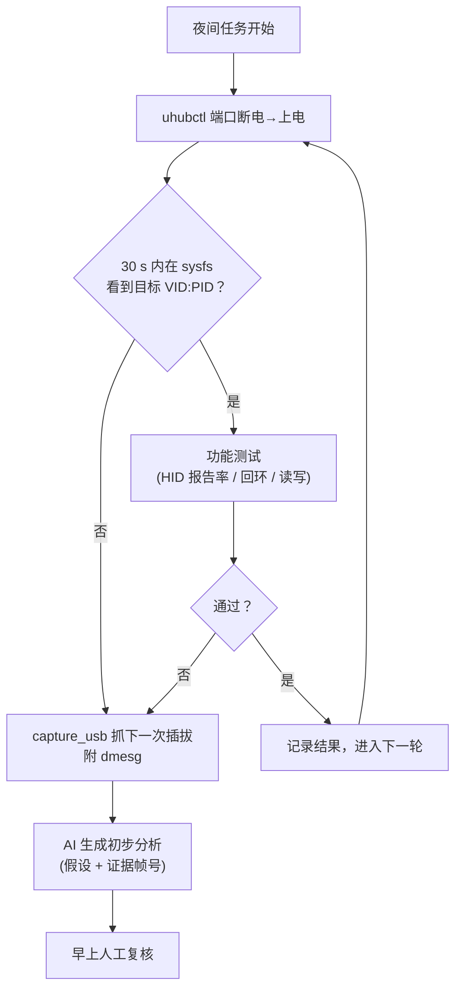

# Agent 硬件在环测试与安全护栏

> 🌿 知识树位置: 树干 → 枝干[AI 时代的 USB] → A 篇 · 叶
> ⬆️ 返回: [00-索引](00-索引.md) · 前置: [集线器与连接管理](../10-树干-USB核心/09-集线器与连接管理.md)

让 Agent 自己插拔设备、抓包、跑功能测试、记录结果，能把"夜间回归"从人盯变成机器跑。但硬件和软件不同：**软件出错可以 `git revert`，设备刷坏了只能拆板子**。本篇先讲怎么搭硬件在环（HIL），再讲护栏。

## 一、"插拔"的自动化：逐端口断电

**【事实】** USB 2.0 规范允许集线器声明三种端口供电切换方式：不切换、联动切换（ganged，所有端口一起）、逐端口切换（per-port），由集线器描述符 `wHubCharacteristics` 的 bit1:0 表示（USB 2.0 §11.23.2.1，Table 11-13）。主机向逐端口切换的集线器发送 `ClearPortFeature(PORT_POWER)` / `SetPortFeature(PORT_POWER)` 即可让某个端口断电/上电（§11.24.2）。

**【事实】** 开源工具 [uhubctl](https://github.com/mvp/uhubctl) 就是基于这一机制控制"智能集线器"（其定义即支持逐端口供电切换的集线器），README 同时提醒：真正正确支持逐端口切换的集线器并不多；可以用 `sudo lsusb -v` 查看集线器的供电切换类型；uhubctl 在 Windows 上能编译但无法切换供电（受 libusb 在 Windows 上的限制）。

```bash
uhubctl                        # 列出支持逐端口切换的集线器及端口状态
uhubctl -l 1-1 -p 2 -a cycle   # 对集线器 1-1 的 2 号端口断电再上电
```

**【经验】**

- 选型前先用 `lsusb -v` 看 `wHubCharacteristics`，不要相信商品页上的"独立开关"字样——有的只是切断 VBUS 指示灯。
- USB 3.x 集线器在系统里表现为一个 USB 2.0 集线器加一个 SuperSpeed 集线器两套逻辑设备，断电时两边都要处理，否则设备可能以 USB 2.0 速度重新枚举。
- 带独立供电的设备（自带电源适配器）断 VBUS 并不会让它真正掉电；需要外接继电器或可编程电源控制它的电源。

## 二、设备仿真与总线观测：Cynthion / Facedancer

**【事实】** [Cynthion](https://cynthion.readthedocs.io/) 是 Great Scott Gadgets 的开源 USB 测试仪器，可配合开源分析软件 [Packetry](https://github.com/greatscottgadgets/packetry) 做 USB 协议抓包，也可作为 [Facedancer](https://facedancer.readthedocs.io/) 的后端——Facedancer 是用 Python 编写 USB 设备仿真（让一段 Python 代码在总线上扮演任意 USB 设备）的框架。

**【观点】** 这一组合非常适合交给 Agent：设备模型是 Python 代码，AI 改起来顺手；抓包由独立硬件完成，能看到软件抓包看不到的总线事件。用法例子：让 Agent 根据某设备类规范生成"故意违规"的设备变体（`wTotalLength` 错、接口号跳号、类请求超时），逐个插给被测主机，记录主机驱动的反应。

## 三、一个夜间回归闭环



**【经验】** 让 Agent 只做"观察 + 可逆操作 + 写报告"，把一切会改变设备状态的动作留到早上由人确认，这样夜里出任何问题最多是"一份错误的报告"。

## 四、护栏：按可逆性分级

**【经验】** 给 Agent 的每个硬件工具按下表分级，分级写在**工具实现里**，而不是只写在提示词或 MCP 注解里（MCP 规范明确要求客户端把工具注解视为不可信，见[03 篇](03-AI辅助抓包分析与MCP工具.md)）。

| 级别 | 例子 | 是否自动执行 | 必备护栏 |
|---|---|---|---|
| L0 只读 | 列设备、读描述符缓存、抓包、读日志 | 是 | 输出截断；路径白名单 |
| L1 可逆 | 白名单端口的断电重上电、设备复位 | 是，限频 | 端口白名单；每小时次数上限；记录审计日志 |
| L2 改变状态 | 厂商控制写、`SET_CONFIGURATION`、切换模式、改 PD 策略 | **否，需人工确认** | 预览将发送的字节；确认后执行 |
| L3 不可逆/高风险 | DFU/固件刷写、OTP/eFuse 烧写、写序列号/MAC、PD 控制器固件更新 | **否，需人工确认 + 双重校验** | VID:PID 白名单、固件镜像哈希比对、确认恢复路径存在、单设备单次 |

**【事实】** DFU 1.1 定义了下载（`DFU_DNLOAD`）后进入 manifestation 阶段的流程；固件在下载或 manifestation 过程中被打断时，设备能否回到可升级状态取决于实现（见 [DFU 固件升级](../20-枝干-设备类协议/其他设备类/01-DFU固件升级.md)）。这正是 L3 必须确认"恢复路径存在"（例如只读 bootloader、双镜像、SWD 可救砖）的原因。

### 4.1 刷写工具的"计划-确认-执行"模式

不要给 Agent 一个 `flash_firmware(path)` 工具。给它一个只生成计划的工具，执行留给人：

```python
import hashlib, json, pathlib

ALLOWED = {("cafe", "4011"): "sha256-of-approved-image"}   # 白名单：VID:PID → 允许的镜像哈希

def plan_dfu_flash(vid: str, pid: str, image: str) -> str:
    """只生成刷写计划，不执行。返回给人看的命令与校验结果。"""
    p = pathlib.Path(image).resolve()
    digest = hashlib.sha256(p.read_bytes()).hexdigest()
    expect = ALLOWED.get((vid.lower(), pid.lower()))
    plan = {
        "device": f"{vid}:{pid}",
        "image": str(p),
        "sha256": digest,
        "allowed": expect == digest,
        "command_for_human": f"dfu-util -d {vid}:{pid} -D {p}",
        "checklist": ["确认恢复路径（bootloader 只读/双镜像/SWD）", "确认供电稳定", "确认只连接了一台目标设备"],
    }
    return json.dumps(plan, ensure_ascii=False, indent=2)
```

**【观点】** 这样做的好处是：Agent 依然能完成 95% 的工作（找镜像、核哈希、拼命令、列检查项），而最后那一下不可逆的动作留在人手里。这和本库对 git 的约定是一个思路：可逆的事自动做，改写历史、强推这类不可逆操作必须人确认。

## 五、其他安全注意事项

- **一次只连一台目标设备**：多台同型号设备在线时，Agent 用 VID:PID 选设备会选错。用端口路径（如 `1-1.2`）或序列号定位。
- **隔离测试主机**：模糊测试和"故意违规设备"测试会让主机内核崩溃，放在虚拟机或专用测试机上。
- **功率**：Agent 反复上电的设备若有大电容或电机，频繁 VBUS 切换会带来浪涌；按设备规格设置最小间隔。

## 相关节点

- [AI 辅助抓包分析与 MCP 工具](03-AI辅助抓包分析与MCP工具.md) · [AI 辅助驱动/固件开发与模糊测试](04-AI辅助驱动固件开发与模糊测试.md)
- [实战 Linux Gadget 与 usbip](../60-枝干-主机侧与实现/07-实战-LinuxGadget与usbip.md) · [经验与坑](12-经验与坑.md)
