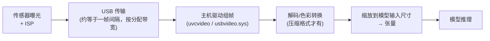

# UVC 与 UAC 喂给模型：带宽与延迟计算

> 🌿 知识树位置: 树干 → 枝干[AI 时代的 USB] → B 篇 · 叶
> ⬆️ 返回: [00-索引](00-索引.md) · 前置: [总线带宽与调度计算](../10-树干-USB核心/13-总线带宽与调度计算.md) · [UVC 详解](../20-枝干-设备类协议/Video-UVC/00-UVC详解.md) · [UAC 概述](../20-枝干-设备类协议/Audio-UAC/00-UAC概述.md)

端侧视觉和语音模型的"眼睛"和"耳朵"大多是 USB 摄像头（UVC）和 USB 麦克风阵列（UAC）。本篇把"这个分辨率、这个帧率能不能走这条总线"变成可以复算的算式。**本篇所有数字均为【计算】，参数取自规范，不是实测跑分。**

## 一、总线一侧：单个同步端点能拿到多少

| 总线 | 单端点同步上限 | 算式 | 出处 |
|---|---|---|---|
| USB 2.0 全速 | 1,023 B/帧 = 8.184 Mbit/s | 1023 × 1000 × 8 | USB 2.0 §5.6.3 |
| USB 2.0 高速（高带宽端点） | 3,072 B/微帧 = **196.608 Mbit/s** | 3 × 1024 × 8000 × 8 | USB 2.0 §5.9；见[带宽计算](../10-树干-USB核心/13-总线带宽与调度计算.md) |
| USB 3.x Gen 1（SuperSpeed） | 49,152 B/服务间隔 = **3,145.728 Mbit/s**（393.216 MB/s） | (bMaxBurst 16) × (Mult 3) × 1024 × 8000 × 8 | USB 3.2 §9.6.7 SuperSpeed 端点伴随描述符 |

说明：

- 高速下所有周期性传输（同步 + 中断）合计不得超过微帧的 80%（USB 2.0 §5.6.4、§5.7.4），多台摄像头共享一个控制器时这条先撞线。
- Gen 2 及以上可用 SuperSpeedPlus 同步端点伴随描述符声明更大的每间隔字节数，本篇不展开。
- UVC 每个负载还带 2~12 字节的负载头（UVC 1.5 §2.4.3.3），下表未计入，量级上可忽略。

## 二、设备一侧：未压缩视频要多少

未压缩数据率 = 宽 × 高 × 每像素位数 × 帧率。YUY2（4:2:2）每像素 16 bit，NV12（4:2:0）每像素 12 bit（两者均为 UVC 1.5 未压缩负载规范定义的格式）。

| 分辨率 | 格式 | 30 fps | 60 fps | 高速同步单端点能撑的最高帧率 | Gen 1 同步单端点能否承载 30 fps |
|---|---|---|---|---|---|
| 640×480 | YUY2 | 147.5 Mbit/s | 294.9 Mbit/s | 40.0 fps | 能 |
| 640×480 | NV12 | 110.6 | 221.2 | 53.3 | 能 |
| 1280×720 | YUY2 | 442.4 | 884.7 | 13.3 | 能 |
| 1280×720 | NV12 | 331.8 | 663.6 | 17.8 | 能 |
| 1920×1080 | YUY2 | 995.3 | 1,990.7 | 5.9 | 能（60 fps 也能） |
| 1920×1080 | NV12 | 746.5 | 1,493.0 | 7.9 | 能 |
| 3840×2160 | YUY2 | 3,981.3 | 7,962.6 | 1.5 | **不能**（超过 3,145.7） |
| 3840×2160 | NV12 | 2,986.0 | 5,972.0 | 2.0 | 能（30 fps 余量约 5%） |

读表要点：

- **USB 2.0 摄像头的未压缩 720p 最高约 13 fps**（YUY2）。所以 USB 2.0 摄像头在 720p/1080p 下几乎都依赖 MJPEG 或 H.264 才能到 30 fps。
- **未压缩 1080p 需要 USB 3.x**；未压缩 4K30 YUY2 连 Gen 1 单端点都放不下。

## 三、压缩格式：带宽省了，延迟和算力换来了

**【事实】** MJPEG 等压缩格式的码率不是固定的，取决于画面内容和编码质量。UVC 用 Probe/Commit 协商时，设备报告 `dwMaxVideoFrameSize` 与 `dwMaxPayloadTransferSize`（UVC 1.5 §4.3.1.1），主机按后者选择带宽合适的备用设置（alternate setting）。

**【事实】** Linux 上，当周期性带宽不够分配时，提交同步 URB 会返回 `-ENOSPC`（"会超出为周期性传输保留的带宽"，见内核文档 [USB error codes](https://docs.kernel.org/driver-api/usb/error-codes.html)）。uvcvideo 驱动对按最大值申请带宽的摄像头提供 `UVC_QUIRK_FIX_BANDWIDTH` 怪癖处理（见内核源码 `drivers/media/usb/uvc/`）。

**【观点】** 给模型喂数据时，格式选择是一个三方权衡：

| 选择 | 总线 | 主机 CPU/GPU | 延迟 | 图像质量（对模型） |
|---|---|---|---|---|
| 未压缩 YUY2/NV12 | 最贵 | 最省（可直接转张量） | 最低 | 无压缩伪影 |
| MJPEG | 省 | 要解码（可用硬件解码器） | 增加解码时间 | 有块效应，小目标检测可能受影响 |
| H.264/H.265（UVC 1.5） | 最省 | 要解码，依赖硬件解码 | 有 GOP/缓冲延迟 | 运动场景伪影 |

## 四、延迟：一帧从传感器到张量

**【计算】** 30 fps 时帧间隔 33.3 ms，60 fps 时 16.7 ms。同步传输按分配到的带宽**匀速**送数据：如果分配的带宽刚好够这个帧率，一帧数据大约要用掉一个帧间隔才能送完。例如 1080p YUY2 一帧 4,147,200 字节，即使独占 Gen 1 同步单端点上限 393.216 MB/s，也需要约 10.5 ms；4K NV12 一帧 12,441,600 字节约需 31.6 ms。

**【观点】** 端到端延迟里 USB 只是一段；但它是**不可压缩的那一段**——带宽给多少，一帧就要花多少时间送。想降低延迟：提高帧率（每帧更小的时间片）、降低分辨率到模型真正需要的尺寸、或让摄像头端裁剪/缩放。把 4K 画面送上主机再缩到模型几百像素的输入尺寸，是最常见的带宽浪费。

## 五、UAC：麦克风阵列

数据率 = 通道数 × 采样率 × 每样本字节数。

| 配置 | 每毫秒字节 | 每微帧字节 | 数据率 | 全速同步（≤1,023 B/帧）能否承载 |
|---|---|---|---|---|
| 2 通道 × 48 kHz × 16 bit | 192 B | 24 B | 1.536 Mbit/s | 能 |
| 4 通道 × 16 kHz × 16 bit | 128 | 16 | 1.024 | 能 |
| 8 通道 × 16 kHz × 16 bit | 256 | 32 | 2.048 | 能 |
| 8 通道 × 48 kHz × 24 bit（3 字节子槽） | 1,152 | 144 | 9.216 | **不能**，需高速 |
| 8 通道 × 48 kHz × 32 bit 子槽 | 1,536 | 192 | 12.288 | 不能，需高速 |
| 16 通道 × 48 kHz × 32 bit 子槽 | 3,072 | 384 | 24.576 | 不能，需高速 |

**【事实】** 高速与多通道高分辨率音频通常走 UAC 2.0；Windows 10 1703 起内置 USB Audio 2.0 类驱动（[Microsoft Learn · USB Audio 2.0 Drivers](https://learn.microsoft.com/en-us/windows-hardware/drivers/audio/usb-2-0-audio-drivers)）。UAC 各版本差异见 [UAC2 与 UAC3](../20-枝干-设备类协议/Audio-UAC/02-UAC2与UAC3.md)。

**【观点】** 语音前端（波束成形、回声消除、唤醒词）放在哪里，决定了总线上走的是什么：

- 放在麦克风阵列端：USB 上只走 1~2 路处理后的音频，全速 UAC1 就够，主机最省事；
- 放在主机端：要把全部原始通道送上来（如 8 路 16 kHz），主机算法可迭代、可换模型，但要求设备提供多通道 UAC 并保证各通道同步采样。

做 AI 语音产品时，"原始多通道上传"模式便于后期用更好的模型重做前端处理，这是一个值得在硬件定型前就想清楚的决策。

## 相关节点

- [UVC 规范级：控制与格式全表](../20-枝干-设备类协议/Video-UVC/01-UVC规范级-控制与格式全表.md) · [UAC 规范级：实体与请求全表](../20-枝干-设备类协议/Audio-UAC/03-UAC规范级-实体与请求全表.md)
- [USB AI 加速器与 AI 外设](06-USB-AI加速器与AI外设.md) · [机器人与具身智能中的 USB](09-机器人与具身智能中的USB.md)
