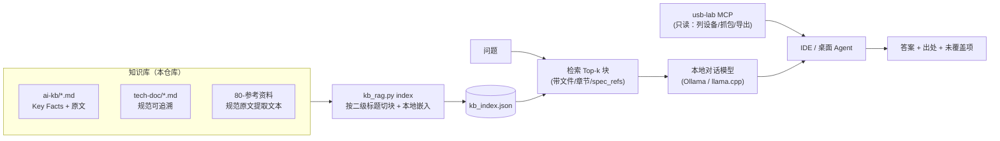

# 用本地模型搭建个人 USB AI 助手

> 🌿 知识树位置: 树干 → 枝干[AI 时代的 USB] → A 篇 · 叶
> ⬆️ 返回: [00-索引](00-索引.md) · 前置: [用 AI 读 USB 规范](01-用AI读USB规范-RAG与幻觉陷阱.md) · [AI 辅助抓包分析与 MCP 工具](03-AI辅助抓包分析与MCP工具.md)

目标：在一台带 RTX 级显卡的工作站上，用本地模型 + 本库知识库 + 只读 USB 工具，搭一个**不出内网**的 USB 助手——查规范、读抓包、审描述符。固件源码、未公开的产品描述符、客户的抓包都不必上传到云端。

## 一、整体架构



## 二、显存怎么算

**【事实】** RTX 5080 官方规格为 16 GB GDDR7、256 bit 位宽（[NVIDIA 产品页](https://www.nvidia.com/en-us/geforce/graphics-cards/50-series/rtx-5080/)）。

**【计算】** 权重占用 ≈ 参数量 × 每权重位数 ÷ 8。4 bit 量化格式因为带缩放因子等元数据，平均每权重略高于 4 bit；下表按 4.5 bit 粗估，实际以具体量化格式和模型文件大小为准。

| 参数量 | FP16（16 bit） | 8 bit | 约 4.5 bit | 能否放进 16 GB（还要留 KV 缓存） |
|---|---|---|---|---|
| 8B | 16 GB | 8 GB | 4.5 GB | 4.5 bit / 8 bit 可以 |
| 14B | 28 GB | 14 GB | 7.9 GB | 4.5 bit 可以 |
| 32B | 64 GB | 32 GB | 18 GB | 放不下，需卸载到内存 |

**【计算】** KV 缓存 ≈ 2（K 和 V）× 层数 × KV 头数 × 每头维度 × 每元素字节 × 上下文长度。以一个**假设配置**为例：48 层、8 个 KV 头、每头 128 维、FP16、32K 上下文：2 × 48 × 8 × 128 × 2 B × 32,768 ≈ 6.4 GB。真实模型的这些参数见其 `config.json`。

**【观点】** 对"查规范 + 读抓包"这类任务，14B 级 4 bit 模型 + 适中上下文（8K~32K）放在 16 GB 显存里通常是平衡点；RAG 每次只喂 6 块左右资料，不需要超长上下文。显存不够时宁可换小模型，也不要依赖"按层把权重搬进显存"的卸载方式——那时链路带宽会成为瓶颈（见 [08 篇](08-USB4雷电外接GPU与AI设备供电.md)）。

## 三、运行时与嵌入模型

**【事实】** Ollama 提供本地 HTTP API，其中 `POST /api/embed` 生成向量（官方示例使用 `embeddinggemma` 模型，返回字段为 `embeddings`）、`POST /api/chat` 进行对话（[Ollama API 文档](https://docs.ollama.com/api/embed)）。

**【观点】** 嵌入模型选**多语言**模型（例如 [BAAI/bge-m3](https://huggingface.co/BAAI/bge-m3)，详见其模型卡），因为本库正文是中文、规范原文与字段名是英文，问题常常中英混杂。对话模型选你本地实测中文与代码都过关的即可，下面的脚本不绑定具体模型。

## 四、索引与问答脚本

下面的 `kb_rag.py` 只用 Python 标准库：读取 `ai-kb/` 与 `tech-doc/` 的编号主题文件，按 frontmatter 取 `title`、`spec_refs`、`usbtree_commit`，按二级标题切块，调用 Ollama 生成向量并检索，再按 [T1 模板](11-提示词模板与检查清单.md) 的规则让模型作答。本文写作时已在本仓库上用替身向量函数验证切块与检索流程（共切出 606 块）；真实向量化需要本地运行 Ollama。

```python
#!/usr/bin/env python3
"""kb_rag.py —— 用本地 Ollama 给 USBTree 的 ai-kb/ 与 tech-doc/ 建检索索引并回答问题（仅标准库）。
用法（在 USBTree 仓库根目录）:
  python3 kb_rag.py index                    # 切块 + 向量化，写 kb_index.json
  python3 kb_rag.py ask "HS 中断端点 bInterval 上限是多少？"
环境变量: OLLAMA=http://127.0.0.1:11434  EMBED_MODEL=<嵌入模型>  CHAT_MODEL=<对话模型>
"""
import json, math, os, pathlib, re, sys, urllib.request

OLLAMA = os.environ.get("OLLAMA", "http://127.0.0.1:11434")
EMBED_MODEL = os.environ.get("EMBED_MODEL", "embeddinggemma")  # Ollama 文档示例中的嵌入模型
CHAT_MODEL = os.environ.get("CHAT_MODEL", "")          # 必填：你在 Ollama 里拉取的对话模型名
SOURCES = ["ai-kb/[0-9]*.md", "tech-doc/[0-9]*.md"]
INDEX = pathlib.Path("kb_index.json")
MAX_CHARS = 2400          # 单块上限；表格尽量整块保留


def post(path, payload):
    req = urllib.request.Request(OLLAMA + path, json.dumps(payload).encode(),
                                 {"Content-Type": "application/json"})
    with urllib.request.urlopen(req, timeout=600) as r:
        return json.load(r)


def embed(texts):
    return post("/api/embed", {"model": EMBED_MODEL, "input": texts})["embeddings"]


def chunks(path):
    text = path.read_text(encoding="utf-8")
    meta, body = {}, text
    m = re.match(r"^---\n(.*?)\n---\n", text, re.S)
    if m:
        body = text[m.end():]
        for key in ("title", "spec_refs", "usbtree_commit"):
            mm = re.search(rf"^{key}:\s*(.+)$", m.group(1), re.M)
            if mm:
                meta[key] = mm.group(1).strip().strip('"')
    for sec in re.split(r"\n(?=## )", body):           # 按二级标题切
        head = sec.strip().splitlines()[0] if sec.strip() else ""
        for i in range(0, len(sec), MAX_CHARS):
            piece = sec[i:i + MAX_CHARS].strip()
            if len(piece) > 40:
                yield {"file": str(path), "section": head.lstrip("# ").strip(),
                       "meta": meta, "text": piece}


def cmd_index():
    items = [c for pat in SOURCES for p in sorted(pathlib.Path().glob(pat)) for c in chunks(p)]
    for i in range(0, len(items), 32):
        batch = items[i:i + 32]
        for it, vec in zip(batch, embed([f"{b['meta'].get('title', '')} / {b['section']}\n{b['text']}" for b in batch])):
            it["vec"] = vec
        print(f"{min(i + 32, len(items))}/{len(items)}", file=sys.stderr)
    INDEX.write_text(json.dumps(items, ensure_ascii=False), encoding="utf-8")


def cos(a, b):
    return sum(x * y for x, y in zip(a, b)) / (math.sqrt(sum(x * x for x in a)) * math.sqrt(sum(y * y for y in b)) or 1)


def search(q, k=6):
    items = json.loads(INDEX.read_text(encoding="utf-8"))
    qv = embed([q])[0]
    return sorted(items, key=lambda it: cos(qv, it["vec"]), reverse=True)[:k]


SYSTEM = ("你是 USB/BLE 协议助手。只依据提供的资料回答。每个数字、字段值、时序参数后面用 [n] 标注资料编号，"
          "并写出资料里给出的规范章节/表号。资料没有覆盖的内容写『资料未覆盖，需查规范原文』，不得推测。"
          "资料之间冲突时以官方规范原文 > Key Facts > 正文 的顺序取舍，并指出冲突。")


def cmd_ask(q):
    if not CHAT_MODEL:
        sys.exit("请先设置 CHAT_MODEL 环境变量")
    hits = search(q)
    ctx = "\n\n".join(f"[{i + 1}] {h['file']} · {h['section']} · spec_refs={h['meta'].get('spec_refs', '-')}\n{h['text']}"
                      for i, h in enumerate(hits))
    r = post("/api/chat", {"model": CHAT_MODEL, "stream": False, "messages": [
        {"role": "system", "content": SYSTEM},
        {"role": "user", "content": f"资料：\n{ctx}\n\n问题：{q}"}]})
    print(r["message"]["content"])
    print("\n— 资料来源 —")
    for i, h in enumerate(hits):
        print(f"[{i + 1}] {h['file']} · {h['section']}")


if __name__ == "__main__":
    if sys.argv[1:2] == ["index"]:
        cmd_index()
    elif sys.argv[1:2] == ["ask"] and len(sys.argv) > 2:
        cmd_ask(" ".join(sys.argv[2:]))
    else:
        print(__doc__)
```

```bash
cd USBTree
export EMBED_MODEL=embeddinggemma CHAT_MODEL=<你本地的对话模型>
python3 kb_rag.py index
python3 kb_rag.py ask "高速中断端点 bInterval 的取值范围和最长周期？"
```

**【经验】** 想让规范原文也参与检索：先用 `bash tools/spec_fetch.sh` 下载规范，再用 `tools/spec_extract.sh` 提取文本（见 [80-参考资料](../80-参考资料/README.md)），把提取出的文本目录加进 `SOURCES`。规范原文块应在元数据里写明规范名与修订号。

## 五、把它接进 Agent

1. **知识检索**：把 `search()` 包成一个 MCP 工具 `search_usb_kb(query) -> [{file, section, spec_refs, text}]`，写法与 [03 篇](03-AI辅助抓包分析与MCP工具.md) 的 `usb-lab` 服务端相同；
2. **硬件只读工具**：同时挂上 03 篇的 `usb-lab`（列设备、抓包、导出 CSV）；
3. **提示词**：系统提示词用 [T1](11-提示词模板与检查清单.md)；抓包任务用 T4；
4. **核对**：重要结论用另一个模型或新会话按 T2 核对。

一个典型的本地工作循环：

| 步骤 | 工具 | 输出 |
|---|---|---|
| 插上新样机，枚举异常 | `usb-lab.list_usb_devices` / `capture_usb` | 设备列表、抓包文件 |
| 导出错误 URB 与控制传输 | `usb-lab.summarize_capture` | CSV |
| 查相关规范条款 | `search_usb_kb("GET_DESCRIPTOR 超时 EP0")` | 带出处的资料块 |
| 生成假设与下一步 | 本地对话模型 + T4 | 假设 + 证据帧号 |
| 核对 | 新会话 + T2 | 有据/无据清单 |

## 六、用本库的勘误做回归评测

**【经验】** 每次换模型、换嵌入、改切块策略后，用 [01 篇错例表](01-用AI读USB规范-RAG与幻觉陷阱.md) 的 9 个问题跑一遍，统计三项：答对率、引用率（数字是否带出处）、拒答正确率（资料没有时是否说"未覆盖"）。这比任何通用评测都更贴近你的实际使用。

## 七、隐私与边界

**【观点】**

- 本地方案的最大价值是**数据不出内网**：客户设备的描述符、抓包、未发布固件都可以放心交给它。
- 本地模型的协议知识通常弱于大型云端模型，所以更要依赖 RAG 与引用纪律，不要让它"凭记忆"答题。
- 工具层依旧遵守 [05 篇](05-Agent硬件在环测试与安全护栏.md) 的分级：本地 ≠ 可以放开写操作。

## 相关节点

- [AI × USB 提示词模板与检查清单](11-提示词模板与检查清单.md) · [经验与坑](12-经验与坑.md)
- [ai-kb/README.md](../ai-kb/README.md) · [tech-doc/README.md](../tech-doc/README.md) · [usb-spec-lookup 技能](../skills/usb-spec-lookup/SKILL.md)
