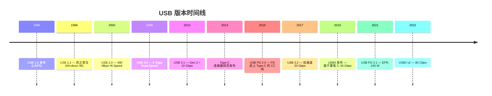

# USB 概述、版本演进与命名

> 层级 入门 · 主题 `core` · 相关：[体系架构、拓扑、端点与管道、集线器](02-architecture-topology.md)、[USB 3.x SuperSpeed：包格式、LTSSM、定时器](30-usb3-superspeed.md)、[USB4：路由器、隧道、配置空间、DROM、连接管理器](31-usb4.md)、[速查表大全与时序参数全表](90-quick-reference.md)

## 核心事实 Key Facts

> 由维护者整理并与规范核对；与下方 USBTree 原文冲突时以本节为准。

| 速率模式 Speed | 标称速率 | 首个规范 | 物理/编码 |
|---|---|---|---|
| Low Speed (LS) | 1.5 Mbit/s | USB 1.0 (1996-01) | D+/D− 半双工, NRZI + bit stuffing |
| Full Speed (FS) | 12 Mbit/s | USB 1.0/1.1 (1998-09) | 同上 |
| High Speed (HS) | 480 Mbit/s | USB 2.0 (2000-04) | 同上, 微帧 125 µs |
| SuperSpeed Gen 1 (SS) | 5 Gbit/s | USB 3.0 (2008-11) | 独立 TX/RX 对, 8b/10b |
| SuperSpeedPlus Gen 2 | 10 Gbit/s | USB 3.1 (2013-07) | 128b/132b |
| Gen 2x2 | 20 Gbit/s | USB 3.2 (2017-09) | 双通道, 仅 Type-C |
| USB4 Gen 3x2 | 40 Gbit/s | USB4 (2019-08) | 隧道架构, 基于 Thunderbolt 3 |
| USB4 Gen 4 | 80 Gbit/s（非对称 120/40） | USB4 v2 (2022-10) | PAM-3 |

- 命名规则：规范版本号 ≠ 速率。现行营销名按速率：SuperSpeed USB 5Gbps / 10Gbps / 20Gbps、USB 40Gbps、USB 80Gbps。USB 3.0 = USB 3.1 Gen 1 = USB 3.2 Gen 1。
- USB 2.0 规范最常查章节：第 7 章 电气、第 8 章 协议层（包/PID/CRC）、第 9 章 USB Device Framework（描述符、标准请求、设备状态）、第 11 章 Hub。
- 设计原则：Host-centric polled bus——所有事务由主机发起；设备唯一主动行为是挂起态下的远程唤醒（Remote Wakeup）。
- USB 2.0（及 1.x）线上是 NRZI + 位填充，有效速率开销来自位填充、包头/握手与微帧调度，不使用 8b/10b。8b/10b 是 USB 3.0 Gen1（5 Gbit/s 线路速率，编码后 4 Gbit/s）；USB 3.1 Gen2 起为 128b/132b。

## 原文：01-概述与版本演进

> Source: [10-树干-USB核心/01-概述与版本演进.md](https://github.com/tangjianfang/USBTree/blob/main/10-树干-USB核心/01-概述与版本演进.md)

### 1. USB 是什么

USB（Universal Serial Bus，通用串行总线）是 1990 年代由 Intel、Microsoft、Compaq 等 7 家公司联合发起的**主机centric 外设总线标准**，目标是取代当时 PC 背后杂乱的串口、并口、PS/2、游戏口。今天它同时承担四件事：

1. **数据通信**——设备与主机间的分层数据传输；
2. **供电**——5V 基础供电，经 Type-C/PD 扩展到最高 240W；
3. **设备描述与驱动绑定**——即插即用（Plug and Play）的协议化；
4. **扩展生态载体**——通过 Alt Mode/隧道承载显示（DP）、PCIe（雷电）等其它协议。

核心设计原则：**主机轮询（Host-centric / polled bus）**。设备永远不能主动发数据，一切事务由主机发起；设备唯一的"主动性"是挂起状态下的远程唤醒信号。这一原则贯穿全树，是理解后续所有机制（NAK、中断传输、PING）的前提。

### 2. 设计目标与被取代者

| 被取代的接口 | 缺点 | USB 的对应优势 |
|---|---|---|
| RS-232 串口 | 速率低、无即插即用、接口针脚不规范 | 统一连接器 + 枚举自描述 |
| PS/2 键鼠 | 不支持热插拔（早期） | 热插拔 + 枚举 |
| 并口（LPT） | 体积大、速率低 | 高速双向传输 |
| 游戏口（Game Port） | 模拟、校准复杂 | HID 类标准化（见 [HID 子树](11-hid-core.md)） |
| 软盘/CD 刻录分发 | — | 大容量存储（MSC） |

关键能力清单：统一连接器与线缆、热插拔（Hot-plug）、即插即用（枚举自动加载驱动）、总线供电（无需外接电源）、可扩展速率、多设备级联（集线器，最多 127 个可寻址设备）。

### 3. 版本演进时间线

#### 版本与速率总表

| 规范版本 | 发布 | 速率模式 | 标称速率 | 编码后有效速率 | 备注 |
|---|---|---|---|---|---|
| USB 1.0 | 1996-01 | LS (Low Speed) | 1.5 Mbit/s | — | 首版，鲜有产品 |
| USB 1.1 | 1998-09 | LS / FS (Full Speed) | 1.5 / 12 Mbit/s | — | 真正普及的起点 |
| USB 2.0 | 2000-04 | HS (High Speed) | 480 Mbit/s | ≈ 414 Mbit/s（NRZI+位填充与协议开销，非 8b/10b） | 引入微帧与事务转换器 |
| USB 3.0 | 2008-11 | SS Gen1 | 5 Gbit/s | 4 Gbit/s（8b/10b） | 全双工双 Simplex |
| USB 3.1 | 2013-07 | SS Gen2 | 10 Gbit/s | ≈ 9.77 Gbit/s（128b/132b） | 新编码方案 |
| USB 3.2 | 2017-09 | Gen 1×1 / 1×2 / 2×1 / 2×2 | 5 / 10 / 20 Gbit/s | ×2 模式双通道并发 | ×2 仅限 Type-C |
| USB4 | 2019-08 | Gen 2×2 / Gen 3×2 | 20 / 40 Gbit/s | 隧道化架构 | 兼容雷电 3 |
| USB4 v2 | 2022-10 | Gen 4 | 80 Gbit/s（非对称可达 120） | PAM-3 调制 | USB 80Gbps |

>  勘误：USB 2.0 有效速率此前写成「8b/10b 无关」，容易读成这条总线跟 8b/10b 有关。USB 2.0（以及 1.x）用的是 **NRZI 加位填充**（USB 2.0 spec §7.1.8、§7.1.9），没有块编码。**8b/10b** 从 USB 3.0 SuperSpeed Gen1 才开始（5 Gbit/s 线路速率，编码后 4 Gbit/s）；USB 3.1 Gen2 改为 **128b/132b**。见上表 USB 3.0 / USB 3.1 两行与[信号编码](03-physical-signaling.md)。

#### 命名混乱澄清表（重要叶子）

USB-IF 的市场命名在 2019 年彻底重编，"USB 3.0/3.1"的说法已被官方废弃，但民间仍在混用。查任何资料先对齐下表：

| 规范名称（现行） | 旧称 1 | 旧称 2 | 现行营销名 | 速率 |
|---|---|---|---|---|
| USB 3.2 Gen 1 | USB 3.0 | USB 3.1 Gen 1 | SuperSpeed USB 5Gbps | 5 Gbit/s |
| USB 3.2 Gen 2 | — | USB 3.1 Gen 2 | SuperSpeed USB 10Gbps | 10 Gbit/s |
| USB 3.2 Gen 2×2 | — | — | SuperSpeed USB 20Gbps | 20 Gbit/s |
| USB4 Gen 3×2 | — | — | USB 40Gbps | 40 Gbit/s |
| USB4 Gen 4 | — | — | USB 80Gbps | 80 Gbit/s |

识别口诀：**看速率别看版本号**——"USB 3.2"设备可能是 5/10/20 Gbps 中任何一个。

### 4. 供电能力演进

| 时代 | 机制 | 最大能力 |
|---|---|---|
| USB 1.x/2.0 | 单位负载 (Unit Load) 100 mA，配置后高功耗 500 mA | 2.5 W (5V×0.5A) |
| USB 3.x | 150 mA 单位负载，配置后 900 mA | 4.5 W |
| BC 1.2（充电规范） | DCP/CDP 端口 | 设备可取 IDEV_CHG ≤1.5 A（7.5 W）；端口额定 CDP 1.5~5.0 A、DCP 0.5~5.0 A（BC 1.2 Table 5-2） |
| Type-C 电阻编码 | Rp 声明电流 | 15 W (5V×3A) |
| USB PD 2.0/3.0 | CC 线数字协商 | 100 W (20V×5A) |
| USB PD 3.1 EPR | 扩展功率范围 | 240 W (48V×5A) |

详见枝干 [接口与供电](20-connectors-typec.md) 与 [USB PD 协议](22-usb-pd.md)。

### 5. 组织与规范体系

- **USB-IF**（USB Implementers Forum）：拥有者与认证机构。规范原文在 usb.org 发布，开发者注册后免费下载。
- 规范族结构（树干层面）：
  - *Universal Serial Bus Specification rev 2.0* —— LS/FS/HS 的圣经，第 5/8/9 章是核心（信号/框架/设备框架）；
  - *USB 3.2 Specification*（含 3.0/3.1 历史合并）、*USB4 Specification*；
  - *Universal Serial Bus Type-C Cable and Connector Specification*；
  - *USB Power Delivery Specification*；
  - 各设备类规范（Device Class Specs），构成本树的所有枝干，见[设备类索引](10-class-index.md)。
- 认证与合规见 [USB-IF 合规认证](51-compliance-security.md)。

### 6. 与其它总线的坐标系

| 总线 | 关系 |
|---|---|
| RS-232 / PS/2 / LPT | 被 USB 取代的对象 |
| IEEE 1394 (FireWire) | 同代竞争者，高成本致败 |
| PCIe | USB4 通过隧道承载它（[USB4 与雷电](31-usb4.md)） |
| I²C / SPI | 板内低速总线；HID 可跨传输运行（[HID 跨传输](12-hid-devices.md)） |
| 蓝牙 BLE | 与 USB 平行的无线总线，交汇于 HCI-over-USB 与 HID（[无线概览](60-usb-wireless-intersection.md)） |

## 原文：03-各版本对比速查

> Source: [40-枝干-高速演进/03-各版本对比速查.md](https://github.com/tangjianfang/USBTree/blob/main/40-枝干-高速演进/03-各版本对比速查.md)

一页看全 USB 从 1.5 Mbps 到 80 Gbps：版本大表、新旧命名对照、每次速率跳变的工程代价、2.0/3.x 并存架构澄清、典型吞吐与选型建议。

### 一、全版本一张大表

| 版本 | 发布年 | 营销名（当时→现行） | 速率（理论） | 编码 | 双工 | 供电能力 | 主连接器 | 关键特性 |
| --- | --- | --- | --- | --- | --- | --- | --- | --- |
| USB 1.0/1.1 | 1996/1998 | Low-Speed / Full-Speed | 1.5 Mbps / 12 Mbps | NRZI | 半双工 | 100/500 mA | Type-A/B | 中断/批量/控制/等时四传输定型 |
| USB 2.0 | 2000 | High-Speed (Hi-Speed) | 480 Mbps | NRZI + 8/16 位 CRC | 半双工 | 500 mA（BC 1.2 补到 1.5 A） | Type-A/B/Mini/Micro | 微帧 (125 µs)、TT 事务转换、OTG |
| USB 3.0 | 2008 | SuperSpeed → 3.1 Gen1 → 3.2 Gen1 → USB 5Gbps | 5 Gbps（有效 4） | 8b/10b + 加扰 | 全双工 | 900 mA | 9 针 A/B、Micro-B、（后）Type-C | 双总线、链路层 CRC/重传、信用流控、包路由 |
| USB 3.1 | 2013 | SuperSpeed+ → 3.1 Gen2 → 3.2 Gen2 → USB 10Gbps | 10 Gbps（有效 ≈9.7） | 128b/132b | 全双工 | 900 mA / Type-C 档 | Type-C 普及 | 接收均衡、Type-C 规范同年落地 |
| USB 3.2 | 2017 | 3.2 Gen 1x1/2x1/**2x2** → USB 20Gbps | 20 Gbps（2×10） | 128b/132b ×2 lane | 全双工 | 同上 + PD | **仅 Type-C**（2x2） | 双通道聚合、Lane Margining |
| USB4 v1 | 2019 | USB4 40Gbps | 40 Gbps（Gen 3x2） | 8b/10b（每 lane Gen3 档） | 全双工 | PD 100 W 时代 | 仅 Type-C | TB3 基因、隧道化、路由器拓扑 |
| USB4 v2 | 2022 | USB4 80Gbps | 80 Gbps 对称 / 120G 非对称 | **PAM-3** | 全双工 | PD 240 W（EPR） | 仅 Type-C | 与 v1 共存、显示带宽优先 |

> 速率均为理论线速；有效数据带宽再乘编码效率与协议开销（见第五节实测参考）。

### 二、新旧命名对照（避坑表）

USB-IF 多次改名，市面包装混乱，对照如下：

| 速率 | 2008 命名 | 2013 命名 | 2017 命名 | 2022 命名 |
| --- | --- | --- | --- | --- |
| 5 Gbps | USB 3.0 | USB 3.1 **Gen 1** | USB 3.2 **Gen 1x1** | USB 5Gbps |
| 10 Gbps | — | USB 3.1 **Gen 2** | USB 3.2 **Gen 2x1** | USB 10Gbps |
| 20 Gbps | — | — | USB 3.2 **Gen 2x2**（营销常简写"USB 3.2"） | USB 20Gbps |
| 40 Gbps | — | — | — | USB 40Gbps（USB4） |
| 80 Gbps | — | — | — | USB 80Gbps（USB4 v2） |

陷阱：商品页写"USB 3.1"可能指 5 G（Gen1）也可能指 10 G（Gen2）；"USB 3.2"可能是 20 G 也可能是改名后的 5/10 G。**只认 Gbps 或 Gen 2x2**。

认证/Logo 速读（印在插头或线上）：

| 标识 | 含义 |
| --- | --- |
| SuperSpeed（SS 徽标） | 5 Gbps |
| SuperSpeed+ / SS10 | 10 Gbps |
| SS x2 / 20 | 20 Gbps（双通道） |
| Certified USB4 | USB4 认证（40G 或 80G 标注在旁） |
| Thunderbolt 徽标（闪电）+ 数字 | 雷电 3/4/5 认证，含 PCIe 隧道保障 |
| 线上数字对（如 5A / 40Gbps） | 电流档与速率代次，两个独立维度（30 枝干 05 叶） |

### 三、每次跳变的代价

| 跳变 | 新增代价 |
| --- | --- |
| FS→HS (2.0) | 高速信号完整性；**微帧与事务转换器 (TT)**：hub 必须在 HS 上行与 FS/LS 下行间缓冲拆包（split 事务）；协议复杂度大增 |
| HS→SS (3.0) | **全新线缆与连接器**（9/10 针，SS 对阻抗控制）；链路训练/LTSSM；链路层 CRC/重传/信用流控；hub 双芯 |
| SS 5G→10G (3.1) | 接收端均衡与重训练（长线/劣线易掉速）；128b/132b 块同步 |
| 10G→20G (3.2) | 双 lane 配对与聚合；**只有 Type-C** 有足够线对（Type-A/B 用户被排除） |
| 20G→USB4 40G | 隧道路由器栈（软件复杂度大增）；线缆需认证代次（E-marker）；长距需**主动线缆** |
| 40G→USB4 v2 80G | PAM-3 PHY；更长距离更依赖有源/光方案 |

规律：速率每上一档，"线"先于"芯"成为瓶颈——排查高速问题时优先怀疑线缆。

### 四、2.0 与 3.x 并存架构（澄清常见误区）

**误区**："3.0 设备先以 2.0 枚举，再切换到 3.0。"

**准确表述**：

1. 3.x 设备物理上同时具备 D+/D−（2.0 接口）与 SSTX/SSRX（SS 接口），两套接口独立工作；
2. 主机 xHCI 在端口检测到连接后，通过 SS 通路（Rx Detect/LFPS）与 D+ 上拉分别探测两条总线；
3. **SS 通路可用（设备和路径都全）时，设备直接在 SS 总线上完成枚举**，全程不涉及 2.0 枚举；
4. 若插入仅 2.0 的环境（2.0 hub 下方、2.0 专用线、SS 对断线），则回退为 **HS 枚举**，走 D+/D−；
5. 2.0 接口的存在是为了**兼容**（插入旧 host/hub），不是枚举的"第一跳"。

由此推论：SS 设备接 2.0 hub 会整体掉到 480 Mbps 且**无法通过换口恢复**，必须换到 SS 路径；这解释了"3.0 U 盘突然变慢"的绝大多数案例。枚举细节见 [../10-树干-USB核心/08-枚举流程与标准请求.md](07-enumeration-requests.md)。

### 五、带宽利用率实测参考

理论线速 × 编码效率 − 协议开销 = 实际吞吐。以下为常见设备的典型量级（存储类受介质制约明显，仅供对照，非规范值）：

| 场景 | 版本路径 | 典型实测吞吐 |
| --- | --- | --- |
| HID 键鼠/串口芯片 | 2.0 FS | KB/s 级（瓶颈在轮询间隔与器件） |
| UVC 摄像头 1080p30 | HS | 视压缩 ~10-30 MB/s（接近 HS 上限的一半即告警） |
| 传统 U 盘 | HS / SS 5G | HS ~30-40 MB/s；SS U 盘 ~150-400 MB/s（介质为主瓶颈） |
| SATA SSD 盒 | SS 5G / 10G | ~400-450 MB/s / ~900 MB/s |
| NVMe 盒 | 10G / 20G | ~900-1000 MB/s / ~1800-2000 MB/s |
| 千兆/2.5G 网卡 | SS 5G | ~118 / ~290 MB/s（网卡线速） |
| 4K60 UVC + 存储并发 | 10G | 视频占用后存储明显降速（共享通道） |
| RAID 阵列盒 | USB4 40G | 数 GB/s（受 RAID/介质限制，难以打满 40G） |

读法：**10 Gbps ≈ 1000 MB/s 理论、~900 MB/s 实际**是工程速算锚点；SS 链路协议开销后有效约 4 Gbps（Gen1）→ 9.7 Gbps（Gen2）。

换算速查：5 Gbps→约 500 MB/s；10 Gbps→约 1000 MB/s；20 Gbps→约 2000 MB/s；40 Gbps→约 4000 MB/s；再按 80%~97% 编码效率与实际协议开销打折。存储设备实测若只有线速的 30%~40%，先怀疑介质与桥接芯片，而不是线缆。

### 六、选型建议（按场景）

| 场景 | 建议 |
| --- | --- |
| HID/串口/慢速传感 | USB 2.0 足够；选低 BCD 需求芯片简化驱动（参考 20 枝干设备类） |
| 摄像头 (UVC) | 1080p 用 HS；4K/多流必须 5G 起步，注意 Isochronous 带宽预算 |
| 移动存储 | ≥10G + 认证线；UASP 支持（见 20 枝干 BOT/UASP）比速率更影响小文件体验 |
| 显示坞 | USB4/TB4（隧道化）或 DP Alt Mode 2 通道+USB3 并行；确认显示器代次 |
| 外接显卡/万兆网络 | 必须 PCIe 隧道（TB3/TB4/USB4+PCIe 实现） |
| 充电优先 | PD 协商与 5A E-marker 线（30 枝干），速率可完全放弃 |

### 七、传输类型与版本矩阵

| 传输类型 | 2.0 | 3.x | USB4 |
| --- | --- | --- | --- |
| 控制 (Control) | 支持（8/16/32/64→512B 包） | 支持（512B） | 经 USB3 隧道不变 |
| 批量 (Bulk) | 512 B/包 | 1024 B/包，流协议 (Streams) 支持 | USB3 隧道承载 |
| 中断 (Interrupt) | 微帧内调度 | 服务间隔 (Service Interval) 协商 | USB3 隧道承载 |
| 等时 (Isochronous) | 每微帧配额 | 时间戳包 (ITP) 同步 + 突发 | USB3 隧道承载（媒体场景也常改走 AV 类隧道思路） |

注意：**USB4 里没有新的设备级传输类型**——设备看到的一直是 USB 3.x 语义，隧道化对设备固件透明。

### 八、排障速查表

| 症状 | 高概率根因 | 检查动作 |
| --- | --- | --- |
| 3.x 设备只跑 480 Mbps | 插在 2.0 hub/2.0 线下；SS 对断线 | 换直插主机口 + 认证线 |
| 时快时慢 | 温控降速或线缆边缘余量 | 换短粗线；看盘温 |
| Type-C 口完全不识别 | 充电线无数据对 / CC 异常 | 换全功能线；读 PD 协商 |
| 充电慢但能识别 | Rp 档位低 / PD 未达成 / 非 5A 线 | 读 PDO 与 SOP' 身份 |
| 扩展坞视频掉线 | DP 带宽被挤出 / DSC 不支持 | 单屏测试；查 Alt Mode 或隧道建立 |
| USB4/TB 设备不识别 | 主机未开 PCIe 隧道 / 线缆代次不足 | 换认证 40G 线；查 BIOS 安全设置（DMA 保护） |
| 大文件传输中断 | 电源不足触发断连 | 测 PD 实际供电档位 |

### 九、术语速查

| 术语 | 含义 |
| --- | --- |
| Gen 1x1 / 2x1 / 2x2 | 3.2 通道配置：代次 × lane 数 |
| U0~U3 | 3.x 链路电源状态（01 叶） |
| LTSSM | 链路训练状态机（01 叶） |
| TT / split | 2.0 hub 的高低速事务转换 |
| Route String | 3.x 包头路由字段（01 叶） |
| Path / Tunnel | USB4 的路由通路与协议封装（02 叶） |
| PDO / RDO | PD 的能力广播与请求对象（30 枝干 04 叶） |
| SOP / SOP' / SOP'' | PD 的端口/近端线缆/远端线缆通信对象 |
