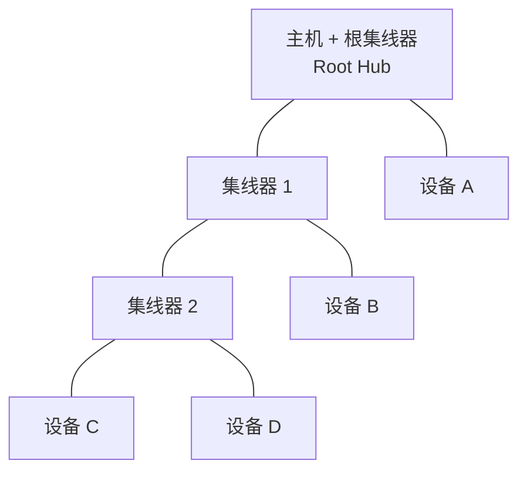
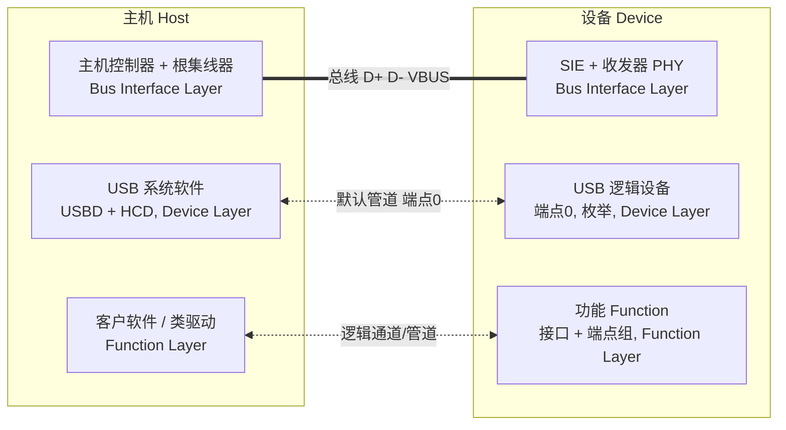
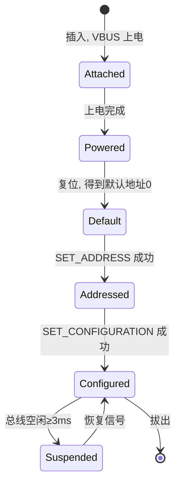
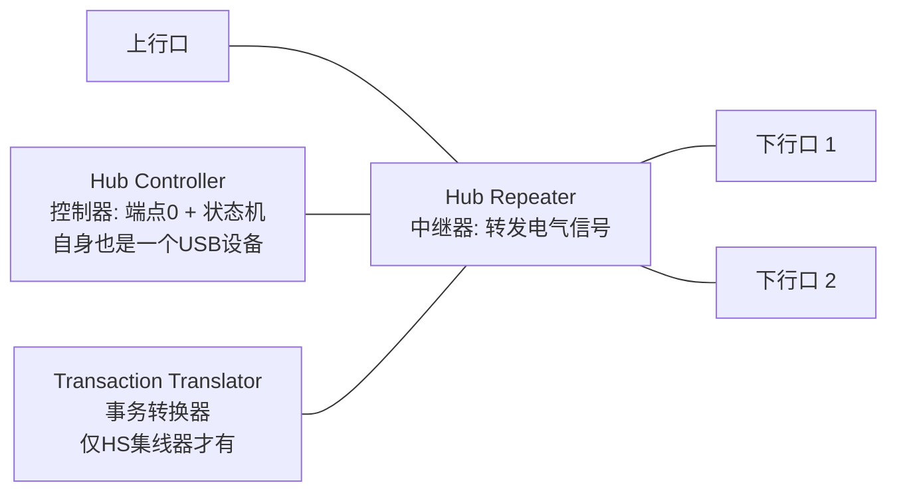
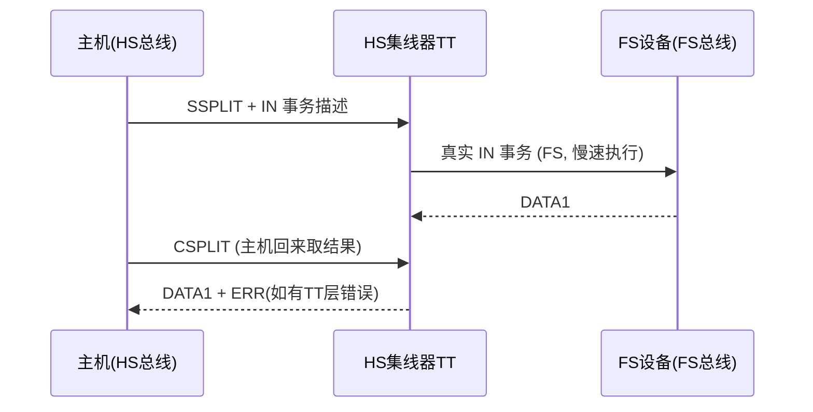

# 体系架构、拓扑、端点与管道、集线器

> 层级 入门 · 主题 `core` · 相关：[包格式、PID、事务、帧与 Data Toggle](04-packets-transactions.md)、[标准描述符字段全表](06-descriptors.md)、[枚举流程、Setup 包与标准请求](07-enumeration-requests.md)

## 核心事实 Key Facts

> 由维护者整理并与规范核对；与下方 USBTree 原文冲突时以本节为准。

| 约束 | 值 | 来源 |
|---|---|---|
| 设备地址 Address | 7 bit, 1–127（0 = 默认地址，仅枚举前） | Token ADDR 字段 7 bit |
| 端点号 Endpoint Number | 0–15，每个方向独立；EP0 双向且必有 | Token ENDP 字段 4 bit |
| 层级 Tiers | 最多 7 层（根集线器为第 1 层；链路上最多 5 个非根集线器） | USB 2.0 §4.1.1 |
| 端点地址编码 | bit7 = 方向（1 = IN 设备→主机），bit3:0 = 端点号，如 0x81 = EP1 IN | USB 2.0 §9.6.6 |

- 方向永远以主机为参照：IN = Device→Host，OUT = Host→Device。
- 层次：Configuration ⊃ Interface（+ Alternate Setting）⊃ Endpoint。同一时刻只有一个 Configuration 生效；类驱动按 Interface 绑定。
- 设备状态（USB 2.0 §9.1）：Attached → Powered → Default（总线复位后）→ Address（SET_ADDRESS）→ Configured（SET_CONFIGURATION ≠ 0）；任一状态总线空闲 3 ms → Suspended。
- 集线器 Hub：上行端口 + Repeater + Hub Controller；HS Hub 含 TT（单 TT / 多 TT）为 FS/LS 设备做 Split 事务。USB 3.x Hub = USB 2.0 Hub + SuperSpeed Hub 并联，两套独立拓扑。
- 复合设备 Composite：bDeviceClass=0x00（或 0xEF/0x02/0x01 + IAD），Windows 由 usbccgp.sys 为每个接口/IAD 功能创建子 devnode。

## 原文：02-体系架构与分层模型

> Source: [10-树干-USB核心/02-体系架构与分层模型.md](https://github.com/tangjianfang/USBTree/blob/main/10-树干-USB核心/02-体系架构与分层模型.md)

### 1. 三种角色

| 角色 | 英文 | 职责 |
|---|---|---|
| 主机 | Host | 唯一的调度者：发起一切事务、分配地址、轮询设备、管理带宽与电源。每条 USB 总线**有且只有一个主机**（USB4 的 Host-to-Host 通信是例外，见[高速演进](31-usb4.md)） |
| 设备 | Device | 功能提供者：响应主机请求、上报数据。逻辑上 = 一个 USB 逻辑设备（唯一地址）+ 若干接口（功能） |
| 集线器 | Hub | 扩展器：一个上行口 + N 个下行口，转发事务并管理端口（详见[集线器与连接管理](02-architecture-topology.md)） |

USB 集线器在协议层也是一种设备（类代码 0x09），所以"设备"是广义概念。

### 2. 拓扑：物理星型，逻辑点对点



- 物理上是以主机为根的**星型树**，集线器只能级联。
- 逻辑上主机把每个设备当作**点对点**连接对待：主机的"客户软件"只看得到自己的设备，集线器对功能层透明。
- 规模上限：
  - 7 位设备地址，0 保留作默认地址 → 最多 **127 个设备**（含集线器）；
  - 含根集线器最多 **7 层**；主机与设备之间的链路上最多串联 **5 个非根集线器**（剩余层次留给设备/集线器本身），这是传播延迟约束。
- USB 3.x 引入路由字符串后，高速包不再向所有下行口广播（见[高速演进](30-usb3-superspeed.md)）。

### 3. 分层模型（树干的主心骨）

主机与设备两端**层与层垂直对应**，水平通信只在物理层真实发生，上层是逻辑对等体：



| 层 | 主机侧 | 设备侧 | 树内对应知识 |
|---|---|---|---|
| 功能层 (Function Layer) | 类驱动 / 客户软件 | 功能固件（接口+端点组合） | 全部设备类枝干（[索引](10-class-index.md)） |
| 设备层 (USB Device Layer) | USBD：枚举、标准请求、地址/配置管理 | 端点 0、描述符、默认管道 | [描述符详解](06-descriptors.md)、[枚举流程](07-enumeration-requests.md) |
| 总线接口层 (Bus Interface) | 主机控制器（UHCI/OHCI/EHCI/xHCI） | SIE（串行接口引擎）+ PHY | [信号编码](03-physical-signaling.md)、[包格式](04-packets-transactions.md)、[主机控制器栈](40-host-controller-os.md) |

**SIE（Serial Interface Engine）** 是设备端硬件状态机，自动完成：NRZI 编解码、位填充/删除、SYNC/EOP 生成检测、CRC 校验、地址比对、PID 解析。固件只在 SIE 校验通过的包之后介入——调试时记住：**SIE 层的问题（时钟偏差、位填充）在固件日志里是看不见的**。

### 4. 端点与管道：一切通信的落点

- **端点 (Endpoint)**：设备端的数据收发缓冲区，用 4 位编号（0~15）+ 1 位方向（IN=设备→主机，OUT=主机→设备）标识。**IN/OUT 以主机视角命名**。
- **端点 0**：每个设备必有，双向，专用于控制传输（枚举与标准请求），也叫**默认控制管道**。
- **管道 (Pipe)**：主机端软件对"某端点+传输类型+带宽+特性"的逻辑抽象：
  - **消息管道 (Message Pipe)**：仅端点 0，有固定格式（Setup/Data/Status）；
  - **流管道 (Stream Pipe)**：中断/批量/同步端点，无结构约定。
- 端点必须在描述符中声明（[描述符详解](06-descriptors.md)），主机按声明分配带宽与调度。

### 5. 设备状态机（USB 2.0 视角）



要点：

1. **Attached→Powered**：设备检测到 VBUS 即上电，但必须等到总线复位才可响应（上电后除端点 0 的基本电路外不得乱拉总线）。
2. **Default**：所有设备初始都用地址 0，主机用它与设备完成第一次描述符读取，再分配唯一地址（见[枚举流程](07-enumeration-requests.md)）。
3. **Addressed**：SET_ADDRESS 的新地址在**该请求状态阶段完成后**生效——常见固件错误是提前切换导致主机收到无应答。
4. **Configured**：只有进入 Configured 态，功能端点才开始工作；高功耗设备此时才可取用超过 100 mA 的电流（150 mA on 3.x）。
5. **Suspended** 与上述状态正交：任何工作态都可以被挂起（见[电源管理](08-power-management.md)）。

### 6. 数据流模型：客户—功能对等

一次数据交换的逻辑路径（以"应用读取 U 盘"为例）：

```
应用 → 文件系统 → MSC 类驱动 → USB 核心(构造 URB/IRP) → HCD(排入调度)
→ 主机控制器(打包/编码) → 总线 → 设备 SIE(解码/CRC) → 端点缓冲 → MSC 固件 → 闪存
```

反向返回数据走同样路径的镜像。理解这条链路后，[错误处理](09-errors-testmode.md)中每一环如何报告错误就都有了位置感：电气错误在 PHY/SIE 被 CRC 捕获，协议错误在设备层表现为 STALL，类语义错误由类驱动翻译。

### 7. 速度与"多速并存"的架构处理

- HS 设备接入时先以 FS 检测，再通过 **Chirp 握手**升级到 HS（详见[信号编码](03-physical-signaling.md)）。
- USB 3.x 设备走独立的 SS 双 Simplex 线对枚举，同时保留 D+/D- 用于向后兼容与首次检测。
- 一个 3.x 集线器内部同时包含 3.x 集线器与 2.0 集线器两套逻辑——低速设备插在 3.x 集线器上实际挂在它的 2.0 半区。

## 原文：09-集线器与连接管理

> Source: [10-树干-USB核心/09-集线器与连接管理.md](https://github.com/tangjianfang/USBTree/blob/main/10-树干-USB核心/09-集线器与连接管理.md)

### 1. 集线器的三件套



- **Hub Repeater**：电气层中继，做连接检测、速率隔离、帧边界转发；
- **Hub Controller**：集线器自己的 USB 设备部分——默认地址 0 → 枚举 → 端点 0 → 类代码 **0x09**；
- **Transaction Translator (TT)**：USB 2.0 集线器独有，把 HS 下行事务转换为 FS/LS 事务（分裂事务）。

### 2. 端口状态与变更位

集线器暴露两类寄存器式请求（类请求，接口=0）：

- `GET_STATUS(端口)`：连接、使能、挂起、过流、复位、供电 + **高速已连接/低速已连接** 位；
- `GET/CLEAR_FEATURE(端口)`：变更位 C_PORT_CONNECTION / C_PORT_RESET / C_PORT_OVER_CURRENT 等——**写 1 清除**（写后自清）模型。

插入流程：设备上拉数据线 → 下行口 15kΩ 下拉检测到变化 → 控制器置 C_PORT_CONNECTION → 集线器驱动（主机）轮询发现 → 复位端口 → 开始[枚举](07-enumeration-requests.md)。**热插拔的协议实现就是这一条轮询链**。

### 3. 端口电源与过流

| 机制 | 说明 |
|---|---|
| 每口独立供电 (per-port) | 可单独开关下行口电源（SET_FEATURE PORT_POWER） |
| 分组供电 (ganged) | 多口同开同关，省成本 |
| 过流检测 | 电流超限 → 置过流位 → 主机可关端口；BC1.2/Type-C 时代由硬件保护接管（[供电枝干](21-charging-bc12-otg.md)） |
| 复位后状态 | 复位完成端口进入 enabled；失败则反复复位若干次后放弃（设备"假死"的一种） |

### 4. 事务转换器 (TT) 与分裂事务

HS 集线器下方挂着 FS/LS 设备时，主机不能让慢速设备占住 480 Mbps 总线。解法是**分裂事务 (Split Transaction)**：



- 主机侧把 FS/LS 设备的带宽按**开销预算**排进微帧（TT 有自己的 FS 帧时域）；
- **单 TT (Single TT)**：所有下行口共享一个 TT → 一个慢设备拖累全 hub；**多 TT (Multi TT)**：每口独立 TT——好集线器的卖点，设备描述符里 bDeviceProtocol=0x02 声明；
- 排查联想：多口 hub 上 U 盘突然掉速/失联，优先怀疑单 TT hub 的 FS/LS 设备干扰。

### 5. 集线器描述符速览

- 标准描述符之外有**集线器类描述符**（类型 0x29）：bNbrPorts、wHubCharacteristics（供电方式/过流模式）、bPwrOn2PwrGood、bHubContrCurrent、每个口的可移除位图 (DeviceRemovable)；
- 类请求：`GET_STATUS/CLEAR_FEATURE/SET_FEATURE` 作用于端口（PORT_RESET/PORT_POWER/PORT_SUSPEND 等特征号）；
- 主机的集线器驱动（Windows usbhub、Linux usbcore 的 hub.c）就是围着这些位转的。

### 6. 挂起/恢复在集线器上的传播

- **全局挂起**：主机停发 SOF，整棵树顺次进入挂起（[电源管理](08-power-management.md)）；
- **选择性挂起**：主机 SET_FEATURE(PORT_SUSPEND) 只挂起某口子树，其余照常；
- **恢复**：主机对端口发恢复信号（PORT_RESUME），集线器向下游转发 K 序列；设备远程唤醒时向上行转发（每级集线器要能"中继唤醒"）；
- 集线器在挂起期间必须保持端口供电与检测电路，且自己消耗 ≤2.5 mA（自供电 hub 有例外计算规则）。

### 7. 层级限制回顾

- 最多 **7 层**（含根集线器）：根(1) + 最多 5 个串联非根集线器 + 设备(7)；
- 127 个地址含沿途所有集线器——一层 6 口 hub×5 级就吃掉 30 个地址；
- 超限的表现：多插的设备不枚举（地址/层级耗尽），无报错——排查外设问题时别忽略。

### 8. USB 3.x 的集线器变化

- 3.x 集线器 = 3.x 半区（包路由、链路训练中继）+ 2.0 半区（含 TT）双逻辑并立；
- 3.x 不再需要分裂事务：3.x 域内没有"慢速设备混跑高速总线"的问题（FS/LS 设备由 2.0 半区处理）；
- 路由字符串 (Routing String) 让 3.x 包沿路径直达端口，不再广播——与 2.0 中继模型的本质差异（[USB3x](30-usb3-superspeed.md)）。
