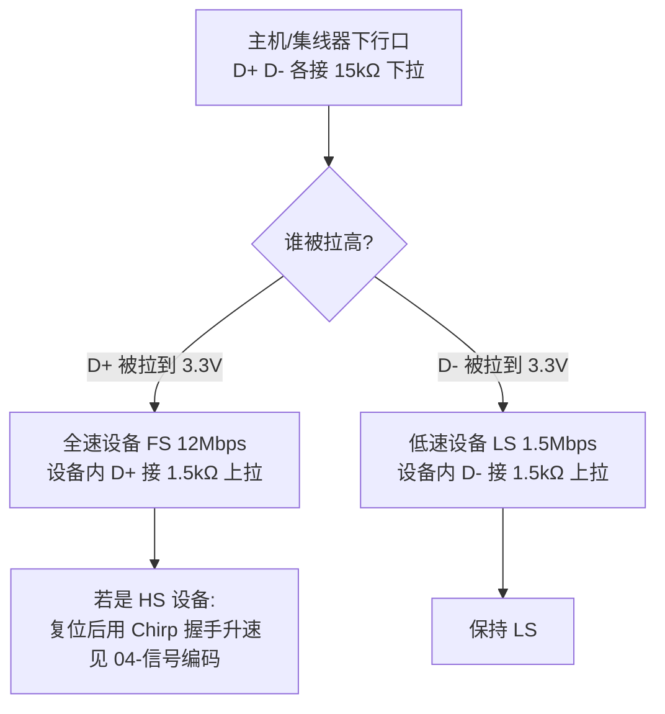
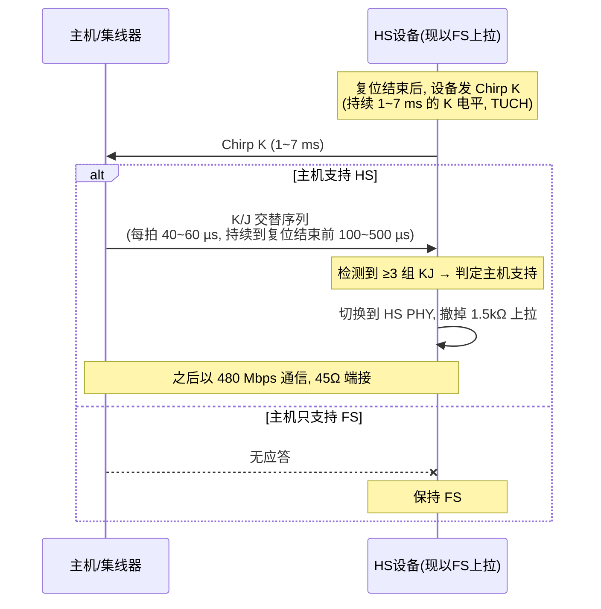

# 物理层、电气特性与信号编码

> 层级 进阶 · 主题 `core` · 相关：[体系架构、拓扑、端点与管道、集线器](02-architecture-topology.md)、[包格式、PID、事务、帧与 Data Toggle](04-packets-transactions.md)、[连接器演进与 USB Type-C（含 CC 状态机与时序）](20-connectors-typec.md)

## 核心事实 Key Facts

> 由维护者整理并与规范核对；与下方 USBTree 原文冲突时以本节为准。

| 项 | 值 |
|---|---|
| USB 2.0 线 | VBUS(5V)、D−、D+、GND |
| FS 设备识别 | 设备 1.5 kΩ 上拉 D+；主机每线 15 kΩ 下拉 |
| LS 设备识别 | 设备 1.5 kΩ 上拉 D− |
| HS 识别 | 以 FS 连接，复位期间设备发 Chirp K，主机回 K-J 序列，成功后切 HS 终端（45 Ω） |
| 编码 | NRZI：数据 0 = 电平翻转，1 = 保持；连续 6 个 1 后插入 0（bit stuffing） |
| 包边界 | SYNC（FS/LS 8 bit，HS 32 bit）开头；EOP = SE0 + J |
| 复位 Reset | 主机驱动 SE0 ≥ 10 ms |
| 单段线长 | FS/HS 约 5 m |

- HS 设备只跑 FS 的首要原因：Chirp 握手失败（信号完整性、线长、经过仅 FS 的 Hub）。

## 原文：03-物理层与电气特性

> Source: [10-树干-USB核心/03-物理层与电气特性.md](https://github.com/tangjianfang/USBTree/blob/main/10-树干-USB核心/03-物理层与电气特性.md)

### 1. USB 2.0 的四根线

| 线 | 名称 | 电气规格 | 功能 |
|---|---|---|---|
| 1 | VBUS | 4.75~5.25 V（源端），最坏情形设备端可低至 4.4 V | 总线供电 |
| 2 | D− | 90 Ω 差分阻抗双绞线，与 D+ 成对 | 差分数据 |
| 3 | D+ | 同上 | 差分数据 |
| 4 | GND | — | 参考地 / 回流 |

Mini/Micro 接口增加第 5 根 **ID** 线，用于 OTG 角色判定（详见[接口形态演进](20-connectors-typec.md)）。

### 2. 供电模型（USB 2.0 时代）

- **单位负载 (Unit Load) = 100 mA**：
  - 未配置设备（枚举未完成/未 SET_CONFIGURATION）最多取 1 个单位负载；
  - 配置为高功耗 (bMaxPower > 100 mA) 后最多 **500 mA**；
  - 低功耗设备永远不超过 100 mA，且不能被远程唤醒负载例外。
- 集线器下行口按端口供电（每口 1 单位负载待机 + 5 单位负载满配）或 ganged 分组供电，必须支持过流检测与报告（见[集线器](02-architecture-topology.md)）。
- 挂起态限流 **2.5 mA**——注意这个数字比一个单位负载还小，做低功耗设备时挂起路径要独立核算。
- 3.x 时代：单位负载 150 mA，最大 900 mA；Type-C/PD 体系彻底另起炉灶（[Type-C](20-connectors-typec.md)、[USB PD](22-usb-pd.md)）。

### 3. 速度检测：上拉/下拉的博弈

这是全树最重要的电气"握手"，发生在任何数据包之前：



固件启示：**D+/D- 的 1.5 kΩ 上拉何时接入由固件控制**（很多 MCU 是"使能 USB 外设"这个动作）。固件初始化完成后再使能上拉，主机才能看到"设备插入"——这就是软件模拟热插拔的电气基础。

### 4. 线缆与连接器

#### 4.1 引脚定义（公头，从接触面看）

| 连接器 | 1 | 2 | 3 | 4 | 5 |
|---|---|---|---|---|---|
| Type-A / Type-B | VBUS | D− | D+ | GND | — |
| Mini-B / Micro-B | VBUS | D− | D+ | **ID** | GND |
| Type-A/B (3.0 版加宽) | VBUS | D− | D+ | GND | + SSTX±/SSRX± 共 9 针 |

3.0 的 SSTX/SSRX 与 D+/D- 物理隔离——3.x 高速通信与 2.0 共用连接器但不用同一对线。

#### 4.2 线缆规格要点

| 参数 | FS | LS | HS/SS |
|---|---|---|---|
| 最大长度（规范建议） | 5 m | 3 m | 5 m（HS）/ 主动线缆延长（SS/USB4） |
| 差分阻抗 | 90 Ω ±15% | 同左 | 90 Ω ±15%（SS 更严） |
| 结构 | 非屏蔽可用（LS） | — | 必须屏蔽双绞 + 地线 |

常见故障源头：仅充电线（没有 D+/D- 线对）、超长劣质线（差分阻抗失控→眼图闭合）、接头氧化。系统性排查见[枚举失败排查手册](50-debug-troubleshooting.md)。

### 5. 信号幅度与阈值（FS/LS）

| 参数 | FS | LS |
|---|---|---|
| 驱动幅度 | 0 / 3.3 V 单端摆幅（差分） | 同 FS |
| 差分接收器灵敏度 | |VID| ≥ 200 mV | 同 |
| 单端阈值 | 0.8 / 2.0 V 之间 | 同 |
| 上升/下降时间 | 4~20 ns | 75~300 ns |

**J/K 状态极性相反**是 LS 的著名坑：

| 总线状态 | FS 含义 | LS 含义 |
|---|---|---|
| Differential 1 | **J**（空闲态） | **K** |
| Differential 0 | K | J |
| SE0（两线均低） | 复位/EOP 用 | 同 |
| SE1（两线均高） | 非法 | 非法 |

### 6. USB 3.x 的物理层变化

- 每方向一对独立差分线（SSTX+/− 主机→设备，SSRX+/− 设备→主机），**全双工**，与 2.0 的半双工轮询根本不同。
- 8b/10b（Gen1，5 Gbps→有效 4 Gbps）→ 128b/132b（Gen2，10 Gbps，效率 97.7%）。
- 幅度降到约 800~1200 mV 峰峰值（Gen1），通过均衡 (Equalization) 补偿通道损耗。
- 线缆认证分级、主动线缆（红光雷电线/光纤）与 E-marker 详见 [AlternateMode 与 E-marker](23-altmode-emarker.md)。
- 信号完整性验证手段：眼图 (Eye Diagram)、TDR 阻抗测量——属于[合规认证](51-compliance-security.md)的电气测试项。

### 7. 插入检测与上电时序

1. 主机/集线器持续驱动 15 kΩ 下拉，轮询检测任一数据线被拉高 → 判定有设备接入；
2. 主机读端口状态，稳定去抖（通常 100 ms 量级的软件延时）后对端口复位；
3. 设备侧：检测 VBUS 有效 → 初始化 SIE → 使能 D+/D- 上拉 → 等待复位；
4. ESD 防护（TVS 阵列）是量产设备标配，注意其结电容对高速信号的影响（选低容 TVS）。

## 原文：04-信号编码与比特流

> Source: [10-树干-USB核心/04-信号编码与比特流.md](https://github.com/tangjianfang/USBTree/blob/main/10-树干-USB核心/04-信号编码与比特流.md)

### 1. NRZI 编码：0 翻转，1 保持

USB 2.0 线上不传时钟，靠 **NRZI（Non-Return-to-Zero Inverted）** 编码携带时序信息：

| 数据位 | NRZI 动作 |
|---|---|
| 0 | 电平翻转（J↔K） |
| 1 | 电平保持 |

示例：设初始态为 J，发送比特流 `1 1 1 0 1 0 0 1`：

```
数据:  1    1    1    0    1    0    0    1
NRZI:  J    J    J    K    K    J    K    K
```

风险：长串 1 → 长时间无翻转 → 接收端时钟漂移失锁。解决方案就是位填充。

### 2. 位填充 (Bit Stuffing)

规则：**每连续 6 个 1 之后，无论下一位是什么，强制插入一个 0**（保证至少每 7 位一次翻转）。

```
原始:   0111111 0 ...      → 连续六个 1 后插入 0
发送:   01111110 ...
```

- 填充发生在**整个包内**（PID 到 CRC，不含 SYNC 与 EOP 的特殊电平序列）；
- 接收端自动删除填充位；若在数据区收到 7 个连续 1，即**位填充错误 (Bit Stuff Error)** → 丢弃整包、不应答（发送方超时重传，见[错误处理](09-errors-testmode.md)）；
- 位填充让实际总线占用率与数据内容相关——理论带宽计算时按最坏情形留余量（FS 每帧有效位时间约 12000 个）。

### 3. SYNC 域：每个包的开胃菜

接收端需要用 SYNC 对齐每位采样时钟：

| 速率 | SYNC 长度 | NRZI 波形 | 比特 |
|---|---|---|---|
| FS/LS | 8 位 | KJKJKJKK | `00000001` |
| HS | 32 位 | (KJ)×15 后接 KK | 32 位 |

主机与设备都用 SYNC 的跳变沿做时钟恢复；HS 需要更长 SYNC 是因为 480 Mbps 下锁相更快更严。

### 4. EOP（包结束）与总线特殊状态

| 状态/序列 | 定义 | 用途 |
|---|---|---|
| EOP (FS/LS) | SE0 持续 2 位时间 + J 持续 1 位 | 正常包结束标记 |
| EOP (HS) | 故意制造的 NRZI 位错误（无填充违规错） | HS 用电气特征替代 |
| 复位信号 | **SE0 ≥ 10 ms** | 主机复位端口/设备 |
| 空闲 (Idle) | FS: J 态 / LS: J 态（各自极性） | 无包时的静默态 |
| 挂起 (Suspend) | 空闲 ≥ 3 ms | 设备进入低功耗（[电源管理](08-power-management.md)） |
| 恢复 (Resume) | **K 态 ≥ 20 ms** + 低速 EOP | 唤醒 |
| 连接指示 | D+（FS/HS）或 D-（LS）被拉高 | 速度检测（[物理层](03-physical-signaling.md)） |

记忆口诀：**复位看 SE0 十毫秒，挂起看空闲三毫秒，唤醒看 K 态二十毫秒**。

### 5. HS Chirp 握手：从全速升到高速

HS 设备接入时先被识别为 FS（D+ 上拉），复位信号结束后发生"谈判"：



排查联想：**HS 设备始终以 FS 运行**，多半是 Chirp 握手环节失败（PHY 供电不足、时钟偏差、上拉未按规范撤除）。更多见[排查手册](50-debug-troubleshooting.md)。

>  勘误（evolve #3）：本节此前误写设备 Chirp 为"17~20 ms"、主机序列"每段 1~7 ms/共 40~60 ms"——均不正确。规范值：设备 Chirp K（TUCH）**1~7 ms**，主机 KJ 交替每拍（TDCHBIT）**40~60 µs**，见 USB 2.0 spec Table 7-5 与 [时序参数全表](90-quick-reference.md) §1.2。

### 6. 时钟与容差

| 项目 | FS/LS | HS |
|---|---|---|
| 数据速率容差 | ±0.25%（FS 从设备），主机更严 | ±500 ppm |
| 每帧抖动要求 | 帧间隔 1 ms ±若千 ns | 微帧 125 µs |
| 帧长 | 1 ms（每帧一个 SOF） | 125 µs 微帧 ×8（每微帧一个 SOF） |

晶振选型教训：内部 RC 振荡器通常达不到 ±0.25%，必须用晶体或经时钟恢复——用内部 RC 的设备枚举失败是经典案例。

### 7. 3.x 的编码（速览）

USB 3.x 放弃 NRZI/位填充，改用：
- **Gen1**: 8b/10b 分组编码（保证直流平衡与时钟内容），加扰 (Scrambling) 扩频；
- **Gen2**: 128b/132b 块编码（效率 97.7%）+ 更强加扰；
- 训练与对齐交给有序集 (Ordered Sets) 与 LFPS 信令，详见 [USB3x 与 SuperSpeed](30-usb3-superspeed.md)。
