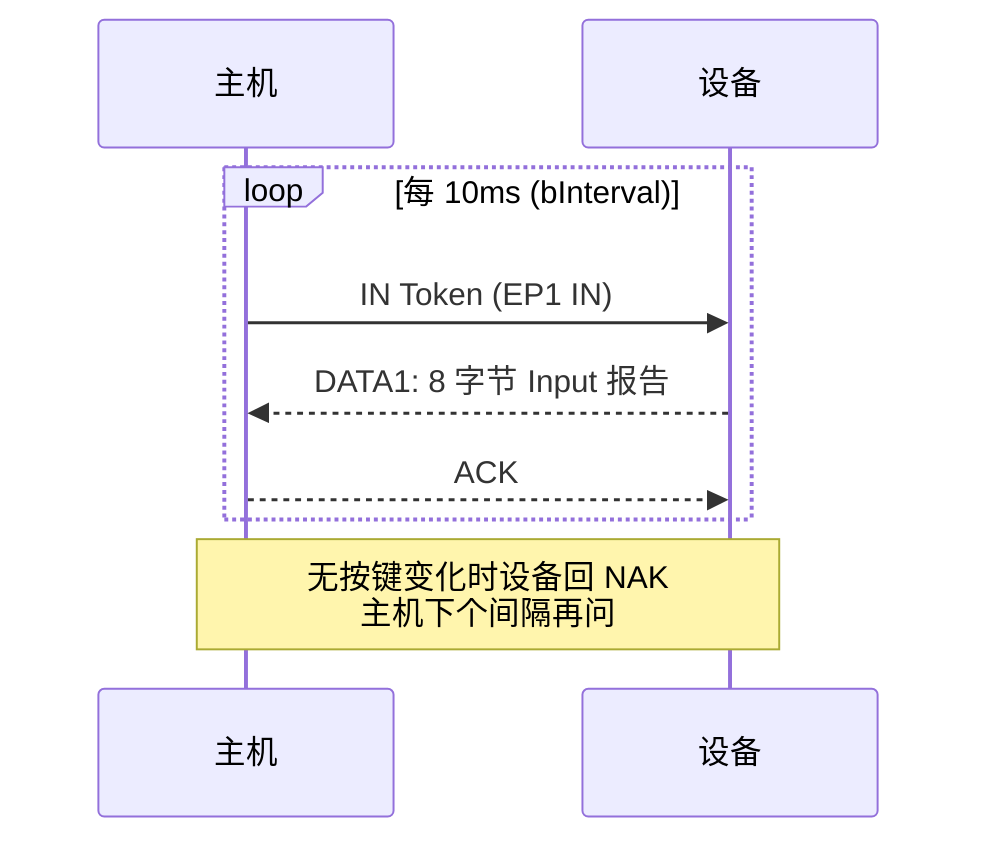
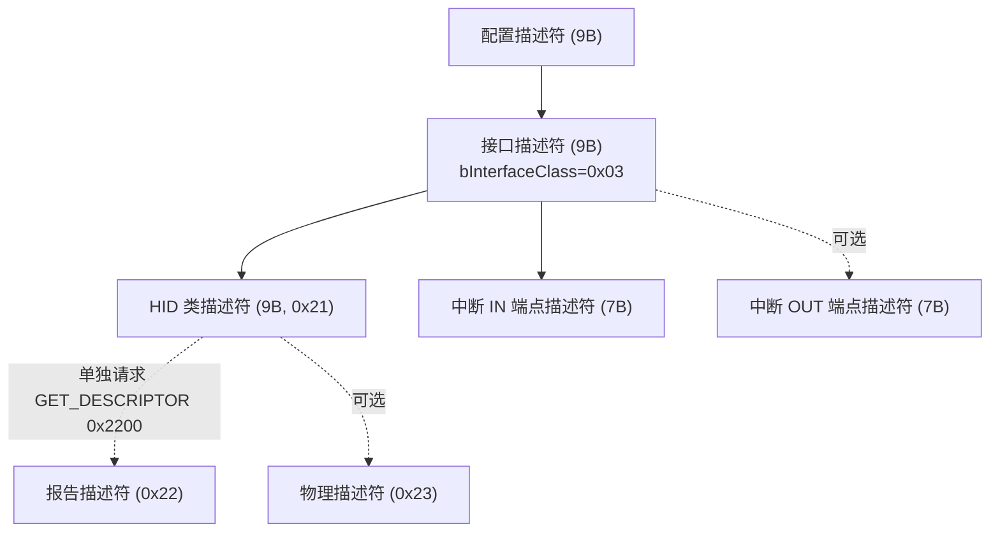
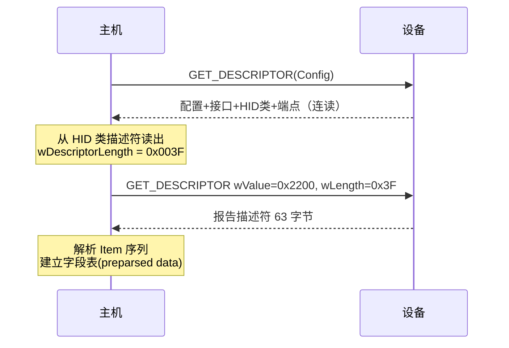
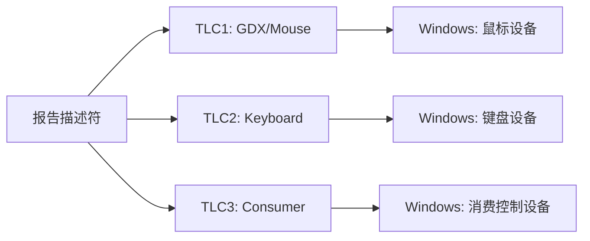
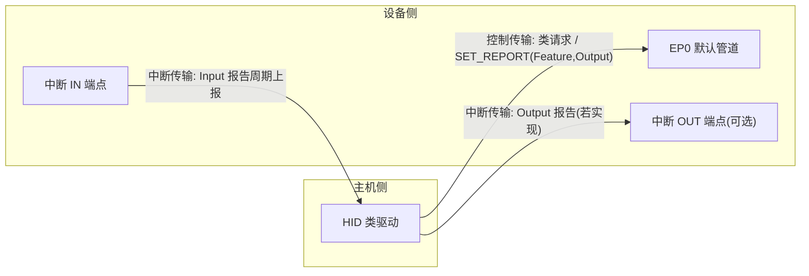
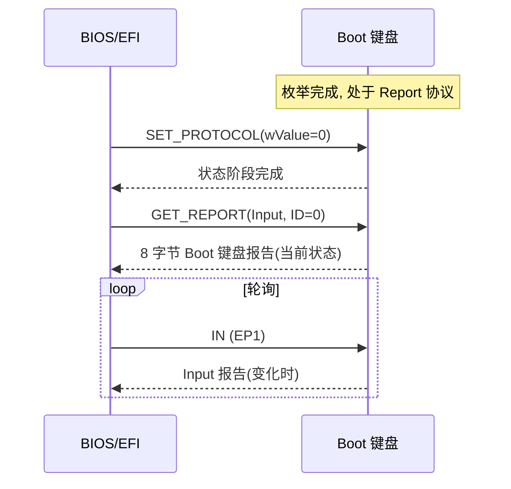
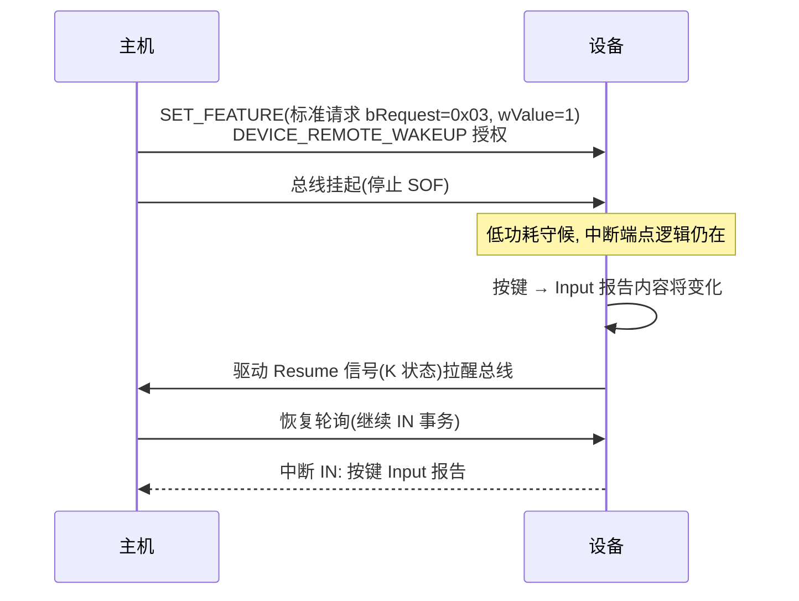

# HID 核心：类描述符、报告描述符 Item、Usage、类请求

> 层级 进阶 · 主题 `class/hid` · 相关：[HID 典型设备：键盘、鼠标、消费控制、手柄、触控、跨传输、完整描述符](12-hid-devices.md)、[HID 规范级附录（全表）](13-hid-spec-appendix.md)、[Windows USB 驱动开发：选型、WinUSB、KMDF/UMDF、调试](41-windows-driver.md)、[无线与 USB 的交汇：HCI-over-USB、HOGP、Wireless USB/MA-USB 历史](60-usb-wireless-intersection.md)

## 核心事实 Key Facts

> 由维护者整理并与规范核对；与下方 USBTree 原文冲突时以本节为准。

接口：bInterfaceClass=0x03；bInterfaceSubClass 0x00 无 Boot / 0x01 Boot；bInterfaceProtocol 0x01 键盘 / 0x02 鼠标（仅 SubClass=1 有意义）。端点：Interrupt IN 必需，Interrupt OUT 可选（无则 Output 报告走 SET_REPORT）。

HID 描述符（0x21，9 B 起）：bLength, bDescriptorType=0x21, bcdHID(2)=0x0111, bCountryCode(1), bNumDescriptors(1), [bDescriptorType(1)=0x22, wDescriptorLength(2)]×N。报告描述符由 GET_DESCRIPTOR（bmRequestType=0x81, wValue=0x2200, wIndex=接口号）读取。

短 Item 前缀字节：bTag[7:4] | bType[3:2]（0 Main/1 Global/2 Local）| bSize[1:0]（0/1/2/4 字节）。长 Item 前缀 0xFE。

| 类型 | Item | 前缀（bSize=1 时） |
|---|---|---|
| Main | Input / Output / Feature | 0x81 / 0x91 / 0xB1 |
| Main | Collection / End Collection | 0xA1 / 0xC0 |
| Global | Usage Page | 0x05 |
| Global | Logical Minimum / Maximum | 0x15 / 0x25 |
| Global | Physical Minimum / Maximum | 0x35 / 0x45 |
| Global | Unit Exponent / Unit | 0x55 / 0x65 |
| Global | Report Size / Report ID / Report Count | 0x75 / 0x85 / 0x95 |
| Global | Push / Pop | 0xA4 / 0xB4 |
| Local | Usage / Usage Minimum / Usage Maximum | 0x09 / 0x19 / 0x29 |
| Local | Designator / String Index / Delimiter | 0x39 / 0x79 / 0xA9 |

Main Item 数据位：bit0 Data(0)/Constant(1)，bit1 Array(0)/Variable(1)，bit2 Absolute(0)/Relative(1)，bit3 No Wrap/Wrap，bit4 Linear/Nonlinear，bit5 Preferred State/No Preferred，bit6 No Null/Null State，bit7 Non Volatile/Volatile（Input 保留），bit8 Bit Field/Buffered Bytes。
Collection 类型：0x00 Physical、0x01 Application、0x02 Logical、0x03 Report、0x04 Named Array、0x05 Usage Switch、0x06 Usage Modifier。

常用 Usage Page：0x01 Generic Desktop（0x02 Mouse, 0x04 Joystick, 0x05 Gamepad, 0x06 Keyboard, 0x30 X, 0x31 Y, 0x38 Wheel）、0x07 Keyboard/Keypad、0x08 LED、0x09 Button、0x0C Consumer（0xE9 Vol+, 0xEA Vol−, 0xCD Play/Pause, 0x238 AC Pan）、0x0D Digitizer、0x0F PID（力反馈）、0x20 Sensors、0xFF00–0xFFFF Vendor-defined。

类请求（Setup）：

| bRequest | 名称 | bmRequestType | wValue | wIndex | 数据 |
|---|---|---|---|---|---|
| 0x01 | GET_REPORT | 0xA1 | 报告类型<<8 \| Report ID（1 Input, 2 Output, 3 Feature） | 接口 | 报告 |
| 0x02 | GET_IDLE | 0xA1 | 0<<8 \| Report ID | 接口 | 1 B |
| 0x03 | GET_PROTOCOL | 0xA1 | 0 | 接口 | 1 B（0 Boot, 1 Report） |
| 0x09 | SET_REPORT | 0x21 | 同 GET_REPORT | 接口 | 报告 |
| 0x0A | SET_IDLE | 0x21 | Duration(4 ms 单位)<<8 \| Report ID | 接口 | 无 |
| 0x0B | SET_PROTOCOL | 0x21 | 0 Boot / 1 Report | 接口 | 无 |

- Boot 设备必须支持 GET_REPORT(Input)、GET/SET_PROTOCOL；设备复位后默认 Report 协议。
- 有 Report ID 时每个报告首字节为 ID；无 Report ID 时 Input/Output/Feature 每种类型各只有一个报告（Windows API 缓冲区首字节仍须为 0）。
- Windows：hidclass.sys 按顶层集合（Top-Level Collection, Application Collection）创建 HID 设备接口；kbdhid.sys / mouhid.sys 独占 Keyboard/Mouse TLC（用户态无法读取其 Input 报告），厂商配置通道通常使用 Usage Page 0xFF00+ 的独立 TLC。API：HidD_GetFeature / HidD_SetFeature（EP0 Feature）、HidD_GetInputReport / HidD_SetOutputReport（EP0）、ReadFile（中断 IN 缓冲）/ WriteFile（中断 OUT，若无则 SET_REPORT）、HidP_GetCaps（*ReportByteLength 含 Report ID 字节）、HidD_SetNumInputBuffers（默认 32，可调至 512）。

## 原文：00-HID概述与定位

> Source: [20-枝干-设备类协议/HID-人机接口设备/00-HID概述与定位.md](https://github.com/tangjianfang/USBTree/blob/main/20-枝干-设备类协议/HID-人机接口设备/00-HID概述与定位.md)

### 1. HID 是什么

HID（Human Interface Device，人机接口设备）是 USB 设备类(Class)中最早、最普及的一类，由 USB-IF 在 1996 年随 USB 1.0 时代发布 HID 1.0 规范，现行版本为 **Device Class Definition for Human Interface Devices 1.11**（2001 年发布）。它最初只为解决一个问题：让鼠标(Mouse)和键盘(Keyboard)不需要为每个型号编写专用驱动，插上就能用。

如今 HID 已经远远超出"键鼠"的范畴：

| 领域 | 典型设备 | 利用的 HID 机制 |
|---|---|---|
| 输入 | 键盘、鼠标、轨迹球、触摸板 | Boot 协议、中断端点 |
| 消费电子 | 多媒体键盘、遥控器、耳机线控 | Consumer Usage Page(0x0C) |
| 游戏 | 手柄、摇杆、方向盘、力反馈 | 多轴 + 按钮阵列 + Output/PID |
| 触控 | 触摸屏、精密触摸板、数位板 | Digitizer Page(0x0D)、多点触控 |
| 医疗 | 血压计、血糖仪面板 | Medical Instruments Page(0x40) |
| VR/模拟 | 头显控制器、飞行摇杆 | VR Page(0x03)、Simulation Page(0x02) |
| 传感 | 传感器中枢（I2C 侧） | 传感器 Usage（编码见 HID Usage Tables） |
| 工业 | 扫码枪(Barcode Scanner 0x8C)、电子秤(Scale 0x8D) | 专用 Usage Page |

HID 能"通吃"这些设备的根本原因是：**HID 不定义"设备是什么"，只定义"如何描述数据"**。这正是它在 USB 枚举体系中的位置——HID 属于接口级类定义，挂在接口描述符(Interface Descriptor)上：

```mermaid
flowchart TD
    D["设备描述符 Device Descriptor"] --> C["配置描述符 Configuration Descriptor"]
    C --> I["接口描述符 Interface Descriptor<br/>bInterfaceClass = 0x03 (HID)"]
    I --> HD["HID 类描述符 (0x21)"]
    I --> EP["中断端点描述符"]
    HD -.->|GET_DESCRIPTOR(0x22) 单独获取| RD["报告描述符 Report Descriptor<br/>描述设备的数据格式"]
```

主机看到 `bInterfaceClass=0x03` 后加载通用 HID 类驱动，再解析报告描述符即可知道"这个设备会上报什么格式的数据"，无需厂商驱动。

### 2. 接口级类代码

HID 的类代码全部定义在**接口描述符**中（设备描述符中的 bDeviceClass 保持 0x00，即"各类在接口级声明"）：

| 字段 | 取值 | 含义 |
|---|---|---|
| `bInterfaceClass` | `0x03` | HID 类 |
| `bInterfaceSubClass` | `0x00` | 不支持 Boot 协议（绝大多数设备） |
| `bInterfaceSubClass` | `0x01` | 支持 Boot 协议(Boot Protocol) |
| `bInterfaceProtocol` | `0x00` | 无（SubClass=0 时无意义） |
| `bInterfaceProtocol` | `0x01` | Boot 键盘 |
| `bInterfaceProtocol` | `0x02` | Boot 鼠标 |

注意：

- `bInterfaceProtocol` **仅在 SubClass=1（Boot）时有意义**；普通 HID 设备一律写 0。
- Boot 协议是一套固定的极简报告格式，专为 BIOS/EFI 在没有完整 HID 解析器时操作键盘鼠标而设（详见 [05-键盘详解.md](12-hid-devices.md)、[06-鼠标详解.md](12-hid-devices.md)）。
- 复合设备（如"键盘+鼠标"）用**多个 HID 接口**实现，每个接口一份 HID 类描述符。

### 3. 自我描述的设计哲学

HID 最核心的设计是**报告描述符(Report Descriptor)**：设备用一段二进制 Item 序列自述"我的报告里有哪些字段、各多少位、取值范围、物理含义"。主机解析一次，之后所有数据交换都按这份"数据字典"进行。

这带来三个结果：

1. **协议与传输无关**。报告描述符只描述数据结构，不绑定 USB——同一份描述符可以跑在 USB、I2C、SPI、蓝牙 GATT 上（见 [10-HID跨传输I2C与BLE.md](12-hid-devices.md)）。
2. **一个通用驱动即可服务无限种设备**。Windows/Linux/macOS 的 HID 类驱动都是"描述符驱动的通用解析器"。
3. **扩展零成本**。新设备（如 VR 手柄）不需要新协议，只需要新的 Usage 组合（见 [03-Usage体系与集合.md](11-hid-core.md)）。

### 4. HID 规范文档族

HID 不是一个文档，而是一个文档族。写 HID 描述符时必须区分"类定义"与"Usage 表"两类规范：

| 文档 | 发布方 | 内容 |
|---|---|---|
| Device Class Definition for Human Interface Devices (HID) 1.11 | USB-IF | 类定义本体：描述符、Item 编码、类请求、Boot 协议 |
| HID Usage Tables（1.x 多个版本） | USB-IF | 全部 Usage Page/Usage ID 分配表（键盘键码、鼠标、Consumer、Digitizer……） |
| HID over I2C Protocol Specification | Microsoft/USB-IF | I2C 传输层（内置触控板/触摸屏） |
| HID over GATT Specification (HOGP) | Bluetooth SIG | BLE 传输层（Report Map 特征复用同一份报告描述符） |
| Device Class Definition for Physical Interface Devices (PID) 1.0 | USB-IF | 力反馈/效果管理（Usage Page 0x0F） |
| HID Sensor Usages | Microsoft | 传感器类 Usage 定义 |

版本细节与最新发布状态请以 usb.org 的 HID 页面为准，本文各数值均以 HID 1.11 与公开的 Usage Tables 为依据。

### 5. 为什么 HID 强制要求中断端点

人机交互数据有两个特点：**数据量小**（每报告几字节到几十字节）、**对延迟敏感**（按下到光标移动必须可感知地"跟手"）。这决定了 HID 不能只靠默认控制管道(Default Control Pipe)：

- 控制传输(Bontrol Transfer)无带宽/服务周期保证，且要和枚举、标准请求、状态轮询共用 EP0，主机软件调度一层叠一层，延迟不可控。
- 中断传输(Interrupt Transfer)的本质是**主机保证以不大于 `bInterval` 的间隔轮询该端点**——给出了一个确定性的最大延迟上限。这正是"低延迟轮询"的含义：不是设备主动打断主机，而是主机周期性地"上门取件"。

因此 HID 1.11 对端点的要求是：

| 端点 | 必选性 | 用途 |
|---|---|---|
| 默认控制端点 EP0 | 必选（USB 通用） | 枚举、类特定请求、Feature 报告 |
| 中断 IN 端点 | **必选**（每个 HID 接口恰好 1 个） | 周期上报 Input 报告（按键/移动） |
| 中断 OUT 端点 | 可选 | 主机向设备推 Output 报告（如键盘 LED）；没有时退化为控制管道上的 `SET_REPORT` |

`bInterval` 与延迟直接挂钩：全速(Full-Speed)下 `bInterval=1ms` 即 1000Hz 轮询，低速率键盘用 10~20ms 也够用。高速(High-Speed)中断端点的 `bInterval` 以微帧(µFrame)为单位按 2^(n−1) 解释。

### 6. 在 USB 事务中的样子

一次典型的键盘按键上报（全速、`bInterval=10ms`）：



设备没有事件时对 IN 令牌回答 NAK，主机按 `bInterval` 周期重试——这就是 HID "永远在线、按需上报"的运行姿态。

### 7. 三类报告模型

HID 的全部数据被组织成三种报告，方向与通道是固定的，所有后续章节都建立在这个模型上：

| 报告类型 | 方向 | 典型内容 | 通道 |
|---|---|---|---|
| Input | 设备 → 主机 | 按键状态、位移、触点、传感器值 | 中断 IN 周期上报；也可 `GET_REPORT` 主动拉取 |
| Output | 主机 → 设备 | LED、背光、马达强度 | 中断 OUT（可选）；无则 `SET_REPORT` |
| Feature | 双向（主机发起） | 配置项：灵敏度、背光档位、协议版本 | 仅控制管道 `GET_REPORT/SET_REPORT` |

三类报告在描述符中分别由 `Input/Output/Feature` Main Item 声明，字段含义与编码规则完全一致，差别只在方向与通道（详见 [02-报告描述符与Item编码.md](11-hid-core.md)、[04-传输与类特定请求.md](11-hid-core.md)）。

### 8. Boot 协议 vs Report 协议

每个 HID 接口有两种运行协议，通过 `SET_PROTOCOL` 切换、逐接口独立：

| 维度 | Boot 协议 | Report 协议 |
|---|---|---|
| 报告格式 | 规范硬性固定（键盘 8B / 鼠标 3B） | 报告描述符任意定义 |
| Report ID | 无（固定格式不含 ID 字节） | 可用 |
| 进入方式 | 主机显式 `SET_PROTOCOL(0)` | **枚举后的默认状态** |
| 面向场景 | BIOS/EFI、恢复环境、无 HID 解析器 | 现代操作系统 |
| 功能上限 | 6 键无冲、3 按钮、无滚轮 | 任意：NKRO、多轴、多点触控、媒体键 |

设计建议：消费级键盘/鼠标应兼容 Boot（保证进 BIOS 可用）；游戏/多功能设备在 Report 协议下扩展，且扩展字段永远"接在 Boot 布局之后"，保证两协议共用一份描述符（[06-鼠标详解.md](12-hid-devices.md) 的双协议示例即此套路）。

### 9. 典型形态速查

| 形态 | 描述符组织 | 参考章节 |
|---|---|---|
| 独立 USB 键盘/鼠标 | 单接口单 TLC（Boot 兼容） | [05](12-hid-devices.md) / [06](12-hid-devices.md) |
| 无线接收器（键鼠一体 dongle） | 单接口多 TLC + Report ID，或多接口 | [11-实战完整报告描述符.md](12-hid-devices.md) |
| 多媒体键盘 | 键盘 TLC + Consumer TLC | [07-消费控制与多媒体.md](12-hid-devices.md) |
| 笔记本内置触摸板 | I2C-HID，Touch Pad TLC | [09](12-hid-devices.md) / [10](12-hid-devices.md) |
| BLE 无线鼠标 | HOGP，Report Map 复用 USB 描述符 | [10-HID跨传输I2C与BLE.md](12-hid-devices.md) |
| 游戏手柄 | Game Pad TLC 多轴 + Output 振动 | [08-游戏手柄与摇杆.md](12-hid-devices.md) |

## 原文：01-HID描述符

> Source: [20-枝干-设备类协议/HID-人机接口设备/01-HID描述符.md](https://github.com/tangjianfang/USBTree/blob/main/20-枝干-设备类协议/HID-人机接口设备/01-HID描述符.md)

### 1. HID 设备的描述符组合

一个 HID 接口由四层描述符叠加描述：**USB 标准描述符**（树干通用）+ **HID 类描述符**(Class Descriptor) + **报告描述符**(Report Descriptor)（不通过配置描述符连读，须单独获取）+ 可选**物理描述符**(Physical Descriptor)。

| 描述符 | 类型码 | 获取方式 | 归属 |
|---|---|---|---|
| 设备描述符 Device | `0x01` | GET_DESCRIPTOR(Device) | USB 标准 |
| 配置描述符 Configuration | `0x02` | GET_DESCRIPTOR(Config)，连读全部下挂描述符 | USB 标准 |
| 接口描述符 Interface | `0x04` | 随配置连读 | USB 标准 |
| **HID 类描述符** | `0x21` | 随配置连读 | HID 类 |
| **报告描述符 Report** | `0x22` | **必须单独 GET_DESCRIPTOR(0x22)** | HID 类 |
| 物理描述符 Physical（可选） | `0x23` | GET_DESCRIPTOR(0x23)，类请求级 | HID 类 |
| 端点描述符 Endpoint | `0x05` | 随配置连读 | USB 标准 |



### 2. HID 类描述符逐字段

HID 类描述符固定挂在接口描述符之后，最常见形态为 9 字节（只有一个报告描述符时）：

| 偏移 | 字段 | 长度 | 示例值 | 说明 |
|---|---|---|---|---|
| 0 | `bLength` | 1 | `0x09` | 本描述符长度（仅报告描述符时为 9） |
| 1 | `bDescriptorType` | 1 | `0x21` | HID 类描述符 |
| 2 | `bcdHID` | 2 | `0x0111` | 类规范版本号 BCD，`0x0111` = HID 1.11 |
| 4 | `bCountryCode` | 1 | `0x00` | 目标国家键盘布局代码，见下表 |
| 5 | `bNumDescriptors` | 1 | `0x01` | 下挂的附属类描述符个数（至少含报告描述符=1） |
| 6 | `bDescriptorType2` | 1 | `0x22` | 第 1 个附属描述符的类型：报告描述符 |
| 7 | `wDescriptorLength` | 2 | 如 `0x003F` | 报告描述符的字节长度（小端） |
| — | （更多附属描述符） | 3/项 | — | 若 bNumDescriptors>1，继续跟 (bDescriptorType, wDescriptorLength) 对 |

#### bCountryCode 取值节选

| 值 | 含义 | 值 | 含义 |
|---|---|---|---|
| 0 | Not Supported（绝大多数设备用此值） | 15 | Japan (Katakana) |
| 1 | Arabic | 16 | Korean |
| 3 | Canadian-Bilingual | 19 | Norwegian |
| 7 | Finnish | 25 | Spanish |
| 8 | French | 26 | Swedish |
| 9 | German | 28 | Swiss/German |
| 13 | International (ISO) | 32 | UK |
| 14 | Italian | **33** | **US** |

完整 0~35 的取值表见 HID 1.11 附录。非键盘设备一律填 0。

#### 物理描述符(0x23)简介

物理描述符用可选的静态数据描述"数据项与人身体部位的对应关系"（如某个轴对应哪根手指），配合 Input/Output Item 中的 Non-Linear、Physical Min/Max 等语义使用。实际产品极少使用，且它是纯信息性的——主机 HID 解析器不依赖它。绝大多数设备不实现，本文不展开。

### 3. 为什么报告描述符必须单独获取

两个结构性原因：

1. **配置描述符的连读链不含类内部数据**。`GET_DESCRIPTOR(Config)` 返回的是"配置→接口→（类描述符）→端点"这一固定骨架；报告描述符在规范里被定义为**可变的、可能很大的**数据块（几十到上千字节）。把它放进 wTotalLength 会让所有通用主机栈在枚举时被迫解析或缓冲未知长度的类数据。
2. **长度要先知道才能取**。报告描述符的长度只记录在 HID 类描述符的 `wDescriptorLength` 里——主机必须先读到 HID 类描述符，才知道用多大的 `wLength` 去请求报告描述符。这是刻意的两段式设计。

获取报告描述符用的是**标准** GET_DESCRIPTOR 请求（不是类请求），只是定向到接口：

| 字段 | 值 |
|---|---|
| `bmRequestType` | `0x81`（Device-to-Host, Standard, Interface） |
| `bRequest` | `0x06` (GET_DESCRIPTOR) |
| `wValue` | `0x2200`（高字节 0x22=Report，低字节 Index=0） |
| `wIndex` | 接口号 |
| `wLength` | HID 类描述符中给出的 `wDescriptorLength` |



### 4. 端点要求

| 端点 | 要求 | 说明 |
|---|---|---|
| 中断 IN | **必选** | Input 报告周期上报的唯一通道 |
| 中断 OUT | 可选 | 有则 Output 报告走它；无则 Output/Feature 全部走 EP0 上的 `SET_REPORT` |
| 等时/批量 | 禁止 | HID 类设备不得使用 |

中断端点参数速查：

| 速率 | wMaxPacketSize 上限 | bInterval 单位/范围 |
|---|---|---|
| 低速 | 8 字节 | ms，10~255 |
| 全速 | 64 字节 | ms，1~255 |
| 高速 | 64 字节 | µFrame，按 2^(n−1) 解释 |

### 5. 完整示例：USB Boot 键盘的配置描述符

一个最简 Boot 键盘（单接口、无 OUT 端点）的配置描述符总长构成：

```
配置描述符 9 + 接口描述符 9 + HID 类描述符 9 + 中断IN端点描述符 7 = 34 字节
```

逐字节十六进制（`wTotalLength = 0x0022 = 34`）：

```text
09 02 22 00 01 01 00 A0 32   ; 配置描述符: 总长34, 1接口, bConfigurationValue=1,
                             ;   iConfiguration=0, bmAttributes=0xA0(总线供电+远程唤醒),
                             ;   bMaxPower=0x32(100mA)
09 04 00 00 01 03 01 01 00   ; 接口描述符: 接口0, 1端点, Class=0x03,
                             ;   SubClass=0x01(Boot), Protocol=0x01(键盘)
09 21 11 01 00 01 22 3F 00   ; HID 类描述符: bcdHID=0x0111, 国家=0(不支持),
                             ;   1个描述符, 报告描述符长 0x003F=63 字节
07 05 81 03 08 00 0A         ; 端点描述符: EP1 IN, 中断, 8字节包, bInterval=10ms
```

要点核对：

- `wTotalLength`（偏移 2~3，小端 `22 00`）= 9+9+9+7 = **34**。
- 若增加一个中断 OUT 端点，总长变为 41 字节（+7）。
- `wDescriptorLength = 0x003F` 对应 [05-键盘详解.md](12-hid-devices.md) 中那份 63 字节的 Boot 键盘报告描述符——两份描述符的数值互相咬合。
- 多接口复合设备（如键盘+鼠标）则为"每接口一套 接口+HID+端点"，配置描述符的 `bNumInterfaces` 相应增加。

### 6. 描述符之间的数值一致性清单

实现时最常翻车的是跨描述符的一致性，逐项检查：

| 检查项 | 来源 | 去向 |
|---|---|---|
| `wDescriptorLength` | HID 类描述符 | GET_DESCRIPTOR(0x22) 的实际返回长度必须相等 |
| `bNumEndpoints` | 接口描述符 | 实际端点描述符个数（HID 恒为 1 或 2） |
| `bInterfaceProtocol` | 接口描述符 | Boot 描述符的固定报告格式（键盘 8B / 鼠标 3B/4B） |
| `wMaxPacketSize` | 端点描述符 | 报告长度（含 Report ID 字节）不得超过它 |
| `bcdHID` | HID 类描述符 | 描述符中使用的 Item 语法不得超出该版本 |

## 原文：02-报告描述符与Item编码

> Source: [20-枝干-设备类协议/HID-人机接口设备/02-报告描述符与Item编码.md](https://github.com/tangjianfang/USBTree/blob/main/20-枝干-设备类协议/HID-人机接口设备/02-报告描述符与Item编码.md)

### 1. 自描述字节流

报告描述符(Report Descriptor)不是"字段表"，而是一段**紧缩的字节码**：由若干 Item（项）顺序排列组成，主机 HID 解析器按顺序"执行"这些 Item，构建出报告的位级布局。它介于"数据结构声明"与"小型编程语言"之间——类比：报告描述符之于 HID 数据，相当于 DTD/Schema 之于 XML。

特点：

- 长度任意（几十字节到数百字节），由 HID 类描述符的 `wDescriptorLength` 声明；
- 获取方式：`GET_DESCRIPTOR(wValue=0x2200)`（见 [01-HID描述符.md](11-hid-core.md)）；
- Item 序列末尾约定俗成以 `0xC0`（End Collection）收束，但严格说解析器以"读满 wDescriptorLength"为准。

### 2. Item 的两种形态

#### 2.1 短 Item（Short Item）

1 字节头部 + 0/1/2/4 字节数据：

```text
  bit  7 6 5 4 | 3 2 | 1 0
     ┌─────────┼─────┼─────┐
     │  bTag   │bType│bSize│
     └─────────┴─────┴─────┘
  bSize: 00=0字节  01=1字节  10=2字节  11=4字节   （数据部分字节数）
  bType: 00=Main  01=Global  10=Local
  bTag:  Item 功能码（随 bType 分空间）
```

- 头部即编码：`前缀 = bTag<<4 | bType<<2 | bSize`。例如 `Usage Page` 的 bTag=0x0、bType=01、数据 1 字节 → 前缀 `0b0000_01_01 = 0x05`。
- **数据为小端(Little-Endian)**，且按规范解释为**有符号数**：若值为负、而数据只有 1/2 字节，解析器将其**符号扩展(sign-extend)到 32 位**。因此 `Logical Minimum (-127)` 编码为 `15 81`（0x81 即 -127），而 `0x15 0xFF` 表示的是 **-1 而不是 255**——这是最常见的编码事故（见 [11-实战完整报告描述符.md](12-hid-devices.md) 错误清单）。

多字节编码示例：

| Item 字节序列 | 解读 |
|---|---|
| `05 01` | Usage Page(Generic Desktop)，1 字节数据 |
| `26 FF 0F` | Logical Maximum(4095)，前缀 0x26=bSize 10（2 字节数据，小端） |
| `27 00 00 01 00` | Logical Maximum(65536)，bSize=11 → 4 字节数据 |
| `15 81` | Logical Minimum(-127)，负数符号扩展 |
| `26 FF FF` | Logical Maximum(**-1**)，经典符号扩展错误现场 |
| `85 03` | Report ID(3) |
| `A4` / `B4` | Push / Pop，bSize=0 无数据 |

#### 2.2 长 Item（Long Item）

前缀固定 `0xFE`（bTag=0xF, bType=11, bSize=10），随后 1 字节说明：高半字节 `bLongItemTag`、低半字节 `bDataSize`，其后跟 0~255 字节数据。长 Item 是规范预留的扩展通道，HID 1.11 未定义任何具体长 Item，实际描述符中不应出现。

### 3. 三类 Item 总表

#### 3.1 Main 类（bType=00）——描述数据与结构

| Item | 前缀（1 字节数据项） | 作用 |
|---|---|---|
| Input | `0x80`+位图 → 实际如 `81 02` | 声明一段"设备→主机"数据字段 |
| Output | `0x90` 基 → 如 `91 02` | "主机→设备"数据字段（LED 等） |
| Feature | `0xB0` 基 → 如 `B1 02` | 双向配置字段，仅走控制通道 |
| Collection | `A1 <type>` | 开启集合（如 `A1 01` = Application） |
| End Collection | `C0` | 关闭集合 |

Input/Output/Feature 的 1 字节数据是**位图标志**：

| 位 | 0 | 1 | 说明 |
|---|---|---|---|
| bit0 | Data | Constant | Constant=填充位/保留位 |
| bit1 | Array | Variable | Array=键码数组；Variable=独立位字段 |
| bit2 | Absolute | Relative | 绝对坐标 vs 相对位移（鼠标 X/Y=Relative） |
| bit3 | No Wrap | Wrap | 数值回绕 |
| bit4 | Linear | Non Linear | 物理映射是否线性 |
| bit5 | Preferred State | No Preferred State | 是否有默认回落状态 |
| bit6 | No Null Position | Null State | Null State=存在"无意义"取值（如帽开关 8~15） |
| bit7 | Non Volatile | Volatile | 仅 Output/Feature 有意义：主机是否可主动改写 |
| bit8 | Bit Field | Buffered Bytes | 按位打包 vs 按字节缓冲 |

常用组合速记：`81 02`=Data,Var,Abs（普通位图）；`81 00`=Data,Array,Abs（键码数组）；`81 06`=Data,Var,Rel（鼠标位移）；`81 03`=Const,Var,Abs（填充字节）；`81 42`=Data,Var,Abs,**Null State**（帽开关）。

#### 3.2 Global 类（bType=01）——带状态、跨 Item 生效

| Item | bTag | 典型前缀（1 字节数据） | 作用 |
|---|---|---|---|
| Usage Page | 0x0 | `05 <page>` | 设置当前 Usage Page（高 16 位） |
| Logical Minimum | 0x1 | `15 <n>` | 字段数值下界（报告值域） |
| Logical Maximum | 0x2 | `25 <n>` | 数值上界 |
| Physical Minimum | 0x3 | `35 <n>` | 物理量下界 |
| Physical Maximum | 0x4 | `45 <n>` | 物理量上界 |
| Unit Exponent | 0x5 | `55 <e>` | 物理单位指数 |
| Unit | 0x6 | `65 <u>` | 物理单位编码 |
| Report Size | 0x7 | `75 <n>` | 每个字段的位数 |
| Report ID | 0x8 | `85 <id>` | 为随后的报告定义 1~255 的编号 |
| Report Count | 0x9 | `95 <n>` | 相同 Size 字段的个数 |
| Push | 0xA | `A4`（无数据） | 压栈保存全部 Global 状态 |
| Pop | 0xB | `B4`（无数据） | 出栈恢复 |

#### 3.3 Local 类（bType=10）——一次性标签

| Item | bTag | 典型前缀 | 作用 |
|---|---|---|---|
| Usage | 0x0 | `09 <id>` | 给随后的 Main Item 贴 Usage 标签 |
| Usage Minimum | 0x1 | `19 <id>` | Array/位图字段的 Usage 起始 |
| Usage Maximum | 0x2 | `29 <id>` | Usage 结束 |

### 4. Global 持久 vs Local 即弃

理解报告描述符的关键心智模型：**解析器维护一个 Global 状态栈和一个 Local 标签列表**。

```text
Global 状态: { Usage Page, Logical Min/Max, Phys Min/Max,
               Unit/Exponent, Report Size, Report Count, Report ID }
   → 一直保持, 直到被新的 Global Item 覆盖或 Pop 恢复

Local 标签: { Usage, Usage Min/Max 累积列表 }
   → 每遇到一个 Main Item(Input/Output/Feature/Collection)
     即"贴"到该 Main Item 上, 然后【清空】
```

因此描述符写作顺序通常是："Global 定参（Page/Logical/Size/Count）→ Local 贴标签 → Main 产出字段"。同一个 `95 08`（Report Count=8）可以连续服务多个 Input Item，直到被改写；而每个 Input 前都要重新贴 Usage。

### 5. 报告字段的位填充与对齐

- 字段从每个字节的**最低位(LSB)开始连续打包**；一个字段可以跨越字节边界（如 12 位 X 后接 12 位 Y 共占 3 字节）。
- **位图(Variable)字段不足整字节时必须用 Constant 位补齐到字节边界**，否则整个报告从此错位：
  `Report Size(1), Report Count(3)`（3 个按钮）+ `Report Size(1), Report Count(5)`（Constant 填充）= 1 字节。
- Array 字段以"取值"表意（值=Usage 编号），单位是 Report Size 位；Boot 键盘的 6 键数组即 6 个 8 位 Array 字段。
- 报告总长 = Σ(Report Size × Report Count) 按字节向上取整，且不得超过端点 `wMaxPacketSize`。

### 6. Report ID 规则

- `85 <id>` 给"随后定义的报告"赋予 1~255 的编号；**Report ID 0 不可用**（0 表示"无 Report ID"的保留语义）。
- 使用 Report ID 后，**该报告在线上传输时第一个字节恒为 Report ID**，数据紧随其后；主机按 ID 分发到不同解析分支。
- 同一接口内 Input/Output/Feature **共用同一套 ID 编号空间**，每个 ID 唯一。
- 一旦接口中任何报告使用了 Report ID，则**所有报告都必须带 ID**（不存在"部分带"的混合状态）。
- 未使用 Report ID 的设备，报告中**没有 ID 字节**，第一个字节就是数据。
- Boot 协议报告是固定格式，永远不含 Report ID 字节（详见 [04-传输与类特定请求.md](11-hid-core.md)）。

### 7. 实例：8 字节 Boot 键盘报告的描述符（逐行注释）

这是 HID 1.11 附录 Boot 键盘描述符的等价形态，共 **63 字节（0x3F）**，与 [01-HID描述符.md](11-hid-core.md) 示例中 `wDescriptorLength=0x003F` 一致：

```text
05 01        Usage Page (Generic Desktop)      ; Global: 页=0x01
09 06        Usage    (Keyboard)               ; Local : TLC 用法=键盘
A1 01        Collection (Application)          ; 顶层集合开始
  05 07      Usage Page (Keyboard/Keypad)      ; 切到键码页
  19 E0      Usage Minimum (0xE0)              ; 左Ctrl
  29 E7      Usage Maximum (0xE7)              ; 右GUI
  15 00      Logical Minimum (0)               ; 位值域 0..1
  25 01      Logical Maximum (1)
  75 01      Report Size (1)                   ; 每字段 1 位
  95 08      Report Count (8)                  ; 8 个 → 第 1 字节
  81 02      Input (Data,Var,Abs)              ; [字节0] 修饰键位图
  95 01      Report Count (1)
  75 08      Report Size (8)
  81 03      Input (Const,Var,Abs)             ; [字节1] 保留, 恒 0
  95 06      Report Count (6)                  ; 6 个 8 位 Array 字段
  75 08      Report Size (8)
  15 00      Logical Minimum (0)               ; 0 = 无事件
  25 65      Logical Maximum (101)             ; 0x65 = 键码上限
  19 00      Usage Minimum (0)                 ; Array 值域映射 Usage 0x00..0x65
  29 65      Usage Maximum (101)
  81 00      Input (Data,Array,Abs)            ; [字节2..7] 6 键数组
  05 08      Usage Page (LEDs)                 ; 以下为 LED Output 报告
  19 01      Usage Minimum (Num Lock)
  29 05      Usage Maximum (Kana)
  15 00      Logical Minimum (0)
  25 01      Logical Maximum (1)
  75 01      Report Size (1)
  95 05      Report Count (5)
  91 02      Output (Data,Var,Abs)             ; 5 个 LED 位
  95 03      Report Count (3)
  91 03      Output (Const,Var,Abs)            ; [bit5..7] 填充补齐 1 字节
C0           End Collection                    ; 顶层集合结束
```

对应报告字节流（无 Report ID）：

| 字节 | bit7 | bit6 | bit5 | bit4 | bit3 | bit2 | bit1 | bit0 |
|---|---|---|---|---|---|---|---|---|
| 0 | 右GUI | 右Alt | 右Shift | 右Ctrl | 左GUI | 左Alt | 左Shift | 左Ctrl |
| 1 | 保留（恒 0） | | | | | | | |
| 2~7 | 键码数组（0=无按键，值域 0x00~0x65） | | | | | | | |

## 原文：03-Usage体系与集合

> Source: [20-枝干-设备类协议/HID-人机接口设备/03-Usage体系与集合.md](https://github.com/tangjianfang/USBTree/blob/main/20-枝干-设备类协议/HID-人机接口设备/03-Usage体系与集合.md)

### 1. Usage = 32 位 = Page + ID

Usage（用法）是 HID 的"语义词汇表"：报告描述符里的每个字段都通过 Usage 告诉主机"这个字段是什么意思"。一个 Usage 是 **32 位**值：

```text
 31              16 15               0
┌──────────────────┬──────────────────┐
│  Usage Page(高)   │   Usage ID(低)   │
└──────────────────┴──────────────────┘
例: 0x00010030 = Generic Desktop 页的 X 轴
```

- Usage Page 是 8 位编码空间（0x00~0xFF），Usage ID 是 16 位空间；
- `Usage Page(Generic Desktop)` 后跟 `Usage(X 0x30)`，等价于完整 Usage `0x00010030`；
- 分配权威是 USB-IF 的《HID Usage Tables》，任何页/ID 都应能在其中查到出处，**禁止私造**——厂商私有功能应使用厂商自定义页（0xFF00~0xFFFF）。

### 2. 常用 Usage Page 一览

| 页码 | 名称 | 典型设备 |
|---|---|---|
| `0x00` | Undefined | 未定义 |
| `0x01` | Generic Desktop | 鼠标、键盘 TLC、轴、系统控制 |
| `0x02` | Simulation Controls | 飞行/驾驶模拟 |
| `0x03` | VR Controls | VR 头显与控制器 |
| `0x05` | Game Controls | 游戏手柄 TLC |
| `0x06` | Generic Device Controls | 设备模式切换（PTP Input Mode 等） |
| `0x07` | Keyboard/Keypad | 键盘键码 |
| `0x08` | LEDs | Num/Caps/Scroll Lock 等 |
| `0x09` | Button | 通用按钮阵列 |
| `0x0A` | Ordinal | 序号（多点触控排序等） |
| `0x0C` | Consumer | 媒体键、遥控（见 [07-消费控制与多媒体.md](12-hid-devices.md)） |
| `0x0D` | Digitizer | 触摸屏/触摸板/数位笔（见 [09-触摸屏触摸板与数字化仪.md](12-hid-devices.md)） |
| `0x0F` | Physical Input Device (PID) | 力反馈（见 [08-游戏手柄与摇杆.md](12-hid-devices.md)） |
| `0x10` | Unicode | 文本输入 |
| `0x40` | Medical Instruments | 医疗设备 |
| `0x84` | Power | 电源设备（UPS 等） |
| `0x8C` | Barcode Scanner | 扫码枪 |
| `0x8D` | Scale | 电子秤 |
| `0x91` | Camera Control | 相机控制 |
| `0x92` | Arcade | 街机设备 |
| `0xFF00`~`0xFFFF` | Vendor Defined | 厂商私有 |

传感器(Sensor)类 Usage（Windows HIDSensor 使用）由微软规范单独定义，具体页码与 ID 请查阅最新《HID Usage Tables》及微软 HID Sensors 文档。另外 0x04(Sport)、0x0B(Telephony)、0x0E(Haptics) 等页也存在，此处不展开。

### 3. Generic Desktop 页常用 Usage

Generic Desktop(0x01) 是最繁忙的页——注意 **0x30=X、0x31=Y、0x32=Z、0x38=Wheel**，不要与其它页混淆：

| Usage ID | 名称 | 用途 |
|---|---|---|
| `0x01` | Pointer | 指针集合（鼠标物理集合常用） |
| `0x02` | Mouse | 鼠标 TLC |
| `0x04` | Joystick | 摇杆 TLC |
| `0x05` | Game Pad | 手柄 TLC |
| `0x06` | Keyboard | 键盘 TLC |
| `0x07` | Keypad | 小键盘 TLC |
| `0x30` | X | X 轴 |
| `0x31` | Y | Y 轴 |
| `0x32` | Z | Z 轴 |
| `0x33` | Rx | 旋转 X |
| `0x34` | Ry | 旋转 Y |
| `0x35` | Rz | 旋转 Z |
| `0x36` | Slider | 滑块（油门等） |
| `0x37` | Dial | 旋盘 |
| `0x38` | Wheel | 滚轮（鼠标 Report 协议扩展） |
| `0x39` | Hat Switch | 帽开关（方向帽） |
| `0x80` | System Control | 系统控制集合 |
| `0x81` | System Power Down | 关机键 |
| `0x82` | System Sleep | 睡眠键 |
| `0x83` | System Wake Up | 唤醒键 |

注：早期资料常把 0x08 误当 X——0x08 在现行 Usage Tables 中并非 X，X 从 0x30 开始。

### 4. Collection 类型与语义

Collection Item（`A1 <type>`）把字段组织成树；1 字节数据是集合类型：

| 类型码 | 名称 | 语义 |
|---|---|---|
| `0x00` | Physical | 物理集合：字段来自同一物理时刻/同一传感器（如鼠标的一个物理集合包住 X/Y） |
| `0x01` | Application | 应用集合：**一个逻辑设备单元**，主机按它拆分/归类设备 |
| `0x02` | Logical | 逻辑集合：字段间有耦合关系（如 2 字节合成一个 16 位值、触点的 X/Y/宽高） |
| `0x03` | Report | 报告集合：标注字段归属哪个报告（不常用，多用于报告交叉引用） |
| `0x04` | Named Array | 命名数组：选择器（从命名选项中选一） |
| `0x05` | Usage Switch | 布尔开关集合 |
| `0x06` | Usage Modifier | 修饰键集合（如把 Ctrl/Alt/Shift 组成一组） |

#### 4.1 Top Level Collection (TLC)

最外层的 Application Collection 称为**顶层集合**，是主机归类设备的依据：



- 一个 TLC ⇒ 一个 HID 设备实例：Windows 的 HID 类驱动为每个 TLC 生成独立的设备栈（PDO/FDO），所以"键鼠一体接收器"在一个 USB 接口里可以表现为系统里的两个设备。
- 多个 TLC ⇒ 复合设备形态：报告之间用 Report ID 区分（见 [11-实战完整报告描述符.md](12-hid-devices.md)）。
- TLC 的 Usage 决定系统行为：TLC=`GDX/Mouse` → 光标移动；`GDX/Keyboard` → 文字输入；`Consumer` → 媒体键；`GDX/System Control` → 电源键语义。
- 同一 TLC 下可以再有 Physical/Logical 等内层集合，但 **Application Collection 不可嵌套 Application**。

### 5. 键盘修饰键 Usage（0xE0–0xE7）

Keyboard/Keypad 页(0x07)的 0xE0~0xE7 是 8 个修饰键，天然构成 1 字节位图（Boot 报告字节 0，见 [05-键盘详解.md](12-hid-devices.md)）：

| Usage ID | 修饰键 | 报告位 |
|---|---|---|
| `0xE0` | Left Control | bit0 |
| `0xE1` | Left Shift | bit1 |
| `0xE2` | Left Alt | bit2 |
| `0xE3` | Left GUI (Win/⌘) | bit3 |
| `0xE4` | Right Control | bit4 |
| `0xE5` | Right Shift | bit5 |
| `0xE6` | Right Alt (AltGr) | bit6 |
| `0xE7` | Right GUI | bit7 |

### 6. 使用规则速查

1. `Usage Page` 属于 **Global** 状态：设置后一直有效，直到下次设置；`Usage/Usage Min/Usage Max` 属于 **Local**：贴完一个 Main Item 即清空（见 [02-报告描述符与Item编码.md](11-hid-core.md)）。
2. 位图字段用 `Usage Minimum~Usage Maximum` 连续区间一次声明（如 LED 0x01~0x05）；离散 Usage 则逐个 `Usage` 列举。
3. Array 字段中，**报告值本身就是要选中的 Usage ID**，因此 Usage Min/Max 必须覆盖 Logical Min/Max 的取值范围，否则解析器查表落空。
4. Usage 超出当前页 16 位 ID 空间的"扩展用法"（Extended Usages）在部分新版 Usage Tables 中存在，遇到时请以最新 Usage Tables 为准。

### 7. Usage 的类型标注

《HID Usage Tables》里每个 Usage 除了编号，还有一个**用法类型(Type)**标注，告诉主机解析器这个字段应按什么语义处理：

| 缩写 | 全称 | 语义 | 典型例子 |
|---|---|---|---|
| MC | Momentary Control | 瞬态：按住为 1，松开为 0 | 普通按键、媒体键 |
| OOC | On/Off Control | 双态切换：状态量 | Num Lock LED |
| OSC | One-Shot Control | 单发触发 | 静音切换 |
| RTC | Re-trigger Control | 可重触发 | 部分遥控键 |
| DV | Dynamic Value | 动态数值 | 轴、坐标、滚轮 |
| DF | Dynamic Flag | 动态标志 | Tip Switch、In Range |
| Sel | Selector | 从命名集合中选一 | 帽开关命名数组 |
| LC | Linear Control | 线性控制量 | 音量滑条 |
| CL / CA | Collection Logical / Application | 集合的语义标签 | Finger / Touch Screen |

写描述符时不必显式声明类型（类型藏在 Usage Tables 里，主机解析器按 Usage 编号查表得知），但**设计报告结构时必须尊重它**：把 OOC 键做成数组选值、或把 DV 轴按位图上报，都会导致主机侧行为异常。

### 8. 查 Usage Tables 的工作流

1. 确定 TLC（Application Collection 的 Usage）——决定 OS 归类；
2. 在 Usage Tables 索引中找到对应 Usage Page，确认页码与所需 Usage ID 及其类型标注；
3. 检查该 Usage 要求的值域/位宽（DV 类常注明建议 Logical 范围）；
4. 厂商私有功能一律进 0xFF00~0xFFFF 厂商页，不得占用标准编号；
5. 记录版本：Usage Tables 有多个版本，编号偶有增补，描述符注释里注明依据的版本，便于回归。

### 9. Ordinal 页(0x0A)与编号语义

Ordinal（序数）页用于"第几个"这类纯序号语义，典型场景是多点触控中给触点编号的辅助手段。它是"值=序号"的页，与 Array 字段配合使用；是否采用由设备厂商决定，现代触控方案多用 Contact Identifier(0x51) 替代（见 [09-触摸屏触摸板与数字化仪.md](12-hid-devices.md)）。

## 原文：04-传输与类特定请求

> Source: [20-枝干-设备类协议/HID-人机接口设备/04-传输与类特定请求.md](https://github.com/tangjianfang/USBTree/blob/main/20-枝干-设备类协议/HID-人机接口设备/04-传输与类特定请求.md)

### 1. HID 的三条通道

HID 接口的数据通路只有三条，与三类报告一一对应：



| 通道 | 承载内容 | 特点 |
|---|---|---|
| 控制管道(EP0) | 六个类特定请求、**Feature 报告**、未实现中断 OUT 时的 Output 报告 | 按需、双向、无周期保证 |
| 中断 IN | **Input 报告** | 主机按 `bInterval` 轮询，延迟有上界 |
| 中断 OUT | Output 报告 | 可选；把"主机→设备"数据从控制管道分流出去 |

**Feature 报告为什么只能走控制通道**：Feature 报告是"配置语义"的数据（设备状态读写），事件性弱、频率低、需要主机主动拉取或推送——控制传输的"请求-响应"模型正合适；而中断端点被定义为周期性数据流，不适合"主机随机读取"的模式。因此 HID 1.11 规定 Feature 报告只通过 `GET_REPORT/SET_REPORT`（类型 3=Feature）在默认管道传输。

### 2. 六个类特定请求总表

| 请求 | bRequest | bmRequestType | wValue | wIndex | wLength | Data 阶段 |
|---|---|---|---|---|---|---|
| GET_REPORT | `0x01` | `0xA1` | 高字节=Report ID，低字节=报告类型 | 接口号 | 报告长度 | 报告数据 |
| GET_IDLE | `0x02` | `0xA1` | 高字节=Report ID，低字节=0 | 接口号 | 1 | 1 字节当前 Idle 率 |
| GET_PROTOCOL | `0x03` | `0xA1` | 0 | 接口号 | 1 | 0=Boot，1=Report |
| SET_REPORT | `0x09` | `0x21` | 高字节=Report ID，低字节=报告类型 | 接口号 | 报告长度 | 报告数据 |
| SET_IDLE | `0x0A` | `0x21` | 高字节=Report ID，低字节=Duration | 接口号 | 0 | 无 |
| SET_PROTOCOL | `0x0B` | `0x21` | 低字节：0=Boot，1=Report | 接口号 | 0 | 无 |

- `bmRequestType` 编码：`10100001B`=`0xA1`（Device→Host，Class，Interface）；`00100001B`=`0x21`（Host→Device，Class，Interface）。
- **wValue 中的报告类型**（低字节）：`1`=Input，`2`=Output，`3`=Feature；高字节为 Report ID（无 Report ID 设备填 0）。
- `wIndex` 恒为接口号——HID 类请求都定向到接口。
- 以上 bRequest 值与 HID 1.11 第 7.2 节一致：注意 **GET_IDLE=0x02、GET_PROTOCOL=0x03**（0x05 未分配给 GET_PROTOCOL，勿与其它类混用）。

#### 2.1 GET_REPORT / SET_REPORT

- 用途：状态同步与初始化。主机开机时不知道设备当前按键/LED 状态，用 `GET_REPORT(Input)` 主动读一次；LED、背光用 `SET_REPORT(Output)`；背光亮度、灵敏度等配置用 `SET_REPORT(Feature)`。
- HID 1.11 要求：**支持 Boot 协议的键盘/鼠标必须支持对 Input 报告的 GET_REPORT**（BIOS/OS 由此轮询当前状态）。
- 无中断 OUT 端点的设备，Output 报告一律经 `SET_REPORT` 下发。

#### 2.2 SET_IDLE / GET_IDLE —— Idle 率

Input 报告默认"变化才上报"，但对某些设备（如 joystick 中位）主机希望周期性拿到最新值。Idle 率解决"多久强制重发一次"：

- **单位是 4ms**：写入值 N 表示 N×4ms，即设备每 N×4ms 对该报告"无变化也重发一次"；
- **Duration=0 表示无限(Infinity)**：退回"仅状态变化时上报"（最常用默认值）；
- `SET_IDLE` 的 Duration 在 **wValue 低字节**，Report ID 在高字节；Report ID=0 表示作用于该接口全部 Input 报告；
- 典型时序：BIOS 时代常用 `SET_IDLE(0)` 关闭重发省电，全速游戏设备则常设非零 Idle 保证轮询可见性。

示例：`21 0A 04 00 00 00 00 00` 是一条完整的 SET_IDLE Setup 包：bmRequestType=0x21, bRequest=0x0A, wValue=`0x0004`（高字节 Report ID=0，低字节 Duration=4 → 16ms；wValue 线上小端，故字节序为 `04 00`），wIndex=0，wLength=0。

#### 2.3 GET_PROTOCOL / SET_PROTOCOL —— 双协议切换

| wValue | 协议 | 报告格式 |
|---|---|---|
| 0 | Boot 协议 | 固定极简格式（键盘 8 字节 / 鼠标 3~4 字节），见 [05-键盘详解.md](12-hid-devices.md)、[06-鼠标详解.md](12-hid-devices.md) |
| 1 | Report 协议 | 报告描述符描述的完整格式 |

- 协议状态**逐接口独立**（同一设备的不同接口可处于不同协议）。
- 设备枚举后默认处于 **Report 协议**；BIOS/EFI 想用键鼠时必须显式 `SET_PROTOCOL(0)`。
- 仅 `bInterfaceSubClass=1` 的接口必须响应这两个请求；普通设备收到应回 STALL。



### 3. 挂起与远程唤醒

USB 总线空闲 ≥3ms 主机即挂起总线（见树干 [10-电源管理与挂起唤醒.md](08-power-management.md)）。键盘鼠标必须在挂起期间保持"能被按键唤醒"的能力，流程分**授权**与**触发**两步：



要点：

1. **远程唤醒必须先获得授权**：主机通过标准请求 `SET_FEATURE`，`wValue=1`（DEVICE_REMOTE_WAKEUP）；配置描述符 `bmAttributes` bit5 置 1 表示"支持远程唤醒"，两者缺一不可。
2. **触发条件是"输入状态将变化"**：按键/鼠标移动使 Input 报告待更新，即构成唤醒事件；设备发 Resume 信号（低速/全速为驱动 K 状态若干 ms），随后主机恢复总线并轮询，设备用中断 IN 交付报告。
3. 主机可随时用 `CLEAR_FEATURE(DEVICE_REMOTE_WAKEUP)` 收回授权，此后设备不得再发 Resume。

### 4. 错误处理

- **不支持/非法的类请求回 STALL**：如普通 HID 收到 `GET_PROTOCOL`，或请求类型字段非法。设备以 `STALL` 握手应答 Data 或 Status 阶段，主机清端点后继续。
- **wLength 与报告长度不符**：设备按 wLength 截断或以短包(Short Packet)结束，不得溢出。
- **Boot 接口未进入 Boot 协议时收到 Boot 语义的请求**：协议请求仅约束协议状态，报告内容仍以当前协议为准。
- 报告管道的传输错误重试由 USB 层完成（见树干 [11-错误处理与可靠性.md](09-errors-testmode.md)），HID 类本身没有额外重传机制——报告是"最新状态"语义，丢一帧等下一帧即可。

### 5. 类请求的 Setup 包字节级示例

控制传输的 Setup 包恒为 8 字节：`bmRequestType, bRequest, wValue(小端2B), wIndex(小端2B), wLength(小端2B)`。

**例 1：点亮 Caps Lock（SET_REPORT, Output, 无 Report ID，1 字节数据）**

```text
21 09 02 00 00 00 01 00    ; wValue=0x0002: 低字节 2=Output, 高字节 ID=0
│  │  └─┬─┘ └─┬─┘ └─┬─┘
│  │    │    │    └─ wLength=1
│  │    │    └─ wIndex=接口0
│  │    └─ wValue: 02 00 (低字节在前!)
│  └─ bRequest=0x09 (SET_REPORT)
└─ bmRequestType=0x21 (Host→Device, Class, Interface)
Data 阶段: 1 字节 LED 位图, 点亮 Caps Lock → 02
```

**例 2：BIOS 读键盘当前状态（GET_REPORT, Input, 无 Report ID）**

```text
A1 01 01 00 00 00 08 00    ; wValue=0x0001 (1=Input), wLength=8
Data 阶段: 设备返回 8 字节 Boot 键盘报告
```

**例 3：进入 Boot 协议（SET_PROTOCOL）**

```text
21 0B 00 00 00 00 00 00    ; wValue 低字节 0=Boot; 无 Data 阶段
```

### 6. 支持矩阵：哪些请求是必须的

| 请求 | 普通 HID 设备（SubClass=0） | Boot 设备（SubClass=1） |
|---|---|---|
| GET_REPORT | 实现 Feature/Output 读取时必须 | **Input 报告的 GET_REPORT 必须**（BIOS 轮询依赖） |
| SET_REPORT | 实现 Output/Feature 时必须 | 建议（LED、模式配置） |
| GET_IDLE / SET_IDLE | 可选；不实现可回 STALL，主机应容忍 | 建议（BIOS 常用 SET_IDLE(0) 关闭重发） |
| GET_PROTOCOL / SET_PROTOCOL | 不支持（应回 STALL） | **必须** |

补充细节：`GET_IDLE` 无论选中哪个 Report ID，**返回恒为 1 字节**（该 ID 当前的 Idle 率）；`GET_PROTOCOL` 返回 1 字节当前协议号。wLength 与规范不符时设备按短包处理，不得溢出缓冲。
