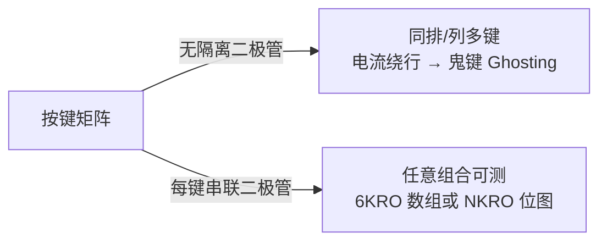
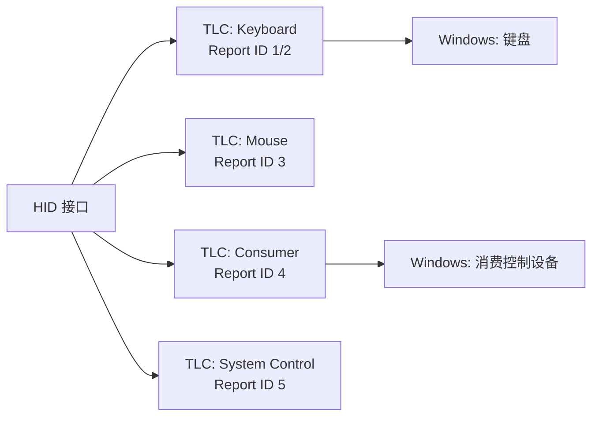
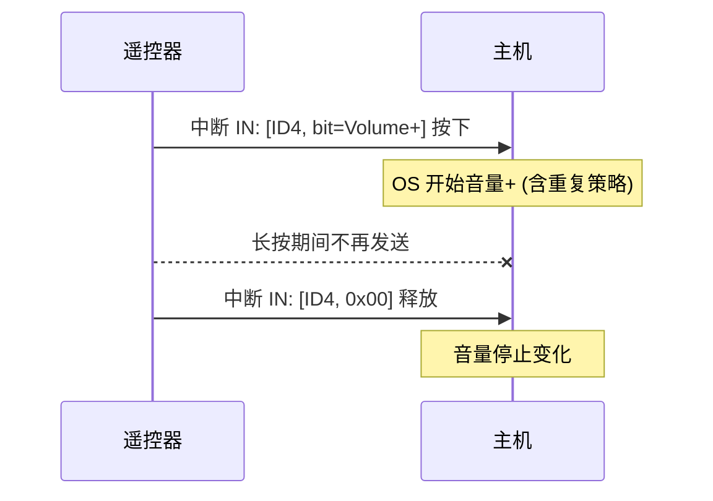
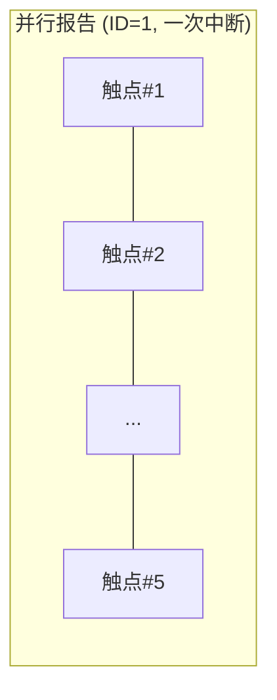
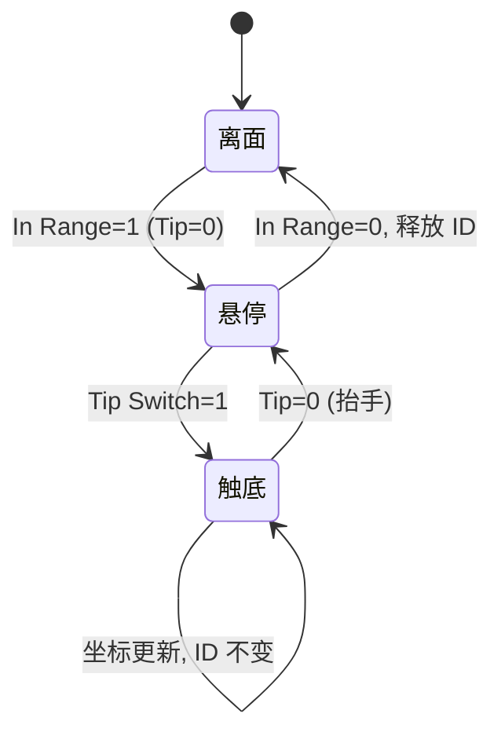
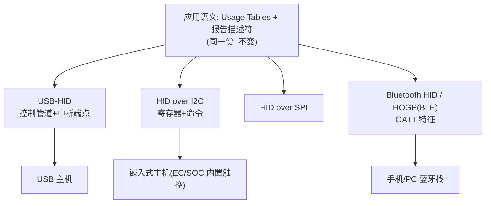
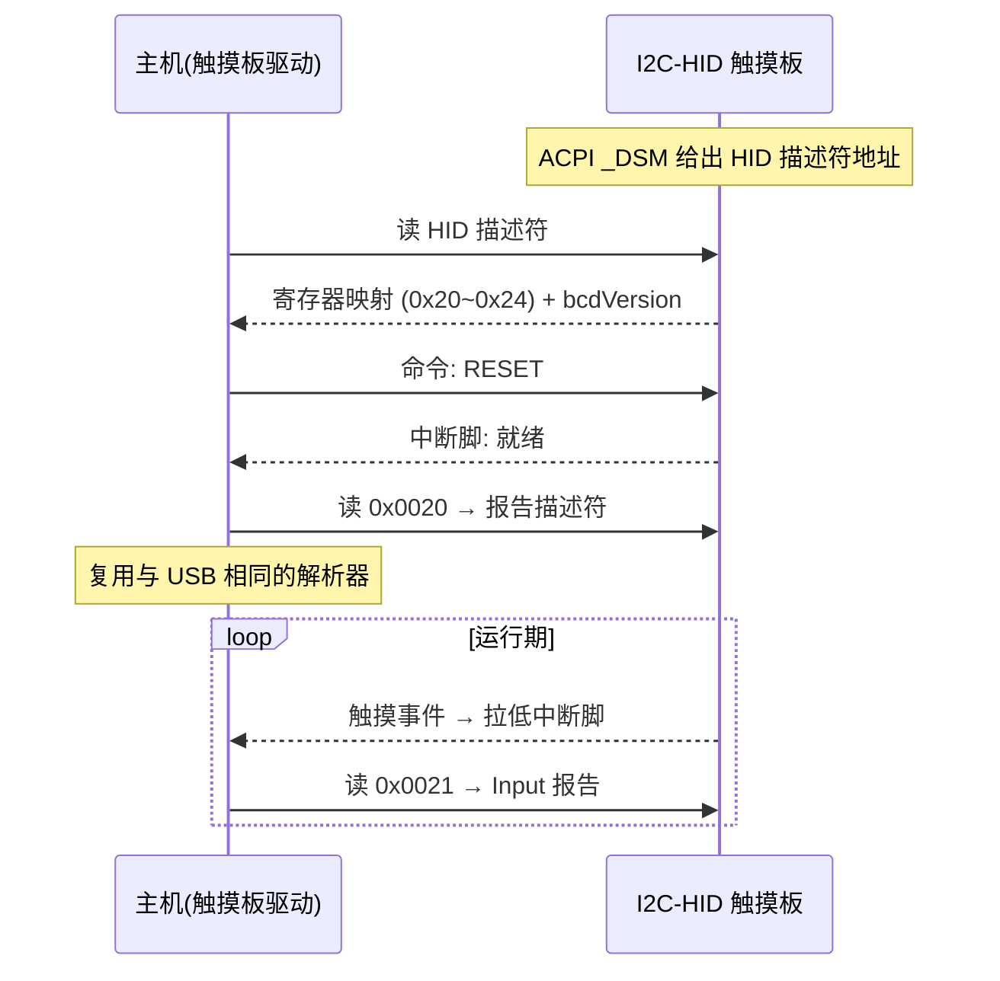
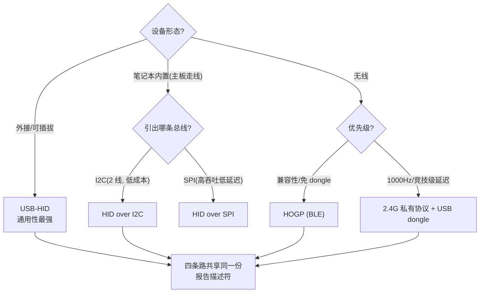
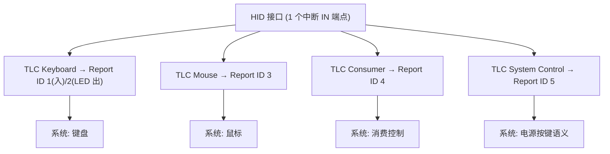

# HID 典型设备：键盘、鼠标、消费控制、手柄、触控、跨传输、完整描述符

> 层级 进阶 · 主题 `class/hid` · 相关：[HID 核心：类描述符、报告描述符 Item、Usage、类请求](11-hid-core.md)、[HID 规范级附录（全表）](13-hid-spec-appendix.md)、[无线与 USB 的交汇：HCI-over-USB、HOGP、Wireless USB/MA-USB 历史](60-usb-wireless-intersection.md)

## 核心事实 Key Facts

> 由维护者整理并与规范核对；与下方 USBTree 原文冲突时以本节为准。

- Boot 键盘 Input 报告 8 B：byte0 修饰键位图（bit0 LCtrl, 1 LShift, 2 LAlt, 3 LGUI, 4 RCtrl, 5 RShift, 6 RAlt, 7 RGUI）、byte1 保留、byte2–7 最多 6 个键码（6KRO，Usage Page 0x07；0x01 = ErrorRollOver）。Output 报告 1 B LED：bit0 NumLock, bit1 CapsLock, bit2 ScrollLock, bit3 Compose, bit4 Kana。
- Boot 鼠标 Input 报告 ≥3 B：byte0 按键位（bit0 左, 1 右, 2 中），byte1 X、byte2 Y（int8 相对），可选 byte3 滚轮。
- 回报率：FS 中断端点 bInterval=1 → 1000 Hz（FS 上限）；HS 中断端点 bInterval=1 → 125 µs → 8000 Hz，bInterval=2 → 4000 Hz，bInterval=4 → 1000 Hz。
- NKRO：用位图式报告（Usage Min 0x00–Max 0xE7 的 Variable 字段）替代 6 键数组。

## 原文：05-键盘详解

> Source: [20-枝干-设备类协议/HID-人机接口设备/05-键盘详解.md](https://github.com/tangjianfang/USBTree/blob/main/20-枝干-设备类协议/HID-人机接口设备/05-键盘详解.md)

### 1. Boot 协议报告：固定的 8 字节

Boot 键盘（`bInterfaceSubClass=1, bInterfaceProtocol=1`）在 Boot 协议下的 Input 报告是**固定 8 字节**，与报告描述符无关：

| 偏移 | 内容 | 说明 |
|---|---|---|
| 0 | 修饰键位图 | 8 位对应 Usage 0xE0~0xE7，见下表 |
| 1 | 保留 | 恒 0（OEM 保留字节） |
| 2~7 | 6 个键码 | 6KRO（6-Key Rollover）数组，0=无按键 |

修饰键位图（值域 0/1，Usage 0xE0 起按位对应）：

| 位 | Usage | 键 | 位 | Usage | 键 |
|---|---|---|---|---|---|
| bit0 | 0xE0 | 左 Ctrl | bit4 | 0xE4 | 右 Ctrl |
| bit1 | 0xE1 | 左 Shift | bit5 | 0xE5 | 右 Shift |
| bit2 | 0xE2 | 左 Alt | bit6 | 0xE6 | 右 Alt |
| bit3 | 0xE3 | 左 GUI | bit7 | 0xE7 | 右 GUI |

示例：按下 `Ctrl+Shift+A` 的报告序列（无按键时全 0）：

```text
按下: 03 00 04 00 00 00 00 00   (修饰键=0x03, 键码 0x04='A')
保持: 03 00 04 00 00 00 00 00   (Idle=0 时变化才发, 无需重复)
释放: 00 00 00 00 00 00 00 00   (必须显式发送"全零"释放报告)
```

Boot 协议报告**不含 Report ID 字节**，即使报告描述符中使用了 Report ID（Boot 格式由规范固定）。

### 2. Report 协议与 NKRO

进入 Report 协议（`SET_PROTOCOL(1)`，见 [04-传输与类特定请求.md](11-hid-core.md)）后，键盘可按报告描述符任意扩展：

- **NKRO（N-Key Rollover，全键无冲）**：用 1 字节 Report ID + 32 字节（256 位）键位图，每键一位，同时按下任意多键互不冲突；
- 或将键码分区，用**多个 Report ID** 分别承载不同键区（主键区/小键盘/多媒体区）；
- 6KRO 数组方案的局限：第 7 个同拍按键被丢弃或覆盖；矩阵无二极管时还会产生"鬼键"(Ghosting)——NKRO 硬件前提是每个键位串联隔离二极管。

### 3. Usage Page 0x07 键值表节选

| Usage ID | 键 | Usage ID | 键 |
|---|---|---|---|
| `0x04`~`0x1D` | a/A ~ z/Z | `0x28` | Return (Enter) |
| `0x1E`~`0x26` | 1! ~ 9( | `0x29` | Escape |
| `0x27` | 0) | `0x2A` | Backspace |
| `0x2B` | Tab | `0x39` | Caps Lock |
| `0x2C` | Spacebar | `0x53` | Keypad NumLock and Clear |
| `0x2D`~`0x31` | -_=…\ | `0x56` | Keypad - |
| `0x33`~`0x38` | ;'`,./ | `0x57` | Keypad + |
| `0x3A`~`0x45` | F1 ~ F12 | `0x58` | Keypad Enter |
| `0x46` | PrintScreen | `0x59`~`0x63` | Keypad 1~0 与 . |
| `0x47` | Scroll Lock | `0x64` | Non-US Backslash |
| `0x48` | Pause | `0x65` | Application (菜单键) |
| `0x49`~`0x4E` | Insert/Home/PgUp/Del/End/PgDn | `0x68`~`0x73` | F13 ~ F24 |
| `0x4F`~`0x52` | →←↓↑ | `0xE0`~`0xE7` | 修饰键 |

注意两处易错：`0x53` 是**小键盘 NumLock**（不是 Keypad Period，小数点在 `0x63`）；F13 从 `0x68` 开始（`0x57/0x58` 是小键盘 +/Enter）。完整表以《HID Usage Tables》Keyboard/Keypad 页为准。

### 4. LED 输出报告

键盘 Output 报告承载 5 个 LED，注意区分**Usage ID**（LED 页 0x08 分配）与**Boot 报告位掩码**两套编号：

| LED | Usage ID (页 0x08) | Boot 报告位掩码 | 报告位 |
|---|---|---|---|
| Num Lock | `0x01` | `0x01` | bit0 |
| Caps Lock | `0x02` | `0x02` | bit1 |
| Scroll Lock | `0x03` | `0x04` | bit2 |
| Compose | `0x04` | `0x08` | bit3 |
| Kana | `0x05` | `0x10` | bit4 |
| （填充） | — | — | bit5~7 |

主机在 Caps Lock 状态变化时以 `SET_REPORT(Output)` 下发 1 字节（有中断 OUT 端点则走端点）；LED 状态是**绝对状态**而非翻转指令——设备不得自行取反。

### 5. 完整 Boot 键盘报告描述符（逐行注释）

63 字节（`0x3F`），Input+LED Output 双报告，无 Report ID，逐字节十六进制：

```text
05 01    Usage Page (Generic Desktop)   ; 全局: 桌面页
09 06    Usage    (Keyboard)            ; TLC = 键盘 → 系统按键盘归类
A1 01    Collection (Application)       ; 顶层应用集合
05 07    Usage Page (Keyboard/Keypad)   ; 切键码页
19 E0    Usage Minimum (0xE0)
29 E7    Usage Maximum (0xE7)
15 00    Logical Minimum (0)
25 01    Logical Maximum (1)
75 01    Report Size (1)
95 08    Report Count (8)
81 02    Input (Data,Var,Abs)           ; [字节0] 修饰键位图 8 位
95 01    Report Count (1)
75 08    Report Size (8)
81 03    Input (Const,Var,Abs)          ; [字节1] 保留字节(常量填充)
95 06    Report Count (6)
75 08    Report Size (8)
15 00    Logical Minimum (0)            ; 数组值 0 = 无按键
25 65    Logical Maximum (101)          ; 0x65 = 最大标准键码
19 00    Usage Minimum (0)              ; 数组值 v ↔ Usage (0x07页) v
29 65    Usage Maximum (101)
81 00    Input (Data,Array,Abs)         ; [字节2~7] 6 键码数组 (6KRO)
05 08    Usage Page (LEDs)              ; ── Output 报告 ──
19 01    Usage Minimum (Num Lock)
29 05    Usage Maximum (Kana)
15 00    Logical Minimum (0)
25 01    Logical Maximum (1)
75 01    Report Size (1)
95 05    Report Count (5)
91 02    Output (Data,Var,Abs)          ; 5 个 LED 位
95 03    Report Count (3)
91 03    Output (Const,Var,Abs)         ; 3 位填充补齐整字节
C0       End Collection
```

描述符侧配套：接口描述符 `bInterfaceSubClass=1`、`bInterfaceProtocol=1`；HID 类描述符 `wDescriptorLength=0x003F`（与 [01-HID描述符.md](11-hid-core.md) 的 34 字节配置描述符示例咬合）。

### 6. 键位无冲与鬼键



- **6KRO**：报告只有 6 个键码槽，第 7 键被丢弃——Boot 协议的先天限制；
- **NKRO**：256 位键位图 + Report ID，全键无冲，代价是报告变大（1+32 字节）且 BIOS 不认识；
- 主机侧实现注意：数组报告的"去重/乱序"要按值处理而非按位置。

### 7. 为什么 BIOS/EFI 需要 Boot 协议

BIOS/EFI 固件没有完整的 HID 解析器（无内存解析 Usage 树、无驱动框架），也不一定有时间枚举解析报告描述符。Boot 协议用三件套把键鼠降到"傻瓜模式"：

1. 接口描述符自报家门：`SubClass=1` + `Protocol=1/2`；
2. 固定格式的报告（键盘 8 字节、鼠标 3 字节），固件硬编码解析；
3. 两个请求搞定一切：`SET_PROTOCOL(0)` 进入 Boot 模式、`GET_REPORT(Input)` 主动取状态（规范要求 Boot 设备必须支持）。

因此做"支持进 BIOS 的键盘"，报告描述符必须同时满足 Boot 约束（固定字段顺序与格式）与 Report 协议扩展——通常用"Boot 字段在前 + Report ID + 扩展字段在后"的双协议描述符（鼠标实例见 [06-鼠标详解.md](12-hid-devices.md)）。

### 8. 从键码到字符：主机的另一半工作

HID 只传递"键码"(0x04='a'位)，**字符映射是 OS 键盘布局层的事**：

| 环节 | 数据 | 例子 |
|---|---|---|
| 设备报告 | 键码 + 修饰键位图 | `02 00 0A 00...` = Shift+G 键码 |
| OS 键盘布局（中文输入法等） | 键码→字符/输入法事件 | 0x0A + Shift → "G" |

推论：

1. 设备永远不知道自己连着德语还是中文布局——`bCountryCode` 只是提示，不改变键码含义；
2. "宏键盘"实现自定义字符的正规途径是发送对应字符的键码序列（含 Shift 位图），而非发明新键码；
3. 多语言方案（如日语罗马字输入）完全由 OS 输入法完成，HID 层无感知。

## 原文：06-鼠标详解

> Source: [20-枝干-设备类协议/HID-人机接口设备/06-鼠标详解.md](https://github.com/tangjianfang/USBTree/blob/main/20-枝干-设备类协议/HID-人机接口设备/06-鼠标详解.md)

### 1. Boot 协议：3 字节最小报告

Boot 鼠标（`bInterfaceSubClass=1, bInterfaceProtocol=2`）的 Input 报告固定为 3 字节（1 键版本可协商 4 字节含滚轮，实践中以 3 字节为基准）：

| 偏移 | 内容 | 值域 |
|---|---|---|
| 0 | 按钮位图：bit0=左键, bit1=右键, bit2=中键，bit3~7 填充 | 0/1 |
| 1 | X 相对位移 | −127~127（计数） |
| 2 | Y 相对位移 | −127~127 |

示例：按住左键向右移动 10、向上移动 4：

```text
按钮: 01   X: 0A   Y: FC   (0xFC = -4, 符号扩展语义)
```

相对位移的语义是"自上一份报告以来的增量计数"，主机累加得到光标位置；一次移动超过 127 计数时设备拆成多帧上报。

### 2. Report 协议扩展

进入 Report 协议后，鼠标常在 Boot 三字节之上扩展（保持前 3 字节兼容即可让 Boot 主机照常工作）：

| 扩展 | Usage | 典型描述 |
|---|---|---|
| 垂直滚轮 | GDX/Wheel `0x38` | Logical −127~127，8 位，Relative；一格=+1 |
| 水平滚轮 | Consumer/AC Pan `0x238` | 同上 8 位，Relative（见 [07-消费控制与多媒体.md](12-hid-devices.md)） |
| 高精度位移 | X/Y 仍 `0x30/0x31` | Report Size 16，±32767 计数，避免大 DPI 拆帧 |
| 更多按键 | Button 页 `0x01..0x08` | 侧键×2 + DPI 切换键等 |
| 双滚轮 | Wheel + AC Pan | 垂直/水平独立 8 位字段 |

补充语义：

- **报告分辨率(Resolution)**：X/Y 报告的是"计数(count)"，计数与物理距离的换算由描述符中 Physical Min/Max + Unit/Unit Exponent 声明——`分辨率 = (Physical Max−Physical Min) / (Logical Max−Logical Min)`。若以 0.0001 英寸为物理单位，分辨率数值即每英寸计数(CPI/DPI)。DPI 档位切换是设备内部改变计数刻度，报告格式不变。
- **高分辨率滚轮**（120 刻度/格的平滑滚动）由微软 High-Resolution Wheel 规范在 Wheel/AC Pan 基础上以 Feature 报告声明倍率实现，细节以微软文档为准。

### 3. 相对 vs 绝对坐标

Input Item 的 **bit2（Absolute/Relative）** 决定主机处理方式：

| 模式 | Input 标志 | 典型设备 | 主机行为 |
|---|---|---|---|
| 相对 | `Data,Var,Rel`（`81 06`） | 鼠标、轨迹球 | 增量累加到光标 |
| 绝对 | `Data,Var,Abs`（`81 02`） | 绝对坐标鼠标/触摸板/数位板 | 值直接映射到屏幕坐标域 |

绝对模式鼠标把整个 Logical Min~Max 映射到虚拟屏幕/板面：例如触摸板 `Logical Max` 对应板面最右缘，配合 Physical Min/Max(米制) 声明物理尺寸；主机将其折算到显示区域。Precision Touchpad 即绝对模式 + Digitizer 语义（见 [09-触摸屏触摸板与数字化仪.md](12-hid-devices.md)）。

### 4. 双协议鼠标报告描述符（逐行注释）

前 3 字节与 Boot 格式逐位一致，后接滚轮/AC Pan/侧键扩展；无 Report ID：

```text
05 01    Usage Page (Generic Desktop)
09 02    Usage (Mouse)                     ; TLC = 鼠标
A1 01    Collection (Application)
  09 01  Usage (Pointer)
  A1 00  Collection (Physical)             ; 三字段来自同一物理采样
  05 09    Usage Page (Button)
  19 01    Usage Minimum (Button 1)
  29 03    Usage Maximum (Button 3)
  15 00    Logical Minimum (0)
  25 01    Logical Maximum (1)
  75 01    Report Size (1)
  95 03    Report Count (3)
  81 02    Input (Data,Var,Abs)            ; [字节0 bit0..2] 左/右/中键
  95 05    Report Count (5)
  81 03    Input (Const,Var,Abs)           ; [bit3..7] 填充
  05 01    Usage Page (Generic Desktop)
  09 30    Usage (X)
  09 31    Usage (Y)
  15 81    Logical Minimum (-127)          ; 有符号! 0x81=-127
  25 7F    Logical Maximum (127)
  75 08    Report Size (8)
  95 02    Report Count (2)
  81 06    Input (Data,Var,Rel)            ; [字节1,2] X/Y 相对位移
  09 38    Usage (Wheel)
  15 81    Logical Minimum (-127)
  25 7F    Logical Maximum (127)
  75 08    Report Size (8)
  95 01    Report Count (1)
  81 06    Input (Data,Var,Rel)            ; [字节3] 垂直滚轮
  05 0C    Usage Page (Consumer)
  0A 38 02 Usage (AC Pan)                 ; AC Pan = Consumer 页 0x238,
                                          ; ID 超过 255 → 用 2 字节数据的
                                          ; Local Usage (前缀 0x0A)
  15 81    Logical Minimum (-127)
  25 7F    Logical Maximum (127)
  75 08    Report Size (8)
  95 01    Report Count (1)
  81 06    Input (Data,Var,Rel)            ; [字节4] 水平滚轮
  05 09    Usage Page (Button)
  19 04    Usage Minimum (Button 4)        ; 侧键×2
  29 05    Usage Maximum (Button 5)
  75 01    Report Size (1)
  95 02    Report Count (2)
  81 02    Input (Data,Var,Abs)            ; [字节5 bit0..1]
  95 06    Report Count (6)
  81 03    Input (Const,Var,Abs)           ; [bit2..7] 填充 → 6 字节报告
C0       End Collection                   ; Physical
C0       End Collection                   ; Application
```

> 写法说明：AC Pan 的标准编码是 Consumer 页 Usage ID `0x238`。1 字节数据的 Local Usage 前缀（`09`）只能表达 0~255 的 ID，因此必须用 2 字节数据形式的 Local Usage（前缀 `0x0A`，数据小端 `38 02`）给出完整 16 位 ID。

对应报告布局（6 字节）：`[0] 按钮位图 [1] X [2] Y [3] Wheel [4] AC Pan [5] bit0..1=侧键2、bit2..7=填充`。

### 5. 轮询间隔与上报率

鼠标"上报率"(Hz) 由端点 `bInterval` 直接决定——主机轮询多快，报告最多就多快：

| bInterval | 上报率 | 适用 |
|---|---|---|
| 10 ms | 100 Hz | 低速设备的上限（LS 中断端点 bInterval≥10ms） |
| 8 ms | 125 Hz | 传统办公鼠标 |
| 4 ms | 250 Hz | 均衡 |
| 2 ms | 500 Hz | 游戏 |
| 1 ms | 1000 Hz | 游戏鼠标（需全速/高速端点） |

要点：

- 低速(Low-Speed)中断端点 `bInterval` 最小 10ms，因此 **1000Hz 游戏鼠标必然是全速或高速设备**；
- 高速端点 `bInterval` 单位是微帧，按 2^(n−1) 微帧解释（n=1 → 125µs ≈ 8000Hz 语境）；
- 上报率与 DPI 独立：DPI 决定"每毫米产生多少计数"，上报率决定"每秒送多少帧"；
- 无移动时设备对 IN 令牌回 NAK，不消耗带宽。

### 6. 报告字节流实例

以第 4 节的 6 字节双协议报告为例（`[0]按钮 [1]X [2]Y [3]Wheel [4]ACPan [5]侧键`）：

```text
事件: 按住左键向右快移 200 计数(8 位 X 一帧装不下, 拆两帧)
  帧1: 01 7F 00 00 00 00    ; 左键=1, X=+127
  帧2: 01 49 00 00 00 00    ; X=+73 (127+73=200)
释放: 00 00 00 00 00 00     ; 按钮位归零, X/Y 无位移
滚轮下滚一格: 00 00 00 FF 00 00   ; Wheel=-1 (0xFF 符号扩展语义)
```

要点：X/Y 是增量，"零位移"字节仍会随按钮状态变化一起发送；固件把一次大位移拆帧时，各帧按钮状态保持一致直到真实释放。

### 7. Boot 模式的两个"没有"

1. **没有滚轮**：Boot 鼠标报告固定 3 字节（3 按钮+X+Y），规范未定义 Boot 滚轮字段——无线接收器即使实现 Boot 鼠标，滚轮也只在 Report 协议下可用；
2. **没有 Report ID**：Boot 报告永不含 ID 字节，即使描述符其它报告使用 ID。

因此"BIOS 里滚轮可用"这个需求无解，属正常现象而非缺陷。

### 8. 高速设备的 bInterval 换算

高速(High-Speed)中断端点的 `bInterval` 以微帧(125µs)为单位，按 **2^(n−1)** 解释：

| bInterval | 轮询周期 | 上报率 |
|---|---|---|
| 1 | 125 µs | 8000 Hz |
| 2 | 250 µs | 4000 Hz |
| 3 | 500 µs | 2000 Hz |
| 4 | 1 ms | 1000 Hz |

4000Hz/8000Hz 的电竞鼠标即高速端点 + 小 bInterval 的产物；全速端点理论上限仍是 1000Hz（bInterval=1ms）。

## 原文：07-消费控制与多媒体

> Source: [20-枝干-设备类协议/HID-人机接口设备/07-消费控制与多媒体.md](https://github.com/tangjianfang/USBTree/blob/main/20-枝干-设备类协议/HID-人机接口设备/07-消费控制与多媒体.md)

### 1. Consumer 页(0x0C)的定位

Consumer Usage Page 承载"媒体控制/遥控器/应用控制"语义：播放、音量、浏览器导航、电源、频道等。它使一个 HID 设备能表达"电视遥控器""耳机线控""多媒体键区"而不需要任何厂商驱动——OS 对这些 Usage 有内建映射。

### 2. 常用 Usage ID

| Usage ID | 名称 | 语义 |
|---|---|---|
| `0x30` | Power | 系统电源键（消费者语义） |
| `0xB5` | Scan Next Track | 下一曲 |
| `0xB6` | Scan Previous Track | 上一曲 |
| `0xB7` | Stop | 停止 |
| `0xCD` | Play/Pause | 播放/暂停切换 |
| `0xE2` | Mute | 静音 |
| `0xE9` | Volume Increment | 音量+ |
| `0xEA` | Volume Decrement | 音量− |
| `0x223` | AC Home | 浏览器主页 |
| `0x224` | AC Back | 浏览器后退 |
| `0x225` | AC Forward | 浏览器前进 |
| `0x238` | AC Pan | 水平滚动（鼠标水平滚轮复用，见 [06-鼠标详解.md](12-hid-devices.md)） |

其余（菜单、频道、快进快退、数字键区等）以《HID Usage Tables》Consumer 页为准，此处不逐一展开。

### 3. 两种描述方式：位图 vs 数组

#### 3.1 位图（Variable）——推荐

每个 Usage 独占 1 位，可**同时**表达多个键、天然支持按住/释放语义：

```text
05 0C        Usage Page (Consumer)
09 01        Usage (Consumer Control)     ; TLC
A1 01        Collection (Application)
  85 02      Report ID (2)
  09 B5      Usage (Scan Next Track)
  09 B6      Usage (Scan Previous Track)
  09 B7      Usage (Stop)
  09 CD      Usage (Play/Pause)
  09 E2      Usage (Mute)
  09 E9      Usage (Volume Increment)
  09 EA      Usage (Volume Decrement)
  15 00      Logical Minimum (0)
  25 01      Logical Maximum (1)
  75 01      Report Size (1)
  95 07      Report Count (7)
  81 02      Input (Data,Var,Abs)        ; 7 位状态位图
  95 01      Report Count (1)
  81 03      Input (Const,Var,Abs)       ; 1 位填充 → 1 字节
C0           End Collection
```

报告示例（Report ID 2）：`02 08` = Play/Pause 按下（第 4 个 Usage → bit3）；`02 00` = 释放。

#### 3.2 数组（Array）

一次报告携带"当前按下的 Usage ID 值"，N 字节可放 N 个同时按键，但**同一字节内语义互斥、表达"按住集合"不如位图直观**，且空报告须填 0（0 通常映射到"无事件"Usage）：

```text
  15 00      Logical Minimum (0)
  26 FF 00   Logical Maximum (255)
  19 00      Usage Minimum (0)
  2A FF 0C   Usage Maximum (0x0CFF)      ; Consumer 页全范围
  75 08      Report Size (8)
  95 02      Report Count (2)
  81 00      Input (Data,Array,Abs)      ; 2 键并发上限的数组
```

#### 3.3 对比

| 维度 | 位图 Variable | 数组 Array |
|---|---|---|
| 并发按键 | 任意多（每位独立） | 受报告字节数限制 |
| 报告大小 | 键多时位图迅速变宽 | 键多时更紧凑（每键 1~2 字节） |
| 释放语义 | 全 0 报告 | 值移除 |
| Usage 稀疏时 | 位图有大量空洞浪费位 | 按需填值，无浪费 |
| 典型场景 | 固定媒体键区 | 数百个遥控键码 |

### 4. 典型实现：复合键盘 + 媒体键

多媒体键盘的标准做法是**单接口多 Report ID 多 TLC**：键盘、鼠标、Consumer 各占一个顶层集合，Report ID 区分（详见 [11-实战完整报告描述符.md](12-hid-devices.md)）：



好处：

- 主机按 TLC 归类，媒体键走"消费控制设备"路径，与普通打字互不干扰；
- 媒体键按下产生 `ID+位图` 报告，OS 映射为系统事件（见下节）；
- 不占用宝贵的 6 键数组槽位。

### 5. OS 级映射行为

| 键 | Windows | macOS |
|---|---|---|
| Volume +/−、Mute | 系统音量（带 OSD 叠加） | 系统音量 |
| Play/Pause、Next/Prev | 媒体会话控制（SMTC） | iTunes/Music/Now Playing |
| AC Home/Back/Forward | 浏览器导航 | 浏览器导航 |
| Consumer Power | 可映射到系统电源动作 | 由系统设置决定 |

注意：映射在 OS 的 HID 输入栈完成，设备无需感知操作系统；同一描述符在两套系统上行为细节（如 OSD、应用内拦截）会有差异，这是平台行为而非协议差异。

### 6. 遥控器场景要点

遥控器/线控是 Consumer 页最重度的用户，工程上有三条硬规矩：

1. **释放必须发全 0 报告**：位图语义下，主机以"位=1 的集合"定义当前按下状态；只发按下不发释放会让音量键一直加到爆。
2. **长按重复由主机实现（Hold & Repeat）**：设备保持位=1 不重复发送，OS 依自身重复策略处理音量连加；设备侧自行连发会导致双倍速率。
3. **键码不跨界**：遥控器专用功能（频道、EPG 等）若在 Usage Tables 中查不到对应 Usage，应进厂商页或改用 array+完整 Usage 编码，不得私占标准 ID。



### 7. 字节级时序实例

以第 3.1 节描述符（7 个媒体键位图，Report ID 2）为例，用户长按"音量+"：

```text
按下:  中断 IN ← 04 20      ; ID=4, bit5=Volume Increment
长按:  (设备静默, 位保持逻辑上为 1)
       OS 依自身重复策略连续加音量
释放:  中断 IN ← 04 00      ; 位图归零, 状态结束
连击组合: Mute+音量− 同时 → 04 50   ; bit4|bit6 = 0x10|0x40
```

组合能力正是位图方案胜过数组的场景：数组一次只能表达"一个键码"，Mute+Vol− 的组合要么丢失要么需要多字节。反之若媒体键区只有三五个键，位图的浪费可忽略。

### 8. 实现陷阱清单

1. **只发按下不发释放**——主机认为键一直按着（音量加到顶、播放键反复触发）；
2. **设备自行连发**代替 OS 重复——长按时音量增速翻倍；
3. **Consumer TLC 缺失**——媒体键塞进键盘 TLC 会被部分系统当普通键处理，OSD/媒体会话不生效；
4. **Report ID 漏发**——多 TLC 设备每个报告首字节必须是 ID，固件手滑发成无 ID 报告会被整包丢弃；
5. **占用标准编号做私事**——找不到 Usage 就进厂商页，占用 Consumer 标准编号会让不同 OS 的内建映射帮倒忙。

## 原文：08-游戏手柄与摇杆

> Source: [20-枝干-设备类协议/HID-人机接口设备/08-游戏手柄与摇杆.md](https://github.com/tangjianfang/USBTree/blob/main/20-枝干-设备类协议/HID-人机接口设备/08-游戏手柄与摇杆.md)

### 1. 顶层集合选择：Game Pad vs Joystick

游戏设备没有专属 Usage Page——它们复用 Generic Desktop 页的 TLC，再加轴/按钮组合：

| TLC Usage | 值 | 适用 |
|---|---|---|
| `GDX/Game Pad (0x05)` | TLC | 双摇杆+十字键+XYAB 面按钮的现代手柄 |
| `GDX/Joystick (0x04)` | TLC | 飞行摇杆、街机摇杆 |
| `GDX/Simulation Controls(0x02 页)` | TLC | 方向盘、油门刹车组合 |

OS 对两者都走通用 HID 游戏设备路径（Windows 下产生游戏控制器设备实例）；差异主要在 UI 与校准体验，语义上按设备形态选择即可。

### 2. 轴与帽开关

#### 2.1 模拟轴

| Usage | 名称 | 典型配置 |
|---|---|---|
| `0x30` X / `0x31` Y | 左摇杆 | Logical −127~127，8 位，Absolute |
| `0x33` Rx / `0x34` Ry | 右摇杆 | 同上 |
| `0x32` Z | 单摇杆设备（或油门） | 同上 |
| `0x35` Rz | 方向盘类旋转轴 | 同上 |
| `0x36` Slider | 滑块/油门杆 | 0~255 或 −127~127 |
| `0x37` Dial | 旋盘 | 同上 |

摇杆中位物理回弹 → 描述符常加 `Preferred State(0)`（bit5=0）+ `No Null Position`；绝对值语义恒为 `Absolute`。

#### 2.2 帽开关（Hat Switch）两种编码

**方式一：4 位数值编码（主流）**——Usage `Hat Switch (0x39)`，4 位，Logical 0~7，Input 加 **Null State** 位（bit6），8~15 表示"居中/无方向"：

```text
09 39      Usage (Hat Switch)
15 00      Logical Minimum (0)
25 07      Logical Maximum (7)
75 04      Report Size (4)
95 01      Report Count (1)
81 42      Input (Data,Var,Abs,Null State)
```

取值表（0=北，顺时针递增）：

| 值 | 方向 | 值 | 方向 |
|---|---|---|---|
| 0 | 上(N) | 4 | 下(S) |
| 1 | 右上(NE) | 5 | 左下(SW) |
| 2 | 右(E) | 6 | 左(W) |
| 3 | 右下(SE) | 7 | 左上(NW) |
| 8~15 | 中性（Null State，无方向） | | |

**方式二：命名数组(Named Array)**——Logical 1~8，Usage Min/Max 逐一对应 Usage Tables 中"帽方向"命名 Usage，报告值即方向名；居中用 Logical 值域外的 0 表达。具体方向 Usage 的编号请查阅《HID Usage Tables》Generic Desktop 页。

### 3. 按钮阵列

按钮永远使用 Button 页(0x09)：`Usage Min 1 / Usage Max N` + `Report Size 1 / Report Count N` + `Input(Data,Var,Abs)`。位序即按钮序，不足整字节补 Constant 位。经典手柄布局（无标准强制，纯约定）：1=△/Y 2=○/B 3=/A 4=□/X 或 ABXY 区分平台——OS 不解释按钮含义，游戏内由玩家映射。

### 4. 振动与力反馈

两条技术路线：

1. **直发 Output 报告（左右马达强度）**：简单粗暴，几乎所有现代手柄都可用。注意 **Output 报告没有标准化的"马达" Usage**——实践中普遍使用厂商自定义页(0xFF00 起)承载，或像 DS4 一样整体用厂商报告格式。
2. **PID 页(0x0F, Physical Input Device)**：USB-IF《Device Class Definition for PID 1.0》定义的完整力反馈模型——效果(Effect)类型、参数包、启动/停止、效果块索引、增益等全部 Usage 化，报告经 Output/Feature 承载。适用于专业力反馈设备（可编程波形），复杂度高，消费级手柄很少实现。具体 Usage 编码请查 Usage Tables 与 PID 1.0 规范。

Output 报告示例（厂商页 + Report ID 2）：

```text
05 FF      Usage Page (Vendor Defined 0xFF00)
09 21      Usage (0x21)
A1 01      Collection (Application)
  85 02    Report ID (2)
  09 01    Usage (Left Motor)
  15 00    Logical Minimum (0)
  26 FF 00 Logical Maximum (255)
  75 08    Report Size (8)
  95 01    Report Count (1)
  91 02    Output (Data,Var,Abs)      ; 左马达强度 0~255
  09 02    Usage (Right Motor)
  91 02    Output (Data,Var,Abs)      ; 右马达强度
C0         End Collection
```

主机经 `SET_REPORT(Output, Report ID 2)` 或中断 OUT 端点下发。

### 5. XInput 与 HID 的关系

| 设备 | 接口形态 | 说明 |
|---|---|---|
| Xbox 360 手柄 | 厂商特定类 `0xFF`/子类 `0x5D`/协议 `0x01` | **非标准 HID**，私有 XInput USB 协议，需微软驱动/包装层 |
| Xbox One/Series 手柄 | 厂商特定类 + GIP 协议 | 同为私有；新固件部分场景兼容 HID 模式 |
| DualShock 4 / DualSense | 标准 HID 接口 + 厂商页扩展 | 报告描述符可用通用 HID 栈解析，振动/灯条走厂商 Output 报告 |
| Switch Pro 手柄 | HID 形态 + 厂商页(0xFF00) | 输入走 HID，配对/命令走厂商协议 |

XInput 是**API+传输**的组合私有方案，绕过了 HID 的自描述机制；HID 手柄则由 OS 通用栈直接支持（DirectInput/Raw Input 路径）。

### 6. 主机 API 三代简表

| API | 年代 | 数据来源 | 特点 |
|---|---|---|---|
| DirectInput | Win95 | HID/非 HID 抽象 | 轴/按钮上限固定、轮询模型老旧，微软已标记过时 |
| XInput | X360 时代 | 仅 XInput 手柄 | 振动/引导灯开箱即用，但只覆盖 XBox 手柄 |
| Raw Input | WinXP 起 | 原始 HID 报告 | 直接拿设备数据，配合 HID 解析最通用；现代游戏常用 Raw Input + XInput 双轨 |

### 7. 完整 Game Pad 报告描述符（逐行注释）

输入含 4 轴+帽开关+16 键（Report ID 1），输出含双马达（Report ID 2）：

```text
05 01      Usage Page (Generic Desktop)
09 05      Usage (Game Pad)              ; TLC = 手柄
A1 01      Collection (Application)
  85 01    Report ID (1)                 ; ── Input 报告 ──
  A1 00    Collection (Physical)
  09 30    Usage (X)                     ; 左摇杆
  09 31    Usage (Y)
  09 33    Usage (Rx)                    ; 右摇杆
  09 34    Usage (Ry)
  15 81    Logical Minimum (-127)        ; 8 位有符号
  25 7F    Logical Maximum (127)
  75 08    Report Size (8)
  95 04    Report Count (4)
  81 02    Input (Data,Var,Abs)          ; [字节1~4] 四轴
  09 39    Usage (Hat Switch)
  15 00    Logical Minimum (0)
  25 07    Logical Maximum (7)
  75 04    Report Size (4)
  95 01    Report Count (1)
  81 42    Input (Data,Var,Abs,Null State) ; [字节5 低4位] 帽开关
  05 09    Usage Page (Button)
  19 01    Usage Minimum (Button 1)
  29 10    Usage Maximum (Button 16)
  15 00    Logical Minimum (0)
  25 01    Logical Maximum (1)
  75 01    Report Size (1)
  95 10    Report Count (16)
  81 02    Input (Data,Var,Abs)          ; [字节5高4位+字节6] 16 键
  75 04    Report Size (4)
  95 01    Report Count (1)
  81 03    Input (Const,Var,Abs)         ; 4 位填充 → 报告共 7 字节
C0         End Collection                ; Physical
05 FF      Usage Page (Vendor Defined)   ; ── Output: 振动 ──
09 21      Usage (0x21)
A1 01      Collection (Application)
  85 02    Report ID (2)
  09 01    Usage (Left Motor)
  15 00    Logical Minimum (0)
  26 FF 00 Logical Maximum (255)
  75 08    Report Size (8)
  95 02    Report Count (2)
  91 02    Output (Data,Var,Abs)         ; 左/右马达
C0         End Collection
C0         End Collection                ; Application(Game Pad)
```

对应 Input 报告（8 字节）：`[0]=Report ID 1 [1..4]=X/Y/Rx/Ry [5低4位]=帽开关 [5高4位+6]=16 键 [7]=填充字节`；Output 报告（3 字节）：`[0]=Report ID 2 [1]=左马达 [2]=右马达`。

> 工程提示：Global 状态（Usage Page、Logical Min/Max、Report Size/Count 等）跨集合持续生效。上面 Output 集合进入前显式重设了 Logical Min/Max/Size/Count——因为继承的 Global 值来自 Input 集合（−127、4 位等），直接沿用会产生错位/错值的报告布局。跨集合务必重新声明完整的 Global 组合（见 [11-实战完整报告描述符.md](12-hid-devices.md) 错误清单）。

## 原文：09-触摸屏触摸板与数字化仪

> Source: [20-枝干-设备类协议/HID-人机接口设备/09-触摸屏触摸板与数字化仪.md](https://github.com/tangjianfang/USBTree/blob/main/20-枝干-设备类协议/HID-人机接口设备/09-触摸屏触摸板与数字化仪.md)

### 1. Digitizer 页(0x0D)总览

触摸屏(Touch Screen)、触摸板(Touch Pad)、数位笔(Stylus)统一使用 Digitizer Usage Page `0x0D`。核心特征：**绝对坐标** + **多触点** + **接触状态机**。

#### 1.1 核心 Usage 表

| Usage ID | 名称 | 语义 |
|---|---|---|
| `0x04` | Touch Screen | 触摸屏 TLC（手指悬停不计入） |
| `0x05` | Touch Pad | 触摸板 TLC（用于 Precision Touchpad） |
| `0x20` | Stylus | 数位笔集合 |
| `0x22` | Finger | 单根手指集合（多点触控的"触点"单元） |
| `0x42` | Tip Switch | 笔尖/指尖是否接触表面（1=触底） |
| `0x32` | In Range | 触点/笔是否在感应范围内 |
| `0x44` | Barrel Switch | 笔侧键 |
| `0x45` | Eraser | 笔尾橡皮 |
| `0x30` | Tip Pressure | 笔压感（Digitizer 页自己的 0x30） |
| `0x48` | Width | 触点宽度 |
| `0x49` | Height | 触点高度 |
| `0x47` | Confidence | 该触点是否为有效触摸（防掌压） |
| `0x51` | Contact Identifier | 触点跟踪 ID（跨帧识别同一触点） |
| `0x54` | Contact Count | 本帧有效触点总数 |
| — | Touch Valid | 触点坐标有效标志；其编码在不同版本 Usage Tables 中有差异，请以最新《HID Usage Tables》为准 |

#### 1.2 关于 X/Y 的页归属

触控描述符中的坐标通常取 **Generic Desktop 页的 X(0x30)/Y(0x31)**（描述符中显式 `05 01` 切页），而不是 Digitizer 页——Digitizer 页自己的 `0x30` 是 Tip Pressure。这是描述符里频繁切页的原因，也是新手最容易混淆的地方。

### 2. 绝对坐标报告

触控字段恒为 `Input(Data,Var,Abs)`；坐标域用 Logical Min/Max 声明（如 0~4095），物理尺寸用 Physical Min/Max + Unit 声明，主机据此换算屏幕位置——与相对模式鼠标（[06-鼠标详解.md](12-hid-devices.md)）形成对照。

笔/手指集合的典型结构：

```text
05 0D        Usage Page (Digitizers)
09 04        Usage (Touch Screen)        ; TLC
A1 01        Collection (Application)
  85 01      Report ID (1)
  09 54      Usage (Contact Count)       ; 全帧触点数
  15 00      Logical Minimum (0)
  25 0A      Logical Maximum (10)
  75 08      Report Size (8)
  95 01      Report Count (1)
  81 02      Input (Data,Var,Abs)        ; [字节1]
  05 0D      Usage Page (Digitizers)     ; 切回 Digitizer 页
  09 22      Usage (Finger)              ; 触点集合
  A1 02      Collection (Logical)
    09 42    Usage (Tip Switch)
    09 32    Usage (In Range)
    15 00    Logical Minimum (0)
    25 01    Logical Maximum (1)
    75 01    Report Size (1)
    95 02    Report Count (2)
    81 02    Input (Data,Var,Abs)        ; 2 个状态位
    95 06    Report Count (6)
    81 03    Input (Const,Var,Abs)       ; 6 位填充 → [字节2]
    05 01    Usage Page (Generic Desktop)
    09 30    Usage (X)                   ; GDX 页的 X!
    09 31    Usage (Y)
    26 FF 0F Logical Maximum (4095)      ; 12 位坐标
    75 10    Report Size (16)            ; 16 位字段装 12 位值域
    95 02    Report Count (2)
    81 02    Input (Data,Var,Abs)        ; [字节3~6]
  C0        End Collection              ; Finger
C0           End Collection              ; Touch Screen TLC
```

报告：`[0]=ID1 [1]=ContactCount [2]=Tip|In|pad [3..4]=X [5..6]=Y`。

### 3. 多点触控两种上报模式

#### 3.1 并行（Parallel）——一帧报全部触点

描述符中把 Finger 逻辑集合重复 N 次（N=最大触点数），一份报告携带所有触点；Windows 触摸屏要求至少 5 点并行。触点数不足时多余槽位 Tip=0。优点是时序一致；代价是报告大（5 点×7 字节）。



#### 3.2 混合（Hybrid）——逐触点上报 + Contact Count

一次报告只含一个触点槽，连续发 N 份"扫描线"，每份首字段 Contact Count 表明本帧总触点数，主机攒齐 N 份后合成一帧。报告小、固件省缓冲，但帧内时序被拉长。描述符只写 1 个 Finger 集合 + Contact Count 即可。

| 维度 | 并行 | 混合 |
|---|---|---|
| 报告大小 | 大（N 触点/帧） | 小（1 触点/报） |
| 帧时序 | 各触点同帧 | 帧被拆成 N 份 |
| Windows 触摸屏认证 | 要求（≥5 点并行） | 不符合触摸屏要求 |
| 典型设备 | 电容触摸屏 | 早期触控/简单触摸板 |

#### 3.3 触点跟踪：Contact Identifier

多触点的灵魂是 `Contact Identifier (0x51)`：每个触点在按下期间保持唯一 ID（递增复用），释放后 ID 作废。主机靠 ID 把"上帧的触点"和"本帧的触点"串成轨迹（单指拖动、双指捏合）。无 ID 的触控流只能按位置匹配，快速滑动时极易断轨。

### 4. Windows Precision Touchpad (PTP) 要点

PTP 是微软对触摸板的报告结构规范（配合 Generic Device Controls 页做模式切换），核心要求：

1. **绝对坐标 + 触点机制**：Touch Pad TLC，逐触点含 Tip Switch、Contact Identifier、（可选）Width/Height；
2. **单位制**：X/Y 以 **0.01mm** 级物理分辨率表达（Unit=cm 系 + Unit Exponent 负指数，配合 Physical Min/Max），主机按物理毫米计算手势速度；
3. **Tip Switch 状态机**：接触→触底(Tip=1)→离面(Tip=0, In Range=0) 的每个迁移都必须可见，主机据此合成点击/拖动；
4. **Confidence**：触点需给出置信位，掌压(大接触面)可被主机丢弃；
5. **模式切换**：通过 Feature/Input 机制在"鼠标模拟"与"PTP 原生"间切换（Generic Device Controls 页的 Input Mode 等 Usage；具体取值见微软 PTP 规范）；
6. 支持 P 的设备在 Windows 中不再走鼠标路径，手势全部由 OS 合成。



### 5. 数位板压感

数位笔集合 = `Stylus(0x20)` 内含 Tip Switch、Barrel Switch、Eraser、In Range、X/Y、**Tip Pressure（Digitizer 页 0x30）**。压感通常 10~16 位（如 0~8191），绝对值，Tip=1 时有效。压感分辨率与报告率（常见 133~266Hz 的 bInterval 折算）共同决定"压感曲线"的手感。进阶参数（倾斜、扭转等）的 Usage 编码请查阅《HID Usage Tables》。

### 6. 触屏 PTP 触摸板与鼠标模拟的关系

| 形态 | Windows 中的表现 | 实现要点 |
|---|---|---|
| 触摸屏 | 原生触摸输入（TLC=Touch Screen） | 并行 ≥5 点，绝对坐标 |
| PTP 触摸板 | 精确触摸板（TLC=Touch Pad，手势 OS 合成） | PTP 报告结构 + 模式切换 |
| 普通触摸板 | 报成"鼠标"，手势由厂商驱动合成 | 描述符就是鼠标（[06-鼠标详解.md](12-hid-devices.md)） |
| 双模设备 | 同一接口切换模式 | Input Mode Feature 决定报告形态 |

设备固件可同时实现"鼠标报告 + PTP 报告 + Input Mode 切换"，老系统当鼠标用，新系统切 PTP——这正是很多笔记本触摸板的实际做法。

### 7. 混合模式字节级实例

用第 2 节的单触点描述符（ID1、ContactCount、单 Finger 槽）上报"三指同时触底"（混合模式）：

```text
第 1 份报告: 01 03 03 00 20 01 40 02   ; Count=3, 触点1: Tip|In=0x03, X=0x0120, Y=0x0240
第 2 份报告: 01 03 03 00 60 01 80 02   ; Count=3, 触点2: X=0x0160, Y=0x0280
第 3 份报告: 01 03 01 00 A0 01 C0 02   ; Count=3, 触点3: Tip=1,In=0
```

主机规则：连续收满 Count 份报告后合成一帧（每份的 Count 字段必须相同）。固件保证三份报告背靠背发出，不被其它报告插队。

### 8. 数位笔描述符片段

```text
05 0D        Usage Page (Digitizers)
09 20        Usage (Stylus)              ; TLC 内的笔集合(或单独 TLC)
A1 00        Collection (Physical)
  09 42      Usage (Tip Switch)
  09 44      Usage (Barrel Switch)
  09 45      Usage (Eraser)
  09 32      Usage (In Range)
  15 00      Logical Minimum (0)
  25 01      Logical Maximum (1)
  75 01      Report Size (1)
  95 04      Report Count (4)
  81 02      Input (Data,Var,Abs)        ; 4 个状态位
  95 04      Report Count (4)
  81 03      Input (Const,Var,Abs)       ; 4 位填充
  09 30      Usage (Tip Pressure)        ; Digitizer 页自己的 0x30
  15 00      Logical Minimum (0)
  26 FF 1F   Logical Maximum (8191)      ; 13 位压感
  75 10      Report Size (16)
  95 01      Report Count (1)
  81 02      Input (Data,Var,Abs)        ; 压感
  05 01      Usage Page (Generic Desktop)
  09 30      Usage (X)                   ; GDX 页的 X/Y
  09 31      Usage (Y)
  ...
C0           End Collection
```

无压感时的"点击"判定：Tip Switch 0→1 即按下；有压感时主机可按压力阈值合成点击（Wacom 式体验）。

## 原文：10-HID跨传输I2C与BLE

> Source: [20-枝干-设备类协议/HID-人机接口设备/10-HID跨传输I2C与BLE.md](https://github.com/tangjianfang/USBTree/blob/main/20-枝干-设备类协议/HID-人机接口设备/10-HID跨传输I2C与BLE.md)

### 1. 传输无关的分层模型

HID 的精髓在于：**报告描述符层与传输层解耦**。Usage/Item/报告格式定义与"字节怎么跑"完全无关，因此同一份报告描述符可以跑在四种传输上：



描述符解析器只需要三个服务：**读报告描述符、送 Input 报告、收 Output/Feature 报告**。三个传输栈各自用本地原语实现这三个服务，上层复用。

### 2. HID over I2C

笔记本内置触摸板/触摸屏/传感器中枢的事实标准（微软主导，规范《HID over I2C Protocol Specification》，随 ACPI 5.0 生态落地）。

#### 2.1 设备发现与描述符定位

- 设备在 ACPI 表中声明（`_HID` 硬件 ID + `_CRS` 挂在 I2C 控制器下；描述符所在寄存器地址由 ACPI `_DSM` 函数返回）；
- 主机从该地址读出 **HID 描述符**（结构不同于 USB 的 HID 类描述符，但同样以 `wHIDDescLength/bcdVersion` 开头），其中给出各功能寄存器地址。

#### 2.2 标准寄存器

规范为 I2C-HID 固定了以下 16 位寄存器地址（设备内偏移）：

| 寄存器 | 地址 | 作用 |
|---|---|---|
| 报告描述符寄存器 | `0x0020` | 从这里读出报告描述符（同一份 USB 风格描述符） |
| Input 报告寄存器 | `0x0021` | 主机读 Input 报告；设备也可用中断脚+主动读通知 |
| Output 报告寄存器 | `0x0022` | 主机写 Output 报告 |
| 命令寄存器 | `0x0023` | 主机写命令（16 位：操作码+参数） |
| 数据寄存器 | `0x0024` | 命令的参数/返回数据通道 |

#### 2.3 命令集

命令集是 USB 类请求的镜像，外加电源控制：`RESET`、`GET_REPORT`、`SET_REPORT`、`GET_IDLE`、`SET_IDLE`、`GET_PROTOCOL`、`SET_PROTOCOL`、`SET_POWER`（`SET_POWER` 取值 ON/SLEEP）。工作流：上电 → RESET（设备就绪后中断）→ 读报告描述符 → 注册 Input 中断 → 正常运行。与 USB 的差异主要是**无枚举、无端点，一切皆寄存器读写**；电是常供的，靠 SET_POWER 管理功耗状态。



#### 2.4 Input 报告的长度前缀

I2C-HID 的报告带"信封"：从 Input 寄存器(`0x0021`)读出的前 2 字节是 **16 位小端长度**（指其后的报告字节数），随后才是报告本体（描述符用 Report ID 时首字节为 ID）。设备以**中断脚(GPIO)拉低**通知"有新报告"，主机再发起 I2C 读——通知与数据分离，这是它与 USB 轮询模型的本质区别。

### 3. HID over SPI 简述

部分平台（尤其嵌入式触摸/传感器）以 SPI 承载 HID，协议形态与 I2C 版同源：描述符+寄存器+命令的寄存器式访问，利用 SPI 的高吞吐换更低的读取延迟。结构与细节以对应规范文本为准，本文不展开。

### 4. 蓝牙：HID Profile 与 HOGP

#### 4.1 经典蓝牙 HID Profile

BR/EDR 上的 HID Profile 用 L2CAP 通道（控制通道+中断通道）承载，消息同样镜像 USB 类请求（GET_REPORT/SET_REPORT/SET_PROTOCOL...）与三类报告。无线键鼠在 BLE 普及前的主流方案。

#### 4.2 HID over GATT (HOGP)

BLE 侧由 Bluetooth SIG 的《HID over GATT Specification (HOGP)》定义，把 HID 挂在 GATT 服务上：

| GATT 对象 | 作用 |
|---|---|
| HID Service (UUID 0x1812) | 承载整个 HID |
| **Report Map 特征** | **内容就是 USB 的那份报告描述符字节流** |
| Report 特征 (Input/Output/Feature) | 每个报告一个特征，由 Report Reference 描述符标注 (Report ID, 报告类型) |
| HID Information / HID Control Point | 协议状态、挂起/唤醒控制 |
| Protocol Mode 特征 | Boot/Report 协议切换 |

主机解析 Report Map 后用**同一套 HID 解析器**生成交付给系统的输入事件——USB 键盘和 BLE 键盘对 OS 输入子系统不可区分。完整 GATT 细节见 [07-HOGP-HIDoverGATT.md](60-usb-wireless-intersection.md)。

### 5. 2.4G 私有 dongle 与双模设备

无线键鼠的另一个常见形态是 **2.4G 私有协议 + USB dongle**：


- 鼠标↔dongle 之间是厂商私有射频协议（自定调度、重传、加密），**dongle 在 USB 侧伪装成标准 USB-HID 键鼠**（常做键盘+鼠标双接口复合设备）；
- PC 侧零驱动——翻译工作全部在 dongle 固件里（私有报告 ↔ USB-HID 报告）；
- 代价：dongle 占一个 USB 口、私有协议闭源；收益：不受蓝牙栈延迟抖动影响，容易做到 1000Hz。

**USB+蓝牙双模**设备（如主流办公键鼠的"接收器/蓝牙"两用）：设备内保存**同一份报告描述符**，USB 连接时以 USB-HID 枚举，蓝牙连接时以 HOGP 暴露 Report Map——两端报告格式逐字节一致，主机侧状态（修饰键锁定等）在传输切换时由设备复位。开关切换传输时，本质是"换管道，不换协议"。

### 6. 三种传输对比

| 维度 | USB-HID | I2C-HID | HOGP (BLE) |
|---|---|---|---|
| 设备发现 | 总线枚举 | ACPI 声明 + `_DSM` 定址 | GATT 服务发现 |
| 报告描述符获取 | GET_DESCRIPTOR(0x22) | 读寄存器 0x0020 | 读 Report Map 特征 |
| Input 报告通道 | 中断 IN 轮询 | 读寄存器 0x0021（中断脚通知） | Report 特征 Notify |
| Output/Feature | SET_REPORT / 中断 OUT | 写寄存器 0x0022 / 命令 | Write 特征 |
| 协议/Idle 控制 | 类请求 | 命令寄存器 | Protocol Mode 等特征 |
| 电源模型 | 总线供电+挂起/远程唤醒 | 常供电+SET_POWER | 连接间隔+外设功耗策略 |
| 延迟 | bInterval 下限（125µs~） | I2C 速率+主机调度 | 连接间隔(7.5ms~)+从机延迟 |
| 典型设备 | 外接键鼠/手柄 | 笔记本内置触控、传感器 hub | 无线键鼠/手柄直连 |

### 7. 传输选型决策



补充说明：

- I2C-HID 设备的 ACPI 硬件 ID 常见如 `MSFT0001`、`ACPI0C50` 等（以具体平台 ACPI 表与规范版本为准）；
- SPI-HID 的寄存器/命令模型与 I2C 版同源，选型主要看 SoC 引出哪条总线和时延预算；
- dongle 方案的"同一份报告描述符"体现在 dongle USB 侧：私有射频协议在 dongle 内翻译成标准 HID 报告。

### 8. 跨移植的工程检查单

1. 报告描述符 **逐字节复用** 前先确认传输层限制：I2C-HID 报告长度寄存器宽度、HOGP MTU（ATT_MTU 影响 Notify 载荷）；
2. Boot 协议支持与否与传输无关，但 BLE 上常省略（手机栈不需要）；
3. Report ID 规划要兼容最窄的传输（某些 I2C 主机控制器按 4 字节对齐缓冲）；
4. 远程唤醒语义映射：USB→Resume 信号；I2C→GPIO 中断；BLE→外设触发连接事件，三者的延迟/功耗预算完全不同，不要假设一致。

## 原文：11-实战完整报告描述符

> Source: [20-枝干-设备类协议/HID-人机接口设备/11-实战完整报告描述符.md](https://github.com/tangjianfang/USBTree/blob/main/20-枝干-设备类协议/HID-人机接口设备/11-实战完整报告描述符.md)

### 1. 设计目标与拓扑决策

目标设备：**键盘 + 鼠标 + 消费控制 + 系统控制**四合一。两种架构：

| 方案 | 结构 | 优点 | 缺点 |
|---|---|---|---|
| A. 多接口复合 | 每功能一个 HID 接口（各自的 接口+HID+端点 描述符） | 隔离彻底，各接口独立 Boot 能力 | 端点/描述符开销大，固件状态机×N |
| B. 单接口多 TLC + Report ID | 一个接口，4 个顶层集合，Report ID 区分 | 1 个端点、1 份描述符；Windows 按 TLC 拆成多个设备 | Report ID 编号需规划；Boot 受限 |

下面采用**方案 B**（无线接收器/键鼠一体机的标准做法）。多 TLC 让 Windows 把它识别为"键盘+鼠标+消费控制设备"三件套；唯一接口只需 1 个中断 IN 端点（Output 报告走 `SET_REPORT`，见 [04-传输与类特定请求.md](11-hid-core.md)）。



**Report ID 规划**：`0` 永远不可用（保留语义=无 ID，见 [02-报告描述符与Item编码.md](11-hid-core.md)）；同一接口内 Input/Output/Feature 共用编号空间。本例：1=键盘入，2=LED 出，3=鼠标，4=消费，5=系统。留出间隔（如 10+ 给厂商 Feature）便于日后追加。

### 2. 完整报告描述符（逐行中文注释）

```text
; ════════ TLC1: 键盘 ════════
05 01        Usage Page (Generic Desktop)
09 06        Usage (Keyboard)
A1 01        Collection (Application)
  85 01      Report ID (1)                 ; 键盘 Input 报告
  05 07      Usage Page (Keyboard/Keypad)
  19 E0      Usage Minimum (0xE0)
  29 E7      Usage Maximum (0xE7)
  15 00      Logical Minimum (0)
  25 01      Logical Maximum (1)
  75 01      Report Size (1)
  95 08      Report Count (8)
  81 02      Input (Data,Var,Abs)          ; 修饰键位图
  95 01      Report Count (1)
  75 08      Report Size (8)
  81 03      Input (Const,Var,Abs)         ; 保留字节
  95 06      Report Count (6)
  75 08      Report Size (8)
  15 00      Logical Minimum (0)
  25 65      Logical Maximum (101)
  19 00      Usage Minimum (0)
  29 65      Usage Maximum (101)
  81 00      Input (Data,Array,Abs)        ; 6KRO 键码数组 → 报告 9 字节
  85 02      Report ID (2)                 ; LED Output 报告
  05 08      Usage Page (LEDs)
  19 01      Usage Minimum (Num Lock)
  29 05      Usage Maximum (Kana)
  15 00      Logical Minimum (0)
  25 01      Logical Maximum (1)
  75 01      Report Size (1)
  95 05      Report Count (5)
  91 02      Output (Data,Var,Abs)         ; 5 个 LED
  95 03      Report Count (3)
  91 03      Output (Const,Var,Abs)        ; 3 位填充 → 报告 2 字节
C0           End Collection

; ════════ TLC2: 鼠标 ════════
05 01        Usage Page (Generic Desktop)
09 02        Usage (Mouse)
A1 01        Collection (Application)
  85 03      Report ID (3)
  09 01      Usage (Pointer)
  A1 00      Collection (Physical)
  05 09      Usage Page (Button)
  19 01      Usage Minimum (Button 1)
  29 05      Usage Maximum (Button 5)      ; 左中右+侧键×2
  15 00      Logical Minimum (0)
  25 01      Logical Maximum (1)
  75 01      Report Size (1)
  95 05      Report Count (5)
  81 02      Input (Data,Var,Abs)          ; 5 个按钮位
  95 03      Report Count (3)
  81 03      Input (Const,Var,Abs)         ; 3 位填充 → [字节1]
  05 01      Usage Page (Generic Desktop)
  09 30      Usage (X)
  09 31      Usage (Y)
  15 81      Logical Minimum (-127)        ; 有符号!
  25 7F      Logical Maximum (127)
  75 08      Report Size (8)
  95 02      Report Count (2)
  81 06      Input (Data,Var,Rel)          ; X/Y → [字节2,3]
  09 38      Usage (Wheel)
  15 81      Logical Minimum (-127)
  25 7F      Logical Maximum (127)
  75 08      Report Size (8)
  95 01      Report Count (1)
  81 06      Input (Data,Var,Rel)          ; 滚轮 → [字节4] → 报告 5 字节
C0           End Collection
C0           End Collection

; ════════ TLC3: 消费控制 ════════
05 0C        Usage Page (Consumer)
09 01        Usage (Consumer Control)
A1 01        Collection (Application)
  85 04      Report ID (4)
  09 B5      Usage (Scan Next Track)
  09 B6      Usage (Scan Previous Track)
  09 B7      Usage (Stop)
  09 CD      Usage (Play/Pause)
  09 E2      Usage (Mute)
  09 E9      Usage (Volume Increment)
  09 EA      Usage (Volume Decrement)
  15 00      Logical Minimum (0)
  25 01      Logical Maximum (1)
  75 01      Report Size (1)
  95 07      Report Count (7)
  81 02      Input (Data,Var,Abs)          ; 7 位媒体键位图
  95 01      Report Count (1)
  81 03      Input (Const,Var,Abs)         ; 填充 → 报告 2 字节
C0           End Collection

; ════════ TLC4: 系统控制 ════════
05 01        Usage Page (Generic Desktop)
09 80        Usage (System Control)
A1 01        Collection (Application)
  85 05      Report ID (5)
  09 81      Usage (System Power Down)
  09 82      Usage (System Sleep)
  09 83      Usage (System Wake Up)
  15 00      Logical Minimum (0)
  25 01      Logical Maximum (1)
  75 01      Report Size (1)
  95 03      Report Count (3)
  81 02      Input (Data,Var,Abs)          ; 3 个电源语义键
  95 05      Report Count (5)
  81 03      Input (Const,Var,Abs)         ; 填充 → 报告 2 字节
C0           End Collection
```

报告长度速查：ID1=9B（1+8）、ID2=2B（Output）、ID3=5B、ID4=2B、ID5=2B。端点 `wMaxPacketSize` 按 16 字节即绰绰有余。

### 3. 多 TLC vs 单 TLC 决策回顾

- 要 **Boot 兼容** → 键盘/鼠标必须各占独立接口（Boot 只认"单 TLC=键盘/鼠标"的简单描述符），即方案 A；
- 要 **省端点/低带宽**（无线设备省电）→ 方案 B；
- **混合方案**（无线接收器常见）：接口 1 = Boot 键盘（单 TLC 无 ID），接口 2 = 鼠标+Consumer+System（多 TLC 有 ID）；
- TLC 的 Usage 决定 OS 归类：`Keyboard`→键盘、`Mouse`→鼠标、`Consumer Control`→媒体、`System Control`→电源键（见 [03-Usage体系与集合.md](11-hid-core.md)）。

### 4. 常见错误清单

| # | 错误 | 症状 | 正确做法 |
|---|---|---|---|
| 1 | 负数逻辑值未符号扩展：把 −127 写成 `15 FF 00` 或把 −1 写成 `15 FF` | 位移/摇杆漂到 +127 | −127=`15 81`；−1（2 字节）=`26 FF FF` |
| 2 | Report Count 与 Report Size 混淆 | 字段错位、报告长度翻倍 | 字节数=Count×Size；Count=字段个数，Size=每字段位数 |
| 3 | 忘写 `End Collection (C0)` | 解析器报"描述符不完整"，设备无法工作 | 每个 Collection 配对一个 C0 |
| 4 | Boot 描述符与 Boot 报告格式不一致 | BIOS 里键盘失灵、OS 内正常 | Boot 描述符严格按附录字段序：修饰键→保留→6 键数组 |
| 5 | 位图字段未做 Constant 填充到字节边界 | 之后所有字段整体错位 | 3 按钮+5 填充；帽开关 4 位后补 4 位 |
| 6 | 使用 Report ID 0 | 主机解析拒绝/行为未定义 | ID 从 1 开始；0 仅在 wValue 中表示"全体报告" |
| 7 | 部分报告带 ID、部分不带 | 主机分发失败 | 用 ID 则接口内所有报告（含 Output/Feature）都带 |
| 8 | Global 状态跨 TLC 串味（忘重设 Usage Page/Logical） | 第二个 TLC 字段落错页/错值域 | 每个 TLC 开头显式重设全套 Global；或用 Push/Pop |
| 9 | Array 的 Usage Min/Max 与 Logical 值域不覆盖 | 某些按键主机不认识 | Array 值域必须落在 Usage 区间内（如 0~0x65） |
| 10 | 报告长度超端点 wMaxPacketSize | 报告被截断或端点 STALL | 描述符定稿后核算最大报告字节数 |

### 5. 调试工具箱

| 工具 | 平台 | 用途 |
|---|---|---|
| usbhid-dump | Linux (libusb) | 枚举 HID 接口并十六进制倾倒报告描述符/报告流 |
| hidapi | 跨平台 C 库 | 应用层读写 HID 报告（新版可取报告描述符），写上位机联调脚本 |
| USB-IF HID Descriptor Tool (dt.exe) | Windows | USB-IF 官方 Item 级解析/校验器，逐 Item 对照规范 |
| Wireshark + USBPcap | Windows | 抓总线包：过滤 `usb.descriptor_type == 0x22` 直接看 GET_DESCRIPTOR(报告描述符) 的原始字节与设备应答 |
| lsusb -v / sysfs | Linux | 查看 HID 类描述符（报告描述符需 usbhid-dump） |
| OS 内置（Windows hidparse/设备管理器、Linux /sys/class/hidraw） | — | 验证解析结果：设备数、报告数、TLC 拆分是否符合预期 |

排查顺序建议：先抓 `GET_DESCRIPTOR(0x22)` 确认设备发出的字节与固件源码一致 → 用官方工具解析 Item → 对照 OS 解析出的设备数/报告布局 → 最后看报告流。

### 6. 报告与描述符字段的对应（C 结构体示例）

以本例 ID3 鼠标报告为例，展示"描述符 Item ↔ 内存布局"的逐字段咬合：

```c
/* 鼠标 Input 报告 (Report ID 3, 共 5 字节) */
typedef struct {
    uint8_t  report_id;      /* 85 03: Report ID(3) —— 线上首字节恒为 ID */
    union {
        uint8_t buttons;     /* 19 01/29 05, 95 05, 81 02: 5 个按钮位 */
        struct {
            uint8_t b1 : 1;  /* 左键  (Usage Button 1) */
            uint8_t b2 : 1;  /* 中键  (Usage Button 2) */
            uint8_t b3 : 1;  /* 右键  (Usage Button 3) */
            uint8_t b4 : 1;  /* 侧键  (Usage Button 4) */
            uint8_t b5 : 1;  /* 侧键  (Usage Button 5) */
            uint8_t pad: 3;  /* 95 03, 81 03: 3 位 Constant 填充 */
        };
    };
    int8_t  x;               /* 09 30, 15 81/25 7F, 81 06: 相对位移 −127..127 */
    int8_t  y;               /* 09 31: 同上 */
    int8_t  wheel;           /* 09 38, 81 06: 滚轮 −127..127 */
} mouse_report3_t;

/* 编译器需按 1 字节对齐打包, 且位域从 LSB 分配 —— 与 HID 的
   "LSB 起填、小端"规则一致; 位域顺序依赖实现, 生产代码建议用位运算 */
```

键盘与消费报告同理：`ID1 = {1, mod, rsvd, key[6]}`、`ID4 = {4, media_bits}`。注意结构体只是"人读"的镜像，**真正的契约是描述符**——改报告必须同步改描述符，主机以描述符为准。
