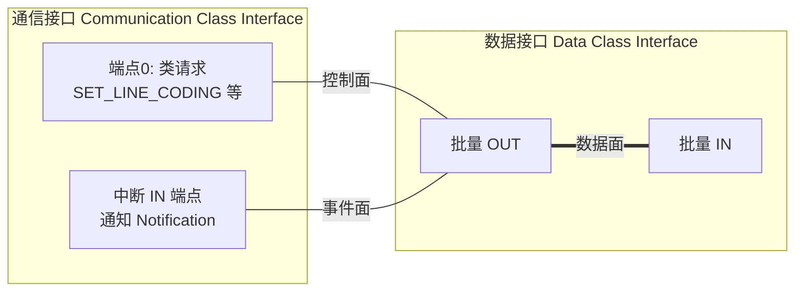

# CDC：ACM 虚拟串口、ECM/NCM/RNDIS 网络、请求与通知全表

> 层级 进阶 · 主题 `class/cdc` · 相关：[标准描述符字段全表](06-descriptors.md)、[设备类代码索引与驱动映射](10-class-index.md)、[设备端固件栈与 TinyUSB 实战](43-device-firmware.md)

## 核心事实 Key Facts

> 由维护者整理并与规范核对；与下方 USBTree 原文冲突时以本节为准。

- 结构：Communication Interface（类 0x02，子类 0x02 ACM / 0x06 ECM / 0x0D NCM，含 Interrupt IN 通知端点）+ Data Interface（类 0x0A，Bulk IN + Bulk OUT）；用 IAD（0xEF/0x02/0x01）或 Union Functional Descriptor 绑定。
- 功能描述符（CS_INTERFACE 0x24）子类型：0x00 Header、0x01 Call Management、0x02 ACM、0x06 Union、0x0F Ethernet Networking、0x1A NCM。
- ACM 请求：SET_LINE_CODING 0x20（bmRequestType 0x21，7 B：dwDTERate(4) bCharFormat(1: 0=1, 1=1.5, 2=2 停止位) bParityType(1: 0 None,1 Odd,2 Even,3 Mark,4 Space) bDataBits(1)）、GET_LINE_CODING 0x21（0xA1）、SET_CONTROL_LINE_STATE 0x22（wValue bit0 DTR, bit1 RTS）、SEND_BREAK 0x23。通知 SERIAL_STATE 0x20（2 B 位图：DCD, DSR, Break, Ring, Framing, Parity, Overrun）。
- 波特率对纯 USB 虚拟串口无物理意义，仅 USB-UART 桥使用。

## 原文：00-CDC概述

> Source: [20-枝干-设备类协议/CDC-通信设备类/00-CDC概述.md](https://github.com/tangjianfang/USBTree/blob/main/20-枝干-设备类协议/CDC-通信设备类/00-CDC概述.md)

>  上一级: [00-设备类索引](10-class-index.md) · 树干基础: [描述符详解](06-descriptors.md)

### 1. CDC 是什么

CDC（Communications Device Class，通信设备类）规范族回答一个问题：**如何用 USB 承载"通信"**——串口线路（调制解调器/RS-232）、以太网帧、电话线路、4G 模组乃至 5G MBIM。它是最古老的设备类规范之一（1.0 与 USB 1.0 同代），也由此背上了"历史包袱"：双接口模型与功能描述符体系在简单场景（虚拟串口）下显得笨重，但却是理解各种"USB 网卡/串口"设备的钥匙。

规范名：《Class definitions for Communication Devices》(CDC) 1.2，配合《PSTN Devices》1.2（串口部分）与《Ethernet/TDM》等子规范。

### 2. 双接口模型：控制与数据分离

CDC 设备的标准形态是**两个接口**组成一个功能：



| 接口 | bInterfaceClass | 端点构成 | 职责 |
|---|---|---|---|
| 通信接口 | 0x02 | 端点 0（类请求）+ 可选中断 IN（事件） | 配置链路参数、上报状态 |
| 数据接口 | 0x0A | 批量 IN + 批量 OUT | 承载业务数据（串口字节流/以太网帧） |

两个接口由 **Union 功能描述符**声明绑为一组（主接口 + 从接口列表）。

### 3. 功能描述符 (Functional Descriptor)

挂在通信接口描述符之后、端点描述符之前的一串**类特定描述符**（bDescriptorType=0x24 CS_INTERFACE），每个以"子类型"区分：

| 子类型 | 名称 | 关键内容 |
|---|---|---|
| 0x00 | Header | bcdCDC 规范版本——功能描述符链的开头 |
| 0x01 | Call Management | 呼叫管理能力位 + 数据接口号 |
| 0x02 | ACM (Abstract Control Management) | 支持的能力位：bit0 请求类命令、bit1 线路编码+串口状态、bit2 Send_Break、bit3 网络连接通知 |
| 0x04 | Direct Line Control | 直线控制模型能力 |
| 0x06 | Union | bMasterInterface + bSlaveInterface[]——把接口捆成一个功能 |
| 0x07 | Country Selection | 国家码列表 |
| 0x0F | Ethernet Networking | ECM 用：MAC 地址、统计能力、段过滤器 |
| 0x1A | NCM | NCM 能力（NTB 格式版本等） |
| 0x1B | MBIM | 移动宽带 |

解析规则与标准描述符一致：bLength + bDescriptorType(0x24) + bDescriptorSubtype + 载荷。

### 4. 子类与协议矩阵

通信接口的 `bInterfaceSubClass` 决定模型，`bInterfaceProtocol` 进一步细化：

| 子类 | 模型 | 本库位置 |
|---|---|---|
| 0x01 | 直线控制（老式调制解调器） | — |
| 0x02 | **ACM** 抽象控制模型（虚拟串口） | [01-虚拟串口ACM](14-cdc.md) |
| 0x03 | 电话控制 | — |
| 0x06 | **ECM** 以太网控制模型 | [02-网络子类](14-cdc.md) |
| 0x08 | WHCM 无线手机控制 | — |
| 0x09 | Device Management | 4G 模组管理通道 |
| 0x0B | OBEX | — |
| 0x0C | **EEM** 以太网仿真模型（协议 0x07） | 同上 |
| 0x0D | **NCM** 网络控制模型 | 同上 |
| 0x0E | **MBIM** 移动宽带接口模型 | 同上 |

ACM 的协议字段：0x01 = AT 命令（V.250），0x02 = GSM 07.07 AT，0x00/0xFF = 无/厂商。多数"USB 转串口"设备实际填 0x00 或 0x01，驱动并不强制。

### 5. 类请求与通知：控制面的两个方向

**主机 → 设备**用类请求（bmRequestType=0x21，接口接收者）：

| bRequest | 名称 | 典型载荷 |
|---|---|---|
| 0x20 | SET_LINE_CODING | 7 字节线路编码 |
| 0x21 | GET_LINE_CODING | 返回 7 字节 |
| 0x22 | SET_CONTROL_LINE_STATE | wValue: DTR bit0 / RTS bit1 |
| 0x23 | SEND_BREAK | wValue: break 时长（ms） |

**设备 → 主机**用通知（Notification，经中断 IN 端点）：

```
| bmRequestType=0xA1 | bNotification | wValue | wIndex(接口) | wLength | 数据 |
```

常用通知：SERIAL_STATE (0x20，DCD/DSR/RI/break 状态位图)、RESPONSE_AVAILABLE (0x01)、NETWORK_CONNECTION (0x00)、CONNECTION_SPEED_CHANGE (0x2A)。通知是**硬件事件机制**——没有它，主机就不知道对端状态变化。

### 6. 枚举与驱动的坑

- **复合设备的 IAD**：CDC 的双接口必须用 IAD（接口关联描述符）捆扎，否则 Windows 会把两个接口拆开分别找驱动而失败；老式替代方案是设备级类代码 0xEF/0x02/0x01（Misc/Common/IAD 提示位）。
- **数据接口不挂驱动**：0x0A 接口由所属 CDC 功能的驱动一并接管，操作系统中不会单独出现它的驱动绑定。
- **驱动现状**：Linux `cdc_acm`/`cdc_ether`/`cdc_ncm` 全内置；Windows 10+ 内置 usbser（纯 CDC-ACM 免驱）；Windows 7 需 INF 指向 usbser；macOS 内置。这使 CDC-ACM 成为嵌入式设备"免驱串口"的首选（对比厂商芯片见 [WebUSB 与自定义类](19-other-classes-b.md)）。

## 原文：01-虚拟串口ACM

> Source: [20-枝干-设备类协议/CDC-通信设备类/01-虚拟串口ACM.md](https://github.com/tangjianfang/USBTree/blob/main/20-枝干-设备类协议/CDC-通信设备类/01-虚拟串口ACM.md)

### 1. ACM 的定位

ACM（Abstract Control Management，抽象控制模型）是 CDC 中最常用的子类：**把 USB 批量端点伪装成一条 RS-232 串口线路**。操作系统枚举后出现虚拟 COM 口/ttyACM*，应用照旧用串口 API 读写——但底层没有 UART，只有 USB。这是嵌入式设备调试口、Arduino、GPS 模组、LoRa 模组的标准形态。

### 2. 完整描述符组合（背下来）

一个 ACM 功能 = 通信接口 + 数据接口，描述符布局：

```
IAD (0x0B: FirstInterface=0, Count=2, Class=0x02/0x02/0x01)
├── 接口0 (通信): bInterfaceClass=0x02, SubClass=0x02(ACM), Protocol=0x01(AT)
│   ├── CS_INTERFACE Header      (0x24/0x00, bcdCDC=0x0110)
│   ├── CS_INTERFACE ACM         (0x24/0x02, bmCapabilities=0x02)
│   ├── CS_INTERFACE Union       (0x24/0x06, Master=0, Slave=1)
│   ├── CS_INTERFACE CallMgmt    (0x24/0x01, bmCapabilities=0x00, DataIf=1)
│   └── 端点: 中断 IN (wMaxPacketSize=8~16, bInterval=2ms~255ms)
└── 接口1 (数据): bInterfaceClass=0x0A, SubClass=0x00, Protocol=0x00
    └── 端点: 批量 IN + 批量 OUT (FS 64B / HS 512B)
```

逐项要点：

- **ACM bmCapabilities=0x02** 是最常见取值：支持 SET_LINE_CODING/GET_LINE_CODING/SERIAL_STATE，不支持 Send_Break 等高级特性；
- **Union 是灵魂**：没有它，主机不知道接口 0 与接口 1 属于同一功能；
- **中断 IN 端点必须存在**（哪怕从不发通知）——它是 ACM 描述符合法性的组成部分，bInterval 建议不要低于 2 ms；
- 批量端点包长按速率取上限（FS 64 / HS 512），吞吐才够（[带宽账本](05-transfer-types-bandwidth.md)）。

### 3. 类请求详解

#### 3.1 SET/GET_LINE_CODING (0x20/0x21)

7 字节线路编码结构：

| 偏移 | 字段 | 说明 |
|---|---|---|
| 0 | dwDTERate | 4 字节 LE，波特率数值（如 115200） |
| 4 | bCharFormat | 停止位：0=1 位，1=1.5 位，2=2 位 |
| 5 | bParityType | 校验：0=无，1=奇，2=偶，3=标志，4=空格 |
| 6 | bDataBits | 数据位 5~8/16 |

关键语义：**这是"抽象"参数**——设备应当记住它（应用层可能据此适配），但对 USB 传输本身毫无影响（USB 永远全速跑批量端点）。固件实现要点：`GET_LINE_CODING 必须可回读`，只实现 SET 的设备会被部分驱动拒绝。

#### 3.2 SET_CONTROL_LINE_STATE (0x22)

wValue 位图：bit0=DTR（数据终端就绪），bit1=RTS（请求发送）。虚拟串口打开/关闭串口时驱动翻转 DTR——固件可用 DTR 下降沿做"主机已断开"事件（如退出命令模式）。

#### 3.3 SEND_BREAK (0x23)

wValue = break 持续毫秒数（0xFFFF 特殊含义见规范）。用于线路 break 条件（如 STM32 DFU 的 1200bps touch：先 SET_LINE_CODING 到 1200 再复位进入 bootloader）。

### 4. 通知：SERIAL_STATE

设备经中断 IN 上报（bmRequestType=0xA1, bNotification=0x20, wLength=2）：

| 位 | 含义 |
|---|---|
| bit3 (0x08) | DSR（数传机就绪） |
| bit2 (0x04) | break |
| bit1 (0x02) | Ring |
| bit0 (0x01) | DCD（载波检测） |

发送条件：状态变化时；无变化不滥发。主机侧重：多数终端程序靠 DCD 判断"线路在位"。

### 5. 数据流与吞吐

```
应用 write() → 驱动缓冲 → 批量 OUT → 设备端点缓冲 → 固件业务
```

- 零长度包 (ZLP) 语义：当传输长度恰为 wMaxPacketSize 整数倍时，框架用 ZLP 标记"这次请求结束"——固件必须正确处理，否则短包粘包（[固件栈](43-device-firmware.md)）；
- 实测吞吐：FS 下 300~700 KB/s，HS 下 5~40 MB/s（取决于主机驱动与固件缓冲策略）；
- 流控缺失提醒：ACM 没有硬件流控语义（RTS/CTS 是抽象的），高速数据流靠批量 NAK 天然反压——设备端缓冲满了让端点 NAK 即可，这是批量传输的礼物（[传输类型](05-transfer-types-bandwidth.md)）。

### 6. 主机侧驱动

| 平台 | 驱动 | 设备出现为 |
|---|---|---|
| Linux | cdc_acm（内核内置） | /dev/ttyACM0 |
| Windows 10+ | usbser.inf 内置 | COM 口（免 INF） |
| Windows 7 | 需 INF 指向 usbser | COM 口 |
| macOS | 内置 IODriverKit | /dev/tty.usbmodem* |

对比厂商串口芯片（FTDI/CH340 需各自驱动）与 WebUSB 方案的选择见[WebUSB 与厂商自定义类](19-other-classes-b.md)。

### 7. 固件实现清单（TinyUSB/裸机通用）

- [ ] 描述符：IAD + 双接口 + 四个功能描述符齐全（顺序：Header→ACM→Union→CallMgmt）；
- [ ] 端点 0 响应 0x20/0x21/0x22/0x23 四个类请求，GET 可回读；
- [ ] 批量 OUT/IN 双缓冲，ZLP 边界正确；
- [ ] （可选）DTR 边沿回调、环形缓冲、热插拔后缓冲清空；
- [ ] 复合（HID+CDC）时 IAD 与接口编号连续性检查（[索引](10-class-index.md)）。

## 原文：02-网络子类ECM-NCM-RNDIS

> Source: [20-枝干-设备类协议/CDC-通信设备类/02-网络子类ECM-NCM-RNDIS.md](https://github.com/tangjianfang/USBTree/blob/main/20-枝干-设备类协议/CDC-通信设备类/02-网络子类ECM-NCM-RNDIS.md)

### 1. 用 USB 跑以太网的四种姿势

| 模型 | 规范来源 | 接口签名 | 定位 |
|---|---|---|---|
| ECM (Ethernet Control Model) | CDC 1.2 | 0x02/0x06/0x00 | 官方基线，性能最弱 |
| NCM (Network Control Model) | CDC-NCM 1.0 | 0x02/0x0D/0x00 | 官方演进版，一包多帧 |
| EEM (Ethernet Emulation Model) | CDC-EEM | 0x02/0x0C/0x07 | 轻量帧封装，少见 |
| RNDIS | 微软私有 | 0xEF/0x04/0x01（或伪装 0x02/0x06/0xFF） | 事实标准(历史)，Android 老方案 |

对操作系统而言，它们都长成一块 USB 网卡；差别在**一趟批量事务里能塞多少帧、控制面多复杂**。

### 2. ECM：教科书模型

- 数据面：一次批量事务 = 一个以太网帧（前导/FCS 不传，从目的 MAC 到载荷）；
- 控制面：通信接口带 **Ethernet Networking 功能描述符**（0x0F：48 位 MAC 地址、bmEthernetStatistics、wMaxSegmentSize=1514、段过滤器能力位）；
- 类请求：SET_ETHERNET_PACKET_FILTER (0x0E，wValue=过滤位图：广播/组播/单播/全收)；
- 通知：NETWORK_CONNECTION (0x00，链路 up/down)、CONNECTION_SPEED_CHANGE (0x2A，wValue=上行速率，wIndex=下行速率，单位 bps)；
- 性能天花板：**一帧一事务 + 每帧 52 字节协议开销**（令牌+握手+ACK 链），FS 上约 0.5~0.8 MB/s，HS 上约 20~30 MB/s 就难再高——千兆时代不可用，于是有了 NCM。

### 3. NCM：聚合传输（现代标准）

核心思想：**把 N 个以太网帧打包进一个 NTB（NCM Transfer Block）再走批量端点**，摊薄协议开销、减少事务次数。

NTB 结构骨架（16 位 NTB，NTB-16）：

```
| NHHeader (12B): "NCMH" 签名 0x484D434E, wHeaderLength,
|                 wSequence, wBlockLength(整块长度), wNdpIndex |
| 以太网帧 1 | 帧 2 | ... | 帧 N |
| NDP (网络数据指针): "NCDP"? → 项数组: wDatagramIndex(偏移), wDatagramLen |
```

- 设备与主机互发 NTB；`GET_NTB_PARAMETERS` (0x86) 协商最大块长、NDP 对齐等参数；
- 16 位/16 位 DPS（Datagram Pointer Signature）模式与 32 位 NTB-32 面向 HS/SS；
- Linux `cdc_ncm` 是 4G/5G 上网卡的标准驱动；Windows 8+ 内置。实测 HS 下可稳定 40+ MB/s，配合 SSD 时达瓶颈消除；
- 复合形态：MBIM（子类 0x0E）在 NCM 传输层之上跑 IP 会话协议，是现代蜂窝模组的标准（控制面命令复用同一批量通道，规范独立于 CDC 1.2）。

### 4. RNDIS：微软的"先发优势"

Remote NDIS 是微软在 CDC-ECM 成熟前定义的私有协议（2001），特点：

- 消息封装：`REMOTE_NDIS_INITIALIZE_MSG → INITIALIZE_CMPLT`、`REMOTE_NDIS_PACKET_MSG`（一包一帧，头部 44 字节量级）、KEEPALIVE 心跳；
- 控制面走**接口 0 的中断/控制通道**，数据面走批量对——与 CDC 结构貌合神离；
- 接口签名常见两种：`0xEF/0x04/0x01`（厂商自declare + MS OS 描述符声明 RNDIS）或伪装成 `0x02/0x06/0xFF`（假 CDC，靠 Windows 的兼容 ID 认领）；
- 历史：Android 4.x 之前"USB 网络共享"默认 RNDIS；Windows 全系支持（内置 rndis 驱动）；Linux `rndis_host`。**已被 NCM 取代**（Android 13 起默认 NCM），但存量设备与老车机/工控环境仍常见；
- 驱动绑定的黑科技全靠 [Microsoft OS 描述符](19-other-classes-b.md)——想理解 RNDIS 设备怎么免驱，去看那篇。

### 5. 对比速查

| | ECM | NCM | RNDIS | EEM |
|---|---|---|---|---|
| 标准化 | USB-IF | USB-IF | 微软私有 | USB-IF |
| 聚合 | 无（1 帧/事务） | NTB 多帧 | 无 | 帧束（bundle） |
| HS 实测吞吐 | ~20 MB/s | 40+ MB/s | ~30 MB/s | ~35 MB/s |
| 驱动覆盖 | 全平台内置 | Win8+/Linux/macOS | 全平台(存量) | Linux 为主 |
| 现状 | 教学/兼容 | **推荐** | 遗留维护 | 少见 |

### 6. 调试叶子

- Wireshark 抓 USB 网卡：Linux 上直接抓对应 usbmon 接口可见 NTB；抓"网卡侧"则看 cdc_ncm/rndis_host 之上的 ethX；
- 手机"USB 网络共享"不识别：先看设备管理器/lsusb 的接口签名，确认主机驱动认哪种模型（很多手机固件可切换 RNDIS/NCM）；
- 吞吐不达预期：检查 NTB 最大块长协商值与固件缓冲（单帧模式=忘了聚合）、ZLP 边界；
- MBIM/QMI 模组：wwan0 出现但无网 → 控制面会话未建立，属于移动宽带协议层问题，与 USB 传输层无关。

## 原文：03-CDC规范级-请求与通知全表

> Source: [20-枝干-设备类协议/CDC-通信设备类/03-CDC规范级-请求与通知全表.md](https://github.com/tangjianfang/USBTree/blob/main/20-枝干-设备类协议/CDC-通信设备类/03-CDC规范级-请求与通知全表.md)

>  全部数值提取自 **CDC 1.2**（核心规范 Table 4/5/13/19、§6.2/6.3）、**PSTN 1.2**、**ECM 1.2**、**WMC 1.1**（同一 zip 缓存，见 [../../80-参考资料/README.md](92-spec-references.md)）。模型与驱动实战见 [01-虚拟串口ACM.md](14-cdc.md) / [02-网络子类ECM-NCM-RNDIS.md](14-cdc.md)。

### 1. 类代码、子类全表与协议编码

接口类：通信控制接口 `bInterfaceClass=0x02 (COMM)`；数据接口 `0x0A (Data Interface Class)`（其子类未用填 0）。

**通信接口子类全表（CDC 1.2 Table 4，0x00~0x0F）：**

| 代码 | 子类/模型 | 出处 | | 代码 | 子类/模型 | 出处 |
|---|---|---|---|---|---|---|
| 00h | 保留 | — | | 08h | Wireless Handset Control Model (WHCM) | WMC1.1 |
| 01h | Direct Line Control Model（直连） | PSTN1.2 | | 09h | Device Management | WMC1.1 |
| 02h | Abstract Control Model (ACM，虚拟串口) | PSTN1.2 | | 0Ah | Mobile Direct Line Model (MDLM) | WMC1.1 |
| 03h | Telephone Control Model | PSTN1.2 | | 0Bh | OBEX | WMC1.1 |
| 04h | Multi-Channel Control Model | ISDN1.2 | | 0Ch | Ethernet Emulation Model (EEM) | EEM1.0 |
| 05h | CAPI Control Model | ISDN1.2 | | 0Dh | Network Control Model (NCM) | NCM1.0 |
| 06h | Ethernet Networking Control Model (ECM) | ECM1.2 | | 0Eh | Mobile Broadband Interface Model (MBIM)* | MBIM1.0 |
| 07h | ATM Networking Control Model | ATM1.2 | | 0Fh~7Fh 保留 / 80h~FEh 厂商 | | |

\* 0Eh/MBIM 不在 CDC 1.2 表内，取自 MBIM 1.0 规范（zip 未缓存该文档），谨慎引用。

**通信接口协议编码（CDC 1.2 Table 5）：** `00h` 无类协议、`01h` AT 命令 (ITU-T V.250)、`02h` PCCA-101 AT、`03h` PCCA-101 & Annex O、`04h` GSM 07.07 AT、`05h` 3GPP 27.007 AT、`06h` C-S0017-0 (CDMA TIA AT)、`07h` USB EEM、`08h~FDh` 由 Command Set Functional Descriptor 声明的外部协议、`FEh` 保留、`FFh` 厂商自定义。

**数据接口协议（Table 7 摘要）**：`00h` 无、`01h` Network Transfer Block（NCM 的 NTB，数据接口唯一类协议值）；`30h~32h+` ISDN BRI 物理层协议（I.430/HDLC 等）。

### 2. 类特定请求全表（CDC 1.2 Table 19，0x00~0x8A，按子规范归属）
>  对抗抽查（evolve #20）：SET_LINE_CODING=20h、SET_CONTROL_LINE_STATE=22h（PSTN）、SET_ETHERNET_PACKET_FILTER=**43h**（ECM——注意常见误传 0x0E）与 CDC 1.2 原文比对一致。

所有类请求 bmRequestType：SET=`00100001b (0x21)`，GET=`10100001b (0xA1)`；接收者为通信接口（wIndex=接口号，wValue 多为 0 或选择子）。

| 代码 | 请求 | 模型/出处 | wValue / 数据载荷 |
|---|---|---|---|
| 00h | SEND_ENCAPSULATED_COMMAND | 核心 §6.2.1 | OUT：wLength=命令长度，Data=协议命令（AT 等） |
| 01h | GET_ENCAPSULATED_RESPONSE | 核心 §6.2.2 | IN：Data=上一命令的响应（可分块读） |
| 02h | SET_COMM_FEATURE | PSTN1.2 | OUT：wValue=Feature Selector（00h ABSTRACT_STATE / 01h COUNTRY_SETTING），Data=2B 状态 |
| 03h | GET_COMM_FEATURE | PSTN1.2 | IN：同上，返回当前特征 |
| 04h | CLEAR_COMM_FEATURE | PSTN1.2 | 恢复默认特征，无 Data |
| 05h~0Fh | 保留 | — | — |
| 10h | SET_AUX_LINE_STATE | PSTN | wValue: 0 断开 / 1 连接副话机 |
| 11h | SET_HOOK_STATE | PSTN | wValue: 0000h ON_HOOK / 0001h OFF_HOOK / 0002h SNOOPING（来电显示） |
| 12h | PULSE_SETUP | PSTN | wValue=FFFFh 结束脉冲拨号保持，其他=准备 |
| 13h | SEND_PULSE | PSTN | wValue=make/break 脉冲周期数 |
| 14h | SET_PULSE_TIME | PSTN | 高字节断开 ms，低字节接通 ms |
| 15h | RING_AUX_JACK | PSTN | wValue=振铃次数 |
| 20h | **SET_LINE_CODING** | PSTN | OUT：7 字节 Line Coding 结构（见下） |
| 21h | **GET_LINE_CODING** | PSTN | IN：同结构 |
| 22h | **SET_CONTROL_LINE_STATE** | PSTN | wValue 位图：D0 RTS（载波，V.24-105），D1 DTR（终端在位，V.24-108/2） |
| 23h | **SEND_BREAK** | PSTN | wValue=break 时长 ms；FFFFh=持续 break 直至收到 0000h |
| 30h | SET_RINGER_PARMS / 31h GET_RINGER_PARMS | PSTN | 振铃参数结构 |
| 32h | SET_OPERATION_PARMS / 33h GET_OPERATION_PARMS | PSTN | 拨号/等待参数 |
| 34h | SET_LINE_PARMS / 35h GET_LINE_PARMS | PSTN | 线路参数结构 |
| 36h | DIAL_DIGITS | PSTN | Data=拨号串结构 |
| 37h | SET_UNIT_PARAMETER / 38h GET_UNIT_PARAMETER / 39h CLEAR_UNIT_PARAMETER | ISDN | 单元参数 |
| 3Ah | GET_PROFILE | ISDN | IN：设备配置档 |
| 40h | SET_ETHERNET_MULTICAST_FILTERS | ECM | OUT：组播 MAC 地址表 |
| 41h | SET_ETHERNET_POWER_MANAGEMENT_PATTERN_FILTER | ECM | OUT：电源管理唤醒模式滤波器 |
| 42h | GET_ETHERNET_POWER_MANAGEMENT_PATTERN_FILTER | ECM | IN：读取滤波器状态 |
| 43h | SET_ETHERNET_PACKET_FILTER | ECM | wValue 位图（广播/组播/单播等，ECM §6.3.x）；**注意网络旧文常误写 0x0E，规范值为 43h** |
| 44h | GET_ETHERNET_STATISTIC | ECM | IN：统计计数器结构 |
| 50h | SET_ATM_DATA_FORMAT / 51h GET_ATM_DEVICE_STATISTICS / 52h SET_ATM_DEFAULT_VC / 53h GET_ATM_VC_STATISTICS | ATM | ATM 数据格式/统计 |
| 60h~7Fh | MDLM 语义模型专用请求（32 个） | WMC1.1 Table 5-4 | 具体值由 MDLM Detail 描述符声明的语义模型定义 |
| 80h | GET_NTB_PARAMETERS | NCM1.0 | IN：NTB 参数结构（NTB 格式、缓冲大小等） |
| 81h | GET_NET_ADDRESS / 82h SET_NET_ADDRESS | NCM1.0 | 6 字节 MAC 地址 |
| 83h | GET_NTB_FORMAT / 84h SET_NTB_FORMAT | NCM1.0 | wValue：0001h=16bit NTB，0002h=32bit NTB |
| 85h | GET_NTB_INPUT_SIZE / 86h SET_NTB_INPUT_SIZE | NCM1.0 | 4 字节 dwNtbInMaxSize |
| 87h | GET_MAX_DATAGRAM_SIZE / 88h SET_MAX_DATAGRAM_SIZE | NCM1.0 | 2 字节最大数据报（NCM1.0 新增） |
| 89h | GET_CRC_MODE / 8Ah SET_CRC_MODE | NCM1.0 | wValue：0000h 无 CRC / 0001h 32bit CRC |
| 8Bh~FFh | 保留 | — | — |

**COMM_FEATURE 选择子（PSTN Table 14，SET/GET/CLEAR_COMM_FEATURE 的 wValue）：**

| 选择子 | 代码 | Data 长度 | 含义 |
|---|---|---|---|
| ABSTRACT_STATE | 01h | 2 | 位图：D0=呼叫管理信息复用到数据类接口；D1=Idle（接口暂停收发）——仅 ACM 模型有效 |
| COUNTRY_SETTING | 02h | 2 | ISO3166 国家码，须与 Country Selection 功能描述符声明一致 |

**Line Coding 结构（PSTN Table 17，虚拟串口核心）**：

| 偏移 | 字段 | 值 |
|---|---|---|
| 0 | dwDTERate (4B) | 波特率 bps（LE） |
| 4 | bCharFormat (1B) | 停止位：0=1 位，1=1.5 位，2=2 位 |
| 5 | bParityType (1B) | 0=None，1=Odd，2=Even，3=Mark，4=Space |
| 6 | bDataBits (1B) | 数据位 5/6/7/8/16 |

#### 2.1 ECM 请求载荷细节（ECM 1.2 §6.2）

| 请求 | wValue | wLength / Data |
|---|---|---|
| SET_ETHERNET_MULTICAST_FILTERS (40h) | 过滤器数 N | N×6 字节组播 MAC 列表（网络字节序）；改一个须整表重发 |
| SET_ETHERNET_POWER_MANAGEMENT_PATTERN_FILTER (41h) | 过滤器编号 | 电源管理唤醒模式结构：MaskSize(2B)+Mask+Pattern（模式从以太帧 DA 起匹配）；wLength=0 表示清除该滤波器 |
| GET_ETHERNET_POWER_MANAGEMENT_PATTERN_FILTER (42h) | 过滤器编号 | 返回 2B 布尔：0x0001 生效 / 0x0000 未设置或装不下 |
| SET_ETHERNET_PACKET_FILTER (43h) | 过滤位图 | 无 Data。位图：D0 PACKET_TYPE_PROMISCUOUS、D1 ALL_MULTICAST、D2 DIRECTED、D3 BROADCAST、D4 MULTICAST（列表内组播）；D5~D15 保留 |
| GET_ETHERNET_STATISTIC (44h) | 统计特征选择子 | 返回 4B 无符号计数（上电/复位起累计，回绕） |

统计特征选择子（ECM Table 9）：`01h XMIT_OK`、`02h RCV_OK`、`03h XMIT_ERROR`、`04h RCV_ERROR`、`05h RCV_NO_BUFFER`、`06h~0Bh DIRECTED/MULTICAST/BROADCAST_BYTES/FRAMES_XMIT`、`0Ch~11h …_RCV`（各 4B）。

### 3. 类特定通知全表（CDC 1.2 §6.3 + PSTN Table 30 + ECM Table 11）

通知走通信接口的**中断 IN 端点**，固定 `bmRequestType=10100001b (0xA1)`，wIndex=接口号。

| 代码 | 通知 | 出处 | wValue / wLength / Data |
|---|---|---|---|
| 00h | NETWORK_CONNECTION | 核心/PSTN/ECM | wValue 0=断开 1=连接；wLength=0 |
| 01h | RESPONSE_AVAILABLE | 核心/PSTN | 主机应发 GET_ENCAPSULATED_RESPONSE；wLength=0 |
| 08h | AUX_JACK_HOOK_STATE | PSTN | wValue 0=On hook / 1=Off hook |
| 09h | RING_DETECT | PSTN | POTS 线路振铃；wLength=0 |
| 20h | SERIAL_STATE | PSTN | wLength=2，UART 状态位图（见下） |
| 28h | CALL_STATE_CHANGE | PSTN | wValue 高字节=呼叫索引、低字节=状态变更；Data=变长附信息（来电显示等） |
| 29h | LINE_STATE_CHANGE | PSTN | 线路状态变更 |
| 2Ah | CONNECTION_SPEED_CHANGE | 核心/ECM | wLength=8：DLBitRate(4B)+ULBitRate(4B)，bps；规范要求每次 NETWORK_CONNECTION 后必须紧跟本通知 |
| 40h~5Fh | MDLM 语义模型专用通知（32 个） | WMC1.1 Table 5-5 | 语义模型定义 |
| 0Ah~07h/21h~27h/2Bh~3Fh/60h~FFh | 保留 | — | — |

**SERIAL_STATE UART 位图（PSTN Table 31）**：D0 bRxCarrier（DCD，V.24-109）、D1 bTxCarrier（DSR，V.24-106）、D2 bBreak、D3 bRingSignal、D4 bFraming、D5 bParity、D6 bOverRun；D7~D15 保留。一次性信号（break/ring/overrun）通知后自动清零，等状态再次变化才重发；载波类信号仅在变化时通知。

### 4. 功能描述符子类型全表（CDC 1.2 Table 13，CS_INTERFACE 内）

功能描述符通用格式：`bFunctionLength(1) | bDescriptorType=0x24 CS_INTERFACE(1) | bDescriptorSubtype(1) | 类型专属字段…`，置于接口描述符的类特定附加段，且必须以 Header 开头。

| 子类型 | 功能描述符 | | 子类型 | 功能描述符 |
|---|---|---|---|---|
| 00h | Header（头） | | 0Dh | Multi-Channel Management（ISDN） |
| 01h | Call Management（PSTN） | | 0Eh | CAPI Control Management（ISDN） |
| 02h | Abstract Control Management（PSTN/ACM） | | 0Fh | Ethernet Networking（ECM） |
| 03h | Direct Line Management（PSTN/DLM） | | 10h | ATM Networking |
| 04h | Telephone Ringer（PSTN） | | 11h | Wireless Handset Control Model（WMC） |
| 05h | Telephone Call & Line State Reporting（PSTN） | | 12h | Mobile Direct Line Model（WMC） |
| 06h | Union（核心） | | 13h | MDLM Detail（WMC） |
| 07h | Country Selection（核心） | | 14h | Device Management Model（WMC） |
| 08h | Telephone Operational Modes（PSTN） | | 15h | OBEX（WMC） |
| 09h | USB Terminal（PSTN） | | 16h | Command Set（WMC） |
| 0Ah | Network Channel Terminal（PSTN） | | 17h | Command Set Detail（WMC） |
| 0Bh | Protocol Unit（PSTN） | | 18h | Telephone Control Model（WMC） |
| 0Ch | Extension Unit（PSTN） | | 19h | OBEX Service Identifier（WMC） |
| 1Ah | NCM Functional Descriptor（NCM1.0） | | 1Bh~7Fh 保留 / 80h~FEh 厂商 | |

数据类功能描述符（Table 14）只有 `00h Header`，其余保留/厂商。MBIM 功能描述符子类型 0x1F（MBIM 1.0，zip 未缓存，谨慎引用）。

### 5. 核心功能描述符逐字段

**Header（子类型 00h，核心 Table 15）：**

| 偏移 | 字段 | 值 |
|---|---|---|
| 0 | bFunctionLength | 5 |
| 1 | bDescriptorType | 0x24 (CS_INTERFACE) |
| 2 | bDescriptorSubtype | 0x00 |
| 3 | bcdCDC | 规范版本，1.2 版设备 = 0x0120（BCD，LE） |

**Union（子类型 06h，核心 Table 16）：**

| 偏移 | 字段 | 说明 |
|---|---|---|
| 0 | bFunctionLength | 5+N |
| 1 | bDescriptorType | 0x24 |
| 2 | bDescriptorSubtype | 0x06 |
| 3 | bControlInterface | 主控接口号（通信接口） |
| 4~ | bSubordinateInterface0..N-1 | 被捆绑的下级接口号（数据接口等）；主机靠它把 ECM/ACM 的控制接口与数据接口配对 |

**Call Management（子类型 01h，PSTN Table 3）：**

| 偏移 | 字段 | 说明 |
|---|---|---|
| 0 | bFunctionLength | 5 |
| 1 | bDescriptorType | 0x24 |
| 2 | bDescriptorSubtype | 0x01 |
| 3 | bmCapabilities | D0：1=设备自身处理呼叫管理；D1：1=呼叫管理信息可走数据类接口（D0=0 时 D1 必须为 0） |
| 4 | bDataInterface | 用于呼叫管理的数据接口号（不用填 0） |

**Abstract Control Management（子类型 02h，PSTN Table 4）：**

| 偏移 | 字段 | 说明 |
|---|---|---|
| 0 | bFunctionLength | 4 |
| 1 | bDescriptorType | 0x24 |
| 2 | bDescriptorSubtype | 0x02 |
| 3 | bmCapabilities | D0：支持 SET/GET/CLEAR_COMM_FEATURE；D1：支持 SET_LINE_CODING+SET_CONTROL_LINE_STATE+GET_LINE_CODING+SERIAL_STATE 通知；D2：支持 SEND_BREAK；D3：支持 NETWORK_CONNECTION 通知；D4~D7 保留。虚拟串口设备典型值 **0x02** 或 **0x06** |

**Direct Line Management（子类型 03h，PSTN Table 5）：**

| 偏移 | 字段 | 说明 |
|---|---|---|
| 0 | bFunctionLength | 4 |
| 1 | bDescriptorType | 0x24 |
| 2 | bDescriptorSubtype | 0x03 |
| 3 | bmCapabilities | D0：支持 PULSE_SETUP+SEND_PULSE+SET_PULSE_TIME；D1：支持 SET_AUX_LINE_STATE+RING_AUX_JACK+AUX_JACK_HOOK_STATE 通知；D2：脉冲拨号需额外 PULSE_SETUP 释放保持电路；D3~D7 保留 |

Country Selection（子类型 07h，核心 Table 17）：iCountryCodeRelDate(1，字符串索引，日期格式 ddmmyyyy) + wCountryCode0..N-1(各 2B，ISO3166 十六进制码)。

**Ethernet Networking（子类型 0Fh，ECM §5.3）：**

| 偏移 | 字段 | 说明 |
|---|---|---|
| 0 | bFunctionLength | 13 |
| 1 | bDescriptorType | 0x24 |
| 2 | bDescriptorSubtype | 0x0F |
| 3 | iMACAddress | 字符串索引：MAC 地址字符串（以 UTF-16LE 十六进制文本存于 String Descriptor） |
| 4 | bmEthernetStatistics (4B) | 位图：设备支持哪些 Table 9 统计计数器 |
| 8 | wMaxSegmentSize (2B) | 网段内最大帧段（不含 CRC，以太网通常 1514） |
| 10 | wNumberMCFilters (1B) | 可支持组播地址过滤器个数与能力位 |
| 11 | wNumberPowerFilters (1B) | 电源管理模式滤波器个数 |

NCM 功能描述符（子类型 1Ah，NCM1.0 §5.3）：bMasterInterface/bSlaveInterface0（Union 的 NCM 化重复声明）+ bmNetworkCapabilities（D0=支持 extended statistics? 按位定义——zip 未含 NCM 原文，字段细节以 NCM 1.0 为准）。
