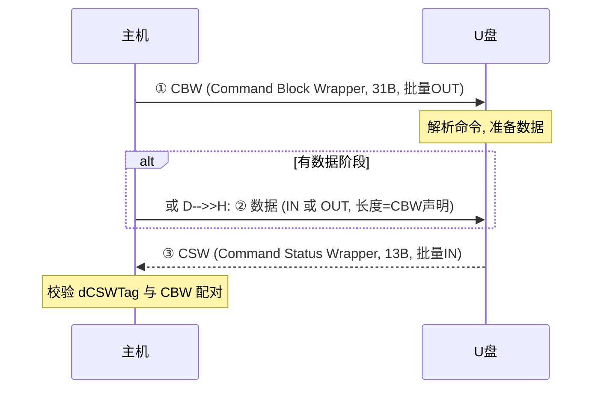
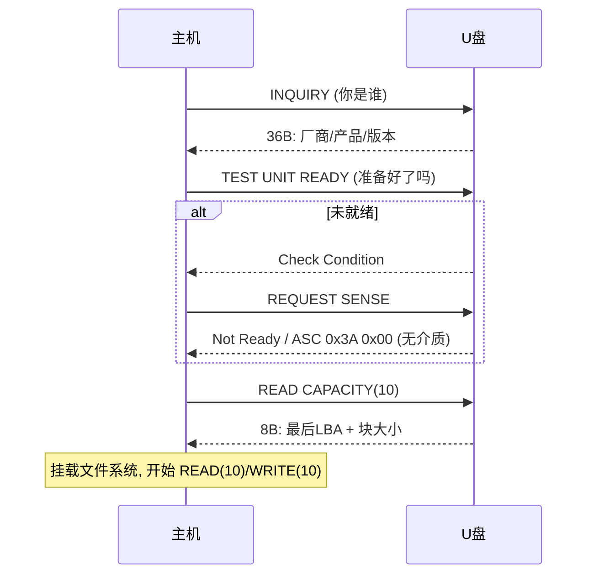

# MSC：BOT、CBW/CSW、SCSI 命令与 Sense 全表

> 层级 进阶 · 主题 `class/msc` · 相关：[设备类代码索引与驱动映射](10-class-index.md)、[USB 3.x SuperSpeed：包格式、LTSSM、定时器](30-usb3-superspeed.md)

## 核心事实 Key Facts

> 由维护者整理并与规范核对；与下方 USBTree 原文冲突时以本节为准。

- 接口：class 0x08，subclass 0x06 SCSI transparent（0x04 UFI 软驱），protocol 0x50 BOT / 0x62 UAS / 0x00 CBI。
- CBW 31 B：dCBWSignature 0x43425355 ("USBC")、dCBWTag、dCBWDataTransferLength、bmCBWFlags（bit7 1=IN）、bCBWLUN、bCBWCBLength(1–16)、CBWCB[16]。
- CSW 13 B：dCSWSignature 0x53425355 ("USBS")、dCSWTag（回显）、dCSWDataResidue、bCSWStatus（0 Passed, 1 Failed, 2 Phase Error）。
- 类请求：Bulk-Only Mass Storage Reset 0xFF（0x21）、Get Max LUN 0xFE（0xA1，返回最大 LUN 号，0 = 单 LUN）。
- Phase Error 恢复：Reset Recovery = BOMS Reset + 对两个批量端点 CLEAR_FEATURE(HALT)。

## 原文：00-MSC概述与BOT

> Source: [20-枝干-设备类协议/MSC-大容量存储/00-MSC概述与BOT.md](https://github.com/tangjianfang/USBTree/blob/main/20-枝干-设备类协议/MSC-大容量存储/00-MSC概述与BOT.md)

>  上一级: [00-设备类索引](10-class-index.md) · 树干基础: [四种传输类型](05-transfer-types-bandwidth.md)

### 1. MSC 在树上的位置

大容量存储类（Mass Storage Class）= **USB 传输层 + 块设备命令集**两层拼装：

```
应用(文件系统) → 驱动 → SCSI/SBC 命令 (CDB)   ← 命令层: 借用 SCSI
                        ↓ 封装
                 BOT 或 UAS 传输协议           ← 传输层: 本篇主角
                        ↓
                 USB 批量端点 (FS 64B / HS 512B)
```

接口签名（U 盘标准形态）：`bInterfaceClass=0x08, bInterfaceSubClass=0x06 (SCSI 透明命令集), bInterfaceProtocol=0x50 (BOT)`，单接口 + 批量 IN/OUT 两个端点。

| 子类 | 命令集 | 说明 |
|---|---|---|
| 0x01 | RBC 精简块命令 | 少见 |
| 0x02 | ATAPI/MMC-2 (CBI) | 老光驱 |
| 0x04 | UFI | 软盘系，常见于老读卡器 |
| 0x05 | SFF-8070i | 老读卡器 |
| **0x06** | **SCSI 透明（SBC）** | **事实标准** |

### 2. BOT：三段式事务

Bulk-Only Transport (BOT) 把"一条命令"变成批量端点上的三段：



#### CBW 31 字节逐字段

| 偏移 | 字段 | 说明 |
|---|---|---|
| 0 | dCBWSignature | 0x43425355（小端读作 "USBC"） |
| 4 | dCBWTag | 命令序号，CSW 原样带回——配对凭据 |
| 8 | dCBWDataTransferLength | 数据阶段期望长度（0 = 无数据阶段） |
| 12 | bmCBWFlags | bit7=方向（1=数据 IN，即设备→主机）；bit6~0 保留=0 |
| 13 | bCBWLUN | bit3~0：目标逻辑单元号（多分区读卡器 >0） |
| 14 | bCBWCBLength | bit4~0：命令块有效长度（1~16） |
| 15 | CBWCB[16] | 命令块本身（SCSI CDB，大端字段） |

#### CSW 13 字节逐字段

| 偏移 | 字段 | 说明 |
|---|---|---|
| 0 | dCSWSignature | 0x53425355（"USBS"） |
| 4 | dCSWTag | 必须等于对应 CBW 的 Tag |
| 8 | dCSWDataResidue | 数据阶段实际未完成的字节数 |
| 12 | bCSWStatus | 0x00=命令成功；0x01=命令失败(查 REQUEST SENSE)；0x02=阶段错误(严重，需复位恢复) |

### 3. 流控与 STALL

- **设备缓冲不足** → 端点 NAK（[批量传输](05-transfer-types-bandwidth.md)的天然反压），主机继续轮询——BOT 吞吐的重要参数是设备端"深度缓冲+提前预取"；
- **命令失败** → 设备在数据/状态阶段 STALL → 主机随后发 REQUEST SENSE 取错误详情 → 清 halt → 继续；
- **阶段错误 (0x02)**：主机声明的数据方向/长度与命令语义不符（驱动 bug 或线缆位损坏）→ 必须走**复位恢复**。

#### 复位恢复（背下来）

1. 主机发类请求 **Bulk-Only Mass Storage Reset**（bmRequestType=0x21, bRequest=0xFF, wIndex=接口, 无数据阶段）——设备复位自己的 BOT 状态机；
2. 主机对批量 IN、批量 OUT **分别 CLEAR_FEATURE(ENDPOINT_HALT)** 清除挂起；
3. 从头重发命令。

这是 MSC 唯一的两个类请求（另一个是 GET_MAX_LUN：bmRequestType=0xA1, bRequest=0xFE，返回 1 字节 = 最大 LUN 号，单 LUN 设备返回 0）。

### 4. UAS：BOT 的继任者

USB Attached SCSI Protocol (UASP) 用**流 (Stream)** 重写传输层，与 BOT 对比：

| | BOT | UAS |
|---|---|---|
| 并发命令 | 一次一条（串行） | 多命令并发（Stream ID 区分，类 SCSI 队列深度） |
| 状态通道 | 复用批量 IN (CSW) | 独立中断 IN 端点 |
| 端点 | 批量 IN + OUT | 批量 IN + OUT + 中断 IN |
| HS 实测 | 30~38 MB/s 封顶 | 40 MB/s+（SS 更显著） |
| 接口签名 | 0x08/0x06/0x50 | 0x08/0x06/0x62 |

BOT 的性能天花板来自"一条命令未完成不能发下一条"——UAS 解除了这个限制（NCQ 式排队）。注意 UAS 依赖 HS 批量端点的 **Streams 能力**（xHCI 原生支持，EHCI 时代无 UAS）。

### 5. 多 LUN 与典型设备

- 读卡器多卡槽 = 多 LUN：GET_MAX_LUN 返回 N-1，CBW 的 bCBWLUN 选择目标；
- Android 手机"USB 大容量存储"时代已终结（挂载期间整机存储被独占），现用 [MTP](18-other-classes-a.md)；
- U 盘/移动硬盘/读卡器/车载媒体主机是 BOT 的存量主力。

## 原文：01-SCSI命令与UFI

> Source: [20-枝干-设备类协议/MSC-大容量存储/01-SCSI命令与UFI.md](https://github.com/tangjianfang/USBTree/blob/main/20-枝干-设备类协议/MSC-大容量存储/01-SCSI命令与UFI.md)

BOT 只解决"命令怎么运"，命令本身是什么由这层回答：U 盘用的是 **SCSI 块命令（SBC）**的精简子集。CBWCB 里是一个 CDB（Command Descriptor Block），其中**多字节字段一律大端**——与 USB 描述符的小端相反，初学者第一坑。

### 1. 主机枚举后的标准盘问流程



### 2. 核心命令逐条

#### 2.1 INQUIRY (0x12) — 标准数据 36 字节

| 偏移 | 内容 | 说明 |
|---|---|---|
| 0 | 外设限定符(高3位)\|类型(低5位) | 0x00=直连块设备 |
| 1~3 | RMB(可移除位7)/版本/数据格式 | RMB=1 是 U 盘/读卡器标志 |
| 8~15 | 厂商 (ASCII) | 如 "SanDisk " |
| 16~31 | 产品名 (ASCII) | — |
| 32~35 | 版本 (ASCII) | — |

主机驱动凭它决定挂载策略（可移除介质、写保护轮询等）。

#### 2.2 REQUEST SENSE (0x03) — 错误详情

18 字节返回，关键字段：偏移 2 = Sense Key；偏移 12/13 = ASC/ASCQ。必背组合：

| Sense Key | ASC/ASCQ | 含义 |
|---|---|---|
| 0x02 Not Ready | 0x3A 0x00 | 介质不存在（没插卡） |
| 0x02 Not Ready | 0x04 0x00 | 逻辑单元未就绪（初始化中） |
| 0x05 Illegal Request | 0x20 0x00 | 不支持的命令 |
| 0x05 Illegal Request | 0x21 0x00 | LBA 越界 |
| 0x05 Illegal Request | 0x24 0x00 | CDB 字段非法 |
| 0x06 Unit Attention | 0x28 0x00 | 介质刚插入（复位"注意"状态） |
| 0x07 Data Protect | 0x27 0x00 | 写保护 |

**Unit Attention 机制**：设备状态变化（插卡、复位）后第一条命令返回 0x06，主机收 Sense 后重试原命令——"第一次必错一次"不是 bug 而是协议。

#### 2.3 READ CAPACITY(10) (0x25) — 容量

返回 8 字节（大端）：偏移 0~3 = **最后一个可寻址 LBA**，偏移 4~7 = 块长度（512/4096）。容量 = (LBA+1)×块长。超过 2 TB（LBA 32 位溢出）必须换 READ CAPACITY(16)。

#### 2.4 READ(10) 0x28 / WRITE(10) 0x2A

CDB 10 字节布局：

| 偏移 | 字段 |
|---|---|
| 0 | 操作码 (0x28/0x2A) |
| 1 | RDPROTECT 等标志（通常 0） |
| 2~5 | LBA（大端 32 位） |
| 6 | 组号（0） |
| 7~8 | 传输块数（大端 16 位，0=256 块 for READ(10)? 实际 READ(10) 中 0 表示 0 块/无效，65535 上限） |
| 9 | 控制字节 |

数据阶段：读 = CBW 声明 IN + 块数×块长；写 = OUT。固件把 LBA 翻译成闪存页/NAND 操作，主机视角只有线性扇区数组。

#### 2.5 其它常用

| 命令 | 操作码 | 用途 |
|---|---|---|
| TEST UNIT READY | 0x00 | 零数据命令探活，轮询插卡 |
| PREVENT/ALLOW MEDIUM REMOVAL | 0x1E | 弹出保护（系统"安全弹出"前锁定） |
| READ FORMAT CAPACITIES | 0x23 | 可格式化容量（软盘/光驱时代） |
| FORMAT UNIT | 0x04 | 格式化（U 盘厂商工具用） |
| SYNCHRONIZE CACHE(10) | 0x35 | 强制刷缓存——**弹出流程的最后一条命令**，固件必须在此把易失缓冲落盘 |

### 3. UFI：软盘血统的子集

UFI（USB Floppy Interface）规范是 SBC 的祖先裁剪版，主要差异：READ(10)/WRITE(10) 存在但部分字段固定、头部多了几条软盘专用命令（如 READ DEFECT DATA）。读卡器类 MSC 设备（子类 0x04）用 UFI；现代 U 盘（子类 0x06）走 SBC。对固件作者：**实现 SBC 精简子集即可兼容 99% 主机**——INQUIRY/TEST UNIT READY/REQUEST SENSE/READ CAPACITY/READ(10)/WRITE(10)/格式容量 + SYNCHRONIZE CACHE。

### 4. BOT × SCSI：一次完整读扇区的包流

```
CBW(31B): READ(10), LBA=1000, 1 块, DataLen=512, 方向 IN
  ↓ 批量 OUT
设备解析 → 命中缓存/读闪存 → 端点 IN 送出 512B (可能 NAK 数轮)
  ↓ 批量 IN
CSW(13B): Tag 配对, Residue=0, Status=0x00
```

抓包时按 CBW→Data→CSW 三段循环读 trace，每个 CSW 的 Status=0x01 后必跟 REQUEST SENSE（[BOT 主篇](15-msc.md)、[抓包方法论](50-debug-troubleshooting.md)）。

### 5. 固件实现的常见坑

- [ ] 大端/小端混用：CDB 与 SCSI 数据大端，描述符与 CBW 头小端；
- [ ] REQUEST SENSE 必须自清：Sense 数据取走后 Check Condition 状态清除，否则死循环；
- [ ] RESXID/Residue 计算错误 → 主机判阶段错误 → 复位恢复风暴；
- [ ] 写数据落盘时机：缓存 SYNCHRONIZE CACHE 与"安全弹出"的契约，直接拔盘丢数据的根因多在固件提前回 ACK；
- [ ] 掉电保护：写中掉电导致 FAT 表撕裂——文件系统一致性是设备端责任。

## 原文：02-SCSI操作码与Sense全表

> Source: [20-枝干-设备类协议/MSC-大容量存储/02-SCSI操作码与Sense全表.md](https://github.com/tangjianfang/USBTree/blob/main/20-枝干-设备类协议/MSC-大容量存储/02-SCSI操作码与Sense全表.md)

>  CDB/Sense 数值提取自 **MSC-UFI-1.0**（§4 命令集、§5 Sense 表）与 **UASP-1.0 白皮书**；BOT 传输见 [00-MSC概述与BOT.md](15-msc.md)，命令实战见 [01-SCSI命令与UFI.md](15-msc.md)。U 盘（直连块设备）命令语义另遵 **SBC-2/SPC-3**（未缓存于本库，仅列确信值）。

### 1. 操作码速查全表

来源标注：〔UFI〕= MSC-UFI-1.0 §4 定义；〔SBC〕= SBC 常用（U 盘固件实际实现子集）；〔SPC〕= SPC 通用。

| Op | 命令 | 来源/用途 |
|---|---|---|
| 00h | TEST UNIT READY | 〔UFI §4.16/SPC〕无数据阶段；就绪性探测，出错后配 REQUEST SENSE |
| 01h | REZERO UNIT | 〔UFI §4.12〕软盘归零（UFI 特有保留） |
| 03h | REQUEST SENSE | 〔UFI §4.11/SPC〕取上一条命令的 18 字节 Sense 数据 |
| 04h | FORMAT UNIT | 〔UFI §4.1〕格式化介质（软盘/读卡器场景） |
| 12h | INQUIRY | 〔UFI §4.2/SPC〕36B 标准识别数据（厂商/产品/版本） |
| 1Ah | MODE SENSE(6) | 〔SPC/UFI 5Ah 变体〕读设备参数页（UFI 用 5Ah MODE SENSE(10)） |
| 1Bh | START-STOP UNIT | 〔UFI §4.15〕电机启停/弹盘（Immed、LoEj、Start 位） |
| 1Dh | SEND DIAGNOSTIC | 〔UFI §4.14〕自检 |
| 1Eh | PREVENT/ALLOW MEDIUM REMOVAL | 〔UFI §4.6/SPC〕锁介质：Byte4=00h 允许 / 01h 禁止 / 11h 持续禁止 |
| 23h | READ FORMAT CAPACITIES | 〔UFI §4.10〕可移动介质专用：返回当前/最大可格式化容量列表 |
| 25h | READ CAPACITY(10) | 〔UFI §4.9/SBC〕8B：最后 LBA(4B)+块长(4B)，U 盘挂载必经 |
| 28h | READ(10) | 〔UFI §4.7/SBC〕按 LBA 读块 |
| 2Ah | WRITE(10) | 〔UFI §4.18/SBC〕按 LBA 写块 |
| 2Bh | SEEK(10) | 〔UFI §4.13〕寻道到 LBA |
| 2Eh | WRITE AND VERIFY(10) | 〔UFI §4.20〕写后校验（BYTCHK 位） |
| 2Fh | VERIFY(10) | 〔UFI §4.17〕校验已写数据（不传数据时 BYTCHK=0） |
| 35h | SYNCHRONIZE CACHE(10) | 〔SBC〕把易失缓存刷到介质；BOT U 盘常见支持位 |
| 37h | READ DEFECT DATA(10) | 〔SPC；UFI/读卡器罕见〕介质缺陷表（任务提及的"UFI 特有 READ DEFECT DATA"实为 SPC 命令，UFI 1.0 §4 未定义） |
| 43h | READ TOC | 〔UFI/MMC〕读目录表（光驱/UFI 保留） |
| 55h | MODE SELECT(10) | 〔UFI §4.3〕写设备参数 |
| 5Ah | MODE SENSE(10) | 〔UFI §4.4〕读参数页（01h 读写纠错 / 05h 软盘 / 1Bh 可移除能力 / 1Ch 定时保护） |
| A8h | READ(12) | 〔UFI §4.8〕32 位传输长度版 |
| AAh | WRITE(12) | 〔UFI §4.19〕32 位传输长度版 |

> U 盘（非软盘）的最小可行集即 [01-SCSI命令与UFI.md](15-msc.md) 的 8 条：INQUIRY / TEST UNIT READY / REQUEST SENSE / READ CAPACITY / READ(10) / WRITE(10) / PREVENT ALLOW / SYNCHRONIZE CACHE。

#### 1.1 MODE SENSE(10) 5Ah 参数页（UFI §4.5）

MODE SENSE 返回 MODE Parameter List：参数头（Mode Data Length(2B)+Medium Type+Device-Specific Param+Reserved+Block Descriptor Length(2B)）+ 块描述符 + 页。

| 页码 | 名称 | 要点 |
|---|---|---|
| 01h | Read-Write Error Recovery Page | 读/写重试次数、ECC 修正阈值等恢复参数 |
| 05h | Flexible Disk Page | 软盘几何：磁道数、转速、每扇区字节数、每道扇区数 |
| 1Bh | Removable Block Access Capabilities | 可移除能力：Page Format(位4)、报告写保护 D0~D1 等；软盘设备应支持 |
| 1Ch | Timer and Protect Page | 超时与软件写保护（SWPP 位） |

介质类型代码（MODE 头 Medium Type，UFI §4.5.3 摘要）：软盘按 2DD/2HD/容量组合编码（如 00h~1Ch 段为 720K/1.44M 等）；U 盘固件一般填 00h。

### 2. CDB 逐字段（UFI 12 字节 CDB，多字节大端）

**READ(10) 28h / WRITE(10) 2Ah（UFI Table 25/47，二者字段同构）：**

| 字节 | 字段 | 说明 |
|---|---|---|
| 0 | Operation Code (28h/2Ah) | — |
| 1 | LUN(高3位) \| DPO(位4) \| FUA(位3) \| 保留 | DPO/FUA/RelAdr 在 UFI 中应置 0 |
| 2~5 | Logical Block Address (MSB~LSB) | 起始 LBA，32 位大端 |
| 6 | 保留 | — |
| 7~8 | Transfer Length (MSB,LSB) | 块数；0=不传输，不算错误 |
| 9~11 | 保留 | — |

（READ(12)/WRITE(12)：字节 6~9 为 32 位 Transfer Length，字节 10~11 保留。）

**INQUIRY 12h（UFI Table 7 / SPC）：**

| 字节 | 字段 | 说明 |
|---|---|---|
| 0 | Operation Code (12h) | — |
| 1 | LUN \| EVPD(位0) | EVPD=1 时 Byte2 为页码（0x80=序列号）；标准 INQUIRY 用 EVPD=0 |
| 2 | Page Code | EVPD=0 时保留 |
| 3~4 | Allocation Length | 主机通常请求 36h |
| 5 | Control | — |

返回的标准数据 36B 布局见 [01-SCSI命令与UFI.md](15-msc.md)（外设类型 0x00 直连块 / 0x04 软盘 / RMB 位7=1 可移除）。

**REQUEST SENSE 03h（UFI Table 38）：**

| 字节 | 字段 | 说明 |
|---|---|---|
| 0 | Operation Code (03h) | — |
| 1 | LUN \| 保留 | — |
| 2~3 | 保留 | — |
| 4 | Allocation Length | 通常 18 |
| 5~11 | 保留 | — |

规范要求：上一命令的 Sense 数据必须用本命令取回，否则会被下一条命令覆盖；REQUEST SENSE 本身不清 Sense，UNIT ATTENTION 类条件在取回后清除（UFI §4.11）。

**其余常用短 CDB（UFI）：**

| 命令 | 关键字段 |
|---|---|
| TEST UNIT READY 00h | 仅 Byte0=操作码，Byte1 高 3 位 LUN，其余保留；无数据阶段 |
| PREVENT/ALLOW 1Eh | Byte4：00h 允许取走 / 01h 禁止 / 10h 保留 / 11h 持续禁止 |
| START-STOP UNIT 1Bh | Byte1 位0 IMMED（UFI 忽略）；Byte7 位1 LoEj、位0 Start：Start=1 启用介质访问，LoEj=1 且 Start=0 弹出介质 |
| READ CAPACITY 25h | Byte1 高 3 位 LUN；Byte8=RelAdr 应为 0。返回 8B：Bytes0~3=最后逻辑块地址（LBA，MSB 在前），Bytes4~7=块长度（字节） |
| VERIFY 2Fh | Byte1 含 BYTCHK（位2）：0=只校验介质（无数据），1=主机送出待比对数据 |

**READ FORMAT CAPACITIES 23h（可移动介质特色，UFI §4.10）**：返回 Capacity List：头 4B（容量表长度）+ 当前介质容量描述符 8B（块数(3B)+描述符代码(1B：01h 未格式化/02h 已格式化/03h 无介质)+块长(3B)）+ N 个可格式化容量描述符（同 8B 结构）。

### 3. Sense Data 18 字节逐字段（UFI Table 39，Request Sense Standard Data）

| 偏移 | 字段 | 说明 |
|---|---|---|
| 0 | Error Code (70h) + Valid(位7) | 70h=当前错误；Valid=1 表示 Information 有效 |
| 1 | 保留 | （分段服务为 71h 时表示延迟错误） |
| 2 | Sense Key（低 4 位） | 见 §4 |
| 3 | 保留 | — |
| 4~7 | Information (MSB~LSB) | 通常为出错 LBA，Valid=1 时有效 |
| 8 | Additional Sense Length | 固定填 10h（后续还有 10 字节） |
| 9~10 | 保留 | — |
| 11 | ASC | 附加感知码（必填） |
| 12 | ASCQ | 附加感知码限定符（必填） |
| 13~17 | 保留 | — |

### 4. Sense Key 全表（UFI Table 50）

| Key | 名称 | 含义（UFI 原文摘译） |
|---|---|---|
| 0h | NO SENSE | 无特定信息（命令成功） |
| 1h | RECOVERED ERROR | 恢复动作后成功完成 |
| 2h | NOT READY | 无法访问（可能需操作者干预） |
| 3h | MEDIUM ERROR | 介质缺陷或数据损坏导致的不可恢复错误 |
| 4h | HARDWARE ERROR | 不可恢复硬件故障 |
| 5h | ILLEGAL REQUEST | CDB 或参数数据含非法值 |
| 6h | UNIT ATTENTION | 介质可能已更换/设备复位 |
| 7h | DATA PROTECT | 写保护介质上的写尝试被拒 |
| 8h | BLANK CHECK | 遇到空白介质/格式化数据结束标志 |
| 9h | Vendor Specific | 厂商自定义 |
| Ah | 保留 | — |
| Bh | ABORTED COMMAND | 命令被中止，重试可能恢复 |
| Ch~Fh | 保留 | — |

### 5. Sense Key / ASC / ASCQ 组合全表（UFI Tables 51~53，40 条）

>  对抗抽查（evolve #16）：随机 5 组（02/3A00、06/2800、07/2700、2Bh SEEK、Sense Key 7）与缓存 UFI 原文 grep 比对一致。

| Key | ASC | ASCQ | 含义 | | Key | ASC | ASCQ | 含义 |
|---|---|---|---|---|---|---|---|---|
| 00 | 00 | 00 | NO SENSE | | 05 | 25 | 00 | 逻辑单元不支持 |
| 01 | 17 | 01 | 重试后恢复数据 | | 05 | 26 | 00 | 参数表字段非法 |
| 01 | 18 | 00 | ECC 恢复数据 | | 05 | 26 | 01 | 参数不支持 |
| 02 | 04 | 01 | 正在就绪 (BECOMING READY) | | 05 | 26 | 02 | 参数值非法 |
| 02 | 04 | 02 | 需初始化 | | 05 | 39 | 00 | 不支持保存参数 |
| 02 | 04 | 04 | 格式化进行中 | | 06 | 28 | 00 | 就绪迁移-介质已更换 |
| 02 | 04 | FF | 设备忙 | | 06 | 29 | 00 | 上电复位/总线复位发生 |
| 02 | 06 | 00 | 未找到参考位置 | | 06 | 2F | 00 | 命令被其他 Initiator 清除 |
| 02 | 08 | 00 | LUN 通信失败 | | 07 | 27 | 00 | 写保护介质 |
| 02 | 08 | 01 | LUN 通信超时 | | 03 | 30 | 01 | 无法读介质-格式未知 |
| 02 | 08 | 80 | LUN 通信过载 | | 03 | 31 | 01 | 格式化命令失败 |
| 02 | 3A | 00 | **介质不存在（无卡/无盘）** | | 03 | 02 | 00 | 寻道未完成 |
| 02 | 54 | 00 | USB 到主机系统接口失败 | | 03 | 03 | 00 | 写故障 |
| 02 | 80 | 00 | 资源不足 | | 03 | 10 | 00 | ID CRC 错 |
| 02 | FF | FF | 未知错误 | | 03 | 11 | 00 | 不可恢复读错误 |
| 03 | 12 | 00 | ID 字段地址标记未找到 | | 05 | 1A | 00 | 参数表长度错误 |
| 03 | 13 | 00 | 数据字段地址标记未找到 | | 05 | 20 | 00 | **非法命令操作码** |
| 03 | 14 | 00 | 未找到记录实体 | | 05 | 21 | 00 | **LBA 越界** |
| 04 | 40 | NN | 部件 NN 诊断失败(80h~FFh) | | 05 | 24 | 00 | **CDB 字段非法** |
| 0B | 4E | 00 | 尝试重叠命令 | | — | — | — | 完整表见 SPC-3/SBC-2 |

BOT 主机栈最常用组合的速记（与上文表格对应）：`02/3A00` 无介质、`02/0401` 变就绪、`05/2000` 非法命令、`05/2400` 非法 CDB 字段、`05/2100` LBA 越界、`06/2800` 介质变化、`06/2900` 上电复位、`07/2700` 写保护、`03/1100` 不可恢复读错。SBC 场景另有 `02/0402` LU 初始化中、`00/0000` 直接 GOOD 等通用值（完整 ASC/ASCQ 表在 SPC-3 附录，未缓存于此库）。

补充两条 UFI 表外但 SPC 标准的常见组合（标 SPC，写固件可先留错误路径）：`02/0400` LOGICAL UNIT NOT READY（原因未明）、`06/2A00` PARAMETERS CHANGED（模式参数被其他 Initiator 修改）。

**截断与清除规则（UFI §4.11）**：REQUEST SENSE 的 Allocation Length 小于可用 Sense 长度时，设备只返回请求的字节数，且**不得**相应调小 Additional Sense Length 字段；PERSISTENT 失败与 UNIT ATTENTION 条件在 Sense 被 REQUEST SENSE 取回后清除。

### 6. UASP 命令 IU 概貌（UASP-1.0 白皮书 + T10 [UAS]）

管道模型（白皮书 §5.3，Figure 2~9）：**Command 管道**（Bulk-OUT，主机发 CIU）＋ **Status 管道**（Bulk-IN，设备回 RIU/SIU）＋ **Data-IN/OUT 管道**（Bulk，可配 Streams，SID 关联命令）。高速模式用 xHCI/EHCI 模拟 [USB3] Streams 协议子集。

| IU | 标识值 | 方向/管道 | 作用 |
|---|---|---|---|
| COMMAND IU (CIU) | 0x01 | OUT / Command | 携带 CDB、LUN、Task Tag、期望数据长度、方向标志 |
| SENSE IU (SIU) | 0x03 | IN / Status | Check Condition 时携 SCSI Status + Sense 数据 |
| RESPONSE IU (RIU) | 0x04 | IN / Status | 命令完成响应（含 SCSI 状态，非数据命令无 Data 管道活动） |
| TASK MANAGEMENT IU | 0x05 | OUT / Command | ABORT TASK 等任务管理（完成经 RESPONSE IU 回） |
| READ READY IU (RRIU) | 0x06 | IN / Status | 通知主机可在数据 IN 流上读（Streams 仲裁） |
| WRITE READY IU (WRIU) | 0x07 | IN / Status | 通知主机可向数据 OUT 流写 |
| DATA OUT IU | 见注 | OUT / Data-OUT | 携带写数据与 Task Tag |

注：IU 标识值提取自 T10 [UAS] 规范的公开内容（d2095）；本库缓存的 UASP-1.0 白皮书只给出 CIU/RIU/SIU/RRIU/WRIU 名称与示例时序，未印码表——DATA OUT IU 的标识值请以 T10 原文为准，此处不臆写。描述符层面 UASP 依赖 Pipe Usage Class Specific Descriptor 声明管道用途（白皮书 Table 1）。

**Sense/Status IU 布局（T10 UAS，Linux uas 驱动同构）：**

| 偏移 | 字段 | 说明 |
|---|---|---|
| 0 | IU ID（0x03） | 标识本 IU 类型 |
| 1 | 保留 | — |
| 2~3 | Tag (LE) | 回带 COMMAND IU 的命令 Tag |
| 4~5 | Status Qualifier | 状态限定符 |
| 6 | bStatus | SCSI 状态：00h GOOD、02h CHECK CONDITION、08h BUSY、28h TASK SET FULL（SAM 标准值） |
| 7 | Sense Length | 后随 Sense 数据长度 |
| 8~ | Sense Data | 18B 标准 Sense（§3 布局） |

时序要点（白皮书 §5.3）：非数据命令只走 Command+Status 两管道（CIU→RIU）；高速设备以双 Bulk 端点模拟 Streams，SuperSpeed 则用真实 Streams（SID）；命令可乱序完成，主机靠 Tag 配对。
