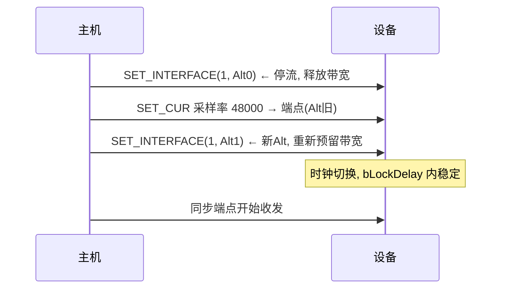

# UAC：音频类 1.0/2.0/3.0、实体与请求全表

> 层级 进阶 · 主题 `class/uac` · 相关：[UVC：视频类控制、格式、Probe/Commit 全表](16-uvc.md)、[四种传输类型、bInterval 与带宽调度](05-transfer-types-bandwidth.md)

## 核心事实 Key Facts

> 由维护者整理并与规范核对；与下方 USBTree 原文冲突时以本节为准。

- 接口：class 0x01；subclass 0x01 AudioControl、0x02 AudioStreaming、0x03 MIDIStreaming；UAC2 bInterfaceProtocol 0x20（IP_VERSION_02_00），UAC3 0x30。
- 同步模式：Asynchronous（设备时钟，需反馈端点）、Adaptive（设备跟随主机数据速率）、Synchronous（同步于 SOF）。反馈值格式：FS 10.14（3 B），HS 16.16（4 B），单位 样本/帧或样本/微帧。
- UAC2 增加 Clock Source/Selector/Multiplier 实体、HS 支持、CUR/RANGE 请求（0x01 CUR, 0x02 RANGE）；Windows 10 1703+ 内置 usbaudio2.sys。

## 原文：00-UAC概述

> Source: [20-枝干-设备类协议/Audio-UAC/00-UAC概述.md](https://github.com/tangjianfang/USBTree/blob/main/20-枝干-设备类协议/Audio-UAC/00-UAC概述.md)

>  上一级: [00-设备类索引](10-class-index.md) · 树干基础: [四种传输类型](05-transfer-types-bandwidth.md)

### 1. UAC 在树上解决什么

USB 音频类（USB Audio Class, UAC）把两件事标准化：**音频数据怎么传**（同步端点 + 时钟闭环）与**音量/静音等控制怎么调**（实体图 + 类请求）。代际：UAC 1.0（1998，全速时代，嵌入式声卡事实标准）→ UAC 2.0（2009，高速，实体化时钟）→ UAC 3.0（2016，移动低功耗，采用率低）。

接口签名：bInterfaceClass=0x01；子类 0x01=音频控制 (AC)，0x02=音频流 (AS)，0x03=MIDI 流（见 [MIDI 类](19-other-classes-b.md)）。

### 2. 实体图 (Entity Graph)：UAC 的世界观

UAC 不用固定结构描述设备，而是画一张**信号流图**：每个实体 (Entity) 有唯一 ID，彼此用 ID 引用连接：


| 实体 | 子类型 | 职责 |
|---|---|---|
| Input/Output Terminal | 0x02/0x03 | 信号进出设备的"端口"（USB 流 / 模拟接口） |
| Mixer Unit | 0x04 | 多路混合（音量矩阵） |
| Selector Unit | 0x05 | 多输入选一（如前后面板切换） |
| **Feature Unit** | 0x06 | 音量/静音/低音高音——90% 设备只有它 |
| Processing Unit | 0x07 | 均衡器、AGC、延迟等 |
| Extension Unit | 0x08 | 厂商私有扩展 |
| Clock Source (仅 UAC2+) | 0x0A | 时钟实体（见 [UAC2](17-uac.md)） |

主机混音器直接把实体图映射成系统音量控件——**你调节的系统音量就是一条 SET_CUR 请求打在 Feature Unit 上**。

### 3. 接口与端点构成

一个完整音频功能（IAD 捆扎）：

```
IAD
├── 接口0: 音频控制 AC (0x01/0x01/0x00)
│   ├── 类特定 AC 头 + 实体图描述符
│   └── (可选) 中断 IN 端点: 音量变化/静音状态主动上报
├── 接口1: 音频流 AS (0x01/0x02/0x00)
│   ├── Alt0: 零带宽(无端点) ← 挂起/停流用
│   ├── Alt1: 48kHz/16bit 立体声 + 同步端点
│   └── Alt2: 96kHz/24bit ...（带宽换挡）
└── (可选) 同步反馈端点: 挂在 AS 接口上
```

三个关键点：

1. **同步 (Isochronous) 端点**承载音频数据，带宽在配置时预留（[传输类型](05-transfer-types-bandwidth.md)）；
2. **Alternate Setting 换挡**：停止播放 → 主机切 Alt0（释放带宽），开始播放 → 切 Alt1；采样率/位深切换就是切 Alt Setting 或动态改时钟（UAC2）；
3. **反馈端点**：异步播放的时钟闭环，见下。

### 4. 时钟同步三模式（音频品质的分水岭）

| 模式 | 主时钟在哪 | 机制 | 品质 |
|---|---|---|---|
| 同步 Synchronous | 主机（SOF） | 设备锁 SOF 派生采样时钟 | 差：SOF 抖动直入音频 |
| 自适应 Adaptive | 主机数据流 | 设备锁**数据到达速率**恢复时钟 | 中 |
| **异步 Asynchronous** | **设备**（本地晶振/DAC） | 设备自有高精度时钟，用**反馈端点**告诉主机"我真实消耗速率"，主机微调发送量 | **最佳**（USB 时钟域与音频时钟域隔离） |

反馈端点机制：异步**播放**（主机→设备）设备的同步 OUT 端点旁挂一个同步 IN 端点，周期性上报采样频率比率（格式由**总线速度**决定而非 UAC 版本：全速 FS 为 3 字节 **10.14** 定点、单位"样本/1 ms 帧"；高速 HS 为 4 字节 **16.16** 定点、单位"样本/125 µs 微帧"，见 USB 2.0 §5.12.4.2），FS 下 48 kHz 为 48×2¹⁴ = **0x0C0000**，HS 下为 6×2¹⁶ = **0x00060000**（实测围绕该值 ±100 ppm 微调）。主机据此每毫秒增减 1~2 个采样帧——**这就是"异步 USB 解码器"宣传的协议基础**。

### 5. 控制面：类请求的统一格式

所有控制都发往实体：`SET_CUR/GET_CUR`（UAC1: bRequest 0x01/0x02；UAC2: 0x01/0x02 + RANGE 0x02），`wValue = (控制选择子<<8) | 通道号`，`wIndex = (实体ID<<8) | 接口号`：

- Feature Unit 通道 0 = 主音量（全通道联控），通道 1/2 = 左/右；
- 音量选择子：MUTE=0x01，VOLUME=0x02；
- 采样率控制在 UAC1 挂在**同步端点**（SAMPLING_FREQ_CONTROL），在 UAC2 挂在 **Clock Source 实体**——代际分水岭（[UAC2 与 UAC3](17-uac.md)）。

### 6. 主机驱动

Linux `snd-usb-audio`（UAC1/2/3 全支持）、macOS CoreAudio 内置、Windows usbaudio.sys（UAC1 免驱；UAC2 从 Win10 支持）。**免驱 + 任意采样率自适应**使 UAC 成为最成功的设备类之一；声卡厂商的"驱动盘"装的只是控制面板，不是协议驱动。

## 原文：01-UAC1.0详解

> Source: [20-枝干-设备类协议/Audio-UAC/01-UAC1.0详解.md](https://github.com/tangjianfang/USBTree/blob/main/20-枝干-设备类协议/Audio-UAC/01-UAC1.0详解.md)

UAC 1.0（规范修订至 1.0a? 以 USB-IF 发布版为准）诞生于全速时代，至今仍是嵌入式声卡（STM32/ESP32/电视棒/USB 麦克风）的主流选择：描述符简单、所有主机免驱。代价是**全速同步带宽有限**（[带宽账本](05-transfer-types-bandwidth.md)：FS 同步 ≤1023 B/ms）——16bit/48kHz 立体声（192 KB/ms 的 15%）没问题，7.1/192kHz 就必须上 UAC2。

### 1. 描述符链全景

以"USB 麦克风 + 回放"设备为例，完整骨架（类型码 0x24=CS_INTERFACE，实体描述符都在 AC 接口内）：

```
IAD (0x0B: 捆扎接口0+1)
├── 接口0: AC (0x01/0x01/0x00), 无端点或中断 IN
│   └── CS_AC_INTERFACE:
│       ├── HEADER (8B):  bcdADC=0x0100, wTotalLength, bInCollection=1, baInterfaceNr=[1]
│       ├── INPUT_TERMINAL (12B): ID=1, 类型=0x0201(麦克风), 通道数/掩码
│       ├── FEATURE_UNIT (9B+): ID=2, Source=1, bControlSize=1,
│       │                maControls=[静音|音量位图] ×(通道数+1)
│       └── OUTPUT_TERMINAL (9B): ID=3, Source=2, 类型=0x0101(USB流)
└── 接口1: AS (0x01/0x02/0x00)
    ├── Alt0: 零端点（停流态）
    ├── Alt1:
    │   ├── CS_AS_GENERAL (7B): bTerminalLink=3, bDelay=1, wFormatTag=0x0001(PCM)
    │   ├── CS_FORMAT_TYPE (8B): Type I(0x01): bNrChannels=2, bSubframeSize=2,
    │   │                        bBitResolution=16, bSamFreqType=n, tSamFreq[]×3B
    │   ├── 标准同步端点描述符: FS 1023B? wMaxPacketSize=按最坏采样率算
    │   └── CS_AS_ISO_ENDPOINT (7B): bmAttributes(采样率控制位), bLockDelayUnits, wLockDelay
    └── Alt2: 另一采样率/位深 ...
```

字段精读：

- **Feature Unit 的 maControls**：每通道一组控制位图（bit0=MUTE，bit1=VOLUME…），通道 0 = 主控；bControlSize=1（UAC1 惯例 8 位位图，UAC2 改 16 位）；
- **tSamFreq**：3 字节小端采样率列表（`80 BB 00` = 48000），bSamFreqType=0 表示"连续范围"（配 2 字节上下限）；
- **wMaxPacketSize 按最坏情形**：同步端点声明的是"每帧最大字节数"，主机全额预留——声明过大永久浪费带宽（合规检查项，见[合规认证](51-compliance-security.md)）；
- **bLockDelay**：设备从设置采样率到产生稳定数据所需的内部延迟提示（单位：毫秒/PCM 采样帧）。

### 2. 类请求实战

UAC1 请求码（**以规范 Table A-9 为准**；evolve #37 勘误——本节此前误写 GET_CUR=0x02/GET_MIN=0x84 等）：SET_CUR=0x01、**GET_CUR=0x81**、SET_MIN=0x02、**GET_MIN=0x82**、SET_MAX=0x03、**GET_MAX=0x83**、SET_RES=0x04、**GET_RES=0x84**、SET_MEM=0x05、GET_MEM=0x85、GET_STAT=0xFF。寻址：`wValue=(控制选择子<<8)|通道`，`wIndex=(实体ID<<8)|接口`。

| 操作 | 请求打点 |
|---|---|
| 主音量 | SET_CUR(0x02选择子, 通道0) → FeatureUnit(实体2) |
| 左声道静音 | SET_CUR(0x01, 通道1) |
| 音量范围协商 | GET_MIN/GET_MAX/GET_RES → 有符号数，步进由 RES 给出 |
| 换采样率 | SET_CUR(0x01, 0x0100) → **同步端点**（接收者=端点） |
| 读当前采样率 | GET_CUR 同上 |

音量数值为有符号整数，范围与步进完全由设备自报（主机按 MIN/MAX/RES 换算 dB 显示）——不同设备每步 1/256 dB 或 1/100 dB 都合法，主机不做单位假设。

#### 换采样率的完整时序



固件义务：每个 Alt Setting 的采样率组合在描述符里自洽；SET_CUR 之后端点参数（包长）必须随之生效。

### 3. 端点与反馈

- **播放（主机→设备）异步模式**：AS 接口额外声明一个同步 IN 反馈端点，全速设备用 **10.14 定点**（3 字节，USB 2.0 §5.12.4.2；UAC1 设备几乎都是全速，所以常被简称"UAC1 用 10.14"）报采样率比率（48 kHz 精确主时钟 → **0x0C0000** = 48×2¹⁴，实测在 ±100 ppm 内微调；evolve 勘误——曾误写 0x05A000，该值换算仅 22.5 采样/毫秒）；端点描述符 bRefresh=3 表示 2³ ms 上报一次；
- **录音（设备→主机）异步模式**：设备按自己时钟发送，主机自然跟随，无需反馈端点；
- 同步/自适应设备不设反馈端点——抓包看到"神秘 IN 同步端点"就是异步标志。

### 4. 带宽核算（为何 UAC1 停在全速）

| 配置 | 每毫秒数据量 | FS 同步上限占比 |
|---|---|---|
| 立体声 16bit/44.1kHz | 176.4 B | 17% |
| 立体声 24bit/96kHz | 576 B | 56%（可行但挤占总线） |
| 7.1 24bit/96kHz | 2304 B | **超限，必须 HS+UAC2** |

### 5. 实现与调试清单

- [ ] wTotalLength 与实体描述符总长一致（枚举失败常见根因，[排查手册](50-debug-troubleshooting.md)）；
- [ ] Feature Unit 至少实现 SET/GET_CUR(MUTE,VOLUME) + MIN/MAX/RES，否则系统音量条无效；
- [ ] Alt0/Alt1 切换时端点启停干净（残留同步包会被判 babble? 最多致告警）；
- [ ] Linux 调试利器：`lsusb -v` 看实体图、`alsa-utils` 的 `alsactl monitor` 盯控制事件、`arecord -D hw:N -f S16_LE` 验证；
- [ ] 常见投诉"有杂音/断续"：先查时钟模式描述与实际实现不符（声称异步却没反馈端点）。

## 原文：02-UAC2与UAC3

> Source: [20-枝干-设备类协议/Audio-UAC/02-UAC2与UAC3.md](https://github.com/tangjianfang/USBTree/blob/main/20-枝干-设备类协议/Audio-UAC/02-UAC2与UAC3.md)

### 1. UAC 2.0：实体化与高速化 (2009)

UAC2 的两个根本变化：

1. **时钟成为一等实体**——Clock Source/Selector/Multiplier 单独成实体，采样率控制从"端点的附属属性"升级为"时钟实体的属性"；
2. **面向高速带宽**——24bit/192kHz 多通道、多流并行成为可能。

#### 1.1 时钟实体三件套

| 实体 | CS_INTERFACE 子类型 | 职责 |
|---|---|---|
| Clock Source | 0x0A | 一个真实时钟源（内部 PLL / SPDIF 输入 / …），带采样率控制与有效性/锁定状态 |
| Clock Selector | 0x0B | 多时钟源选一（如"内部晶振 or 外部字时钟"） |
| Clock Multiplier | 0x0C | 时钟倍频（整数/分数） |

#### 1.2 请求体系差异（与 UAC1 对照背）

| | UAC 1.0 | UAC 2.0 |
|---|---|---|
| 读/写当前值 | GET_CUR=**0x81** / SET_CUR=0x01（evolve #37 按 Table A-9 勘误） | CUR：0x01(SET)/0x01(GET, bit7 区分? — 2.0 中请求码 CUR=0x01, RANGE=0x02，方向由 bmRequestType 区分) |
| 范围查询 | GET_MIN/GET_MAX/GET_RES (0x84~0x86) | **RANGE (0x02)** 一次返回 [Min,Max,Res] 列表 |
| 采样率挂在哪 | 同步端点 (SAMPLING_FREQ_CONTROL) | **Clock Source 实体** (CS_SAM_FREQ_CONTROL=0x01) |
| 寻址 | wValue/wIndex 简单 | wValue=(控制选择子<<8)\|通道号, wIndex=(实体ID<<8)\|接口——**一切控制都经实体 ID** |
| 控制位图 | 8 位 | 16 位（支持更多控制类型） |

UAC2 的 GET_INFO 返回能力位（bit0=可读，bit1=可写），驱动先问再调，交互更严谨。

#### 1.3 描述符变化

- CS_INTERFACE 子类型新增：CLOCK_SOURCE 0x0A、CLOCK_SELECTOR 0x0B、CLOCK_MULTIPLIER 0x0C、SAMPLE_RATE_CONVERTER 0x0D；
- Terminal 实体多一个 **bCSourceID** 字段——直接声明"我由哪个时钟源驱动"，实体图从此含时钟拓扑；
- AS 接口的 Type I 格式描述符支持高带宽同步端点（HS 微帧 ×2/×3 事务，[传输类型](05-transfer-types-bandwidth.md)）；
- 反馈端点数值格式随**总线速度**而定（USB 2.0 §5.12.4.2）：UAC2 常跑高速，HS 下为 4 字节 **16.16**（样本/微帧）；若 UAC2 设备工作在全速，仍是 3 字节 10.14——并非 UAC2 规范本身改了格式。

#### 1.4 高速带来的能力表

| 指标 | UAC1 (FS) | UAC2 (HS) |
|---|---|---|
| 典型上限 | 16bit/48kHz 立体声舒适 | 24bit/192kHz × 8 通道可行 |
| 多设备同总线 | 2~3 个即挤占 | 数十个无压力 |
| DSD/DoP、专业多轨 | 不可行 | DAC 旗舰标配 |

#### 1.5 驱动支持现状

Linux snd-usb-audio 全面支持；macOS 内置；**Windows 10 1703+ 才内置 UAC2**（此前需厂商驱动）——这是 UAC2 普及晚于技术成熟的原因，也是老设备坚持 UAC1 的现实理由。

### 2. UAC 3.0：为移动而生，为省电而改 (2016)

UAC3 的动机：手机/平板 OTG 生态里 USB 音频的**待机功耗**。核心变化：

- **电源优先架构**：挂起时音频路径可近乎断电，唤醒/待机由 BOS + 新协议驱动；
- **实体模型再重构**：引入 Cluster/GPI/GPIO/Interrupt 实体，控制路径与数据路径进一步解耦；
- **BADD**（Basic Audio Device Definition）：预定义几种标准拓扑（如"Type I 头戴式耳机""Type II 转接坞"），设备按模板声明，主机按模板解析——牺牲灵活性换一致性；
- 音频数据仍走同步端点，控制面改用"Interrupt Message"经中断端点上报（控制事件主动化）。

**现实地位**：规范完整、生态冷淡——手机厂商多走自带协议/厂商驱动，PC 生态支持有限。选型建议：**消费级新设备 → UAC2；嵌入式兼容优先 → UAC1；UAC3 暂观望**。

### 3. 三代总对比

| | UAC 1.0 (1998) | UAC 2.0 (2009) | UAC 3.0 (2016) |
|---|---|---|---|
| 目标速率 | 全速 FS | 高速 HS | HS（电源优化） |
| 时钟模型 | 端点属性 | **Clock Source 实体** | Clock Source 实体+电源状态 |
| 范围查询 | MIN/MAX/RES 三请求 | RANGE 一次到位 | RANGE |
| 典型应用 | 嵌入式声卡/麦克风 | DAC/专业音频/会议设备 | 移动配件（少） |
| 主机免驱 | 全平台 | Win10 1703+/Linux/macOS | 部分平台 |
| 固件复杂度 | 低 | 中 | 高 |

### 4. 选型与实现速断

- 做麦克风/廉价声卡/固件资源紧张 → **UAC1**（TinyUSB 等栈支持最成熟，见[固件栈](43-device-firmware.md)）；
- 做高分辨率 DAC/多通道会议音箱 → **UAC2**，认真做 Clock Source 实体（可提供双时钟源：内部+外部 SPDIF）；
- 反馈端点必须真实现（按本地时钟实测速率上报），假反馈 = 抖动杀手；
- 抓包定位音频问题：看同步端点每微帧实际包长波动与反馈值联动是否合理（[抓包](50-debug-troubleshooting.md)）。

## 原文：03-UAC规范级-实体与请求全表

> Source: [20-枝干-设备类协议/Audio-UAC/03-UAC规范级-实体与请求全表.md](https://github.com/tangjianfang/USBTree/blob/main/20-枝干-设备类协议/Audio-UAC/03-UAC规范级-实体与请求全表.md)

>  数据提取自 **UAC 1.0**（含 Frmts10 音频数据格式、Termt10 终端类型）与 **UAC 2.0**（Audio20 final），缓存见 [../../80-参考资料/README.md](92-spec-references.md)。架构叙述见 [01-UAC1.0详解.md](17-uac.md) / [02-UAC2与UAC3.md](17-uac.md)，本文只放编号与字段。

### 1. 类代码速记
>  对抗抽查（evolve #20）：UAC2 CLOCK_SOURCE 子类型=0x0A 与 Audio20 原文比对一致。

| 层级 | UAC1 | UAC2 |
|---|---|---|
| 接口类 bInterfaceClass | AUDIO=0x01 | AUDIO=0x01 |
| 子类 | AUDIOCONTROL=0x01 / AUDIOSTREAMING=0x02 / MIDISTREAMING=0x03 | 同左（未定义子类=0x00） |
| Audio Function 级（设备描述符） | — | AUDIO_FUNCTION=0xFF，子类 0x00，协议 AF_VERSION_02_00=0x20 |

### 2. UAC1 类特定请求码全表（UAC1 §A.9，Table A-9，共 11 个）

| bRequest | 值 | bmRequestType | 方向 | 作用 |
|---|---|---|---|---|
| SET_CUR | 0x01 | 00100001b/00100010b (0x21/0x22) | OUT | 写控件当前值 |
| SET_MIN | 0x02 | 同上 | OUT | 写最小值（少见可编程） |
| SET_MAX | 0x03 | 同上 | OUT | 写最大值 |
| SET_RES | 0x04 | 同上 | OUT | 写分辨率（步进） |
| SET_MEM | 0x05 | 同上 | OUT | 写实体内存空间 |
| GET_CUR | 0x81 | 10100001b/10100010b (0xA1/0xA2) | IN | 读当前值 |
| GET_MIN | 0x82 | 同上 | IN | 读最小值 |
| GET_MAX | 0x83 | 同上 | IN | 读最大值 |
| GET_RES | 0x84 | 同上 | IN | 读步进 |
| GET_MEM | 0x85 | 同上 | IN | 读实体内存 |
| GET_STAT | 0xFF | 10100001b/10100010b | IN | 读实体状态（中断占位，见 §7） |

寻址规则（§5.2.1）：wValue 高字节 = Control Selector (CS)，低字节 = Channel Number (CN)（Mixer 用输出通道 OCN×16+输入 ICN？实为 MCN，Mixer 控制单列）；wIndex 低字节 = 接口号/端点号，高字节 = 实体 ID（Unit/Terminal ID；寻址接口本身为 0）。接收者 0x01=接口（AudioControl 或 AudioStreaming），0x02=同步端点。

### 3. UAC1 控制选择子（UAC1 §A.10）

**Terminal（A.10.1）**：`0x00 TE_CONTROL_UNDEFINED`、`0x01 COPY_PROTECT_CONTROL`。

**Feature Unit（A.10.2，bmaControls 位图序号 = 控制号）**：

| 控制号 | 名称 | | 控制号 | 名称 |
|---|---|---|---|---|
| 0x00 | FU_CONTROL_UNDEFINED | | 0x06 | GRAPHIC_EQUALIZER_CONTROL |
| 0x01 | **MUTE** | | 0x07 | AUTOMATIC_GAIN |
| 0x02 | **VOLUME** | | 0x08 | DELAY |
| 0x03 | BASS | | 0x09 | BASS_BOOST |
| 0x04 | MID | | 0x0A | LOUDNESS |
| 0x05 | TREBLE | | 0x0B+ | 保留（UAC1 无 0x0B~0x0D） |

FU 描述符中每通道 1 字节位图：D0=MUTE 支持、D1=VOLUME、…（即 bmaControls 的第 n 位对应控制号 n）；通道 0 为主控（master），后接每逻辑通道各一字节（§3.5.5 / Table 4-7）。

**Processing Unit 各类型（A.10.3）**：

| PU 类型 | 选择子（值） |
|---|---|
| Up/Down-mix (UD) | UD_ENABLE 0x01、UD_MODE_SELECT 0x02 |
| Dolby Prologic (DP) | DP_ENABLE 0x01、DP_MODE_SELECT 0x02 |
| 3D Stereo Extender (3D) | 3D_ENABLE 0x01、SPACIOUSNESS 0x03 |
| Reverberation (RV) | RV_ENABLE 0x01、REVERB_LEVEL 0x02、REVERB_TIME 0x03、REVERB_FEEDBACK 0x04 |
| Chorus (CH) | CH_ENABLE 0x01、CHORUS_LEVEL 0x02、CHORUS_RATE 0x03、CHORUS_DEPTH 0x04 |
| Dynamic Range Compressor (DR) | DR_ENABLE 0x01、COMPRESSION_RATE 0x02、MAXAMPL 0x03、THRESHOLD 0x04、ATTACK_TIME 0x05、RELEASE_TIME 0x06 |

（各类型 0x00 均为 *_CONTROL_UNDEFINED。）

**Extension Unit（A.10.4）**：`0x00 XU_CONTROL_UNDEFINED`、`0x01 XU_ENABLE_CONTROL`，其余厂商自定义。
**Endpoint（A.10.5，寻址同步端点）**：`0x00 EP_CONTROL_UNDEFINED`、`0x01 SAMPLING_FREQ_CONTROL`、`0x02 PITCH_CONTROL`。

### 4. UAC1 终端类型完整表（Termt10 §2，wTerminalType）

**USB 终端（0x01xx，Table 2-1）**：0x0100 USB Undefined、0x0101 **USB streaming**（AS 接口 bTerminalLink 指向）、0x01FF USB vendor specific。

**输入终端（0x02xx，Table 2-2）**：0x0200 Undefined、0x0201 Microphone、0x0202 Desktop microphone、0x0203 Personal microphone（头戴/领夹）、0x0204 Omni-directional microphone、0x0205 Microphone array、0x0206 Processing microphone array。

**输出终端（0x03xx，Table 2-3）**：0x0300 Undefined、0x0301 Speaker、0x0302 Headphones、0x0303 Head Mounted Display Audio、0x0304 Desktop speaker、0x0305 Room speaker、0x0306 Communication speaker、0x0307 Low Frequency Effects Speaker（低音炮）。

**双向终端（0x04xx，Table 2-4，成对 IT/OT 用 bAssocTerminal 互链）**：0x0400 Undefined、0x0401 Handset、0x0402 Headset、0x0403 Speakerphone（无回声消除）、0x0404 Echo-suppressing speakerphone、0x0405 Echo-canceling speakerphone。

**电话终端（0x05xx，Table 2-5，双向）**：0x0500 Undefined、0x0501 Phone line（PSTN/ISDN/PBX）、0x0502 Telephone、0x0503 Down Line Phone。

**外部终端（0x06xx，Table 2-6）**：0x0600 Undefined、0x0601 Analog connector、0x0602 Digital audio interface、0x0603 Line connector、0x0604 Legacy audio connector、0x0605 S/PDIF interface、0x0606 1394 DA stream、0x0607 1394 DV stream soundtrack。

**内嵌功能终端（0x07xx，Table 2-7）**：0x0700 Undefined、0x0701 Level Calibration Noise Source (O)、0x0702 Equalization Noise (O)、0x0703 CD player (I)、0x0704~0x07xx Turntable、Tape、Tuner、Satellite 等内嵌源（Termt10 §2.7 余段）。

### 5. UAC1 预置格式类型表（Frmts10 §A.1，wFormatTag）

| Type | wFormatTag | 名称 | Type | wFormatTag | 名称 |
|---|---|---|---|---|---|
| I | 0x0000 | TYPE_I_UNDEFINED | III | 0x2000 | TYPE_III_UNDEFINED |
| I | 0x0001 | **PCM**（Type I 描述符含 bNrChannels/tSubframeSize/bBitResolution/tSamFreq[]） | III | 0x2001 | IEC1937_AC-3（非音频载荷走 IEC 60958 帧） |
| I | 0x0002 | PCM8 | III | 0x2002 | IEC1937_MPEG-1_Layer1 |
| I | 0x0003 | IEEE_FLOAT | III | 0x2003 | IEC1937_MPEG-1_Layer2/3 或 MPEG-2_NOEXT |
| I | 0x0004 | ALAW | III | 0x2004 | IEC1937_MPEG-2_EXT |
| I | 0x0005 | MULAW | III | 0x2005 | IEC1937_MPEG-2_Layer1_LS |
| II | 0x1000 | TYPE_II_UNDEFINED（描述符带 wMaxBitRate/wSamplesPerFrame） | III | 0x2006 | IEC1937_MPEG-2_Layer2/3_LS |
| II | 0x1001 | MPEG | — | — | — |
| II | 0x1002 | AC-3 | — | — | — |

FORMAT_TYPE 码（AS 格式描述符 bFormatType，Frmts10 §A.2）：0x00 未定义、0x01 TYPE_I、0x02 TYPE_II、0x03 TYPE_III。MPEG/AC-3 专用 AS 控制选择子见 Frmts10 §A.3（如 MPEG: MP_MPEG2_LAYER 等，AC-3: AS_MODE 等——需要时查原文，此处从略）。

> 0x8xxx 段无官方预置值；厂商自定义格式走 WAVE_FORMAT_EXTENSIBLE 风格 GUID（UAC1 未定义，勿写 0x8xxx 编号）。Type III 的本质：把非 PCM 压缩流伪装成 16-bit PCM 过 IEC 60958，使老式同步机制可用（Frmts10 §2.3）。

### 6. UAC1 GET_STAT 中断机制（UAC1 §5.2.4.2）

- UAC1 **没有**音频控制中断端点；状态经 `GET_STAT (0xFF)` 轮询：bmRequestType=0xA1（接口）/0xA2（端点），wValue=0，wIndex=实体 ID+接口（或端点），Data = 状态消息（规范留空，当前应返回空包/短包）。

### 7. UAC2 CS_INTERFACE 描述符子类型全表（UAC2 §A.9/A.10）

**AudioControl (AC) 接口（A.9）：**

| 子类型 | 值 | 子类型 | 值 |
|---|---|---|---|
| AC_DESCRIPTOR_UNDEFINED | 0x00 | EXTENSION_UNIT | 0x09 |
| HEADER | 0x01 | CLOCK_SOURCE | 0x0A |
| INPUT_TERMINAL | 0x02 | CLOCK_SELECTOR | 0x0B |
| OUTPUT_TERMINAL | 0x03 | CLOCK_MULTIPLIER | 0x0C |
| MIXER_UNIT | 0x04 | SAMPLE_RATE_CONVERTER | 0x0D |
| SELECTOR_UNIT | 0x05 | — | — |
| FEATURE_UNIT | 0x06 | — | — |
| EFFECT_UNIT | 0x07 | — | — |
| PROCESSING_UNIT | 0x08 | — | — |

**AudioStreaming (AS) 接口（A.10）**：0x00 AS_DESCRIPTOR_UNDEFINED、0x01 AS_GENERAL、0x02 FORMAT_TYPE、0x03 ENCODER、0x04 DECODER。

### 8. UAC2 类特定请求码（A.14）与寻址

| bRequest | 值 | bmRequestType | 说明 |
|---|---|---|---|
| CUR | 0x01 | SET: 0x21/0x22；GET: 0xA1/0xA2 | 当前值（单值）。SET 面向控件/端点；GET 面向全部 |
| RANGE | 0x02 | GET: 0xA1/0xA2 | 代替 UAC1 的 MIN/MAX/RES：返回 wNumSubRanges + 各 {MIN,MAX,RES} 三元组 |
| MEM | 0x03 | SET: 0x21；GET: 0xA1 | 实体内存空间（wValue=零基偏移） |

- wValue = CS（高字节）+ CN（低字节，主控 CN=0）；Mixer 控件低字节为 MCN。
- wIndex = 接口号（低）+ 实体 ID（高）；端点控件时高字节为 0。
- 字节序：UAC2 多字节参数为**小端**（与 UAC1 相同，但 RANGE 布局是 2.0 新增）。
- 实体控制能力经 High Capability 描述符（bBitBitmapPerChannel 等）声明，不做"逐属性探测"。

**RANGE 参数块布局（§5.2.3）**：`wNumSubRanges(2, LE)` 后接每组 `{MIN, MAX, RES}` 三元组，宽度与该控制的 CUR 值一致——CS_SAM_FREQ 每项 4 字节 LE（如 {44100, 44100, 0} 表示单点）、FU_VOLUME 每项 2 字节。单值控制（如 MUTE）RANGE 通常返回 1 组 {0,1,0} 或 STALL；主机据此绘制可选值集合。

**UAC1 → UAC2 请求迁移速记**：SET_CUR/GET_CUR 保留；MIN/MAX/RES 三请求合并为 RANGE；SET_MEM/GET_MEM → MEM；GET_STAT(0xFF) → 中断端点消息（§10）；新增 SET 信息经 High Capability 描述符预声明，不再逐属性 GET 探测。

**值宽度备忘**：UAC1 端点 SAMPLING_FREQ_CONTROL 的 CUR 值为 **3 字节 LE**（0x01 控制），FU_VOLUME CUR 为 2 字节（正值=增益，负值=衰减，步进由 GET_RES 给出）；UAC2 的 CS_SAM_FREQ CUR 为 **4 字节 LE**——混用两代规范时的经典坑。

### 9. UAC2 实体控制选择子全表（A.17）

**Clock Source（A.17.1）**：`0x00 UNDEFINED`、`0x01 CS_SAM_FREQ_CONTROL`（CUR+RANGE）、`0x02 CS_CLOCK_VALID_CONTROL`（只读 CUR：0=无效 1=有效）。

**Clock Selector（A.17.2）**：`0x00 UNDEFINED`、`0x01 CX_CLOCK_SELECTOR_CONTROL`（CUR：当前选中的时钟源 1 基序号）。

**Clock Multiplier（A.17.3）**：`0x00 UNDEFINED`、`0x01 CM_NUMERATOR_CONTROL`、`0x02 CM_DENOMINATOR_CONTROL`。

**Terminal（A.17.4，IT/OT 通用）**：0x00 UNDEFINED、0x01 TE_COPY_PROTECT、0x02 TE_CONNECTOR、0x03 TE_OVERLOAD、0x04 TE_CLUSTER、0x05 TE_UNDERFLOW、0x06 TE_OVERFLOW、0x07 TE_LATENCY。

**Mixer（A.17.5）**：0x00 UNDEFINED、0x01 MU_MIXER、0x02 MU_CLUSTER、0x03 MU_UNDERFLOW、0x04 MU_OVERFLOW、0x05 MU_LATENCY。

**Selector（A.17.6）**：0x00 UNDEFINED、0x01 SU_SELECTOR、0x02 SU_LATENCY。

**Feature Unit（A.17.7，0x00~0x10）**：

| 控制号 | 名称 | | 控制号 | 名称 |
|---|---|---|---|---|
| 0x00 | FU_CONTROL_UNDEFINED | | 0x09 | FU_BASS_BOOST |
| 0x01 | FU_MUTE | | 0x0A | FU_LOUDNESS |
| 0x02 | FU_VOLUME | | 0x0B | FU_INPUT_GAIN |
| 0x03 | FU_BASS | | 0x0C | FU_INPUT_GAIN_PAD |
| 0x04 | FU_MID | | 0x0D | FU_PHASE_INVERTER |
| 0x05 | FU_TREBLE | | 0x0E | FU_UNDERFLOW（只读） |
| 0x06 | FU_GRAPHIC_EQUALIZER | | 0x0F | FU_OVERFLOW（只读） |
| 0x07 | FU_AUTOMATIC_GAIN | | 0x10 | FU_LATENCY（只读） |
| 0x08 | FU_DELAY | | — | — |

**Effect Unit（A.17.8，按效果类型分表）**：参数 EQ (PE)：ENABLE 0x01、CENTERFREQ 0x02、QFACTOR 0x03、GAIN 0x04 (+UNDERFLOW/OVERFLOW/LATENCY 0x05~0x07)；混响 (RV)：TYPE 0x02、LEVEL 0x03、TIME 0x04、FEEDBACK 0x05、PREDELAY 0x06、DENSITY 0x07、HIFREQ_ROLLOFF 0x08 (0x09~0x0B 状态)；调制延迟 (MD)：BALANCE 0x02、RATE 0x03、DEPTH 0x04、TIME 0x05；动态范围压缩 (DR)：COMPRESSION_RATE 0x02、MAXAMPL 0x03、THRESHOLD 0x04、ATTACK 0x05、RELEASE 0x06。效果类型码见 A.11（PARAM_EQ_SECTION 0x01、REVERBERATION 0x02、MOD_DELAY 0x03、DYN_RANGE_COMP 0x04）。

**Processing Unit（A.17.9）**：Up/Down-mix (UD)、Dolby Prologic (DP)、Stereo Extender (ST) 三类，均 ENABLE/MODE_SELECT + 状态位（UNDERFLOW/OVERFLOW/LATENCY），值表见 A.17.9 原文。

**Extension Unit（A.17.10）**：仅 0x00 UNDEFINED，其余厂商自定义。
**AudioStreaming 接口（A.17.11）**：0x00 UNDEFINED、0x01 AS_VALID_ALT_CONTROL、0x02 AS_ACT_ALT_CONTROL（只读：当前 alternate setting）。

### 9b. UAC2 其他类型码（A.11~A.13、A.15、A.16）

**Effect Unit 效果类型 wEffectType（A.11）**：0x00 EFFECT_UNDEFINED、0x01 PARAM_EQ_SECTION_EFFECT、0x02 REVERBERATION_EFFECT、0x03 MOD_DELAY_EFFECT、0x04 DYN_RANGE_COMP_EFFECT（Effect Unit 描述符 wEffectType 字段决定用 A.17.8 的哪张选择子表）。

**Processing Unit 过程类型 wProcessType（A.12）**：0x00 PROCESS_UNDEFINED、0x01 UP/DOWNMIX_PROCESS、0x02 DOLBY_PROLOGIC_PROCESS、0x03 STEREO_EXTENDER_PROCESS。

**端点描述符子类型（A.13）**：0x00 DESCRIPTOR_UNDEFINED、0x01 EP_GENERAL。

**编码器类型（A.15，AS ENCODER 描述符）**：0x00 UNDEFINED、0x01 OTHER、0x02 MPEG、0x03 AC-3、0x04 WMA、0x05 DTS；**解码器类型（A.16，AS DECODER 描述符）**：0x00 UNDEFINED、0x01 OTHER、0x02 MPEG、0x03 AC-3、0x04 WMA、0x05 DTS。

### 10. UAC2 中断数据消息（§6.1，Table 6-1，固定 6 字节）

| 偏移 | 字段 | 值 |
|---|---|---|
| 0 | bInfo | D0：0=类特定 / 1=厂商自定义；D1：0=来自接口内实体 / 1=来自端点；D7..2 保留 |
| 1 | bAttribute | 触发中断的属性：0x01 CUR / 0x02 RANGE / 0x03 MEM |
| 2 | wValue | CS（高）+ CN 或 MCN（低）；MEM 时为零基偏移，偏移 0 表示"多处变化需全查" |
| 4 | wIndex | 实体 ID 或 0（高）+ 接口号/端点号（低） |

要点：边沿触发，无需主机应答清位；中断仅通知，细节靠 GET 请求回查；无 pending 中断时端点 NAK。UAC1 的对应物是 GET_STAT 轮询（§6），两代机制完全不同。
