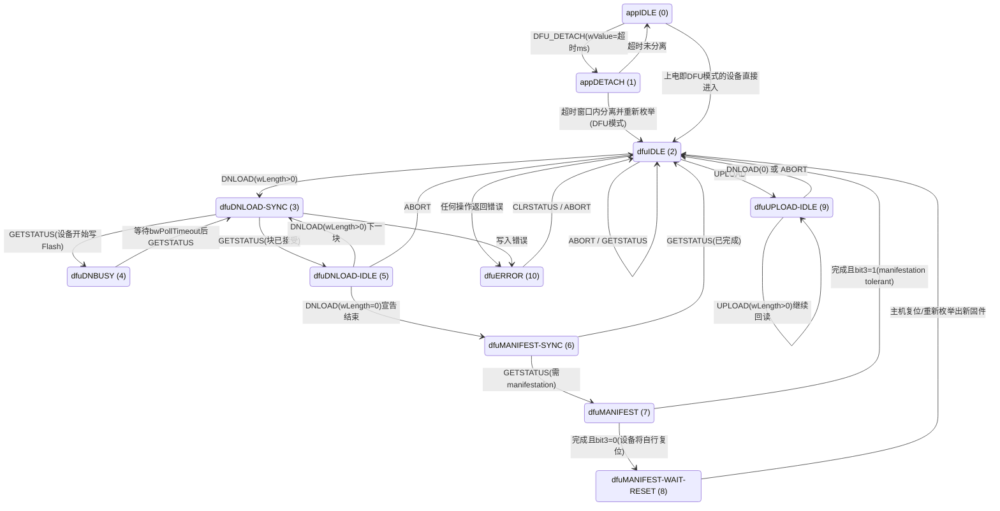
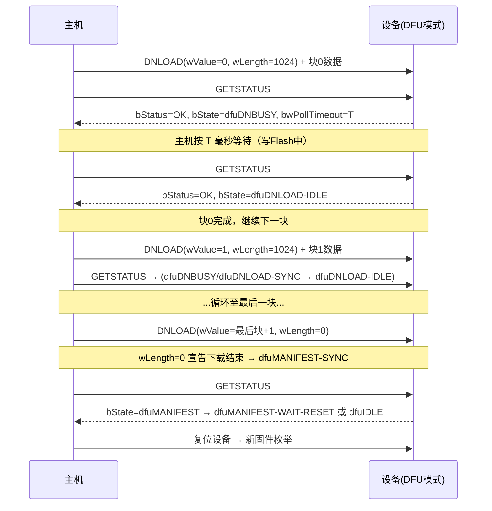
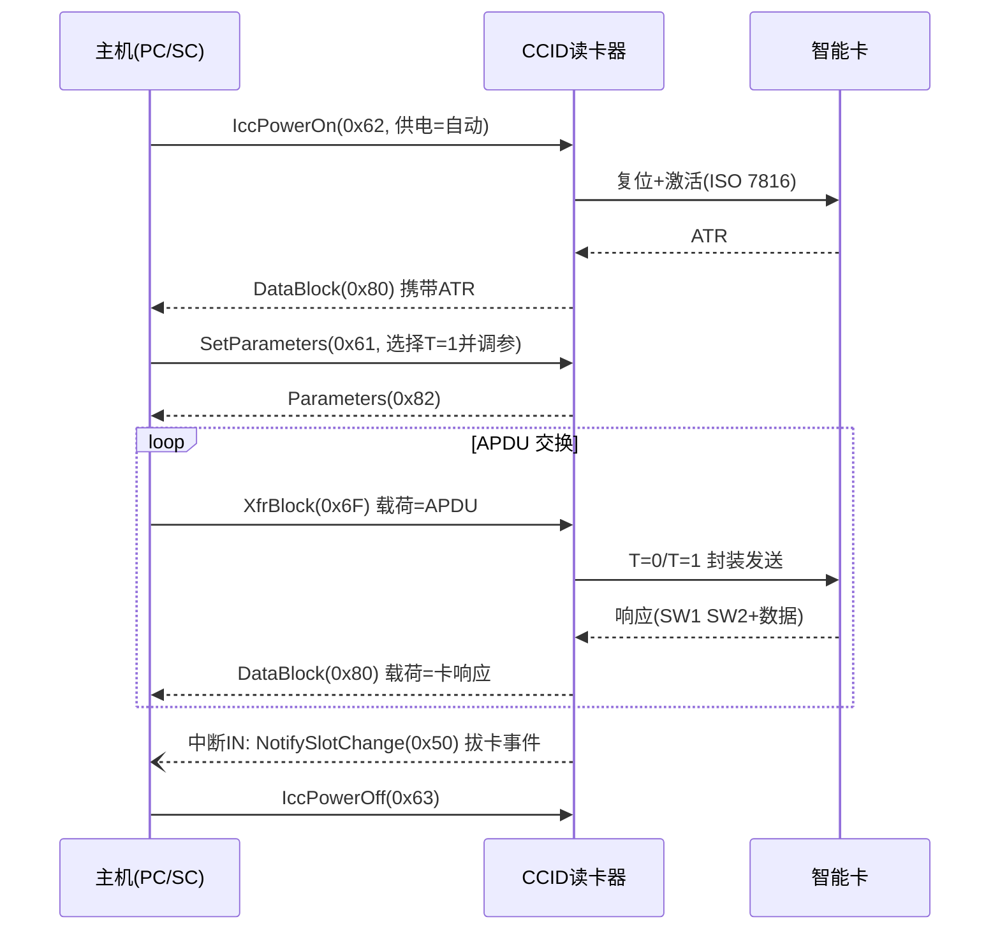
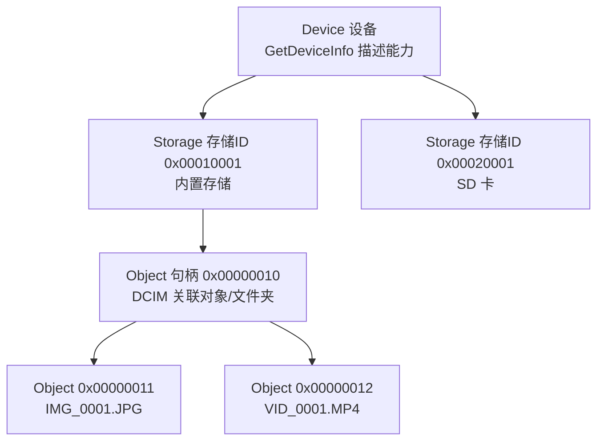
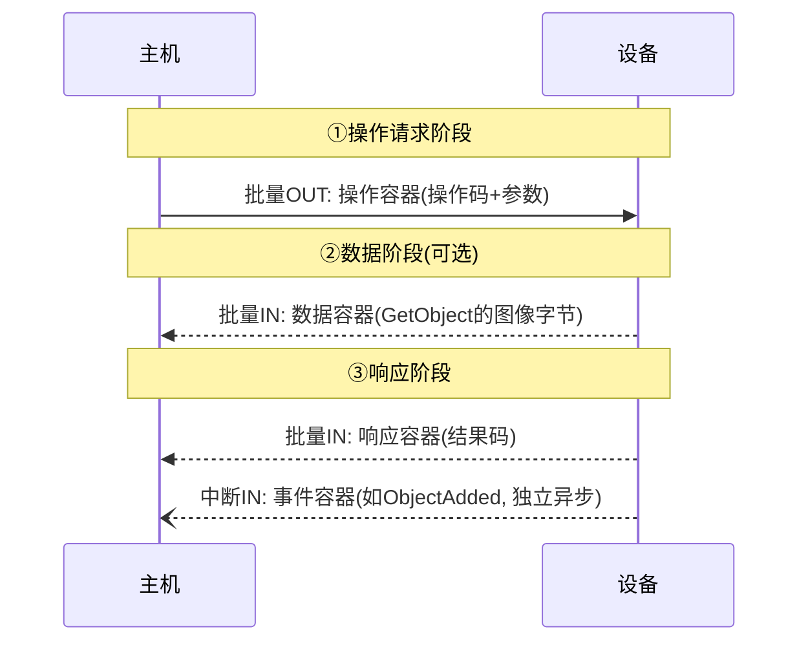

# 其他设备类 A：DFU、CCID、PTP/MTP、Printer

> 层级 进阶 · 主题 `class/other` · 相关：[设备类代码索引与驱动映射](10-class-index.md)、[其他设备类 B：蓝牙 HCI、WebUSB/厂商类、MIDI、USBTMC、长尾类、AV、PHDC](19-other-classes-b.md)

## 核心事实 Key Facts

> 由维护者整理并与规范核对；与下方 USBTree 原文冲突时以本节为准。

- DFU：接口 0xFE/0x01，protocol 0x01 运行时 / 0x02 DFU 模式。请求：DETACH 0x00、DNLOAD 0x01、UPLOAD 0x02、GETSTATUS 0x03、CLRSTATUS 0x04、GETSTATE 0x05、ABORT 0x06。状态：0 appIDLE、1 appDETACH、2 dfuIDLE、3 dfuDNLOAD-SYNC、4 dfuDNBUSY、5 dfuDNLOAD-IDLE、6 dfuMANIFEST-SYNC、7 dfuMANIFEST、8 dfuMANIFEST-WAIT-RESET、9 dfuUPLOAD-IDLE、10 dfuERROR。
- CCID：class 0x0B；Bulk OUT 发 PC_to_RDR_* 消息，Bulk IN 回 RDR_to_PC_*，Interrupt IN 报插卡/拔卡。
- Printer：class 0x07，protocol 0x01 单向 / 0x02 双向 / 0x03 IEEE 1284.4；请求 GET_DEVICE_ID 0x00、GET_PORT_STATUS 0x01、SOFT_RESET 0x02。

## 原文：01-DFU固件升级

> Source: [20-枝干-设备类协议/其他设备类/01-DFU固件升级.md](https://github.com/tangjianfang/USBTree/blob/main/20-枝干-设备类协议/其他设备类/01-DFU固件升级.md)

### 1. 定位

DFU（Device Firmware Upgrade，设备固件升级）是 USB-IF 发布的设备类规范（当前版本 1.1），定义了一套**不依赖文件系统、仅用控制传输（Control Transfer）即可传输固件镜像**的通用升级通道。它是 MCU（微控制器）与嵌入式 USB 设备领域事实上的引导协议标准：主机侧工具（如 dfu-util）与设备侧 bootloader（引导程序）只要都实现 DFU 1.1，即可互通。

核心概念只有两个方向：

| 操作 | 方向 | 说明 |
|---|---|---|
| Download（下载） | 主机 → 设备 | 把固件镜像写入设备 Flash |
| Upload（上传） | 设备 → 主机 | 回读设备中的固件/存储内容（可选实现） |

### 2. 两种运行模式与接口标识

DFU 设备有两种工作模式，通过**不同固件里的两个同名接口**区分：

| 模式 | bInterfaceProtocol | 运行者 | 典型场景 |
|---|---|---|---|
| Runtime 模式（运行模式） | 0x01 | 应用固件 | 设备正常工作，DFU 只是其中一个接口；主机发 `DFU_DETACH` 请求"劝"设备分离复位 |
| DFU 模式（升级模式） | 0x02 | Bootloader 固件 | 复位/重启后设备重新枚举，只提供 DFU 接口，专用于升级，不能回到应用 |

接口标识：DFU 不占用正式类编号，挂在"应用特定类"（Application Specific）之下：

| 字段 | 取值 | 说明 |
|---|---|---|
| bInterfaceClass | 0xFE | Application Specific（应用特定类） |
| bInterfaceSubClass | 0x01 | DFU |
| bInterfaceProtocol | 0x01 / 0x02 | Runtime 模式 / DFU 模式（见上表） |

典型升级流程：Runtime 模式收到 `DFU_DETACH` → 设备从总线分离 → 复位进 bootloader → 以 DFU 模式重新枚举（PID 往往变化，如 STM32 体现为 PID 0xDF11）→ 主机与 DFU 模式接口执行下载。

### 3. DFU 功能描述符（DFU Functional Descriptor）

每个 DFU 接口都跟随一个类专属描述符：

| 偏移 | 长度 | 字段 | 说明 |
|---|---|---|---|
| 0 | 1 | bLength | 固定 9 |
| 1 | 1 | bDescriptorType | 0x21（DFU_FUNCTIONAL） |
| 2 | 1 | bmAttributes | 能力位图，见下表 |
| 3 | 2 | wDetachTimeOut | `DFU_DETACH` 后等待主机完成分离/复位的超时（毫秒，小端） |
| 5 | 2 | wTransferSize | 单次 DNLOAD/UPLOAD 的最大块字节数（小端），如 STM32 常为 1024 |
| 7 | 2 | bcdDFUVersion | BCD 版本号，1.1 规范为 0x0110 |

`bmAttributes` 位定义：

| 位 | 名称 | 含义 |
|---|---|---|
| 0 | bitDownloadCapable | 支持下载（固件写入） |
| 1 | bitUploadCapable | 支持上传（回读） |
| 2 | bitWillDetach | Runtime 模式下收到 `DFU_DETACH` 会自行总线分离并重新枚举 |
| 3 | bitManifestationTolerant | 编程完成后设备能自行切回 dfuIDLE 并继续响应 USB（=1）；否则需复位（=0） |
| 4~7 | 保留 | 必须为 0 |

### 4. 类专属请求（全部为接口请求）

所有 DFU 请求的 bmRequestType 均为 **0x21**（主机→设备、类请求、接口接收者），wIndex = DFU 接口号：

| bRequest | 名称 | wValue | 数据阶段 | 作用 |
|---|---|---|---|---|
| 0x00 | DFU_DETACH | 分离超时（毫秒） | 无 | 仅 Runtime 模式有效；请求设备分离并进入 DFU 模式（DFU 模式下收到会 STALL） |
| 0x01 | DFU_DNLOAD | 块号 wBlockNum | wLength 字节数据 | 发送一块固件数据；wLength=0 表示"下载结束" |
| 0x02 | DFU_UPLOAD | 块号 | IN 数据 | 回读一块数据 |
| 0x03 | DFU_GETSTATUS | 0 | 返回 6 字节 | 查询状态/设备状态机状态/预计等待时间（轮询的主力） |
| 0x04 | DFU_CLRSTATUS | 0 | 无 | 清除错误，从 dfuERROR 回到 dfuIDLE |
| 0x05 | DFU_GETSTATE | 0 | 返回 1 字节 | 仅查询 bState |
| 0x06 | DFU_ABORT | 0 | 无 | 放弃当前操作，回到 dfuIDLE |

### 5. GETSTATUS 的 6 字节响应

`DFU_GETSTATUS` 是整个协议的"心跳"，返回固定 6 字节：

| 偏移 | 长度 | 字段 | 说明 |
|---|---|---|---|
| 0 | 1 | bStatus | 错误码（见第 7 节） |
| 1 | 3 | bwPollTimeout | 完成当前操作主机还需等待的毫秒数（**LSB 在前**，24 位） |
| 4 | 1 | bState | 设备当前状态机状态（见第 6 节） |
| 5 | 1 | iString | 错误描述的字符串描述符索引（可为 0） |

### 6. 状态机全图

DFU 定义了 11 个状态（bState 取值）：

| bState | 状态名 | 含义 |
|---|---|---|
| 0 | appIDLE | Runtime 模式空闲，正常工作 |
| 1 | appDETACH | 已收到 DFU_DETACH，等待总线分离/复位（超时则退回 appIDLE） |
| 2 | dfuIDLE | DFU 模式空闲，可开始下载/上传 |
| 3 | dfuDNLOAD-SYNC | 已收到下载块，等待主机 GETSTATUS 同步 |
| 4 | dfuDNBUSY | 正在写 Flash，不可响应除 GETSTATUS 外的请求 |
| 5 | dfuDNLOAD-IDLE | 一块写完，可继续 DNLOAD 下一块 |
| 6 | dfuMANIFEST-SYNC | 下载结束，等待主机确认 manifestation（编程收尾）进度 |
| 7 | dfuMANIFEST | 正在完成编程（重映射/校验/收尾） |
| 8 | dfuMANIFEST-WAIT-RESET | 收尾完成，等主机复位（设备将重新枚举为新固件） |
| 9 | dfuUPLOAD-IDLE | 上传就绪/进行中 |
| 10 | dfuERROR | 发生错误，需 CLRSTATUS 或 ABORT 恢复 |



### 7. 错误码（bStatus）

DFU 1.1 规范（表 4.2）定义了 0x00~0x0F 共 16 个错误码（下表描述为意译，原文措辞见规范）：

| bStatus | 名称 | 含义（意译） |
|---|---|---|
| 0x00 | OK | 无错误 |
| 0x01 | errTARGET | 文件与本设备目标不匹配 |
| 0x02 | errFILE | 文件本身不适用于本设备 |
| 0x03 | errWRITE | 写 Flash 失败 |
| 0x04 | errERASE | 擦除失败 |
| 0x05 | errCHECK_ERASED | 擦除后校验失败（未真正擦净） |
| 0x06 | errPROG | 编程（烧写）失败 |
| 0x07 | errVERIFY | 编程后校验失败 |
| 0x08 | errADDRESS | 地址非法/越界 |
| 0x09 | errNOTDONE | 编程操作未完成 |
| 0x0A | errFIRMWARE | 固件镜像不合法（如校验和/签名错误） |
| 0x0B | errVENDOR | 厂商自定义错误 |
| 0x0C | errUSBR | 检测到 USB 复位 |
| 0x0D | errPOR | 检测到掉电（上电复位） |
| 0x0E | errUNKNOWN | 未知错误 |
| 0x0F | errSTALLEDPKT | 设备仍在 STALL 状态（上一请求被拒绝） |

### 8. 下载一个块的完整时序

固件按 `wTransferSize` 分块；每块的流程是 **DNLOAD → 轮询 GETSTATUS 直到 bState 回到 dfuDNLOAD-IDLE**。DFU_DNLOAD 的 wValue 为块号（0、1、2…），数据阶段携带本块内容：



要点：
- 上传（UPLOAD）对称：dfuIDLE 发 UPLOAD → 进入 dfuUPLOAD-IDLE，逐块回读，ABORT 或 DNLOAD(0) 退出。
- 出错时任一环节可能返回 bStatus≠OK 且 bState=dfuERROR，主机用 CLRSTATUS 恢复。
- 全部事务都是控制传输，无中断/批量端点参与（传输类型背景见 [../../10-树干-USB核心/06-四种传输类型.md]）。

### 9. DFU 文件格式

#### 9.1 通用 DFU 后缀（DFU 1.1，16 字节，置于文件末尾）

| 偏移 | 长度 | 字段 | 说明 |
|---|---|---|---|
| 0 | 2 | bcdDevice | 适配的设备版本（0xFFFF 常表通配，由工具决定） |
| 2 | 2 | idProduct | 适配的产品 PID |
| 4 | 2 | idVendor | 适配的厂商 VID |
| 6 | 2 | bcdDFU | 后缀格式版本标识 |
| 8 | 3 | ucDfuSignature | 签名 "DFU"，即 0x44 0x46 0x55 |
| 11 | 1 | bLength | 后缀总长 0x10（16） |
| 12 | 4 | dwCRC | CRC-32，覆盖文件本体加上前 12 字节后缀 |

主机工具靠这个后缀校验"文件与哪台设备匹配"。

#### 9.2 DfuSe（ST 变体）

STMicroelectronics 扩展出 DfuSe 格式，在文件**头部**增加多镜像/多目标（Target）结构：

- 文件头：签名 "DfuSe"（5 字节）+ bVersion（1 字节，0x01）+ DFUImageSize（4 字节，全文件大小）+ bTargets（1 字节）；
- 每个 Target 前缀：签名 "Target"（6 字节）+ bAlternateSetting（1 字节）+ 是否命名标志（4 字节）+ 255 字节目标名 + dwTargetSize（4 字节）；
- 元素（Element）：dwElementAddress（4 字节，目标 Flash 地址）+ dwElementSize（4 字节）+ 数据；
- 文件尾仍是 9.1 的 16 字节通用后缀，ST 设备约定 idVendor=0x0483、idProduct=0xDF11。

DfuSe 还在 DNLOAD 载荷里扩展了命令语义（如擦除、按地址写、`:leave` 跳转），与 DFU 1.1 纯数据语义不同，具体编码见 ST 官方应用笔记 AN3156。

### 10. 工具链

| 工具 | 说明 |
|---|---|
| dfu-util | 通用开源工具（Linux/macOS/Windows），支持 DFU 1.1 与 DfuSe，常用 `-l` 列设备、`-a 0 -D fw.bin` 下载、`-U` 上传、`-s :leave`（DfuSe 跳转） |
| dfu-programmer | 面向 Atmel/Microchip AVR/UC3 系列片上 DFU bootloader |
| DfuSe Utility | ST 官方图形工具，配合 STM32 DfuSe |
| Teensy Loader | PJRC Teensy 的下载工具；其板载 bootloader（HalfKay）用的是私有协议而非 DFU，功能定位相近 |

### 11. 平台实例

| 平台 | 现状 |
|---|---|
| STM32 | 内置系统 bootloader（ROM），按 BOOT0 引脚进入，可提供 USART/I2C/USB 等接口；USB DFU 枚举为 VID 0x0483 / PID 0xDF11，采用 DfuSe 协议。**这是业界最广泛使用的 USB DFU 实现** |
| Nordic nRF52/nRF52840 | 官方/开源 bootloader（Open DFU bootloader）使用 Nordic 私有 DFU 协议；nRF52840 的 USB 方案经 **USB CDC ACM**（串口形态）承载该协议，**并非 USB DFU 类** |
| ESP32 | 不使用 USB DFU：原生 USB 表现为 CDC/JTAG-Serial；固件下载走 UART 上的 esptool（ROM bootloader）或 OTA 空中升级 |
| 其他 | 大量自制设备（键盘、无人机飞控、开发板）直接用开源 DFU bootloader（如基于 STM32 的方案）实现"插 USB 就能刷机" |

#### WebUSB + DFU 的现代组合

借助 WebUSB（见 [06-WebUSB与厂商自定义类.md]），浏览器页面可以经 `navigator.usb` 直接执行 DFU 状态机——开源项目 webdfu 把 dfu-util 移植到 WebUSB 上，实现"打开网页即可刷固件"，用户无需安装任何驱动或工具。这已成为开发者工具与教程页面的常见形态。

### 12. 实践要点

- `wTransferSize` 决定分块，主机不得超发；块边界对齐要求由 bootloader 实现决定。
- 写 Flash 慢：务必按 bwPollTimeout 等待，否则 GETSTATUS 在 dfuDNBUSY 期间可能被拒绝。
- bit3（manifestation tolerant）=0 的设备（如多数 STM32）在收尾阶段"消失"再以新固件出现，主机脚本要处理枚举等待。
- DFU 请求被拒（如 DFU 模式下收 DFU_DETACH）表现为 STALL，错误恢复路径见 [../../10-树干-USB核心/11-错误处理与可靠性.md]。

## 原文：02-CCID智能卡

> Source: [20-枝干-设备类协议/其他设备类/02-CCID智能卡.md](https://github.com/tangjianfang/USBTree/blob/main/20-枝干-设备类协议/其他设备类/02-CCID智能卡.md)

### 1. 定位

CCID（USB Chip/Smart Card Interface Devices，USB 芯片/智能卡接口设备）是 USB-IF 发布的智能卡读卡器类规范（常见版本 1.1，又称 CCID 1.10）。它把"读卡器 + 卡"抽象成一组**槽（Slot）**，主机通过批量端点收发标准化消息，消息载荷即 ISO 7816 的 **APDU**（Application Protocol Data Unit，应用协议数据单元），从而让任何操作系统免驱动地访问智能卡。

一句话模型：**CCID = 智能卡协议（ISO 7816-3/4）的 USB 封装层**；主机侧的 PC/SC 框架（Personal Computer/Smart Card）通过 CCID 与卡对话。

### 2. 接口标识与端点构成

| 字段 | 取值 |
|---|---|
| bInterfaceClass | 0x0B（智能卡类） |
| bInterfaceSubClass / bInterfaceProtocol | 规范未细分，通常为 0 |
| bNumEndpoints | 3 |

| 端点 | 类型 | 方向 | 用途 |
|---|---|---|---|
| 批量 OUT | Bulk | 主机 → 读卡器 | PC_to_RDR_* 命令消息 |
| 批量 IN | Bulk | 读卡器 → 主机 | RDR_to_PC_* 响应消息 |
| 中断 IN | Interrupt | 读卡器 → 主机 | 插拔卡等异步状态事件 |

### 3. 消息模型：10 字节级消息头

CCID 批量消息以公共头开始，核心字段如下（偏移对两类方向一致）：

| 偏移 | 长度 | 字段 | 说明 |
|---|---|---|---|
| 0 | 1 | bMessageType | 消息类型码（方向不同编号空间不同，见下表） |
| 1 | 4 | dwLength | 后续数据 abData 长度（**小端**） |
| 5 | 1 | bSlot | 槽号（0 ~ bMaxSlotIndex，多数读卡器仅 1 槽取 0） |
| 6 | 1 | bSeq | 主机分配的序号，响应原样带回，用于配对 |
| 7 | 1 | bStatus | 仅 RDR_to_PC_* 有效：命令状态 + ICC 状态（见第 4 节） |
| 8 | 1 | bError | 仅 RDR_to_PC_* 有效：错误码/时间扩展参数 |

PC_to_RDR_* 消息在 bSeq 之后是消息专属字节（多数为保留，XfrBlock 等有 bBWI/wLevelParameter 等，具体见 CCID 规范第 6 章各消息表）。完整字段定义以规范原文为准。

#### 常用消息类型码（bMessageType）

| 方向 | 消息 | 码 | 用途 |
|---|---|---|---|
| PC → RDR | IccPowerOn | 0x62 | 上电并获取 ATR；附带供电选择（0x00 自动 / 0x01 5.0V / 0x02 3.0V / 0x03 1.8V） |
| PC → RDR | IccPowerOff | 0x63 | 下电 |
| PC → RDR | GetSlotStatus | 0x65 | 查询槽/卡状态 |
| PC → RDR | XfrBlock | 0x6F | **APDU 透传**核心消息（含 bBWI、wLevelParameter） |
| PC → RDR | SetParameters | 0x61 | 设置协议参数（T=0 / T=1 参数结构） |
| PC → RDR | GetParameters | 0x6C | 读取协议参数 |
| PC → RDR | ResetParameters | 0x6D | 恢复默认协议参数 |
| PC → RDR | Secure | 0x69 | PIN 板输入等安全操作（可选） |
| PC → RDR | Abort | 0x72 | 中止槽上处理（配合 Abort 控制请求） |
| RDR → PC | DataBlock | 0x80 | 数据响应（ATR、APDU 响应都从这里返回） |
| RDR → PC | SlotStatus | 0x81 | 槽状态响应 |
| RDR → PC | Parameters | 0x82 | 协议参数响应 |
| RDR → PC | Escape | 0x83 | 厂商私有 Escape 命令的响应 |
| RDR → PC | NotifySlotChange | 0x50 | 中断端点消息：报告各槽卡在位状态位图 |

### 4. bStatus 编码

RDR_to_PC_* 消息的 bStatus 拆为两部分：

| 位 | 含义 |
|---|---|
| bit7~6 | 命令状态：00b 处理成功；01b 失败（bError 给出原因）；10b 请求时间扩展（Time Extension，处理未完，稍后再查） |
| bit5~0 | ICC 状态：0x00 卡在位且激活；0x01 卡在位未激活；0x02 卡不在位 |

时间扩展是 CCID 对慢操作（如密钥生成）的标准应对：读卡器不阻塞批量通道，而是先回"还要等"，主机稍后重询。

### 5. 时钟/协议选择：T=0 与 T=1

ISO 7816-3 定义了卡与终端间的两种传输协议，CCID 用 SetParameters 的协议数据结构选择并调参：

| 协议 | 特点 | 参数要点 |
|---|---|---|
| T=0 | 面向字节的异步半双工，早期 SIM 卡常用 | 保护时间、字符等待整数（CWT）等 |
| T=1 | 面向块的异步半双工，现代银行卡/证件常用 | 块等待时间（BWT）、校验方式 CRC/LRC 等 |

上电成功后读卡器以 DataBlock 返回 **ATR**（Answer To Reset，复位应答），ATR 中的 TAi/TBi 接口字节声明可用协议与时钟频率，主机据此用 SetParameters 完成协商。参数结构的具体编码见 CCID 规范表 6.02 系列。

### 6. 一次典型读卡流程



### 7. 字节级示例

主机让槽 0 上电（自动电压），第 1 条命令（bSeq=0x01）：

```
62 00 00 00 00  00  01  00 00
│  └─dwLength=0─┘ │   │  └─消息专属(RFU/供电选择)
│                 │   └─bSeq=01
│                 └─bSlot=0
└─IccPowerOn
```

读卡器返回 ATR（示例，实际 ATR 因卡而异）：

```
80 0D 00 00 00  00  01  00  3B F8 13 00 00 ...
│ └─dwLength=13─┘ │   │   │  └─abData: ATR
│                 │   │   └─bError
│                 │   └─bStatus: 0x00=成功+卡激活
│                 └─bSeq(回带01)
└─DataBlock
```

APDU 透传（发 SELECT 一条应用，APDU 例：`00 A4 04 00 07 A0 00 00 00 03 10 10 00`）走 XfrBlock，dwLength = APDU 长度。

### 8. 应用场景

| 场景 | 说明 |
|---|---|
| 安全密钥 | YubiKey 等以 CCID 模式提供 PIV（NIST SP 800-73，美国政府个人身份验证接口）、OpenPGP 卡应用；同一设备常做成 **HID+CCID 复合**（FIDO 走 HID、PIV/OpenPGP 走 CCID） |
| 银行 U 盾/网银 | 国内 U 盾、电子签名卡普遍以 CCID 免驱接入 |
| 身份证/电子护照 | 终端经 CCID 发 APDU 读取芯片数据 |
| NFC 读卡器 | 常见 NFC 读写器内置非接前端芯片，CCID 消息透传 ISO 14443 层之上的 APDU；也常见 CCID+HID 复合设备形态 |
| 电信 SIM 管理 | 写卡器以 CCID 管理可插拔 SIM/USIM |

### 9. 驱动与主机侧架构


| 平台 | 方案 |
|---|---|
| Linux | 内核不提供通用 CCID 驱动；由 **pcscd**（PC/SC 守护进程）+ **libccid**（经 libusb 访问设备）承担，应用走 PC/SC Lite API |
| Windows | 内置 CCID 类驱动与系统智能卡服务（SCardSvr / WinSCard），插入即用，无需厂商驱动 |
| macOS | 内置 CCID 支持与 CryptoTokenKit/PCSC 框架 |

### 10. 相关联的类与易混概念

| 名称 | 与 CCID 的关系 |
|---|---|
| ICCD（Integrated Circuit Card Device，USB-IF） | 面向**卡片本身**（而非读卡器）原生 USB 接口的规范，卡片省去读卡器中介；分 Type A/B 两类，复用 CCID 消息并配合少量控制请求，细节见其规范原文 |
| SDIO（Secure Digital I/O，SD 协会） | 属于 SD 协会的总线接口标准，**不是 USB 设备类**，与 CCID 无直接对应关系；SD 存储卡接入 USB 主机时走 MSC 类，多合一读卡器则常以 CCID 管理卡槽、以 MSC 暴露存储 |

### 11. 实践要点

- bSeq 配对：批量管道严格按序，但多槽/时间扩展场景下仍应以 bSeq 核对响应归属。
- 中断 IN 不可省：不轮询 GetSlotStatus 的读卡器依赖 NotifySlotChange 上报插拔。
- 时间扩展（bStatus 命令状态=10b）期间不要重发原命令，稍后重询即可。
- Abort 需要控制请求 + 消息配合（规范定义了 Abort 控制请求与 PC_to_RDR_Abort 的成对流程），具体见规范原文。

## 原文：03-PTP与MTP

> Source: [20-枝干-设备类协议/其他设备类/03-PTP与MTP.md](https://github.com/tangjianfang/USBTree/blob/main/20-枝干-设备类协议/其他设备类/03-PTP与MTP.md)

### 1. 定位

USB "Still Image Capture Device"（静态图像采集设备）类把 **PTP**（Picture Transfer Protocol，图像传输协议，即 ISO 15740 / PIMA 15740）承载在 USB 上，用于相机向主机传输图片与元数据。微软在此基础上扩展出 **MTP**（Media Transfer Protocol，媒体传输协议），把"图像"推广为任意媒体/文档对象。今天 MTP 已是 Android 手机连接 PC 的默认方式，也是 Windows 手机/播放器生态的标准协议。

三者关系：**ISO 15740（PTP）+ USB Still Image 类 = USB 上的 PTP；PTP + 微软扩展 = MTP**。

### 2. 接口标识与端点构成

| 字段 | 取值 | 说明 |
|---|---|---|
| bInterfaceClass | 0x06 | Image（图像类） |
| bInterfaceSubClass | 0x01 | Still Image Capture（静态图像采集） |
| bInterfaceProtocol | 0x01 | PIMA 15740（PTP） |

端点构成（共 3 个）：

| 端点 | 类型 | 方向 | 用途 |
|---|---|---|---|
| 批量 OUT | Bulk | 主机 → 设备 | 操作请求容器、数据容器（上传） |
| 批量 IN | Bulk | 设备 → 主机 | 数据容器（下载）、响应容器 |
| 中断 IN | Interrupt | 设备 → 主机 | 事件容器（ObjectAdded 等异步通知） |

### 3. 对象模型：Device → Storage → Object

PTP 把设备抽象成三层树：



| 概念 | 载体 | 说明 |
|---|---|---|
| StorageID | 32 位 | 一个存储卷（内置存储/SD 卡）；0x00000000 表示"所有存储" |
| ObjectHandle | 32 位 | 对象句柄；0x00000000 表示"根"；0xFFFFFFFF 表示"所有对象" |
| 关联对象（Association） | ObjectFormatCode 0x3001 等 | 文件夹就是格式为"关联"的对象，父子关系由 ParentObject 决定 |
| ObjectFormatCode | 16 位 | 对象类型：0x3000 未定义关联、0x3001 文件夹关联、0x3801 EXIF/JPEG、0x3808 TIFF、0xB982 MP4（MTP 常用）、0xB901 WMA 等 |

### 4. 事务模型与容器格式

每个 PTP 操作都是三阶段事务（可无数据阶段）：



USB 上的 PTP 容器（Container）统一以 12 字节头开始：

| 偏移 | 长度 | 字段 | 说明 |
|---|---|---|---|
| 0 | 4 | dwLength | 容器总长（小端） |
| 4 | 2 | 容器类型 | 0x0001 操作/请求、0x0002 数据、0x0003 响应、0x0004 事件 |
| 6 | 2 | 代码 | 操作码 / 响应码 / 事件码（数据容器回带当前操作码） |
| 8 | 4 | TransactionID | 事务号，同一事务三阶段一致；事件容器该位回带相关事务号（无需关联则为 0） |

数据阶段长度超限或主机想提前放弃时，用 `CancelTransaction`（0x64 控制请求）配合事件码 0x4001 取消（控制请求细节见规范）。

### 5. 核心操作码表（OperationsSupported）

| 操作码 | 名称 | 参数要点 |
|---|---|---|
| 0x1001 | GetDeviceInfo | 无；返回设备能力描述（版本、扩展、支持的操作/事件/属性/格式清单、厂商型号） |
| 0x1002 | OpenSession | 参数 SessionID（通常 1）；其余操作前必须先开会话 |
| 0x1003 | CloseSession | 结束会话 |
| 0x1004 | GetStorageIDs | 返回存储 ID 数组 |
| 0x1005 | GetStorageInfo | 按 StorageID 返回容量/文件系统类型/描述 |
| 0x1006 | GetNumObjects | 按存储/格式统计对象数 |
| 0x1007 | GetObjectHandles | **列出对象**：存储 ID + 关联句柄 + 格式码筛选 |
| 0x1008 | GetObjectInfo | 返回 ObjectInfo：文件名、大小、格式、父对象、时间戳等 |
| 0x1009 | GetObject | **下载对象本体**（文件字节） |
| 0x100A | GetThumb | 下载缩略图 |
| 0x100B | DeleteObject | 删除对象（关联对象可递归） |
| 0x100C | SendObjectInfo | 上传前登记对象信息（配合 SendObject） |
| 0x100D | SendObject | 上传对象本体 |
| 0x100E | InitiateCapture | 触发拍摄 |
| 0x1014 / 0x1015 / 0x1016 | GetDevicePropDesc / GetDevicePropValue / SetDevicePropValue | 设备属性（电池电量、拍摄模式等）的读取/设置 |

完整操作码清单见 ISO 15740 及设备 GetDeviceInfo 返回值。

### 6. 事件（中断端点）

设备经中断 IN 发送事件容器（12 字节头，类型 0x0004），常用事件码：

| 事件码 | 名称 | 场景 |
|---|---|---|
| 0x4002 | ObjectAdded | 拍照后新对象出现（相机侧生成照片时主机实时感知） |
| 0x4003 | ObjectRemoved | 对象被删除 |
| 0x4004 / 0x4005 | StoreAdded / StoreRemoved | 存储卡插拔 |
| 0x4006 | DevicePropChanged | 设备属性变化 |
| 0x4007 | ObjectInfoChanged | 对象元数据变化 |
| 0x4009 | RequestObjectTransfer | 设备主动请求主机取走对象（"拍摄后即传"流程） |
| 0x400D | CaptureComplete | 拍摄完成 |

事件由设备在任意时刻主动发出，无需请求——这正是中断 IN 端点存在的意义。完整事件表见规范。

### 7. 响应码（ResponseCode，常用）

| 响应码 | 名称 |
|---|---|
| 0x2001 | OK |
| 0x2002 | General_Error |
| 0x2003 | Session_Not_Open |
| 0x2005 | Operation_Not_Supported |
| 0x2009 | Invalid_ObjectHandle |
| 0x200F | Access_Denied |
| 0x2019 | Device_Busy |

### 8. MTP：微软扩展

MTP 在 PTP 命令集之上增加**对象属性系统**（Object Property System），让元数据查询/设置不随文件本体传输：

- 设备在 GetDeviceInfo 中声明厂商扩展 ID = 6（Microsoft）及扩展描述 "microsoft.com: 1.0;"，由此进入 MTP 兼容模式；
- 新增操作码：GetObjectPropsSupported 0x9801、GetObjectPropDesc 0x9802、GetObjectPropValue 0x9803、SetObjectPropValue 0x9804、GetObjectPropList 0x9805（批量属性查询）等；
- 对象属性码（ObjectPropCode）常用：StorageID 0xDC01、ObjectSize 0xDC04、ObjectFileName 0xDC07、ParentObject 0xDC0B、PersistentUniqueObjectIdentifier 0xDC41、Artist 0xDC46、Title 0xDC48；
- MTP 还扩展了设备属性（如 DeviceFriendlyName 0xD402）与大量媒体格式码。

背景：MTP 脱胎于微软 Windows Media Device Manager（WMDM）体系，设计目标之一是支持受 DRM（数字版权管理）保护的媒体资产安全传输，手机/播放器至今沿用其权限模型。

### 9. Android 为什么从 USB Mass Storage 转向 MTP

| 对比项 | MSC（大容量存储/块级） | MTP（文件级） |
|---|---|---|
| 访问粒度 | 主机独占**块设备**，直接读写分区 | 主机按**文件**请求，文件系统仍在设备手中 |
| 挂起行为 | 挂上 USB 后手机自身**必须卸载**该分区，App 全部无法访问存储 | 手机存储全程可用，两边可同时工作 |
| 文件系统 | 要求双方都能读的文件系统（FAT/exFAT），损坏风险在主机侧写坏 | 设备可用 ext4 等自有文件系统，一致性由设备保证 |
| 权限/DRM | 无 | 可按对象控制访问，保护受版权内容 |
| 驱动 | 简单通用 | 主机需 MTP 栈（现代系统均内置） |

MSC 的"分区锁"问题在智能机上不可接受（连 USB 就等于 SD 卡被拔走），这是 Android 4.x 起全面转向 MTP 的根本原因。MSC 分枝细节见 [../MSC-大容量存储/](https://github.com/tangjianfang/USBTree/blob/main/20-枝干-设备类协议/MSC-大容量存储)。

### 10. 主机侧生态

| 组件 | 说明 |
|---|---|
| gphoto2 / libgphoto2 | Linux/macOS 相机访问事实标准，其 ptp2 camlib 支持 PTP/MTP 相机遥控与下载 |
| libmtp / libptp2 | 纯用户态 MTP/PTP 协议库，libmtp 衍生出大量播放器工具 |
| Windows WPD | Windows Portable Devices API + 内置 MTP 驱动（Vista 起随系统提供） |
| macOS | "图像捕捉"（Image Capture）原生支持 PTP；MTP 需第三方工具（如 OpenMTP） |
| GNOME/KDE | gvfs-mtp、kio-mtp 让文件管理器直接挂载 MTP 设备 |

iPhone 连 PC 传照片走的也是 PTP，但叠加了苹果专有扩展；完整文件访问走的是另一套专有体系（usbmuxd/lockdownd 之上的 AFC，Apple File Conduit），与 USB 设备类无关，仅在此备注区分。

### 11. 字节级示例：OpenSession

主机打开会话（SessionID=1）：

```
0C 00 00 00  01 00  02 10  01 00 00 00
│  总长12    │类型1  │操作码   │TransactionID=1
│           │操作容器 │0x1002  │
```

设备响应成功：

```
0C 00 00 00  03 00  01 20  01 00 00 00
│           │类型3   │响应码   │同事务号
│           │响应容器 │0x2001=OK│
```

### 12. 实践要点

- 批量管道是半双工串行使用的：请求 →（数据）→ 响应，顺序严格，不能并发多个事务。
- 中断 IN 事件与批量事务解耦，应用应独立监听事件端点（如 gphoto2 的 "--watch"）。
- 大文件下载靠 GetObject 数据容器的多包批量传输，主机按容器 dwLength 累积拼接。
- 会话未开（0x2003）时除 GetDeviceInfo/OpenSession 外的操作都会被拒。

## 原文：04-Printer打印机类

> Source: [20-枝干-设备类协议/其他设备类/04-Printer打印机类.md](https://github.com/tangjianfang/USBTree/blob/main/20-枝干-设备类协议/其他设备类/04-Printer打印机类.md)

### 1. 定位

USB 打印机类规范（USB-IF "Printer Class" / Universal Serial Bus Printer Device Class, 1.1）的设计哲学是**极简**：USB 只负责一条"透明管道"，把主机生成的页面数据原样灌进打印机；理解数据的不是 USB 栈，而是打印机自己的命令解释器。设备识别、状态查询则由三个类专属控制请求完成。

因此 USB 打印机类几乎不增加打印机固件负担，成为从喷墨/激光一体机到小票机、标签机全面普及的类。

### 2. 接口标识

| 字段 | 取值 | 说明 |
|---|---|---|
| bInterfaceClass | 0x07 | Printer（打印类） |
| bInterfaceSubClass | 0x01 | 打印机 |
| bInterfaceProtocol | 0x01 | 单向（Unidirectional）：仅批量 OUT |
| bInterfaceProtocol | 0x02 | 双向（Bidirectional）：批量 OUT + 批量 IN |
| bInterfaceProtocol | 0x04 | IPP over USB（PWG IPP-USB 规范新增，见第 7 节） |

Windows 老设备管理器里显示的"USB 打印支持（USB Printing Support）"即为此类驱动。

### 3. 端点构成

| 协议 | 端点 | 用途 |
|---|---|---|
| 0x01 单向 | 批量 OUT | 页面描述/打印数据流 |
| 0x02 双向 | 批量 OUT | 打印数据流 |
| 0x02 双向 | 批量 IN | 回读状态、通道级回传数据 |

### 4. 类专属请求（共 3 个）

| bRequest | bmRequestType | 名称 | wValue | wIndex | 数据 | 作用 |
|---|---|---|---|---|---|---|
| 0x00 | 0xA1（IN、类、接口） | GET_DEVICE_ID | 高字节=配置序号（通常 0），低字节=接口号（典型用法） | 语言 ID（常见 0x0409） | 返回 IEEE 1284 设备 ID 字符串 | 设备识别：厂商/型号/命令集 |
| 0x01 | 0xA1 | GET_PORT_STATUS | 0 | 接口号 | 返回 1 字节状态位图 | 纸尽/选中/错误 |
| 0x02 | 0x21（OUT、类、接口） | SOFT_RESET | 0 | 接口号 | 无 | 软复位打印通道（清缓冲，保留已配置状态） |

#### 4.1 IEEE 1284 设备 ID（GET_DEVICE_ID 返回）

格式：前 2 字节为**大端长度**（含长度字节自身），随后是 `分号` 分隔的 `KEY:VALUE;` 键值串。USB 打印机规范中的示例：

```
00 37 "MFG:HEWLETT-PACKARD;MDL:DESKJET 990C;CMD:MLC,PCL,PML;"
│ │
│ └─字符串53字节 + 2字节长度 = 55 = 0x37
└─大端长度高字节
```

常用键：

| 键 | 含义 | 示例 |
|---|---|---|
| MFG / MANUFACTURER | 制造商 | EPSON |
| MDL / MODEL | 型号 | TM-T20III |
| CMD | **支持的打印机语言（命令集）**，分号内逗号分隔 | `CMD:ESCPL2,BDC;`、`CMD:PCL6,PS;` |
| CLS | 设备类别 | PRINTER |

主机驱动正是凭 CMD 字段匹配打印机语言，再决定用什么驱动/过滤程序生成数据。

#### 4.2 端口状态（GET_PORT_STATUS 返回 1 字节）

| 位 | 名称 | 含义 |
|---|---|---|
| bit5 | Paper Empty | 1=缺纸 |
| bit4 | Select | 1=联机选中 |
| bit3 | Not Error | 1=无错误 |
| 其余 | 保留/未用 | 读作 0 |

示例 `0x18`（0b0001_1000）= 已选中且无错误；`0x10`（bit3=1、bit4=0）= 未选中；缺纸则 bit5=0。

### 5. 数据通道：打印机语言直通

批量 OUT 上的字节流就是打印机语言本身，USB 层不做任何加工：

| 语言 | 厂商/定位 | 常见 CMD 标识 |
|---|---|---|
| ESC/P、ESC/P2 | 爱普生针打/喷墨经典 | ESCPL2 |
| ESC/POS | 爱普生收银小票/热敏标准 | ESC/POS |
| PCL 5/6 | 惠普激光事实标准 | PCL、PCL6 |
| PostScript | 印刷级页面描述 | PS |
| ZPL / EPL | 斑马（Zebra）标签打印机 | ZPL、EPL |
| 厂商私有 | 多数厂商的增强通道（如 HP MLC） | MLC、BDC 等 |

正因为是直通，任何会"说"这些语言的程序（CUPS 过滤链、Zebra 设计软件、收银系统）都能直接写批量 OUT 完成打印，无需经过操作系统打印框架。

#### 5.1 字节级示例：一次完整的识别与打印

主机枚举后先识别设备，再灌入数据：

```
① GET_DEVICE_ID（控制读取）
   请求: A1 00  00 00  00 00  09 04  FF 00
         │请求   │wValue │wIndex │wLength
         │0x00   │配置0/接口0 │LangID │255字节
   响应: 00 37 "MFG:EPSON;MDL:TM-T20III;CMD:ESC/POS;CLS:PRINTER;"

② GET_PORT_STATUS
   请求: A1 01  00 00  00 00  00 00  01 00   → 响应: 18（选中+无错+有纸）

③ 打印数据（批量 OUT，直接是 ESC/POS 指令流）
   1B 40          ; ESC @ 初始化
   1D 68 50       ; GS h 80   (条码高度)
   1B 61 01       ; ESC a 1   (居中)
   "Hello USB" 0A ; 文本 + 换行
   1D 56 42 00    ; GS V 66 0 (切纸)
```

### 6. 主机侧：CUPS 与 usb:// 寻址


- Linux 内核传统驱动 `usblp` 把设备暴露为 `/dev/usb/lp0`（字符设备）；现代 CUPS 默认改用 **libusb 用户态 usb 后端**（需屏蔽 usblp 抢占设备）。
- 协议 0x01（单向）是历史遗留：早期 1.0 规范只有打印方向；如今设备普遍实现 0x02，主机可回读状态（缺纸/卡纸上报）让打印队列给出有意义的提示。
- CUPS 设备 URI 形如：`usb://EPSON/TM-T20III?serial=XZ1234`，即"usb://厂商/型号[?serial=...]"，厂商/型号取自 IEEE 1284 设备 ID。
- Windows 由"USB 打印支持"驱动在 USB 端口之上虚拟出 LPT 风格端口（USB001…），老式 GDI 驱动无需感知 USB。
- 双向模式下主机通过批量 IN 回读状态与错误（缺纸、卡纸），支撑打印队列的反馈。

### 7. 新趋势：ipp-usb（IPP over USB）

PWG（打印机工作组）的 **IPP Over USB** 规范让 USB 打印机直接跑 HTTP + IPP（Internet Printing Protocol）——即网络打印机的协议栈搬到 USB 上：

- 接口仍为类 0x07 / 子类 0x01，但 bInterfaceProtocol = **0x04**；
- 使用**多对批量端点**承载并发 HTTP 通道（IPP/HTTP 消息分段在批量管道上封送）；
- 意义：打印机呈现为标准 IPP 打印机后，系统可用**无驱动打印（driverless）**——基于 IPP Everywhere/eSCL（扫描走 IPP 的 AirPrint 体系），不再需要厂商专有驱动或老打印类通道；
- Linux 上的 `ipp-usb` 守护进程把这类设备桥接成 IPP 网络打印机供 CUPS 无驱动使用；macOS/Windows 新版均已支持。

老协议（0x01/0x02）与新协议（0x04）可在同一设备上并存为不同接口，供新旧系统各取所需。

### 8. 典型场景

| 场景 | 说明 |
|---|---|
| 共享打印 dongle | USB 转并口/串口打印适配器把老并口打印机伪装成 USB 打印机类设备，老打印机获得"USB 免驱"能力 |
| 标签/条码打印机 | Zebra、Brother 等标签机直通 ZPL/EPL；仓储与物流系统常绕过打印框架直接批量写指令 |
| 小票/收银打印机 | ESC/POS 热敏机广泛使用 0x07 类（部分廉价机型用厂商自定义类或串口桥）；收银 POS 软件直接吐指令流 |
| 一体机扫描通道 | 打印接口（0x07）与扫描接口（常见为厂商私有或 WIA/图像类）在同一配置中并列，打印与扫描各走各的接口 |

### 9. 实践要点

- GET_DEVICE_ID 的返回是**字节串**（非 USB 字符串描述符），其前 2 字节长度为 IEEE 1284 约定的大端。
- SOFT_RESET 复位的是数据通道缓冲，不清除打印机面板设置。
- 廉价"USB 小票机"若枚举为 0xFF 厂商类，多半是私有 ESC/POS 封装，需厂商 SDK 或社区驱动（参见 [06-WebUSB与厂商自定义类.md]）。
- 批量传输的可靠性（NAK 流控、错误恢复）见 [../../10-树干-USB核心/11-错误处理与可靠性.md]。
