# 其他设备类 B：蓝牙 HCI、WebUSB/厂商类、MIDI、USBTMC、长尾类、AV、PHDC

> 层级 进阶 · 主题 `class/other` · 相关：[设备类代码索引与驱动映射](10-class-index.md)、[Windows USB 驱动开发：选型、WinUSB、KMDF/UMDF、调试](41-windows-driver.md)、[libusb 用户态访问、Linux Gadget/usbip、macOS 与 Linux 主机开发](42-linux-macos-libusb.md)、[无线与 USB 的交汇：HCI-over-USB、HOGP、Wireless USB/MA-USB 历史](60-usb-wireless-intersection.md)

## 核心事实 Key Facts

> 由维护者整理并与规范核对；与下方 USBTree 原文冲突时以本节为准。

- 蓝牙控制器：0xE0/0x01/0x01。HCI Command → 控制端点（bmRequestType 0x20 类请求，bRequest 0x00）；HCI Event → Interrupt IN；ACL → Bulk IN/OUT；SCO/eSCO → Isochronous（接口 1 多个 alt setting）。
- MS OS 2.0：BOS 中 Platform Capability UUID {D8DD60DF-4589-4CC7-9CD2-659D9E648A9F}，给出 vendor code 与描述符集长度；主机发厂商请求（bRequest=vendor code, wIndex=0x07 MS_OS_20_DESCRIPTOR_INDEX）取描述符集；其中 Compatible ID "WINUSB" 让 Windows 自动绑定 winusb.sys（免 INF）；Registry Property 可写 DeviceInterfaceGUIDs。
- WebUSB：BOS Platform Capability UUID {3408B638-09A9-47A0-8BFD-A0768815B665}；GET_URL（wIndex=2）返回 Landing Page。

## 原文：05-蓝牙控制器类-HCIoverUSB

> Source: [20-枝干-设备类协议/其他设备类/05-蓝牙控制器类-HCIoverUSB.md](https://github.com/tangjianfang/USBTree/blob/main/20-枝干-设备类协议/其他设备类/05-蓝牙控制器类-HCIoverUSB.md)

### 1. 定位：USB 蓝牙适配器到底是什么

一个"USB 蓝牙适配器（dongle）"在 USB 总线上呈现为一个 **Wireless Controller（无线控制器）类**设备，其实质是：**设备内固化了一个完整的蓝牙 Controller（链路层 Link Layer + 射频），主机通过 USB 上的 HCI（Host Controller Interface，主机控制器接口）传输层与它对话**。

| 字段 | 取值 | 说明 |
|---|---|---|
| bInterfaceClass | 0xE0 | Wireless Controller（无线控制器类） |
| bInterfaceSubClass | 0x01 | Radio Frequency（射频） |
| bInterfaceProtocol | 0x01 | Bluetooth（蓝牙编程无线电） |

因此主机端只需要**蓝牙 Host（主机栈）**，不需要知道射频细节；dongle 即插即用的原因正是：三大操作系统都内置了识别 0xE0/0x01/0x01 并自动绑定蓝牙栈的类驱动。

HCI over USB 的规范出处是蓝牙核心规范（Bluetooth Core Specification）卷 4 的 HCI 传输层章节之 USB Transport Layer；历史上蓝牙早期文档曾把 USB 传输层称为 **H2**（H4 即常见 UART 传输层）。

### 2. Host/Controller 分工

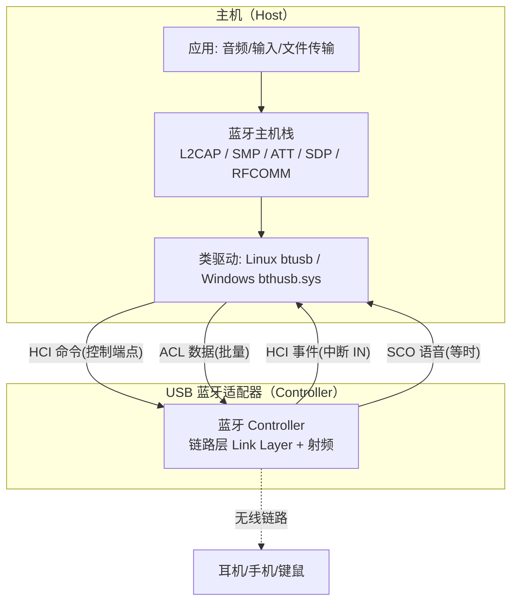

HCI 是蓝牙规范划定的 Host 与 Controller 边界：命令、事件、ACL 数据、SCO 数据四类 HCI 包分别映射到不同的 USB 管道。

### 3. 端点布局：包类型由管道隐含

典型 dongle 的描述符含两个接口：**接口 0**（中断 IN + 批量 OUT + 批量 IN）与**接口 1**（等时 OUT + 等时 IN，带多个备用设置用于按需切换语音带宽）。常见端点编号如下（以实际描述符为准）：

| 端点（典型编号） | 类型 | 方向 | 承载的 HCI 包 |
|---|---|---|---|
| EP0 | 控制 | 双向 | **HCI 命令**（类专属控制请求：bmRequestType=0x21、bRequest=0x00，wIndex=接口号，数据为命令包） |
| 0x81 | 中断 | IN | **HCI 事件**（Connection Complete、Command Complete 等） |
| 0x02 / 0x82 | 批量 | OUT / IN | **ACL 数据**（主机↔控制器双向各一个） |
| 0x03 / 0x83 | 等时 | OUT / IN | **SCO/eSCO 语音**（同步数据流） |

关键规则：**USB 上不使用 H4 的 1 字节包类型前缀**——包类型不再写在数据里，而是由"走哪条管道"隐含。这与 UART H4 传输层的根本差异如下表：

| 对比项 | H4（UART） | HCI over USB |
|---|---|---|
| 类型标识 | 每包前置 1 字节：命令 0x01 / ACL 0x02 / SCO 0x03 / 事件 0x04 | 无前缀；命令走控制端点、事件走中断 IN、ACL 走批量、SCO 走等时 |
| HCI 命令 | 与事件、数据共用一条 UART | 控制传输（EP0，类请求） |
| HCI 事件 | 共用 UART | 中断 IN |
| 流控 | H4 本身无流控（依赖低层），H5 才补充 | USB 原生 NAK/信用机制 |
| 语音通道 | 常外接 PCM 线（HCI 外路由） | 等时端点原生承载 SCO |

SCO 等时接口的多个 **Alternate Setting** 对应不同同时语音链路数下的包尺寸（如 1 条 SCO 时小包、多条时大包）；主机按当前活动 SCO 连接数切换 alt setting（Linux btusb 正是这样做）。不少音频设备固件也支持把 SCO 路由到 PCM 引脚而非 USB（HCI 之外的路由，属控制器配置选项）。

### 4. 四类 HCI 包与 USB 管道的映射总表

| HCI 包类型 | H4 类型码 | USB 管道 | 传输类型 | 方向 |
|---|---|---|---|---|
| HCI Command | 0x01 | EP0 类专属请求 | 控制 | 主机 → 控制器 |
| HCI Event | 0x04 | 中断 IN 端点 | 中断 | 控制器 → 主机 |
| ACL Data | 0x02 | 批量 OUT/IN | 批量 | 双向 |
| SCO Data | 0x03 | 等时 OUT/IN | 等时 | 双向 |

HCI 包的内部格式（命令头 3 字节 = Opcode 2 字节 + 参数长度 1 字节；事件头 2 字节；ACL 头 4 字节含连接句柄；SCO 头 3 字节）属于 HCI 协议本体，详见 [../../50-枝干-无线关联/BLE-低功耗蓝牙/01-蓝牙体系架构与HCI.md]，此处不展开。

#### 4.1 典型描述符布局示例

老牌 dongle（如 CSR8510 方案）的接口描述符通常长这样（数值以实物为准，此处为常见取值）：

```
接口 0:
  bInterfaceClass=0xE0, SubClass=0x01, Protocol=0x01, bNumEndpoints=3
  EP 0x81  中断 IN   bInterval=1        ← HCI 事件
  EP 0x02  批量 OUT  wMaxPacketSize=64   ← ACL（主机→控制器）
  EP 0x82  批量 IN   wMaxPacketSize=64   ← ACL（控制器→主机）
接口 1（多个备用设置）:
  bAlternateSetting=0: 0 端点（无语音时省带宽）
  bAlternateSetting=1: EP 0x03 等时 OUT / EP 0x83 等时 IN, wMaxPacketSize=9~49 等 ← SCO
  bAlternateSetting=2..5: 等时包尺寸逐步加大（支持多条 SCO 同时活动）
```

主机在建立 SCO 连接时按需 `SetInterface(接口1, alt=N)` 切换语音带宽——这就是等时接口带备用设置的意义。

#### 4.2 HCI 初始化序列（首次进入 dongle）

| 步骤 | HCI 命令 | 目的 |
|---|---|---|
| 1 | Reset (0x0C03) | 复位链路层至已知状态 |
| 2 | Read Local Version Information | 读取 HCI/LL 版本、厂商，决定是否需加载固件补丁 |
| 3 | Read Buffer Size / LE Read Buffer Size | 获取 ACL 缓冲大小与数量，规划分包 |
| 4 | Set Event Mask / LE Set Event Mask | 订阅关心的事件 |
| 5 | 扫描/广播/连接 | 进入正常工作 |

### 5. 一次连接的时序示例

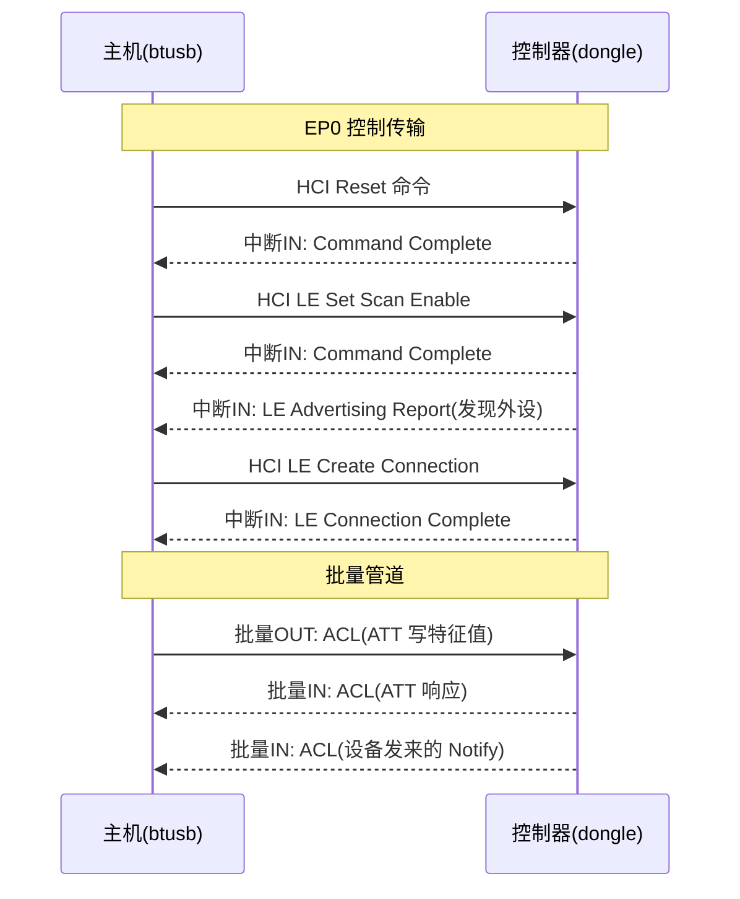

### 6. 驱动与栈绑定

| 平台 | 传输驱动 | 说明 |
|---|---|---|
| Linux | **btusb**（内核驱动） | 承接 HCI 到 USB 管道的映射，向 hci_core 注册通用 HCI 设备；上层 BlueZ 栈（bluetoothd）提供 profile/服务 |
| Windows | bthusb.sys / bthport.sys | Microsoft 蓝牙栈的 USB 传输与端口驱动，枚举 0xE0/0x01/0x01 后自动接管 |
| macOS | 系统蓝牙栈 | 内置对蓝牙 USB 控制器的支持（部分 Mac 平台已改用 PCIe/UART 形态，协议仍是 HCI） |

即插即用的完整链条：类代码匹配 → 栈绑定 → （可能先加载固件）→ HCI Reset → 开始扫描/广播，全程无需用户操作。

### 7. 典型芯片与固件加载

并非所有 dongle 出厂即全功能：不少 Controller 需要**主机在 HCI 正常工作前下载固件补丁（patch/ROM 补丁）**。Linux 侧由 btusb 与各厂商子模块（btintel/btbcm/btrtl）从 linux-firmware 拉取：

| 家族 | 典型芯片 | 固件特征 |
|---|---|---|
| CSR（高通前身） | CSR8510 A10 | 老款多为 Flash 版免加载；市场上存在大量"克隆 CSR8510"，行为异常，Linux 内核内置了识别/标记机制 |
| Realtek | RTL8761A/B 等 | btusb 经 btrtl 请求 `rtl_bt/rtl8761b_fw.bin` 等 ROM 补丁后 HCI 才完整可用 |
| Intel | 7265/8265/AX200/AX210 等 | 需加载 `intel/ibt-*.sfi`（与 .ddc 调节数据），由 btintel 完成下载与校验 |
| Broadcom | BCM20702 等 | 需 `brcm/*.hcd` 固件文件（老型号 BCM2033 曾有专门的 bcm203x 加载驱动） |

固件加载的通用流程：设备以 USB 枚举（此时厂商命令/下载模式接口可用）→ 主机发送厂商私有 HCI/厂商命令载入镜像 → 芯片复位/重枚举 → 正式进入标准 HCI 模式。各厂商的私有命令各不相同，细节以其 SDK/内核驱动实现为准。

### 8. 自制蓝牙 Host 的实用价值

正因为接口是纯标准化 HCI，自己写一个 USB 主机就能获得完整蓝牙能力，常见用途：

- 嵌入式 USB Host（如带 USB OTG 的 MCU、树莓派 Zero）通过 dongle 为产品加入 BLE；
- 安全研究/嗅探：主机侧完全控制 HCI，可注入自定义扫描/连接/广播参数；
- 协议学习：用 Python（pyusb/libusb）几十行代码即可收发 HCI 命令与事件（免驱用户态访问见 [../../60-枝干-主机侧与实现/04-libusb与用户态访问.md]）；
- 蓝牙网关：把 BLE 外设数据经 USB 采集后转 MQTT/以太网上报。

### 9. 实践要点

- HCI 命令走控制传输意味着命令速率受控制管道吞吐限制（不过每包 ≤64 字节、命令频率不高，实践中不构成瓶颈）。
- 事件端点的 bInterval 很小（通常 1ms 框架），保证事件低延迟上报。
- 等时管道无重传，SCO 音频丢包靠编码冗余容忍；USB 复位/挂起会打断语音链路。
- 克隆 CSR 与"假 dongle"是Linux 社区著名坑：枚举正常但行为怪异，更换芯片批次通常可解。

## 原文：06-WebUSB与厂商自定义类

> Source: [20-枝干-设备类协议/其他设备类/06-WebUSB与厂商自定义类.md](https://github.com/tangjianfang/USBTree/blob/main/20-枝干-设备类协议/其他设备类/06-WebUSB与厂商自定义类.md)

### 1. 厂商自定义类：自由与代价

当设备不适合套用任何标准类时，接口可以声明为**厂商自定义类**（Vendor-Specific Class）：

| 字段 | 取值 | 说明 |
|---|---|---|
| bInterfaceClass | 0xFF | Vendor Specific |
| bInterfaceSubClass | 任意 | 厂商自定 |
| bInterfaceProtocol | 任意 | 厂商自定 |

**自由**：端点数量/类型、请求语义、数据格式完全自定，固件实现成本最低（一个批量 OUT + 一个批量 IN 就能干活）。

**代价**：操作系统不会自动绑定任何功能驱动——厂商必须自己提供驱动，或借助下文的免驱机制。主机侧能看到的只是"不明设备"，没有 `VID:PID → 驱动` 的映射就只能等用户装驱动。

### 2. 老式代表：USB 串口桥芯片

历史最悠久的厂商类大军是 USB 转串口桥（UART bridge）芯片，它们各自定义私有批量协议（寄存器读写 + 数据流），靠内核/厂商驱动暴露出串口：

| 芯片 | 厂商 | Linux 内核驱动 | 备注 |
|---|---|---|---|
| FT232 系列 | FTDI | ftdi_sio | 业界老牌，协议私有，驱动内置大量 PID 表 |
| CP210x | Silicon Labs | cp210x | 常见小封装桥，配置存于芯片 |
| CH340/CH341 | 沁恒 WCH | ch341 | 国产低价桥，Arduino 兼容板大量使用 |
| PL2303 | Prolific | pl2303 | 老牌桥；近年假货泛滥，新驱动屏蔽仿冒品 |

对比：这些芯片若改用 **CDC-ACM**（USB 通信设备类的抽象控制模型）实现，即可在三大系统免驱枚举成标准串口——代价是固件要实现 CDC 的管理/通知机制。二者的取舍（私有协议 + 驱动表 vs 标准类 + 免驱）正是本文件主题的缩影。CDC 细节见 [../CDC-通信设备类/](https://github.com/tangjianfang/USBTree/blob/main/20-枝干-设备类协议/CDC-通信设备类)。

### 3. WinUSB 方案：让 Windows 自动免驱

微软提供两代机制，让设备**在固件里声明**"请给我绑定 winusb.sys"（通用 USB 客户端驱动），应用通过 WinUSB API 访问，厂商零驱动。

#### 3.1 MS OS 1.0 描述符

第一代机制由三部分组成：

1. **MS OS 1.0 字符串描述符**：挂在字符串索引 **0xEE**，设备插入 Windows 时被自动读取：

```
bLength=0x12  bDescriptorType=0x03(字符串)
qwSignature="MSFT100"(UTF-16LE: 4D 00 53 00 46 00 54 00 31 00 30 00 30 00)
bMS_VendorCode=0x01   bPad=0x00
```

2. **扩展兼容 ID 描述符**（Extended Compat ID OS Feature Descriptor）：主机以 GET 描述符方式经厂商码请求（wIndex=0x0004），函数级条目给出兼容 ID `"WINUSB"`；
3. **扩展属性描述符**（Extended Properties OS Feature Descriptor，wIndex=0x0005）：声明注册表属性 `DeviceInterfaceGUID`（REG_SZ）/ `DeviceInterfaceGUIDs`（REG_MULTI_SZ，类型 7），供应用按 GUID 打开设备接口。

#### 3.2 MS OS 2.0 描述符

第二代机制挂在 **BOS 描述符**的 Platform Capability（平台能力）上，避免 0xEE 字符串被某些系统误读，并支持更多能力声明：

- 平台能力 UUID：`D8DD60DF-4589-4CC7-9CD2-659D9E648A9F`（Microsoft OS 2.0 Platform Capability ID）；
- 主机经厂商码读取描述符集（MS OS 2.0 Descriptor Set，wIndex=0x0007），集合内含头描述符、配置/函数子集与特性条目：**兼容 ID 条目**（类型编号见 MS OS 2.0 规范）声明 `"WINUSB"`，**注册表属性条目**声明 DeviceInterfaceGUID；
- 描述符框架基于 USB 2.0 BOS/平台能力扩展，属 USB 2.1+ 生态（BOS 机制见 [../../10-树干-USB核心/07-描述符详解.md]）。

两代机制可同时实现（新系统读 2.0、老系统回退 1.0），这是主流固件库（如 TinyUSB、libopencm3、ESP-IDF）的标准做法。

#### 3.3 字节级示例

MS OS 1.0 扩展兼容 ID 描述符（单接口设备绑定 WinUSB）的典型内容：

```
头:  28 00 00 00                    ; dwLength = 0x28(40)
     00 01                          ; bcdVersion = 0x0100
     04 00                          ; wIndex = 0x0004 (Extended Compat ID)
     01                             ; bCount = 1 个函数条目
     00*7                           ; 保留
条目: 00                             ; bFirstInterfaceNumber = 0
     00                             ; 保留
     57 49 4E 55 53 42 53 00        ; compatibleID = "WINUSB"
     00*8                           ; subCompatibleID = 空
```

0xEE 字符串描述符的完整字节（共 0x12=18 字节）：

```
12 03 4D 00 53 00 46 00 54 00 31 00 30 00 30 00 01 00
│  │  └─"MSFT100" UTF-16LE──────────────────────┘  │  └─bPad
│  └─字符串描述符                                   └─bMS_VendorCode=0x01
└─bLength
```

### 4. WebUSB：浏览器直达 USB 设备

**WebUSB** 是 Google 提出的 W3C/WHATWG 生态提案规范：让网页 JavaScript 在用户授权下直接收发 USB 数据，目标是"插上设备 → 打开网页 → 即可配置/升级/调试"，把厂商工具（含 DFU 刷机，见 [01-DFU固件升级.md]）搬进浏览器。

#### 4.1 设备侧声明

WebUSB 复用 MS OS 2.0 同款的 BOS Platform Capability 机制，但使用自己的能力 UUID `3408B638-09A9-47A0-8BFD-A0768815B665`，字段包括：

| 字段 | 说明 |
|---|---|
| bcdVersion | 0x0100 |
| bVendorCode | 厂商请求码（主机用它发两条额外请求） |
| iLandingPage | 落地页 URL 描述符索引（0 表示无） |

主机随后用该厂商码发 **GET_URL** 请求（`bmRequestType=0xC0`、`bRequest=bVendorCode`、`wValue=`描述符索引、`wIndex=0x0002`），设备返回 **URL 描述符**（`bDescriptorType=WEBUSB_URL=3`）：`bScheme` 为方案前缀（0x00=`http://`、0x01=`https://`、0xFF=URL 字段即完整 URL），后接 UTF-8 URL。早期草案中的"允许来源（allowed origins）"列表已从现行规范删除（请求码 1 现为保留值）。字节级布局与固件回调见 [../../65-枝干-框架与API/10-设备端框架与WebUSB固件桥接.md](https://github.com/tangjianfang/USBTree/blob/main/65-枝干-框架与API/10-设备端框架与WebUSB固件桥接.md)。

#### 4.2 主机侧 JavaScript API

```javascript
// 必须在用户手势（点击等）中调用
const device = await navigator.usb.requestDevice({
  filters: [{ vendorId: 0x2e8a, productId: 0x000a }]
});
await device.open();
await device.claimInterface(0);            // 类似 libusb 的 claim
await device.transferOut(0x01, data);      // 批量 OUT
const res = await device.transferIn(0x81, 64); // 批量 IN
await device.controlTransferOut({          // 控制传输(厂商请求)
  requestType: 'vendor', recipient: 'interface',
  request: 0x01, value: 0x00, index: 0
}, payload);
```

#### 4.3 安全模型

| 机制 | 说明 |
|---|---|
| 用户手势 + 选择器 | `requestDevice` 必须由点击触发，并弹出设备选择对话框，用户显式勾选 |
| Origin 绑定 | 权限按网站来源授予并持久化（`getDevices()` 只返回本 origin 已授权设备），陌生站点即使知道 VID:PID 也无法静默连接 |
| 浏览器支持 | Chromium 系（Chrome/Edge/Opera）实现；Firefox/Safari 未实现 |
| 职责边界 | 受保护接口类不可认领：0x01 音频、0x03 HID、0x08 大容量存储、0x09 集线器、0x0B 智能卡、0x0E 视频、0x10 音视频、0xE0 无线控制器（WebUSB 规范 §6.4）；另有按 VID/PID 的 USB 黑名单 |

### 5. libusb：桌面端免驱访问

libusb 是跨平台用户态 USB 库，免驱访问的接口匹配策略随系统而异：

| 平台 | 免驱条件 |
|---|---|
| Linux | 设备接口未被内核驱动占用即可直接访问；被占用时可 `detach_kernel_driver`（需 udev 权限规则授权普通用户） |
| Windows | 设备需绑定 WinUSB/libusb/winusb 兼容驱动——正是第 3 节 MS OS 描述符的用武之地；存量设备可用 Zadig 工具手动换绑 |
| macOS | 系统不会为未知厂商类自动加载驱动，libusb 天然可直接打开 |

libusb 的 API（open/claimInterface/bulk transfer）与 WebUSB 高度同构——WebUSB 本质上是"进了浏览器的 libusb"。工程细节见 [../../60-枝干-主机侧与实现/04-libusb与用户态访问.md]。

### 6. 免驱/低驱方案选型对比

| 方案 | 免驱程度 | 吞吐/时延 | 固件成本 | 适合场景 |
|---|---|---|---|---|
| HID | 全平台免驱 | 受报告速率与端点轮询限制（约每毫秒千字节级，远低于批量） | 需报告描述符 | 配置工具、低速率传感、传感器面板（见 [../HID-人机接口设备/00-HID概述与定位.md]） |
| CDC-ACM | Linux/macOS/Win10+ 免驱 | 批量级吞吐 | 需实现 CDC 接口组 | 虚拟串口、日志口、AT 命令通道 |
| WinUSB + MS OS 描述符 | Windows 免驱（其他系统配 libusb） | 批量级 | 描述符工作量小 | 自定义协议设备、产测/调试工具 |
| WebUSB | Chromium 浏览器内免驱 | 批量级 | BOS 能力 + 厂商码 | 网页版刷机/配置器、在线示波器 |
| 厂商类 + 专有驱动 | 需装驱动 | 无限制（可用等时/高速大包） | 协议自由但驱动开发昂贵 | 高吞吐专有设备（采集卡、调试器） |

选型口诀：**能用标准类就用标准类；确需自定义协议时，叠加 WinUSB 描述符 +（可选）WebUSB 能力**，让同一台设备在桌面用 libusb、在浏览器用 WebUSB、在手机上用 OTG 应用三线通吃。

### 7. 实践要点

- 0xEE 字符串描述符对非 Windows 系统是"多余"的，某些 Linux 工具会将其打印为乱码——属正常现象。
- MS OS 2.0 的兼容 ID 条目是**函数级**的，要正确挂在对应接口子集下，否则 Windows 只会绑定设备级默认驱动。
- WebUSB 的 `claimInterface` 与内核驱动互斥：若设备被 CDC/HID 内核驱动占用，浏览器将无法 claim，设计固件时应把 WebUSB 接口设为 0xFF。
- 落地页只是浏览器"可以"提示用户访问的链接（规范用语为 MAY），不构成任何访问授权；网页访问设备始终需要用户在选择器中授权。发布前用 `chrome://usb-internals` 测试描述符。

## 原文：07-MIDI类

> Source: [20-枝干-设备类协议/其他设备类/07-MIDI类.md](https://github.com/tangjianfang/USBTree/blob/main/20-枝干-设备类协议/其他设备类/07-MIDI类.md)

### 1. 定位

USB MIDI 设备类规范（Universal Serial Bus Device Class Definition for MIDI Devices, Version 1.0，1999 年发布）把传统 MIDI 1.0（音乐数字接口，Musical Instrument Digital Interface，5 针 DIN、31250 bps 串行）搬到 USB 上。它在架构上**隶属音频类（Audio Device Class）家族**，以"音频类 + MIDI 流送（MIDIStreaming）接口"的方式实现——音频口（Audio Interface）负责时钟与能力声明，MIDIStreaming 接口负责事件流。

| 字段 | 取值 | 说明 |
|---|---|---|
| bInterfaceClass | 0x01 | Audio（音频类） |
| bInterfaceSubClass | 0x03 | MIDIStreaming |
| bInterfaceProtocol | 0x00 | 兼容音频类 1.0 协议约定 |

传统 DIN MIDI 的物理层是 31.25 kbps 电流环串口；USB-MIDI 改用 USB 批量管道承载，带宽与并接能力大幅提高，同时消息体仍是经典 MIDI 字节流，因此"USB MIDI 键盘"对应用而言等价于一台传统 MIDI 设备。

### 2. 端点构成

| 端点 | 类型 | 方向 | 用途 |
|---|---|---|---|
| 批量 IN | Bulk | 设备 → 主机 | USB-MIDI 事件包（演奏数据/系统消息上传） |
| 批量 OUT | Bulk | 主机 → 设备 | USB-MIDI 事件包（下发音序/控制） |

MIDI 1.0 类**只使用批量传输**，不需要等时（同步）端点——MIDI 数据本质是低速率事件流，不需要音频流的时钟同步框架（音频本体由同一设备里的 AudioStreaming 接口 0x02 承担，见 [../Audio-UAC/](https://github.com/tangjianfang/USBTree/blob/main/20-枝干-设备类协议/Audio-UAC)）。

### 3. 核心：USB-MIDI 事件包（USB-MIDI Event Packet）

批量管道上的最小单元是**固定 4 字节**的事件包：

| 字节 | 内容 | 说明 |
|---|---|---|
| 字节 0 | 高 4 位 = Cable Number（线缆号 CN，0~15） | 设备内部虚拟 MIDI 线编号（多音轨/多端口设备用） |
| 字节 0 | 低 4 位 = Code Index Number（CIN，代码索引） | 声明后续字节的含义与长度 |
| 字节 1~3 | MIDI_1 / MIDI_2 / MIDI_3 | MIDI 消息本体；不足 3 字节用 0 补齐 |

#### CIN 常用取值表

关键规律：**通道语音消息的 CIN 恰好等于其 MIDI 状态字节的高 4 位**，一眼可读。

| CIN | 长度 | 含义 |
|---|---|---|
| 0x8 | 2 字节数据 | Note Off（音符关） |
| 0x9 | 2 字节数据 | Note On（音符开） |
| 0xA | 2 字节数据 | Poly KeyPress（复音触后） |
| 0xB | 2 字节数据 | Control Change（控制改变） |
| 0xC | 1 字节数据 | Program Change（音色改变） |
| 0xD | 1 字节数据 | Channel Pressure（通道触后） |
| 0xE | 2 字节数据 | Pitch Bend（弯音轮） |
| 0x2 | 2 字节数据 | 双字节系统通用消息（如 MTC 四分之一帧 0xF1） |
| 0x3 | 3 字节数据 | 三字节系统通用消息（如乐曲位置指针 0xF2） |
| 0xF | 1 字节 | 单字节系统消息（实时消息、Tune Request 等；可穿插在数据流中） |
| 0x4 | 3 字节数据 | SysEx 开始或继续（3 字节均有效） |
| 0x5 | 1 字节 | SysEx 结束（含 1 字节） |
| 0x6 | 2 字节数据 | SysEx 结束（含 2 字节） |
| 0x7 | 3 字节数据 | SysEx 结束（含 3 字节） |
| 0x0 / 0x1 | — | 保留（杂项/线缆事件扩展，规范预留） |

#### 字节级示例

按 C4 键（Note On，通道 0，力度 0x40）：MIDI 消息 `90 3C 40`，事件包为：

```
09 90 3C 40
│  │  │  └─力度 0x40
│  │  └─音符 C4=60=0x3C
│  └─状态字节 0x90(通道0 Note On)
└─0x09: CN=0, CIN=9(Note On)
```

一条 SysEx `F0 7E 7F 09 01 F7`（6 字节）需拆成两个事件包：

```
包1: 04 F0 7E 7F   ; CIN=0x4 SysEx开始，载 3 字节
包2: 07 09 01 F7   ; CIN=0x7 SysEx结束，载 3 字节
```

### 4. 描述符模型：Jack 与 Element

MIDI 类用"插孔（Jack）"描述数据通路，类似音频类拓扑建模：

| 描述符（MIDIStreaming 接口下） | 子类型码 | 说明 |
|---|---|---|
| MS 接口头（MS_HEADER） | 0x01 | bcdADC、wTotalLength（拓扑描述总长） |
| MIDI IN Jack | 0x02 | MIDI 数据流入 USB 的源：**Embedded**（内嵌=由 USB 端点供给/输出到端点，类型码 0x01）或 **External**（外置=物理 DIN 口等，类型码 0x02） |
| MIDI OUT Jack | 0x03 | MIDI 数据流出 USB 的目的地，同样分 Embedded/External |
| Element | 0x04 | 设备内部的信号处理单元（如合成器引擎、路由器），有若干 Pin 输入输出 |

端点描述符之后还有**类专属端点描述符**（子类型 0x01），声明该端点关联的内嵌 Jack 列表（bNumEmbMIDIJack + 各 JackID），主机据此把"Cable Number ↔ Jack ↔ 物理端口"连接成路由表。Jack/Element 的完整字段表见规范原文（描述符总体结构背景见 [../../10-树干-USB核心/07-描述符详解.md]）。

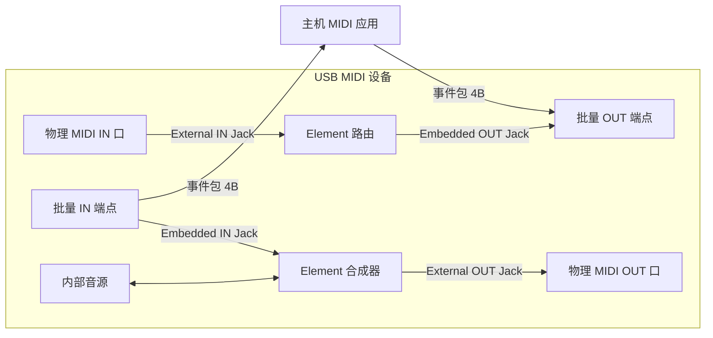

#### 4.1 描述符链布局（MIDIStreaming 接口内部）

```
标准接口描述符        bInterfaceClass=0x01, SubClass=0x03
└─类专属 MS 接口头     子类型 0x01: bcdADC=0x0100, wTotalLength=拓扑描述总长
   ├─MIDI IN Jack 1   子类型 0x02: 类型=Embedded(0x01), JackID=1
   ├─MIDI OUT Jack 2  子类型 0x03: 类型=External(0x02), JackID=2, 输入Pin=1
   └─批量端点描述符
      └─类专属端点描述符 子类型 0x01: bNumEmbMIDIJack=1, baAssocJackID=[1]
```

字节级示例（MS 接口头，共 7 字节）：

```
07 24 01 00 00 42 00
│  │  │  └─bcdADC=0x0100
│  │  └─子类型 0x01 (MS_HEADER)
│  └─bDescriptorType=0x24 (CS_INTERFACE)
└─bLength           └─wTotalLength 低字节=0x42(示例值)
```

### 5. 主机侧驱动：全平台免驱

| 平台 | 驱动 | 说明 |
|---|---|---|
| Linux | ALSA **snd-usb-audio**（历史上的独立模块 snd-usb-midi 已并入） | 枚举为标准 ALSA RawMIDI/Sequence 端口，与音频流统一管理 |
| Windows | 内置 **usbaudio.sys**（Windows XP 起支持 USB MIDI） | 枚举为标准 MIDI 端口，DirectMusic/WinMM/MIDI API 可用 |
| macOS | **CoreMIDI** | 系统级免驱，Audio MIDI Setup 里可视化接线 |

因为驱动全部内置，USB MIDI 键盘/音源是"插上就能弹"的典范设备类。

### 6. MIDI 2.0 / UMP 与 USB MIDI 2.0 类

2020 年 MIDI 协会发布 **MIDI 2.0**，其核心是 **UMP**（Universal MIDI Packet，通用 MIDI 包）：

- UMP 是 4/8/12/16 字节（32/64/96/128 位）四种长度的包格式，首 32 位的**高 4 位为消息类型、次 4 位为组号（Group 0~15）**——每组内再含 16 个通道，容量从"16 通道"扩展为"16 组 × 16 通道"；各组各类消息的具体类型编码见 MIDI 2.0 规范原文；
- UMP 兼容封装 MIDI 1.0 通道语音消息，也定义 MIDI 2.0 专属消息（更高分辨率控制、按音符属性等）；
- **USB MIDI 2.0 类**（USB Device Class Definition for MIDI Devices 2.0）把 UMP 流放在 **USB Audio Class 2.0（UAC 2.0）描述符框架**之上：MIDIStreaming 接口子类仍为 0x03、数据仍走批量端点，但声明版本为 2.0，并可同时提供 MIDI 1.0 传统端点，做到新旧主机通吃。

工程现状：新款键盘/音频接口开始同时暴露"MIDI 1.0 端口 + MIDI 2.0 端口"，主机栈（Windows MIDI 2.0 服务、Linux ALSA UMP 支持、macOS CoreMIDI 2.0 API）逐步完善中。

### 7. 典型设备形态

| 设备 | USB 形态 |
|---|---|
| MIDI 键盘 / 电钢琴 | MIDI 类；若带音频输出则与 UAC 复合；面板常含多个 Cable Number（多音轨） |
| 硬件合成器 / 音源 | MIDI 类 + AudioStreaming 复合（MIDI 收指令、USB 音频回传声音） |
| DJ 控制器 | MIDI（或 HID）承载推子/转盘，UAC 承载双立体声通道；部分机型同时暴露 MIDI+HID 两种模式，游戏/映射软件走 HID |
| MIDI 接口盒 | 1 进多出 DIN 口，用多个 Jack 对扩展 CN |
| 鼓机/打击垫 | 常为 MIDI + HID 复合（打击垫供 DAW 直读） |

### 8. 实践要点

- 事件包永远 4 字节对齐：短消息补 0，长度信息只看 CIN，不要按字节流扫描。
- CN 与端点是两层概念：一个批量端点可复用 16 个 CN；路由由描述符的 Jack/Element 拓扑决定。
- 实时消息（0xF8 时钟、0xFE 活动感知）单字节即可成包（CIN=0xF），高频时注意批量端点轮询间隔带来的时延上限。
- 自制乐器固件（如 Teensy、RP2040、ESP32-S3）实现"接口 0=音频控制 + 接口 1=MIDIStreaming"即可全平台免驱，是 DIY 音频设备最常见路线。

## 原文：08-USBTMC测试测量类

> Source: [20-枝干-设备类协议/其他设备类/08-USBTMC测试测量类.md](https://github.com/tangjianfang/USBTree/blob/main/20-枝干-设备类协议/其他设备类/08-USBTMC测试测量类.md)

>  兄弟目录参考: [../HID-人机接口设备/00-HID概述与定位.md](11-hid-core.md)
> 规范原文缓存索引: [../../80-参考资料/README.md](92-spec-references.md)

### 1. 定位：把 GPIB 搬到 USB 上

USBTMC（USB Test & Measurement Class，USB 测试测量类，USB-IF 规范 1.0，2003-04-14 发布）为示波器、电源、万用表、频谱仪、电子负载等可编程仪器定义了一条**基于批量传输（Bulk Transfer）的消息通道**。它的历史使命是替代 GPIB（IEEE 488 总线）：只要仪器和主机软件都讲 USBTMC，仪器的"编程消息"（program message，即 SCPI 命令文本）就能像当年走 GPIB 一样收发，但物理层换成了便宜的 USB。

USBTMC 本身**不含任何仪器语义**——它只负责把字节流可靠地双向搬运并标记"消息结束"；命令内容的语义由上层生态决定：

| 层 | 名称 | 职责 |
|---|---|---|
| 应用 | IVI 驱动 / 测试程序 | 面向仪器的可互换驱动与自动化脚本 |
| 命令 | SCPI（Standard Commands for Programmable Instruments） | `*IDN?`、`:MEAS:VOLT?` 等标准命令文本 |
| API | VISA（Virtual Instrument Software Architecture，VPP-4.3） | 统一的会话/资源寻址与读写接口 |
| 传输 | **USBTMC**（本文） | USB 批量通道上的消息帧、中止、状态 |
| 物理 | USB 2.0/3.x 批量端点 | 可靠的字节管道 |

规范族共两份：**USBTMC 1.0 基础规范** + **USB488 子类规范**（同日发布）。USB488 子类在基础之上补齐 IEEE 488.1/488.2 的遗留语义（触发、状态字节、SRQ 服务请求、远地/本地切换），完整表见 USBTMC 1.0 规范与 USB488 子类规范原文。

### 2. 接口标识与端点要求

| 字段 | 取值 | 说明 |
|---|---|---|
| bInterfaceClass | 0xFE | 应用特定类（Application Specific，与 [01-DFU固件升级.md](18-other-classes-a.md) 同挂 0xFE 下） |
| bInterfaceSubClass | 0x03 | USBTMC |
| bInterfaceProtocol | 0x00 | 纯 USBTMC，无子类适用 |
| bInterfaceProtocol | 0x01 | USBTMC + USB488 子类 |

端点配置（基础规范强制）：

| 端点 | 数量 | 用途 |
|---|---|---|
| 批量 OUT（Bulk-OUT） | 恰好 1 个 | 主机 → 仪器：命令消息（SCPI 文本、TRIGGER 等） |
| 批量 IN（Bulk-IN） | 恰好 1 个 | 仪器 → 主机：响应消息 |
| 中断 IN（Interrupt-IN） | 至多 1 个 | 基础规范中可选；USB488 子类若声明 SR1（可发服务请求）则**必须**有，用于 SRQ/状态字节通知 |

细节约束：Bulk-OUT 的 `wMaxPacketSize` 必须是 4 的倍数；基础规范要求设备描述符 `bcdUSB ≥ 0x0200`、iManufacturer/iProduct/iSerialNumber 三个字符串索引**必须非零**（VISA 靠"VID+PID+序列号"唯一定位一台仪器）。`lsusb` 里一行 `bInterfaceClass 254 App. Specific, bInterfaceSubClass 3, bInterfaceProtocol 1` 就是典型的 USB488 仪器接口。

### 3. 消息模型
>  对抗抽查（evolve #28）：MsgID=0x01 DEV_DEP_MSG_OUT、厂商 0x7E/0x7F 与 USBTMC 1.0 原文（Table 3 等）比对一致。
：12 字节头定天下

USBTMC 的所有批量通信都以一个 **12 字节消息头**开头，之后紧跟消息数据：

| 偏移 | 字段 | 大小 | 说明 |
|---|---|---|---|
| 0 | MsgID | 1 | 消息类型（见第 4 节表） |
| 1 | bTag | 1 | 传输标识，主机每发新头 +1，取值 1~255 |
| 2 | bTagInverse | 1 | bTag 的反码（如 0x5B ↔ 0xA4），用于帧完整性校验 |
| 3 | Reserved | 1 | 必须 0x00 |
| 4-7 | TransferSize | 4 | 消息数据字节数（不含头与对齐字节），小端（LSB 在前） |
| 8-11 | bmTransferAttributes 等 | 4 | 各消息专属，见下 |

**bTag/bTagInverse 配对校验**是同步机制的灵魂：

- 主机发出的每个批量 OUT 头携带新 bTag；设备的批量 IN 响应头必须**原样回显**引起该响应的命令的 MsgID/bTag/bTagInverse；
- 若响应头与请求不匹配（bTagInverse ≠ bTag 反码、bTag 对不上、MsgID 不认识），主机按规范丢弃数据并走中止（INITIATE_ABORT_BULK_IN）恢复同步；设备侧发现参数非法则停转（Halt）批量端点；
- 主机发送的每笔批量 OUT 事务总长须为 **4 字节对齐**（末尾补 0~3 个对齐字节）；设备的批量 IN 传输**必须以短包（short packet，含零长包）结束**。

一次典型的 `*IDN?` 查询（USB488 设备）：

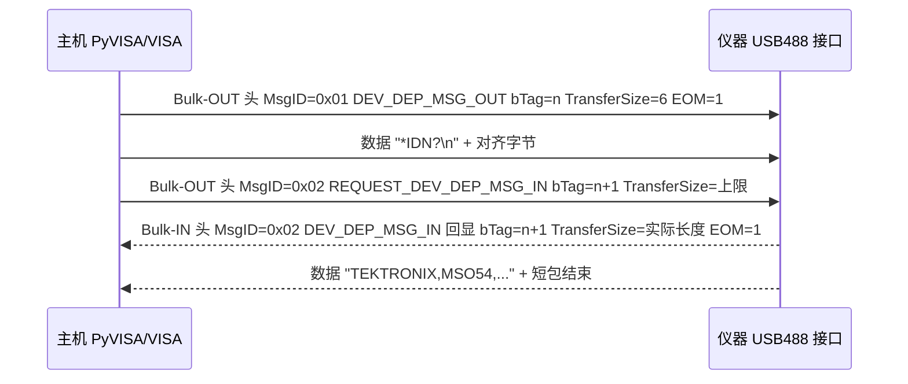

### 4. 核心消息表（MsgID）

| MsgID | 方向 | 宏名 | 用途 |
|---|---|---|---|
| 0x00 | — | 保留 | 保留 |
| 0x01 | OUT | DEV_DEP_MSG_OUT | 设备相关命令消息：主机向仪器写数据（SCPI 命令文本就坐在这里） |
| 0x02 | OUT | REQUEST_DEV_DEP_MSG_IN | 请求响应：主机通知仪器"请在批量 IN 上回送数据"，TransferSize = 主机最多愿收多少 |
| 0x02 | IN | DEV_DEP_MSG_IN | 对 REQUEST_DEV_DEP_MSG_IN 的响应消息（**与请求共用 MsgID 2**，靠方向与 bTag 区分） |
| 0x03~0x7D | — | 保留 | USBTMC 保留 |
| 0x7E | OUT | VENDOR_SPECIFIC_OUT | 厂商自定义命令消息 |
| 0x7F | OUT/IN | REQUEST_VENDOR_SPECIFIC_IN / VENDOR_SPECIFIC_IN | 厂商自定义请求/响应 |
| 0x80~0xBF | — | 保留 | **留给 USBTMC 子类**：USB488 子类在此定义了 0x80 TRIGGER |
| 0xC0~0xFF | — | 保留 | 留给 VISA 规范 |

> 注意两个易错点：其一，**响应消息 MsgID=2 而不是 3**（0x03 起均为保留值，Linux 内核 usbtmc 驱动即校验 `MsgID == 2`）；其二，主机一次必须把整条命令消息用**一笔传输**发完（DEV_DEP_MSG_OUT 例外，允许多笔传输续传）。完整表见 USBTMC 1.0 规范 Table 2。

三条主力消息的字段差异：

| 消息 | 偏移 8 | 偏移 9 |
|---|---|---|
| DEV_DEP_MSG_OUT | bmTransferAttributes：D0=**EOM**（本传输最后一个数据字节即整条 USBTMC 消息的最后一个字节），D1~D7 保留 | 保留 |
| REQUEST_DEV_DEP_MSG_IN | bmTransferAttributes：**D1=TermCharEnabled**（须设备在 GET_CAPABILITIES 中声明支持），D0 必须 0 | TermChar（终止字符值） |
| DEV_DEP_MSG_IN | bmTransferAttributes：D0=EOM；D1=确实因 TermChar 而截断 | 保留 |

### 5. EOM 与传输终止语义

USBTMC 规范用 **EOM（End Of Message，消息结束位）**承担 GPIB 中 **EOI（End Or Identify）**线的角色——这也是 USB488 子类名字里"488"的呼应点：

| 终止条件 | 谁判定 | 语义 |
|---|---|---|
| EOM=1 的最后一个数据字节 | 主机写 / 设备读 | 整条 USBTMC 消息到此结束，仪器可开始解析执行 |
| 收满 TransferSize 个字节 | 双方 | 本笔 USB 传输的数据量额度（注意：设备可能一次只交出一部分，剩余部分主机须再发一次 REQUEST_DEV_DEP_MSG_IN 续读） |
| TermChar 匹配 | 设备 | 仅当请求中 TermCharEnabled=1 且设备支持；设备回送时置 D1=1 |
| 短包 | 设备 | 批量 IN 传输的 USB 层终止条件（可用最多 wMaxPacketSize-1 个对齐字节避免零长包） |

主机侧的正常读循环是：发 REQUEST_DEV_DEP_MSG_IN → 收 DEV_DEP_MSG_IN → 若 EOM=0 且还没收够，继续发新的请求读剩余字节。

### 6. 类专属请求（控制传输）

USBTMC 的"管理面"走控制传输，全部为类请求、接收者为接口（0xA1）或端点（0xA2）。中止与清除采用 **INITIATE + CHECK_STATUS 分步事务**（split transaction）：INITIATE 返回 0x02 PENDING 时主机须轮询对应 CHECK_STATUS 直到非 PENDING。

| bRequest | 名称 | bmRequestType | wValue | 数据阶段（IN） | 必选 |
|---|---|---|---|---|---|
| 0x01 | INITIATE_ABORT_BULK_OUT | 0xA2 | bTag | 2 字节：状态 + 当前 bTag | 必选 |
| 0x02 | CHECK_ABORT_BULK_OUT_STATUS | 0xA2 | 0 | 8 字节：状态 + 保留3 + NBYTES_RXD(4B) | 必选 |
| 0x03 | INITIATE_ABORT_BULK_IN | 0xA2 | bTag | 2 字节：状态 + 当前 bTag | 必选 |
| 0x04 | CHECK_ABORT_BULK_IN_STATUS | 0xA2 | 0 | 8 字节：状态 + bmAbortBulkIn + 保留 + NBYTES_TXD(4B) | 必选 |
| 0x05 | INITIATE_CLEAR | 0xA1 | 0 | 1 字节：状态 | 必选 |
| 0x06 | CHECK_CLEAR_STATUS | 0xA1 | 0 | 2 字节：状态 + bmClear（D0=Bulk-IN FIFO 仍有残包） | 必选 |
| 0x07 | GET_CAPABILITIES | 0xA1 | 0 | 24 字节能力包（见下） | 必选 |
| 0x40 | INDICATOR_PULSE | 0xA1 | 0 | 1 字节：状态 | 可选（点亮指示灯便于找仪器） |

语义速记：INITIATE_ABORT_BULK_OUT/BULK_IN 只"中止 USB 传输"并恢复帧同步；**INITIATE_CLEAR 才是"丢弃仪器内整条未完成消息"**（对应 IEEE 488 的器件清除语义，USB488 下等同 Selected Device Clear）。

**GET_CAPABILITIES 24 字节响应**（合并基础规范与 USB488 子类的扩展字段）：

| 偏移 | 字段 | 含义 |
|---|---|---|
| 0 | bStatus | 状态，见下表 |
| 1 | 保留 | 0x00 |
| 2-3 | bcdUSBTMC | 规范版本 0x0100 起 |
| 4 | USBTMC 接口能力 | D2=接受 INDICATOR_PULSE，D1=talk-only，D0=listen-only |
| 5 | USBTMC 器件能力 | D0=支持 TermChar 截断 |
| 6-11 | 保留 | 0 |
| 12-13 | bcdUSB488 | 0x0100 起（仅 USB488 接口） |
| 14 | USB488 接口能力 | D2=488.2 接口，D1=接受 REN_CONTROL/GO_TO_LOCAL/LOCAL_LOCKOUT，D0=接受 TRIGGER |
| 15 | USB488 器件能力 | D3=理解全部强制 SCPI，D2=SR1（可发 SRQ），D1=RL1，D0=DT1 |
| 16-23 | 保留 | 0 |

**USBTMC_status 状态值**（所有类请求响应的第一字节）：

| 值 | 宏 | 含义 |
|---|---|---|
| 0x01 | STATUS_SUCCESS | 成功 |
| 0x02 | STATUS_PENDING | 分步事务处理中，继续轮询 |
| 0x80 | STATUS_FAILED | 失败（未细分） |
| 0x81 | STATUS_TRANSFER_NOT_IN_PROGRESS | 要中止的传输不在进行 |
| 0x82 | STATUS_SPLIT_NOT_IN_PROGRESS | 收到意外 CHECK_STATUS |
| 0x83 | STATUS_SPLIT_IN_PROGRESS | INITIATE 未完成又收到新类请求 |
| 0x20 | STATUS_INTERRUPT_IN_BUSY | USB488 专属：中断 IN FIFO 满，状态字节暂无法投递 |

### 7. USB488 子类：让 SCPI 直通、补齐 488 语义

USB488 子类（bInterfaceProtocol=0x01）的核心设计是"**SCPI/IEEE 488.2 编程消息原样直通**"：批量 OUT 上的 DEV_DEP_MSG_OUT 数据就等价于 GPIB 上 ATN=FALSE 时的程序消息（如 `*IDN?\n`），设备里名为 Function Layer 的功能层把它直接喂给命令解析器。子类额外补充：

| 机制 | 载体 | 说明 |
|---|---|---|
| TRIGGER 触发 | 批量 OUT，**MsgID=0x80**，12 字节头后无数据 | 等效 IEEE 488 的 GET（Group Execute Trigger），与批量 OUT 消息保持时序同步；能力位 D0（接口）/D0（器件 DT1）声明支持 |
| 半双工规则 | 协议约束 | 批量 IN 传输未完成前，主机不得再发 DEV_DEP_MSG_OUT/TRIGGER——继承 IEEE 488.2 消息交换协议（MEP），违反时设备执行 UNTERMINATED 动作 |
| SRQ 服务请求 | 中断 IN 端点 |
>  对抗抽查（evolve #60）：bNotify1 D7=1 + bNotify2 状态字节结构，与 USB488 子类规范 §4.3.1.3 比对一致。
 **bNotify1=0x81**（D7=1 子类格式，D6..D0=bTag=0x01）+ **bNotify2=状态字节（Status Byte）**；入队后设备须清除状态字节中的 RQS 位。主机读到 SRQ 即可串行轮询（serial poll）查明是谁在求助 |
| READ_STATUS_BYTE | 控制请求 0x80 | 主机指定 bTag（2~127），响应 3 字节；**状态字节本体从中断 IN 端点回送**（bNotify1 的 bTag 字段回显请求 bTag，bNotify2=状态字节）；无中断端点时才直接在控制响应里给（RQS 恒 0） |
| 远地/本地 | 控制请求 0xA0/0xA1/0xA2 | REN_CONTROL（wValue=1/0 置位/复位 REN）、GO_TO_LOCAL（面板解锁）、LOCAL_LOCKOUT（本地锁定），能力位 RL1 |
| 状态字节 MAV 位 | — | 488.2 接口在"输出队列有数据待读"时必须置 MAV，供主机同步等待 |

实现提示：Linux 内核 usbtmc 驱动的 ioctl（`USBTMC488_IOCTL_TRIGGER`、`USBTMC488_IOCTL_READ_STB`、`USBTMC488_IOCTL_WAIT_SRQ` 等）正是对上述机制的封装；标准 SCPI 仪器几乎都实现到"488.2 + SR1 + SCPI"全能力。

### 8. 主机侧实战路径

**Linux（内核驱动）**：`usbtmc` 内核模块按 0xFE/0x03/0x00 或 0x01 自动绑定，生成 `/dev/usbtmc0`；直接 `echo "*IDN?" > /dev/usbtmc0` 也能跑，但 EOM/分帧由内核 ioctl（`USBTMC_IOCTL_EOM_ENABLE` 等）管理。sysfs 下该接口目录暴露 `interface_capabilities` 等能力文件可读。

**VISA 层（推荐）**：PyVISA / NI-VISA / Keysight IO Libraries 把设备包装成 VISA 资源。资源名格式 `USB[板卡]::制造商ID::型号码::序列号[::接口]::INSTR`，例如（Tektronix，VID 0x0699）：

```python
import pyvisa
rm = pyvisa.ResourceManager()          # 纯 Python 后端用 ResourceManager("@py")
print(rm.list_resources())             # 'USB0::0x0699::0x0368::C000001::INSTR'
scope = rm.open_resource("USB0::0x0699::0x0368::C000001::INSTR")
print(scope.query("*IDN?"))            # 写 *IDN? 并等待响应
```

open_resource 时 VISA 完成：枚举 → 匹配 0xFE/0x03 → GET_CAPABILITIES → 后续读写全部映射为本文第 3~5 节的消息。调试看门道可用 Wireshark + usbmon（Linux）或 BusBee/硬件抓包仪，重点看 bTag 是否递增、EOM 位置、短包结尾。

**Windows**：多数仪器装厂商 VISA（NI-VISA/Keysight/ TekVISA）后由其驱动接管；系统自带的 usbtmc.sys 也支持基本通道。

### 9. 典型设备与识别

| 设备 | 常见形态 | 例子（VID） |
|---|---|---|
| 示波器/逻辑分析仪 | 台式仪器，USB Device 口"USB 2.0 高速" | Tektronix 0x0699、Keysight/Agilent 0x0957、RIGOL 0x1AB1 |
| 可编程电源/电子负载 | 台式或半台式 | Keysight、RIGOL、ITECH 等 |
| 数字万用表 | 台式 6½ 位及以上 | Keysight 344xx 系列 |
| 函数/任意波发生器、频谱仪 | 台式 | 同上厂商生态 |

不少仪器是"复合设备"：一个配置里同时有 USBTMC 接口 + U盘（MSC）接口 + 厂商自定义接口，接口间互不干扰。

### 10. 与 WebUSB/厂商自定义类的取舍

面对"主机软件直连仪器"的需求，常见疑问是：能不能绕开 VISA，用 WebUSB 或 libusb 直接谈？对比：

| 维度 | USBTMC/USB488 | 厂商自定义 + WebUSB/libusb（见 [06-WebUSB与厂商自定义类.md](19-other-classes-b.md)） |
|---|---|---|
| 驱动占用 | 内核 usbtmc/VISA 驱动自动绑定 | 可做成 WinUSB/libusb 绑定，浏览器可访问 |
| 生态兼容 | PyVISA/LabVIEW/IVI 生态开箱即用 | 全部自研，无第三方软件能识别 |
| 协议成本 | 帧格式固定，实现门槛低 | 自定义协议，自由但自担 |
| 互操作性 | 跨品牌统一（SCPI 直通） | 每家一套 |
| 浏览器场景 | 难：接口已被系统驱动占用 | 是其主场（仪器厂商网页调试工具） |

结论：**标准仪器选 USBTMC 是唯一正解**；只有当设备本身不是可编程仪器、或需要网页零安装访问且能提供独立厂商接口时，才考虑 WebUSB 方案。

### 11. 设备侧实现要点（嵌入式视角）

- 最小可用实现：1 个批量 IN + 1 个批量 OUT + GET_CAPABILITIES + INITIATE/CLEAR/ABORT 组，即可被 Linux/Windows 识别为可用仪器；
- bTag 递增到 0xFF 后回绕到 1（跳过 0）；响应头必须严格回显请求头三元组；
- 批量 OUT 收到不认识的 MsgID：停转端点等待主机恢复（规范 Table 7）；
- 需要主动上报（如测量完成、超限告警）才实现 USB488 SR1 + 中断 IN；只做被动查询可省中断端点；
- 固件栈参考：TinyUSB 的 usbtmc 类、libusb_stm32、以及 ST/NXP 各家 USB 库的 TMC 例程。

## 原文：09-长尾设备类-AV-Billboard-Healthcare-I3C

> Source: [20-枝干-设备类协议/其他设备类/09-长尾设备类-AV-Billboard-Healthcare-I3C.md](https://github.com/tangjianfang/USBTree/blob/main/20-枝干-设备类协议/其他设备类/09-长尾设备类-AV-Billboard-Healthcare-I3C.md)

>  兄弟目录参考: [../HID-人机接口设备/00-HID概述与定位.md](11-hid-core.md)
> 规范原文缓存索引: [../../80-参考资料/README.md](92-spec-references.md)

### 1. 为什么要认识"长尾类"

USB-IF 分配了 20 多个基础类代码（Base Class Code），但日常 95% 以上的流量集中在 HID（0x03）、CDC（0x02/0x0A）、MSC（0x08）、Hub（0x09）、UVC（0x0E）、UAC（0x01）、打印机（0x07）等少数类上。剩下的"长尾"类各有分工：有的在 Type-C 时代翻身成了关键角色（Billboard），有的发布即巅峰、如今只活在枚举日志里（AV、Physical）。

对工程师的实际价值是"**知道有它、遇到能认出来**"：

- 抓包/枚举时看到陌生 bInterfaceClass，能立刻判断"这是什么、要不要装驱动、还是设备在报错"；
- 排查 Type-C 投屏失败时，知道去找 Billboard 而不是反复换线；
- 避免把厂商自定义（0xFF）与某个冷门标准类混淆（类代码速查见文末总表）。

### 2. AV 设备类 0x10（Audio/Video Devices）

| 项目 | 内容 |
|---|---|
| 类代码 | bInterfaceClass 0x10（接口级），子类 0x01=AVControl、0x02=AVData 视频、0x03=AVData 音频，协议 0x10（IP_VERSION_01_00） |
| 定位 | USB-IF 试图用一套"控制面 + 数据面分离"的类统一音视频设备（公开规范为 AV Devices 1.0，2011-12-07）。控制面 = AVControl 接口上的**命令块管道（CBP）**：一对批量 IN/OUT 承载 16 字节定长头的 Command/Response/Notify/Null 消息（32 字节粒度）；设备能力用 **AVDD（XML，avschema.xsd）** 描述——注意它**不是** 1394 的 AVC 命令集（常见误传，已按 AV 1.0 原文核实） |
| 描述符要点 | AVControl 与 AVData 为不同接口，靠 IAD 组成复合功能；详细消息模型与 AVDD 结构见 [10-AV设备类详解](19-other-classes-b.md) |
| 驱动支持 | 主流操作系统**均无内置驱动**，需厂商驱动；Windows/Linux 生态几乎空白 |
| 何时会遇到 | 几乎不会——市场上音视频设备早已被 **UAC + UVC 组合**通吃（见 [../Audio-UAC/00-UAC概述.md](17-uac.md) 与 [../Video-UVC/00-UVC详解.md](16-uvc.md)）：UVC 管摄像头、UAC 管音频，简单、驱动齐、免安装。AV 类采用率极低，可视为"标准化的失败尝试"；枚举见到 0x10 基本可判定为老设备或特殊定制 |

### 3. Billboard 0x11：Type-C 拓扑告示牌

Billboard（USB Billboard Device Class，当前版本 1.2.2）是长尾类里**最重要的一个**——它是 Type-C/USB4 时代解决"插了扩展坞投屏却没反应"问题的关键机制。

#### 3.1 它解决的问题

Type-C 设备容器（Device Container，如扩展坞、转接器）支持一种或多种替代模式（Alternate Mode，AUM，如 DisplayPort、Thunderbolt）。当**线缆太老、端口不支持、供电不足或 PD 协商失败**导致替代模式进不去时，设备容器会重新枚举，额外暴露一个 Billboard 设备，用标准 USB 的方式告诉主机："我其实支持哪些模式、为什么现在没进去"。语义链路：USB PD Discover Identity/Discover SVIDs/Discover Modes 的结果 → 被翻译进 Billboard 描述符 → 操作系统读取后提示用户。

#### 3.2 类代码与描述符要点

| 项目 | 内容 |
|---|---|
| 类代码 | **设备级** bDeviceClass 0x11、bDeviceSubClass 0x00、bDeviceProtocol 0x00（USB-IF 规定 0x11 只能出现在设备描述符） |
| 设备形态 | 独立 Billboard 设备只有端点 0（纯控制传输），没有批量/中断端点；也可作为复合设备的一个功能与主功能共存 |
| bcdUSB | ≥ 0x0201（必须支持 BOS 描述符），高速设备还须提供 Device Qualifier |
| BOS 必备 |
>  对抗抽查（evolve #28）：Billboard Capability bDevCapabilityType=0x0D 与 Billboard 1.2.2 原文比对一致。
 **Container ID**（跨枚举唯一标识设备容器）+ **Billboard Capability**（bDevCapabilityType = **0x0D**） |

Billboard Capability 描述符（挂在 BOS 下）核心字段：

| 偏移 | 字段 | 说明 |
|---|---|---|
| 3 | iAdditionalInfoURL | 厂商帮助页 URL 字符串索引 |
| 4 | bNumberOfAlternateOrUSB4Modes | 支持的模式个数 |
| 5 | bPreferredAlternateOrUSB4Mode | 首选模式索引（支持 USB4 时须为 0；0xFF=无偏好） |
| 6-7 | VCONN Power | 适配器需要的 VCONN 功率档位（2~0 位：000b=1W 至 110b=6W；bit15=不需要 VCONN 供电） |
| 8-39 | bmConfigured（32 字节位图） | **每个模式 2 位状态**：00b=未指明错误，01b=未尝试/已退出，10b=尝试了但**未成功进入**，11b=配置成功——系统软件据此决定给用户显示什么 |
| 40-41 | bcdVersion | 描述符版本（1.2.2 规范为 0x0122；0x0000=第一版设备） |
| 42 | bAdditionalFailureInfo | bit0=因供电不足失败，bit1=无 USB PD 通信 |
| 44 起 | 模式数组（每项 4 字节） | wSVID[n]（标准/厂商 ID，USB4 用 **0xFF00**）+ bAlternateOrUSB4Mode[n]（模式序号）+ iAlternateOrUSB4ModeString[n]（说明字符串） |

每个模式还可跟随一个 8 字节的 **Billboard AUM Capability 描述符**（bDevCapabilityType = **0x0F**，即 USB-IF BOS 类型表里的 "Billboard Ex capability"）：模式索引 + 该模式的 Mode VDO（Vendor Defined Object，厂商定义对象）原文。

#### 3.3 主机行为与调试价值

操作系统读取 Billboard 后的表现（以 Windows 为例，按微软 USB4 系统要求文档）：发现 Billboard 设备即弹出"**设备功能可能受限**"类通知（设置页可看到每个模式的状态），macOS/Linux 亦有对应解析逻辑。因此它是**调试 Type-C 投屏失败的第一入口**：

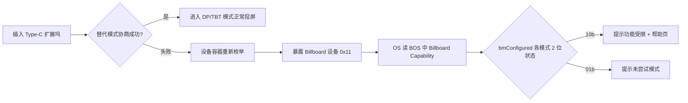

实操：失败场景下在设备管理器/`lsusb` 里看到的"新设备"往往就是 Billboard（设备级 0x11），用 `usbdev`/`lsusb -v` 展开 BOS 即可看到"线缆/设备支持哪些 Alt Mode、哪一项失败"。不少 USB3/USB4 扩展坞主控（如 TI、Realtek、Cypress/Infineon 方案）在失败时自动切换 Billboard 形象。驱动无需用户安装——各系统内置。

### 4. Personal Healthcare 0x0F（PHDC）

| 项目 | 内容 |
|---|---|
| 类代码 | bInterfaceClass 0x0F（接口级），子类/协议 0x00 |
| 定位 | PHDC（Personal Healthcare Device Class，个人健康设备类，USB-IF 1.0，2009 年）定义健康/医疗外设与主机间的数据交换框架：血压计、体重秤、血糖仪、体温计、健身传感器等 |
| 协议模型概貌 | PHDC 本身只做**传输框架**：消息按**元数据（metadata）**标注的服务质量（QoS，如"实时性/可靠性优先"）与分帧信息打包收发；应用层语义委托给 **IEEE 11073**（xHealth：11073-20601 优化交换协议 + 10101 术语/对象编码）——设备先与主机"关联"（association），再上报 MDS（Medical Device System，医疗设备系统）对象及其度量属性 |
| 描述符要点 | 接口级 0x0F/00/00 + 类功能描述符声明能力；批量端点承载数据，中断端点用于低延迟事件提示（细节见规范原文） |
| 驱动支持 | 主流桌面系统无内置驱动，多见于专用网关/嵌入式 Linux；跨平台对应物是蓝牙的 HDP 健康设备（同样基于 IEEE 11073） |
| 何时会遇到 | 拆解老的健康外设、医疗设备固件时。现状：该生态已被 **BLE GATT 健康类 profile**（Health Thermometer、Blood Pressure 等）大幅替代——BLE 免网关、直连手机，PHDC 的"USB 健康设备"路线实际采用很少 |

### 5. USB Type-C Bridge 0x12

一句话：USB-IF 定义的 **USB Type-C Bridge Device**（类代码 0x12，接口级，子类/协议 0x00），用于把两个 USB/Type-C 端口"桥"在一起的调试/互通测试类设备（如双头桥接器、端口对端口直通测试附件），规范与产品都极少见，遇到能认出即可，细节见规范原文。

### 6. I3C 设备类 0x3C（USB I3C Device Class）

| 项目 | 内容 |
|---|---|
| 类代码 | bInterfaceClass 0x3C（接口级），子类/协议 0x00 |
| 定位 | USB-IF 与 MIPI 合作推出的较新规范：把 **I3C 总线（MIPI I3C，Improved Inter-Integrated Circuit，向下兼容 I2C）隧道化（tunneling）到 USB 上**，让主机软件像操作本地总线一样访问设备侧挂接的 I3C/I2C 外设（传感器、PMIC、触控等） |
| 描述符要点 | 接口级 0x3C/00/00；总线上挂了哪些从设备、各自的动态地址与能力，通过类专属描述符/请求上报（细节见规范原文） |
| 驱动支持 | 需厂商或开源栈支持，主流系统无通用内置驱动 |
| 何时会遇到 | **调试/原型场景**为主：开发板/评估板的 USB 桥接器（把板载 I3C 传感器暴露给 PC）、协议分析仪、传感器枢纽产测工具。消费产品里几乎不会作为"用户可见类"出现 |

### 7. Physical 0x05（Physical Interface Device）

| 项目 | 内容 |
|---|---|
| 类代码 | bInterfaceClass 0x05，物理接口设备（Physical Interface Device，PID） |
| 定位 | 上世纪末（规范 1.0，1997 年）为"有物理维度的输入"设计的类：力反馈（force feedback）设备、运动/康复训练器械、3D 跟踪器等，曾配套定义了物理效果描述机制 |
| 描述符要点 | 自带一套类专属的向量/效果描述体系（细节见规范原文，且与 HID 报告并行使用） |
| 驱动支持 | 几乎无现代系统支持；生态已消亡 |
| 何时会遇到 | 现代力反馈设备实际都走 **HID**（见 [../HID-人机接口设备/08-游戏手柄与摇杆.md](12-hid-devices.md)）或厂商自定义；0x05 现在主要存在于教材与老规范引用中 |

### 8. Content Security 0x0D

一句话：**Content Security**（类代码 0x0D，接口级，子类/协议 0x00）为内容保护/数字版权管理（DRM，Digital Rights Management）委托场景定义的类，规范发布于 2000 年代初、采用极少。值得注意的是，实际落地的 USB 内容保护传输协议 **STEP**（Stream Transport Efficient Protocol for content protection）并不挂在 0x0D，而是 Miscellaneous 类下的 **EFh/06h/01h**——遇到内容保护相关枚举先查 0xEF。

### 9. 诊断与无线的长尾补充

#### 9.1 诊断设备类 0xDC（Diagnostic Device）

诊断不是 CDC 的子类，而是**独立顶级类 0xDC**，主流形态两个：

| 子类/协议 | 名称 | 用途 |
|---|---|---|
| DCh/01h/01h | USB2 Compliance Device | USB 2.0 电气一致性测试的"标准载荷"设备形态（一致性测试仪模拟的就是它） |
| DCh/02h/01h | Debug Target | xHCI **DbC（Debug Capability）**调试目标：USB3 端口级别的调试直连（如 Intel DCI 方案、内核调试器经 USB3 直连目标机） |

另有 DCh/03h~08h 预留给在 DbC/DvC 上跑的厂商追踪（trace）协议（如 Intel Trace Hub 相关），属于硅厂调试基础设施，普通产品不出现。

#### 9.2 无线控制器类 0xE0 的非蓝牙子类

0xE0 无线控制器类下除了最常见的蓝牙（E0h/01h/01h，见 [05-蓝牙控制器类-HCIoverUSB.md](19-other-classes-b.md)），还有一排"友军"：

| 子类/协议 | 名称 | 现状 |
|---|---|---|
| E0/01/02 | Ultra WideBand Radio Control（UWB 无线电控制） | 随 Certified Wireless USB 消亡 |
| E0/01/03 | RNDIS（无线承载上的 RNDIS） | 罕见组合 |
| E0/01/04 | Bluetooth AMP Controller | 蓝牙高速旁路控制器（802.11 AMP），未成气候 |
| E0/02/01~03 | Wireless USB Wire Adapter（主机/设备线适配器） | Certified Wireless USB 的"无线转 USB"适配器，已淘汰 |

#### 9.3 CDC 的无线相关子类

CDC（0x02）下除 ACM/ECM/NCM 等通信子类外，还有面向无线终端的长尾子类：**无线手持控制模型 WHCM（Wireless Handset Control Model，子类 0x08）**、设备管理（0x09）、移动直接线（0x0A）等，源自功能机时代"手机当 USB 外设"的形态；细节见 CDC 1.2 规范，现代智能机上已基本绝迹（相关 CDC 主线见 [../CDC-通信设备类/00-CDC概述.md](14-cdc.md)）。

### 10. 长尾类速查总表

| 类代码 | 名称 | 一句话用途 | 驱动现状 | 常见载体设备 |
|---|---|---|---|---|
| 0x05 | Physical Interface Device | 力反馈/运动/康复设备的物理效果描述 | 无现代驱动，已消亡 | 上古力反馈摇杆 |
| 0x0D | Content Security | DRM/内容保护委托 | 无通用驱动 | 罕见；内容保护实际多用 EFh/06h STEP |
| 0x0F | Personal Healthcare (PHDC) | 基于 IEEE 11073 的健康数据交换 | 需专用栈/网关 | 血压计、体重秤（已被 BLE 健康类大幅替代） |
| 0x10 | Audio/Video (AV) | AVControl 批量命令块管道（CBP）+ AVData 流接口，能力用 AVDD(XML) 描述 | 无主流内置驱动 | 采用率极低；音视频已由 UAC+UVC 通吃；详见 [10-AV设备类详解](19-other-classes-b.md) |
| 0x11 | Billboard | Type-C 替代模式协商失败的"告示牌" | 各系统内置 | USB-C 扩展坞/转接器（失败时枚举出） |
| 0x12 | USB Type-C Bridge | 双端口桥接的调试/互通测试附件 | 无通用驱动 | 罕见测试附件 |
| 0x13 | Bulk Display Protocol | VESA 的 USB 批量显示协议 | 需厂商驱动 | 少量便携屏/扩展方案 |
| 0x14 | MCTP over USB | DTMF MCTP 管理组件消息端点 | BMC/服务器管理栈 | 服务器管理（BMC）通道 |
| 0x3C | USB I3C Device Class | I3C/I2C 总线隧道化给主机访问 | 需厂商/开源栈 | 开发板桥接器、协议分析仪 |
| 0xDC | Diagnostic Device | USB2 一致性测试载荷；xHCI DbC 调试目标 | 测试仪/调试栈 | 一致性测试仪、DCI/DbC 调试链路 |
| 0xE0 | Wireless Controller | 无线电控制器（蓝牙只是其中之一） | 蓝牙内置；其余淘汰 | 蓝牙控制器、（历史）Wireless USB 适配器 |

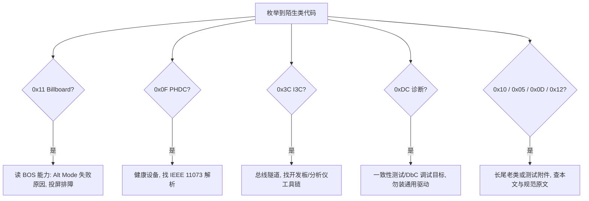

## 原文：10-AV设备类详解

> Source: [20-枝干-设备类协议/其他设备类/10-AV设备类详解.md](https://github.com/tangjianfang/USBTree/blob/main/20-枝干-设备类协议/其他设备类/10-AV设备类详解.md)

> 本文是 [09-长尾设备类速览](19-other-classes-b.md) 中"AV 设备类"一节的完整展开。
> 规范原文缓存: [../../80-参考资料/device-classes/AV-1.0.zip](https://github.com/tangjianfang/USBTree/blob/main/80-参考资料/device-classes/AV-1.0.zip)（含 AVFunction 1.0 + AVFormat 1/2/3，usb.org 公开版）、[../../80-参考资料/device-classes/AV-BDP-1.0.pdf](https://github.com/tangjianfang/USBTree/blob/main/80-参考资料/device-classes/AV-BDP-1.0.pdf)（Basic Device Profile 1.0）；提取文本 AV-1.0-AVFunction.txt / AV-BDP-1.0.txt 同目录。缓存索引: [../../80-参考资料/README.md](92-spec-references.md)
> 描述符/传输基础: [../../10-树干-USB核心/07-描述符详解.md](06-descriptors.md)、[../../10-树干-USB核心/06-四种传输类型.md](05-transfer-types-bandwidth.md)

### 1. 版本与定位：一个"生不逢时"的类

| 项目 | 内容（来源：缓存规范封面与正文） |
|---|---|
| 正式名称 | Universal Serial Bus Device Class Definition for Audio/Video Devices |
| 公开版本 | **Release 1.0，2011-12-07**（usb.org 文档库当前公开下载的即此版；常被引用的 "1.01" 修订未在公开库出现——见规范原文未缓存部分，建议补） |
| 出身 | 扉页注明"Developed pursuant to USB-IF IP agreement for **Video Display** and subsequently renamed"——由 Video Display 工作组规范改名而来；编辑 Geert Knapen（MCCI），参与者含 DisplayLink、Intel、AMD、Dolby、Broadcom、Cypress 等 |
| 配套文档 | AVFunction 1.0（主体）+ AVFormat 1（Video over Bulk）/ AVFormat 2（Isochronous Audio）/ AVFormat 3（Isochronous Video）+ Video & USB Timings（xlsx）+ BDP 1.0（2012-06-12） |
| 类代码 | **0x10**（接口级；USB-IF Defined Class Codes 列为 "Audio/Video"，用法注明 Video Devices） |
| 命运 | 无主流 OS 内置驱动、无消费级采用，音视频外设市场被 UAC + UVC 组合通吃（见第 8 节对比），可视为"标准化的失败尝试" |

**一个需要纠正的常见误解**：包括本文上游 [09 篇](19-other-classes-b.md)在内的不少资料把 0x10 描述为"承载 IEEE 1394 的 AVC（AV/C）命令集"。但**公开的 1.0 版规范全文没有任何 AVC 命令集内容**（全文检索无 "AVC" 字样）——它是一套自研的控制模型：批量端点承载 Command/Response/Notify 消息 + XML 描述文档（下文详述）。若早期草案曾借用过 AV/C，那也只存在于未公开的历史版本中（见规范原文未缓存，建议补早期草案对照）。

### 2. 架构总览：AVFunction = 控制面 + 数据面

规范的核心抽象是 **AVFunction**（音视频功能）：**必须且只需暴露 1 个 AVControl 接口**（合规底线），可选挂 0~n 个 AVData 流接口。多个接口用 **IAD（接口关联描述符）** 绑成一个功能，IAD 的 Function Class 码 = AV 接口类码 0x10，Function Subclass/Protocol 均为 0x00（AVFunction 1.0 §7.1.1）。

角色模型：USB 主机一侧叫 **Controller**（控制者），设备一侧叫 **Controllee**（被控者）；流动的媒体数据叫 **AVStream**。

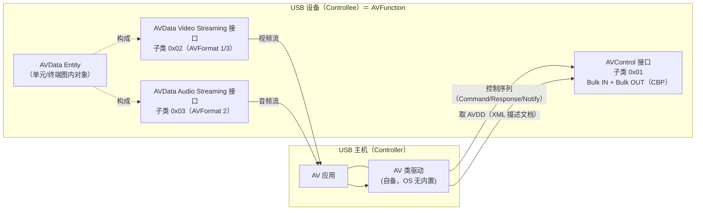

### 3. 类码/子类/协议编码表（核实自规范附录 A）

| 字段 | 编码 | 名称 | 出处 |
|---|---|---|---|
| bInterfaceClass | 0x10 | AV（"assigned by USB"） | 附录 A.4 Table A-4 |
| bInterfaceSubClass | 0x00 | INTERFACE_SUBCLASS_UNDEFINED | 附录 A.5 Table A-5 |
| bInterfaceSubClass | **0x01** | **AVCONTROL**（控制接口） | 同上 |
| bInterfaceSubClass | **0x02** | **AVDATA_VIDEO_STREAMING** | 同上 |
| bInterfaceSubClass | **0x03** | **AVDATA_AUDIO_STREAMING** | 同上 |
| bInterfaceProtocol | 0x00 | INTERFACE_PROTOCOL_UNDEFINED | 附录 A.6 Table A-6 |
| bInterfaceProtocol | **0x10** | **IP_VERSION_01_00**（规范版本 1.0） | 同上 |
| IAD bFunctionClass | 0x10 | AV_FUNCTION（=AV 接口类码） | 附录 A.1 Table A-1 |
| IAD bFunctionSubClass / Protocol | 0x00 | 未用，填 UNDEFINED | 附录 A.2/A.3 |

> 规范自身的"褶皱"：BDP 1.0 附录的示例描述符里，AVControl 接口（Alt 0/1）却填了 SubClass 0x00、Protocol 0x00（AV-BDP-1.0.pdf §4.2.1.3.2）——与 AVFunction 附录编码不自洽。工程上以附录 A 的编码表为准，抓包遇到 0x10/0x00/0x00 也别急着否定是 AV 类。

### 4. AVControl 接口与 Control Bulk Pair（CBP）

与 UAC/UVC"类请求走端点 0 + 中断端点上报"的套路不同，AV 类的**所有类专属控制交互都走一对批量端点**（AVFunction 1.0 §7.2）：

- 端点 0（默认管道）：只处理标准请求（Set Interface 等 USB 通用事务）；
- **CBP（Control Bulk Pair）**：1 个 Bulk OUT + 1 个 Bulk IN，存在于 AVControl 接口的每个 Active Alternate Setting；Command/Response/Notify 消息、以及 AVDD 描述文档的取回，全部走这对管道。

Alternate Setting 语义（§7.2）：**Alt 0 = 整个 AVFunction 关闭态**（所有 AVData 接口同步回 Alt 0，可进低功耗）；至少还需一个 Active Alt 1。选择 Active Alt 时功能复位重启。

#### 4.1 四种消息与传输规则

| 消息 | 方向 | 用途 |
|---|---|---|
| Command | Controller → Controllee | 执行一次 SETR/SET/GET 请求（§9.3.1） |
| Response | Controllee → Controller | 对 Command 的应答（成功结果或 Error Response，§9.3.2） |
| Notify | Controllee → Controller | 设备主动通知（如控制值变化），承载 NOTIF 请求码（§9.3.3） |
| Null | 双向 | 无内容的填充消息，用于凑齐短包结束传输（§9.3.4） |

传输规则（§7.3）：消息按 **32 字节粒度（AV_MESSAGE_GRANULARITY）** 对齐拼接，可多条消息合并进一次批量传输；每次传输必须以短包收尾——若恰好填满 wMaxPacketSize，则补一条 Null 消息制造短包。高速下无额外流控；SuperSpeed 下用标准 NRDY-ERDY（§7.3.1）。

#### 4.2 消息头与寻址字段（16 字节定长头，AV_MESSAGE_INVAR_SIZE）

| 字段 | 含义 |
|---|---|
| EID | EntityID：目标实体（终端/单元/AVData 实体）编号，未知 EID → Error Response |
| TYPE | 请求类型：SETR=0b0001、SET=0b0010、GET=0b0011、NOTIF=0b0100（附录 A.9） |
| PROP | 属性码：CUR=0b0001（当前值）、NEXT=0b0010（链表遍历下一项）（附录 A.10） |
| V | 0=类专属消息，1=厂商自定义消息（§9.3.6） |
| CS | Control Selector：控件类型（附录 A.11，随实体类型而异） |
| IPN / ICN / OCN | 输入引脚号 / 输入通道号 / 输出通道号（Master 通道为 0），无关字段清零 |
| DATALEN | 变长参数块长度；总长 = 16 + DATALEN，再按 32 字节粒度补齐（§9.3） |

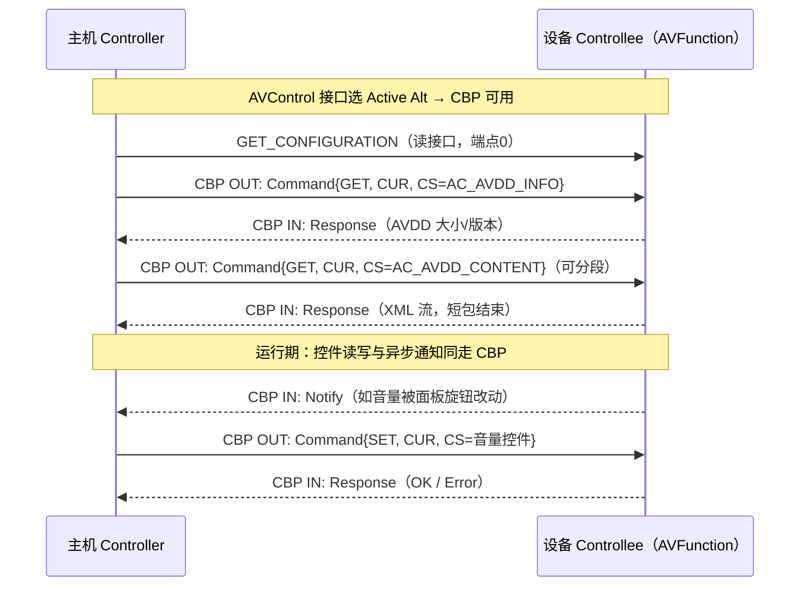

### 5. AVDD（XML 描述文档）与 Legacy View 描述符

AV 类的"自描述"有两条并行路径（§8）：

1. **AVDD（AV Description Document）**：一个 XML 文档，完整描述 AVFunction 的所有类专属能力；模式定义公开在 `avschemas.usb.org/v1/avschema.xsd`（规范引用 [AVSCHEMA]）。主机经 CBP 用 AVControl 接口控件 **AC_AVDD_INFO（0x0001）** 询问大小/版本、**AC_AVDD_CONTENT（0x0002）** 分段取回；**AC_COMMIT（0x0003）** 提交配置。另有 AC_POWER_LINE_FREQ（0x0004）、AC_REMOTE_ONLY（0x0005）。
2. **Legacy View 描述符**：把同样的信息塞回传统配置描述符层级（为不解析 XML 的老式主机准备），类专属描述符类型码（附录 A.13.1 Table A-18）：

| 类型码 | 名称 | 作用（正文 §8.4） |
|---|---|---|
| 0x21 | AVCONTROL_IF | AVControl 接口描述符，4 字节，仅 bcdAVFunction（规范版本 BCD） |
| 0x22 | TERMINAL | 终端描述符，10 字节：wTerminalType（INPUT 0x0001/OUTPUT 0x0002）、wEntityID、wAssocEntityID、wSourceID |
| 0x23 | UNIT | 单元描述符，10 字节：wUnitType、wEntityID、wSourceID1/2（Legacy View 最多暴露 2 个输入引脚） |
| 0x24 | AVDATA | AVData 实体描述符 |
| 0x25 | AVCONTROL | 控件描述符：wControlSelector + wRWN（CUR 权限 R/RW/W + NEXT 实现位） |
| 0x26 | RANGES | 取值范围（RANGE 区间 / VALUELIST 枚举两种） |
| 0x27 / 0x28 / 0x29 | VIDEOBULK / VIDEOISO / AUDIOISO | 三种流接口的载荷描述（对应 AVFormat 1/3/2） |

### 6. 单元/终端模型：与 UAC 的异同

AV 类的拓扑语义明显"师承" UAC1 的 Unit/Terminal 模型（同一批编辑者），但重新洗了牌：

| 对比项 | UAC 1.0（Audio 类） | AV 类 1.0 |
|---|---|---|
| 顶层抽象 | Audio Function → 控制接口 + 流接口 | AVFunction → AVControl 接口 + AVData 接口 |
| 实体类型 | Terminal（In/Out）+ Unit：Mixer/Selector/Feature/Effect/Processing/Extension | Terminal（INPUT 0x0001/OUTPUT 0x0002）+ Unit：Mixer(1)/Selector(2)/Feature(3)/**Effect(4)/Processing(5)/Converter(6)/Router(7)**（附录 A.13.3；把 UAC 的 Extension 换成了 Converter/Router，Router 负责视频/音轨/元数据轨选择——RU_VIDEOTRACK_SELECTOR 等，附录 A.11.10） |
| 控制寻址 | 实体 ID + 控制通道 + 接口号 | EID + IPN/ICN/OCN + CS，再加 CUR/NEXT 属性 |
| 描述 | 静态类描述符（u16 字段） | XML（AVDD）为第一等公民，Legacy View 为兼容层 |
| 控制通道 | 控制端点 0（类请求）+ 中断 IN | **批量端点对 CBP**（无中断通道） |
| 时钟/同步 | Clock Source/Entity（UAC2 起独立实体） | AVData 控件 AD_REFERENCE_CLOCK / AD_CLOCK_CONNECTOR / AD_CLOCK_VALID（附录 A.11.11） |
| 视频语义 | 无 | 全面覆盖：AD_EDID、AD_CEC_READ/WRITE（HDMI CEC 隧道）、AD_CONNECTOR、AD_TUNNEL、AD_STREAM_SELECTOR 等 |

音频终端类型概念也与 UAC 互通（附录 B 的 Audio Types：MICROPHONE/SPEAKER/HEADPHONES/HANDSET/HEADSET/SPEAKERPHONE…，MIC_ARRAY、EC_SPEAKERPHONE 等回声消除形态一应俱全）。

#### 6.1 控件选择子速查（附录 A.11 核实值节选）

控件（AVControl）挂在"实体+输入引脚+通道"上，选择子按实体类型分族：

| 实体族 | 选择子（值） | 语义 |
|---|---|---|
| AVControl 接口 | AC_AVDD_INFO(0x0001)、AC_AVDD_CONTENT(0x0002)、AC_COMMIT(0x0003)、AC_POWER_LINE_FREQ(0x0004)、AC_REMOTE_ONLY(0x0005) | XML 文档取回/提交、电源频纹抑制、"仅遥控"开关 |
| Terminal | TE_CONTROL_UNDEFINED(0x0000)、TE_CLUSTER(0x0001) | 端子簇（多端子编组） |
| Router 单元 | RU_VIDEOTRACK/AUDIOTRACK/METADATATRACK_SELECTOR(0x0001~3)、RU_VIDEO/AUDIO/METADATA_INPUT_PIN_SELECTOR(0x0004~6)、RU_CLUSTER(0x0007) | 节目轨/输入源路由——机顶盒类设备的"换台换源" |
| AVData 实体 | AD_CONNECTOR(0x0001)、AD_OVERLOAD(0x0002)、AD_ACT_ALT_SETTING(0x0003)、AD_TUNNEL(0x0004)、AD_AUDIO_LANGUAGE(0x0005)、AD_CEC_WRITE/WRITE_STATUS/READ(0x0006~8)、AD_SOURCEDATA/SINKDATA(0x0009/A)、AD_STREAM_SELECTOR(0x000B)、AD_EDID(0x000C)、AD_REFERENCE_CLOCK/CLOCK_CONNECTOR/CLOCK_VALID(0x000D~F)、AD_PITCH(0x0010) | 连接器管理、HDMI-CEC 隧道、EDID 读写、参考时钟、变速（pitch） |

Mixer/Selector/Feature/Converter 单元各有专属选择子（MU_*/SU_*/FU_*/CU_*，如 CU_AUDIO_MODE_SELECTOR=0x0004），完整表见规范附录 A.11——本表只收全值核实过的族。

### 7. AVData 实体与三种 AVFormat

**AVData Entity** 是流的功能语义标签（附录 B 摘录）：

| 类别 | 标识符举例 |
|---|---|
| 视频 | GENERIC、CAMERA、WEBCAM、PC_MONITOR、TV_MONITOR、IN_CAR_DISPLAY、COMPOSITE/S_VIDEO/COMPONENT、DP、DVI、VGA、HDMI-IN、TV_TUNER、SAT/CABLE/DSS_TUNER、RECORDER、DVD、BLURAY |
| 音频 | GENERIC、MICROPHONE、DESKTOP_MIC、PERSONAL_MIC、OMNIDIRECTIONAL_MIC、MIC_ARRAY、SPEAKER、DESKTOP/PERSONAL/ROOM_SPEAKER、LFE_SPEAKER、HEADPHONES、HANDSET、HEADSET、SPEAKERPHONE |

三种载荷格式（各自独立成册）：

| 文档 | 传输 | 内容要点 |
|---|---|---|
| AVFormat 1：Video over Bulk | 批量 OUT/IN | 未压缩 VideoSample（RGB565/RGB888/RGB8888/IYU2/YUY2 等，§3.3）+ 压缩 NAL 单元载荷（§3.8.3）；无带宽保证，靠 USB 3.0 吞吐 |
| AVFormat 2：Isochronous Audio | 等时 | 音频样本流 |
| AVFormat 3：Isochronous Video | 等时 | **仅未压缩**视频样本（§"exclusively addresses VideoStreams … uncompressed VideoSamples"），引用 HDMI 与 CEA 时序（720x480p 等逐行格式表） |

**典型拓扑场景**：一台带 USB Device 口的电视/显示器/机顶盒类设备，向主机（Controller）暴露：Input Terminal（HDMI-IN，AD_EDID 控件让主机改写 EDID）→ Router（选 HDMI/调谐器/文件播放源）→ Converter/Feature（缩放、亮度）→ AVData HDMI-Out/Video Streaming-Out 实体 → 等时/批量流接口把像素流送进主机；音频并行走 Audio Streaming 实体。**BDP（Basic Device Profile 1.0，2012-06-12）** 就是给这类设备定的最小档：适用对象明确列举为"能经 USB 或 HDMI 等外部接口交换音视频内容的设备，典型如 PC 显示器、带 USB Device 能力的电视机、带麦克风的一体化摄像头、带 USB Device 能力的手机"，并规定 Mixer 单元、AVData Generic-Out/HDMI-Out 实体等必备对象（BDP §1.1、§3.2）。

### 8. 与"UAC + UVC 组合"对比：为什么 AV 类输了

| 维度 | AV 类 0x10 | UAC（0x01）+ UVC（0x0E）组合 |
|---|---|---|
| 发布时间 | 2011（BDP 2012）——USB 3.0 时代才来 | UAC 1998 / UVC 2003——早了近十年，生态已成 |
| OS 内置驱动 | 无（见第 9 节） | Windows/macOS/Linux 全内置，即插即用 |
| 复杂度 | AVDD XML + CBP 消息 + 双册规范 + BDP，实现门槛高 | 各自独立、结构扁平，固件实现成熟 |
| 音视频统一拓扑 | 强项：跨音视频的路由/缩放/CEC/EDID 统一建模 | 短板：音频视频两套模型，靠应用层缝合 |
| 视频传输 | AVFormat 1 批量（无 QoS）/ AVFormat 3 **仅未压缩**等时，带宽压力巨大 | UVC 等时+批量并重，H.264 等压缩格式从 1.1 起原生支持 |
| 带宽定位 | 未压缩 1080p 逼着用户上 USB 3.0 | 压缩流 USB 2.0 即可 |
| 结局 | 无消费产品采用，仅活在规范与论文里 | 摄像头/声卡事实标准 |

一句话：AV 类想一步到位做"USB 上的 HDMI"（含路由、CEC、EDID、显示拓扑），赌注压在未压缩流与 XML 自描述上；市场却用"UVC 摄像头 + UAC 声卡"这个更土但更简单的组合投了票。它留下的唯一"遗产"是枚举表里的 0x10。

### 9. 驱动与调试现状

| 系统 | 现状（核实来源） |
|---|---|
| Windows | 微软官方"Windows 内置 USB 类驱动"表（learn.microsoft.com，USB device classes）中 **Audio/Video Devices (10h) 一行完全空白**——连"推荐 WinUSB"的待遇都没有（对比 0x05/0x0F/0xDC 等类均有 WinUSB 推荐）。要驱动它只能自写驱动，或手工给接口绑 Winusb.sys 再按规范实现 CBP 消息机 |
| Linux | 内核无 AV 类驱动（drivers/usb/class 无对应条目）；libusb 用户态可枚举与绑定 |
| macOS | 无内置驱动（公开系统信息，未缓存，建议补版本对照） |

调试提示：

- `lsusb -v` / Usbview 认接口：IAD 类 0x10 + 接口 0x10/0x01（或 0x00/0x00，见第 3 节"B褶皱"）即 AVFunction；
- 类描述符里 0x21~0x29 类型码是强特征（与 CDC/HID 的同名类型码值域不同，别按通用表硬解）；
- CBP 上的 Command/Response 可直接当批量流抓包分析，消息头 16 字节定长，TYPE/PROP 位段见第 4.2 节；
- 若目标只是"识别"，读到 bInterfaceClass=0x10 即可下结论：老设备或特殊定制，正牌音视频走 UAC/UVC。

## 原文：11-PHDC健康医疗类

> Source: [20-枝干-设备类协议/其他设备类/11-PHDC健康医疗类.md](https://github.com/tangjianfang/USBTree/blob/main/20-枝干-设备类协议/其他设备类/11-PHDC健康医疗类.md)

> 本文是 [09-长尾设备类速览](19-other-classes-b.md) 中"Personal Healthcare"一节的完整展开。
> 规范原文缓存: [../../80-参考资料/device-classes/PHDC-1.0.zip](https://github.com/tangjianfang/USBTree/blob/main/80-参考资料/device-classes/PHDC-1.0.zip)（PHDC 1.0 + 2008-02-15 Errata，usb.org 公开版）；提取文本 PHDC-1.0.txt / PHDC-1.0-errata.txt 同目录。缓存索引: [../../80-参考资料/README.md](92-spec-references.md)
> 传输基础: [../../10-树干-USB核心/06-四种传输类型.md](05-transfer-types-bandwidth.md)、[../../10-树干-USB核心/08-枚举流程与标准请求.md](07-enumeration-requests.md)

### 1. 定位与版本：给健康外设一根"标准 USB 线"

| 项目 | 内容（来源：缓存规范封面/正文，另注者除外） |
|---|---|
| 正式名称 | USB Device Class Definition for Personal Healthcare Devices |
| 版本 | **Release 1.0，2007-11-08**；Errata 2008-02-15（修正 Get Data Status 的 wLength=2、FEATURE_PHDC_METADATA 命名） |
| 类代码 | **0x0F**——`bInterfaceClass` 或 `bDeviceClass` **二选一必须**填 0x0F；子类/协议均为 0x00（不分子类）（规范 §5.1.1/§5.1.3） |
| 目标设备 | 血压计、血糖仪、体重秤、体温计、脉搏血氧仪、心率带、健身手表、动感单车、运动/跌倒传感器、药盒（pill monitor）等 |
| 核心思想 | PHDC 只做**传输框架**（透明搬运"消息帧 + 元数据"），医疗语义全部委托给 **ISO/IEEE 11073** 家族（20601 优化交换协议 + 10101 术语编码）——"有线 USB 版的 Continua 健康网关" |

规范 §2.1 把用例归入三大主题：

| 主题 | 场景举例 |
|---|---|
| Health & Wellness（健康健身） | 运动手表/心率带/健身车数据传 PC，转教练或社区 |
| Disease Management（慢病管理） | 血压计/血糖仪/体重秤/血氧仪 → PC 或健康终端 → 上传医疗机构 |
| Aging Independently（独立养老） | 运动传感器、药盒等日常生活监测 → 上传护理方/家人 |

数据到达主机的三种形态（§3.1）：**发作式**（踩一次体重秤传一次，甚至传完即断开）、**存储转发**（运动手表回家插 PC 批量上传）、**连续流**（血氧仪夹着手指持续监测）。

### 2. 架构：分层与"不解释数据"

PHDC 刻意保持在传输层，对载荷**完全透明**：应用层把消息打成 **APDU（应用协议数据单元，≤ 63KB）** 交给 PHDC，附带元数据（QoS 等）；PHDC 负责选端点、排队、分帧（§4.1/§4.2）。安全性依赖有线的物理安全，规范不定义加密。

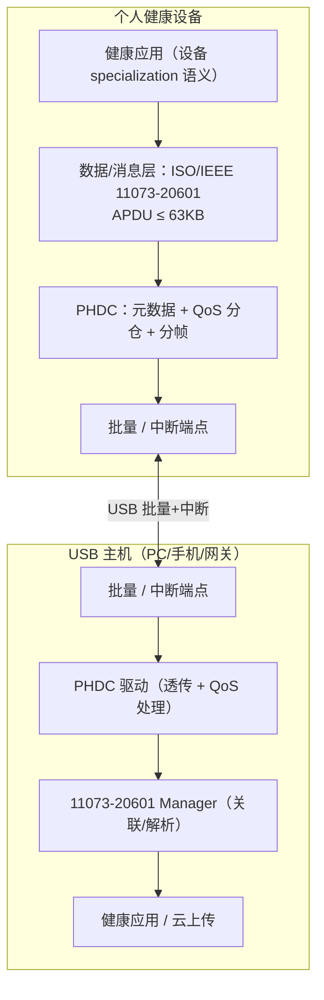

一台设备有**多个健康功能**（如血压+心率）时的两种组织方式（§5.1.3，必须二选一）：① **多接口**——每个功能一个 0x0F 接口，各自带端点；② **组合设备**——单接口承载多功能，由数据/消息层在同一信道内区分（11073 场景即靠 specialization 编码列表声明）。

### 3. QoS 六仓：PHDC 的灵魂

规范分析用例后归纳出六种"延迟×可靠性"组合（QoS Bins，§3.2/§4.2 Table 4），并映射到 USB 端点类型——这是整个类唯一"聪明"的地方：

| QoS Bin | 延迟上限 | 可靠性 | 典型载荷 | 端点映射 |
|---|---|---|---|---|
| Low.Good | < 20 ms | Good | 连续生理流（心电/血氧原始波形） | **中断端点**（仅允许此仓） |
| Medium.Good | < 200 ms | Good | 设备状态/告警 | 批量 |
| Medium.Better | < 200 ms | Better | | 批量 |
| Medium.Best | < 200 ms | Best | | 批量 |
| High.Best | < 2 s | Best | 配置/查询 | 批量 |
| VeryHigh.Best | < 20 s | Best | 存储转发的大块历史数据 | 批量 |

原始数据率范围约 50 bit/s ~ 1.2 Mbit/s、模拟采样周期 1~50 ms（Table 4）——所以 USB 批量/中断完全够用，不需要等时传输。

### 4. 描述符链（核实自规范 §5.2、§8 Table 15~17）

类专属描述符类型码：**CLASSFUNCTION=0x20、QOS=0x21、METADATA=0x22**。

| 描述符 | 位置 | 关键字段 |
|---|---|---|
| PHDC Class Function（0x20） | 跟在其所属接口描述符后 | `bPHDCDataCode`：**0x01=PHDC_VENDOR**（厂商自定义格式）、**0x02=PHDC_11073_20601**（ISO/IEEE 11073-20601 优化交换协议）；`bmCapability` bit0 = 是否实现 Meta-Data Message Preamble 特性 |
| Function Extension（0x20 系） | Class Function 之后、端点之前 | 按数据/消息标准分别定义；11073 场景即下述 11073 PHD Function Extension |
| PHDC QoS（0x21） | **每个端点描述符之后各跟一个** | `bQoSEncodingVersion`=01h；`bmLatencyReliability` 位图 bit0~bit5 对应上表六仓：批量端点可按支持的组合置多位置 1，**中断端点只能置 bit0**（规范 §5.2.3 + Table 9） |
| PHDC Meta-Data（0x22） | 可选，跟在 QoS 描述符后 | 枚举期一次性下发"静态元数据"，内容由厂商定义（规范不规定格式） |
| 11073 PHD Function Extension | 实现 11073 扩展的设备必备 | `bNumDevSpecs` + `wDevSpecializations[]`（**小端 16 位**设备 specialization 码，取自 ISO/IEEE 11073-10101 术语 MDC_PART_INFRA 的设备 specialization 段；不支持任何 specialization 则填 0）——主机据此识别"这是血压计还是体重秤" |

**11073 设备 specialization 编码概貌**（取值见于 Continua/11073-10101 公开资料；规范正文只给出取码规则，数值本身以 11073-10101/20601 命名法附录为最终依据——见规范）：

| 设备 | 码（16 位） |
|---|---|
| 血压计（BP meter） | 0x3060 |
| 体温计（thermometer） | 0x30A4 |
| 体重秤（weighing scale） | 0x30DF |

血糖仪、脉搏血氧仪、心率传感器等同样有对应 specialization 码（数值未逐一核实，见规范 11073-10101），描述符支持一接口声明多个（bNumDevSpecs > 1）。

#### 4.1 配置描述符骨架（11073 体重秤单接口为例）

```text
设备描述符        bDeviceClass=0x0F（或留 00，改在接口级声明）
└─ 配置描述符
   └─ 接口描述符  bInterfaceClass=0x0F, SubClass=0x00, Protocol=0x00
      ├─ PHDC Class Function 描述符 (0x20)
      │    bPHDCDataCode=02h (PHDC_11073_20601)
      │    bmCapability.bit0=1  → 支持元数据前导
      ├─ 11073 PHD Function Extension 描述符
      │    bNumDevSpecs=1, wDevSpecializations=0x30DF (体重秤)
      ├─ 批量 IN 端点描述符
      │  └─ PHDC QoS 描述符 (0x21)   bmLatencyReliability=bit4(High.Best)…
      │     └─ （可选）PHDC Meta-Data 描述符 (0x22)
      ├─ 批量 OUT 端点描述符
      │  └─ PHDC QoS 描述符 (0x21)
      └─ （可选）中断 IN 端点描述符
         └─ PHDC QoS 描述符 (0x21)  仅 bit0 (Low.Good)
```

#### 4.2 主机如何确定一条流的真实 QoS（规范 Figure 10 的文字化）

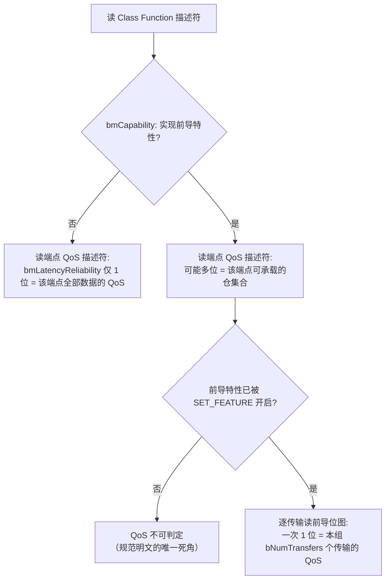

### 5. 消息模型：元数据前导 + 两个类请求

#### 5.1 Meta-Data Message Preamble（元数据消息前导）

把"每个 USB 传输的 QoS 语义"内嵌进数据流的机制（§5.2.4/§6）。特性初始**关闭**，由主机用类请求开启；开启后，**每个新的传输组之前必须先发一个前导包**：

| 偏移 | 字段 | 内容 |
|---|---|---|
| 0 | aSignature（16B） | 常量字符串 **"PhdcQoSSignature"**（防伪验签） |
| 16 | bNumTransfers | 本前导之后跟随的数据传输个数（回放历史数据时可填大值提效；不得为 0） |
| 17 | bQoSEncodingVersion | 01h |
| 18 | bmLatencyReliability | 六仓位图，**一次只允许置 1 位** |
| 19 | bOpaqueDataSize + bOpaqueData | 0~（MaxPacket−21）字节的不透明元数据 |

错误处理（§6.3）：期望前导而未收到、或位图非法 → 设备 STALL 端点 / 主机 SET_FEATURE ENDPOINT_HALT，随后主机 CLEAR_FEATURE，双方重新同步前导。

#### 5.2 类专属请求（§7）

| 请求 | 编码 | 作用 |
|---|---|---|
| SET_FEATURE / CLEAR_FEATURE（扩展） | feature 值 **FEATURE_PHDC_METADATA = 0x01**（Errata 更名，原误作 FEATURE_PHDC_QOS） | 开/关前导特性；wIndex=目标接口。发起前应先确认设备无挂起传输 |
| GET_STATUS（扩展为 Get Data Status） | bRequest=0x00，bmRequestType=10100001B（接口收方），wLength=2 | 返回 16 位**端点数据位图**：bit n=1 表示端点 n 有数据待收（EP0 不跟踪）——主机可据此"免轮询"地知道该读谁（Errata 明确 wLength 非 2 行为未定义） |

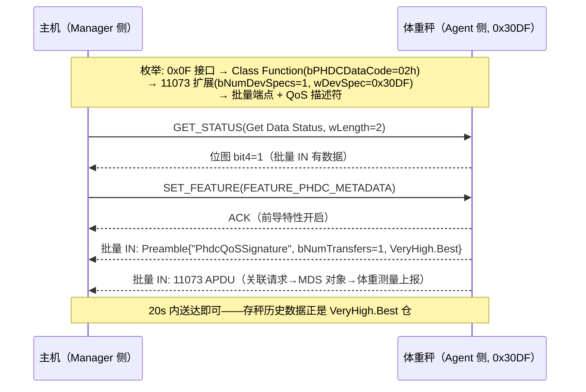

### 6. 与 IEEE 11073-20601 的分工，及 BLE 健康服务的替代关系

11073-20601 定义设备与主机（**Agent/Manager**）间的"关联建立 → MDS（Medical Device System）对象上报 → 测量事件"语义，本身体积优化过（专为低功耗网关设计）；PHDC 把它的 APDU 原样搬过 USB。同一套 11073 语义也被蓝牙 **HDP**（经典蓝牙 Health Device Profile）承载——三者是"同一数据、三种管道"。

而消费市场最终选择的却是第四条路：**BLE GATT 健康服务**——把 11073-20601 的数据模型（浮点/SFLOAT 格式沿用）拆进各个 GATT Service，手机直连免网关。替代关系一览：

| 健康设备 | USB PHDC 路线 | BLE GATT 路线（现行主流） |
|---|---|---|
| 体温计 | 0x0F + 11073（specialization 0x30A4） | **Health Thermometer Service**（0x1809，Temperature Measurement 特征） |
| 血压计 | 0x0F + 11073（0x3060） | **Blood Pressure Service**（0x1810，含 Feature/Measurement） |
| 体重秤 | 0x0F + 11073（0x30DF） | **Weight Scale Service**（0x181D） |
| 血氧仪 | 0x0F + 11073 | **Pulse Oximeter Service（PLX，0x1822）** |
| 心率带 | 0x0F + 11073 | **Heart Rate Service**（0x180D） |
| 血糖仪 | 0x0F + 11073 | Glucose Service（0x1808）+ Record Access |

BLE 路线胜出的原因与 USB 拓扑无关而与生态有关：免网关直连手机、功耗低、iOS/Android 原生支持（服务细节见 [../../50-枝干-无线关联/BLE-低功耗蓝牙/04-ATT与GATT.md](61-ble-core.md)）。PHDC 的"USB 健康外设"路线实际采用很少，多见于：医疗级设备经网关/底座上传、把测量数据导入 PC 的专用仪器、嵌入式教学/研究项目。

#### 6.1 一台 PHDC 设备上电后发生了什么（11073 视角速览）

以血压计插入 PC 为例，USB 层之下还有一层 11073-20601 的"业务建立"（语义细节见规范/11073-20601，此处给工程概貌）：

1. 主机读描述符确认 0x0F + PHDC_11073_20601 + specialization 0x3060 → 加载/唤起对应"血压计 Manager"；
2. Agent（血压计）发出**关联请求**（Association Request，含本机配置列表）；Manager 校验后回**关联响应**（接受/拒绝/转研发送）；
3. Manager 读 Agent 的 **MDS 对象**属性（系统类型、电源状态、时钟、配置对象）；
4. 测量发生时，Agent 以事件报告（含时间戳、SFLOAT/INT 编码的收缩压/舒张压/脉率）上送，经 PHDC 批量端点出线；
5. 断开时走**解除关联**；若前导特性开启，PHDC 层还要按 QoS 仓打包上述 APDU。

这五步在 BLE 健康服务里被拆成 GATT 连接 + 特征值通知，语义同源——所以两者间做网关（如"血压计 USB → 手机 BLE"桥）时协议转换几乎无损，这正是当年 Continua 的设计意图。

### 7. OS 驱动与生态现状（如实描述"小众"）

| 环节 | 现状（来源标注） |
|---|---|
| Windows | **无专属类驱动**；微软官方内置驱动表对 Personal Healthcare (0Fh) 的建议是通用 **WinUSB（Winusb.sys）**。UWP 提供 `Windows.Devices.Usb.UsbDeviceClasses.PersonalHealthcare` 类，应用可直接经 WinUSB 与 0x0F 设备通信（learn.microsoft.com）。历史坑：Win 8.1/Server 2012 R2 曾因 0x0F 与 SuperSpeed 端点伴随描述符冲突导致无法枚举（微软 KB 修复） |
| Linux | **主线上无 PHDC 类驱动**（drivers/usb/class 无条目）；libusb 用户态访问是常态 |
| 设备侧协议栈 | 嵌入式厂商栈活跃过一阵：NXP/MCU（原 Freescale）USB 栈、TI MSP430 USB API、Micrium µC/USB-Device、Weston Embedded Cs/USB 等都带 PHDC 组件（各厂商公开文档） |
| 一致性 | ITU-T H.810 系列（个人健康系统接口）与 H.840（USB 主机侧一致性）引用 PHDC 1.0 + 11073-20601 作规范性参考（itu.int 公开目录） |
| 市场结局 | 未等到规模化即被 BLE 健康服务 + Wi-Fi/云直连绕过；今天拆到 0x0F 设备，多半是 2010 前后的 Continua 试点产品或医疗专用网关 |

### 8. 调试建议

1. **枚举识别**：`lsusb -v` / Usbview 中看到 bInterfaceClass=0x0F（或设备级 0x0F），先读它后面的 0x20 类功能描述符——`bPHDCDataCode=02h` 即 11073 设备；再数 11073 扩展描述符里的 specialization 码，可直接判设备类型（0x3060 血压计…）。
2. **QoS 校验**：每个端点描述符后应紧跟 0x21 QoS 描述符；中断端点只允许 bit0。位图乱填是常见固件 bug，主机行为即未定义。
3. **抓包**：通用 USB 分析仪均可；载荷即 11073-20601 APDU，配合开源 11073-20601 解析库（或按 MDER 编码规则手解）可还原测量值。前导特性开启后，先定位 "PhdcQoSSignature" 字符串再切分消息。
4. **驱动绑定**：Windows 下无类驱动是"正常现象"，手工绑 Winusb.sys / 用 UWP PersonalHealthcare 类即可开始通信；Linux 下 libusb claim 接口。
5. **一致性参照**：ITU-T H.840 免费公开了 USB 主机侧行为的验收思路，比啃 USB-IF 原始规范更快入门。
