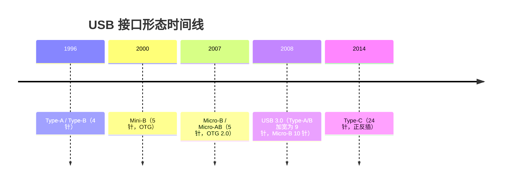
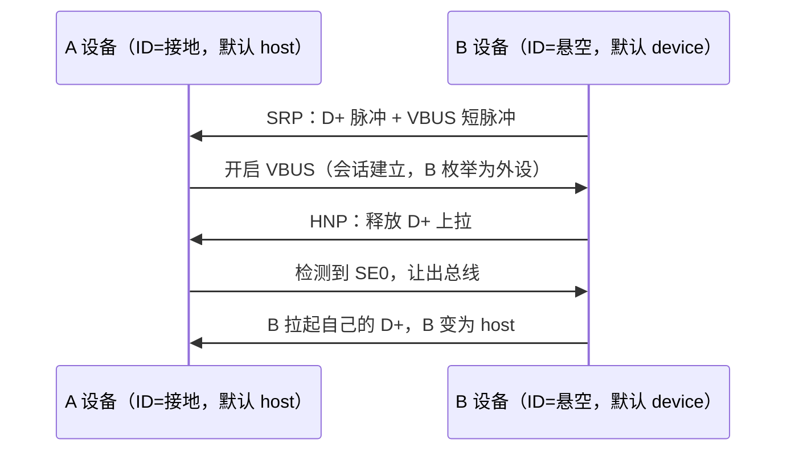
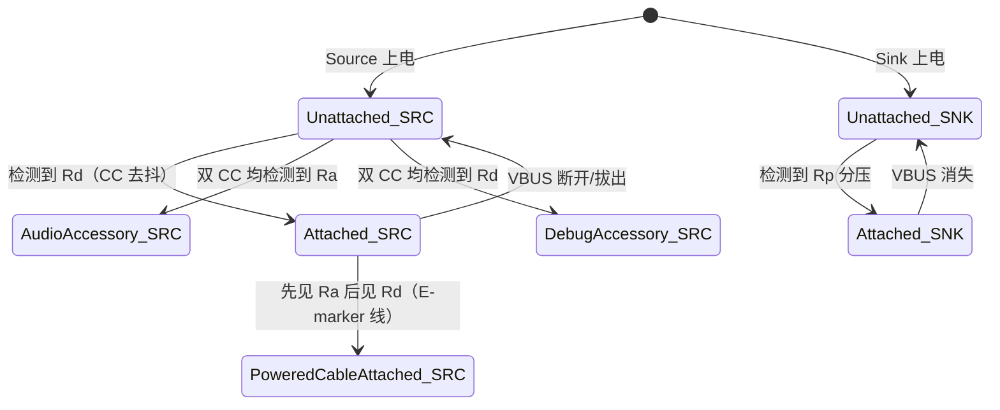
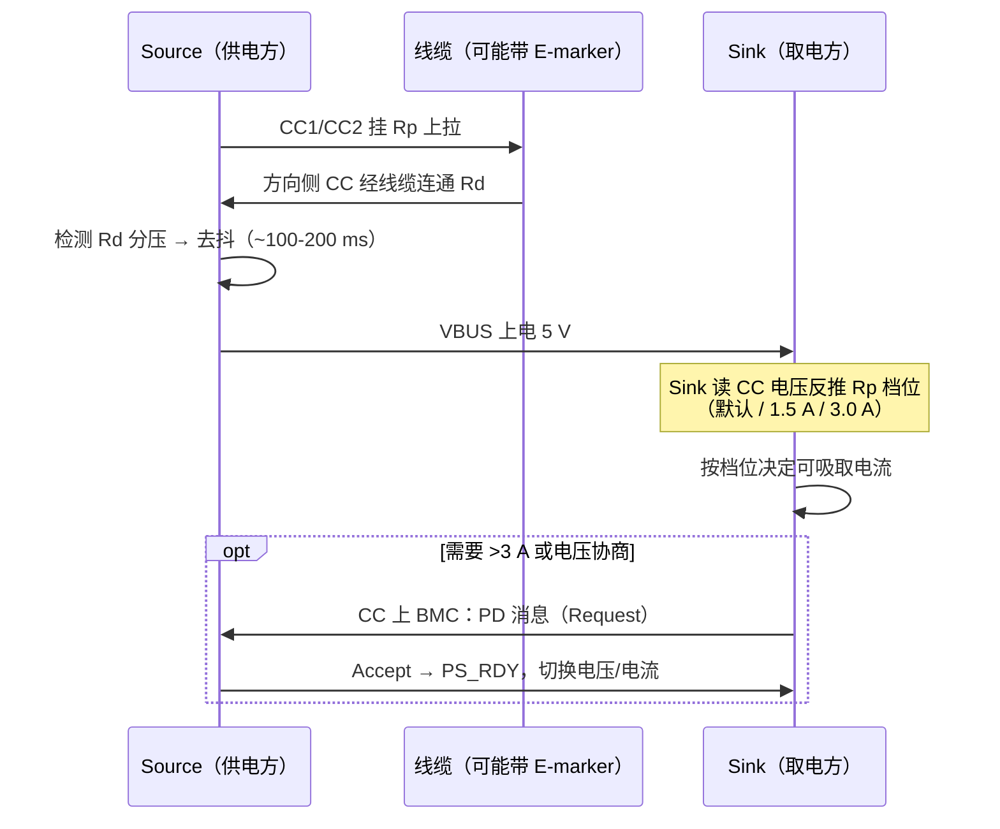
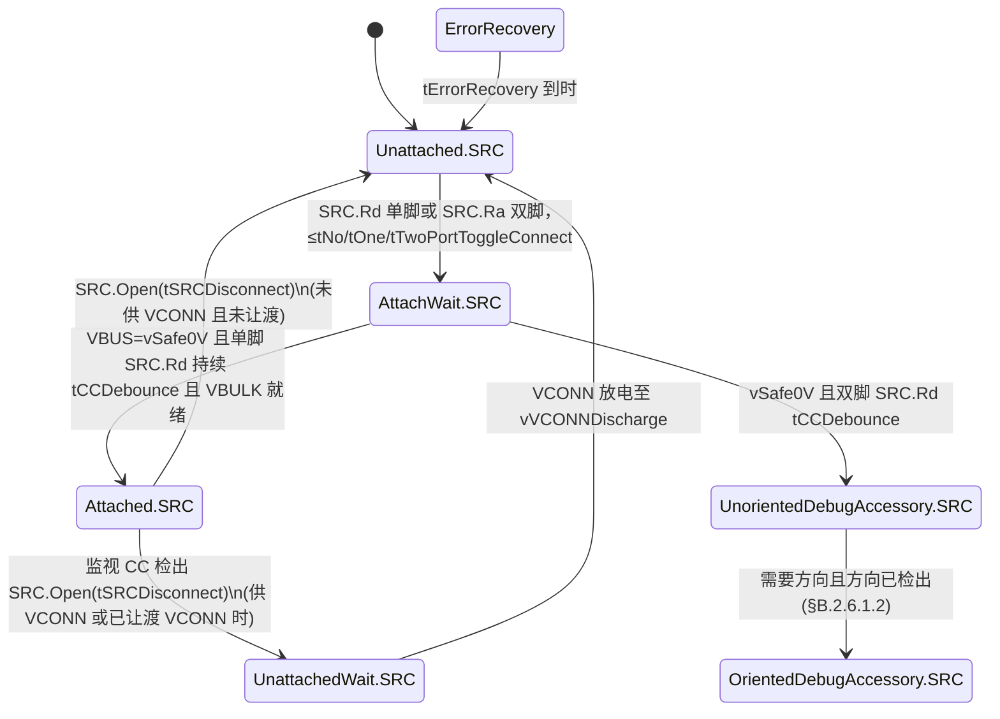
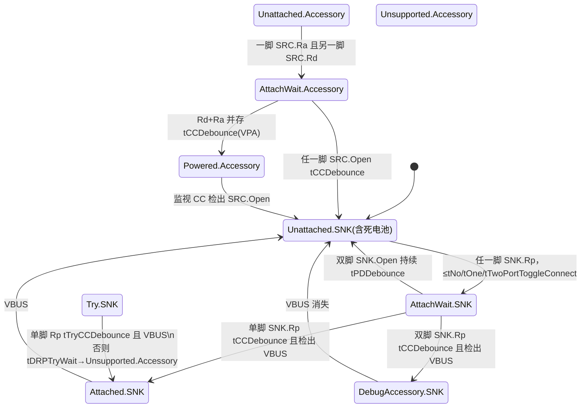

# 连接器演进与 USB Type-C（含 CC 状态机与时序）

> 层级 进阶 · 主题 `phy/typec` · 相关：[充电：BC 1.2、专有快充；OTG 与角色切换 HNP/SRP](21-charging-bc12-otg.md)、[USB Power Delivery：协议、状态机与消息全表](22-usb-pd.md)、[Alternate Mode、Structured VDM 与 E-marker](23-altmode-emarker.md)

## 核心事实 Key Facts

> 由维护者整理并与规范核对；与下方 USBTree 原文冲突时以本节为准。

| 项 | 值 |
|---|---|
| 针脚 | 24：A/B 两排各 GND, TX1/2±, VBUS, CC1/CC2(VCONN), D+/D−, SBU1/2, RX±；线缆只连一组 D+/D− |
| Sink 下拉 Rd | 5.1 kΩ |
| 电缆 Ra | 800 Ω–1.2 kΩ（需要 VCONN 的有源线缆/E-marker） |
| Rp 广播电流（上拉到 5 V） | Default USB 56 kΩ；1.5 A 22 kΩ；3.0 A 10 kΩ（也可用电流源 80/180/330 µA） |
| tCCDebounce | 100–200 ms |
| 角色 | DFP/UFP（数据），Source/Sink（电源），DRP/DRD（双角色） |
| 方向检测 | 检测到 Rd 的 CC 引脚决定插头朝向与高速通道复用 |
| 附件模式 | Rd/Rd = Debug Accessory；Ra/Ra = Audio Adapter Accessory |

## 原文：01-接口形态演进

> Source: [30-枝干-接口与供电/01-接口形态演进.md](https://github.com/tangjianfang/USBTree/blob/main/30-枝干-接口与供电/01-接口形态演进.md)

USB 接口的物理形态（Physical Connector）经历了 Type-A/B → Mini → Micro → Type-C 四代演进。形态演进的主线只有两条：**更小**（适配便携设备）与**更多功能**（高速差分对、供电协商、正反插）。本叶梳理各形态的引脚定义、OTG 角色、机械寿命与供电能力演进，并指出转接中的常见陷阱。

### 一、各形态引脚定义

#### 1.1 Type-A 与 Type-B（4 针，USB 1.x/2.0）

Type-A 为下行端口（主机/Hub 侧）插座，Type-B 为上行端口（设备侧）插座，两者引脚编号与信号相同，仅外形不同（A 扁平、B 方形）。

| 引脚 | 信号 | 说明 |
| --- | --- | --- |
| 1 | VBUS | +5 V 电源（主机输出） |
| 2 | D− | 差分数据负端 |
| 3 | D+ | 差分数据正端（全速/高速上拉判速，见树干） |
| 4 | GND | 地 |

> 引脚序号以插座接触面定义为准；A 座为母端（针在插头上），B 座同理。

#### 1.2 Mini-B 与 Micro-B（5 针，OTG 时代）

Mini-B（2000，用于早期 MP3/相机）与 Micro-B（2007，更薄、寿命更长）引脚布局一致：在 4 针基础上中央插入 **ID 引脚**，用于 OTG 角色识别。

| 引脚 | 信号 | 说明 |
| --- | --- | --- |
| 1 | VBUS | +5 V 电源 |
| 2 | D− | 差分数据负端 |
| 3 | D+ | 差分数据正端 |
| 4 | ID | OTG 角色识别（见下节） |
| 5 | GND | 地 |

USB 3.0 时代另有 **Micro-B 3.0**（10 针）：原 5 针保留，另一侧再加 5 针（SSRX±、GND_DRAIN、SSTX±），外形上宽下窄，兼容 2.0 Micro-B 插头。

#### 1.3 OTG、ID 引脚与 Micro-AB

USB On-The-Go (OTG) 允许两台设备直连，摆脱"必须有主机"的限制。角色由 ID 引脚电平决定：

| ID 引脚状态 | 插头 | 角色 |
| --- | --- | --- |
| 接地（低） | Micro-A 插头 | A 设备（A 角色，默认为主机 host） |
| 悬空（内部上拉） | Micro-B 插头 | B 设备（B 角色，默认为外设 device/peripheral） |

- **Micro-AB 插座**：同时兼容 Micro-A 与 Micro-B 插头的"两用座"，仅 OTG 设备使用；普通外设只装 Micro-B 座。
- **SRP (Session Request Protocol, 会话请求协议)**：A 设备为省电可在会话结束时关断 VBUS。B 设备需要通信时，先在 D+ 上产生脉冲、再向 VBUS 注入短脉冲请求开启会话；A 设备检测到后重新供 VBUS。这是电池供电外设"反向唤醒主机"的机制。
- **HNP (Host Negotiation Protocol, 主机协商协议)**：SRP 建立会话后，若 B 设备实际更适合当主机（如向 A 设备拷文件），可通过 HNP 透明地交换主从角色——插头不动，总线上的 host/device 身份互换：B 先释放 D+ 上拉，A 检测到总线 SE0 后让出总线，B 再以自己的 D+ 上拉成为主机。

#### 1.4 USB 3.0 时代：Type-A/B 加宽为 9 针

USB 3.0 (SuperSpeed) 在 4 针之外新增 **2 对全双工 SuperSpeed 差分对 + 1 根地**，Type-A/B 外观总体兼容但内部加宽：

| 引脚 | 信号 | 说明 |
| --- | --- | --- |
| 1 | VBUS | +5 V 电源 |
| 2 | D− | USB 2.0 差分负端 |
| 3 | D+ | USB 2.0 差分正端 |
| 4 | GND | 地 |
| 5 | SSRX− | SuperSpeed 接收负端 |
| 6 | SSRX+ | SuperSpeed 接收正端 |
| 7 | GND_DRAIN | SuperSpeed 信号地 |
| 8 | SSTX− | SuperSpeed 发送负端 |
| 9 | SSTX+ | SuperSpeed 发送正端 |

9 针 Type-B 同序；USB 3.0 Micro-B 为 10 针（原 5 针 + 5 针 SS 组）。注意 **SSTX/SSRX 全双工**：A 口（主机侧）的 SSTX 对接设备（B 口）的 SSRX，这也是转接线交叉问题的根源（见第六节）。链路与编码细节见 [../40-枝干-高速演进/01-USB3x与SuperSpeed.md](30-usb3-superspeed.md)。

### 二、机械寿命对比

| 形态 | 插拔寿命（规范量级） | 备注 |
| --- | --- | --- |
| Type-A / Type-B | 约 1 500 次 | USB 2.0 规范要求 |
| Mini-B | 约 5 000 次 | 早期便携设备，易坏座 |
| Micro-B | 约 10 000 次 | Micro-B 曾因"安卓时代标配"出货量极大 |
| Type-C | 10 000 次 | 且正反插消除"插三次才对"的损耗 |

#### 2.1 Mini-B 与 Micro-B 的工程对比

| 维度 | Mini-B | Micro-B |
| --- | --- | --- |
| 定位 | 早期便携设备（MP3、相机） | 手机/平板标准，OTG 2.0 载体 |
| 高度 | 较高 | 更薄，适配超薄机身 |
| 寿命 | ~5 000 次 | ~10 000 次 |
| 结构弱点 | 插座焊盘小、受力易脱焊 | 加宽固定脚，受力改善 |
| 遗留影响 | 基本淘汰 | 存量巨大；其 ID 引脚与 Type-C 的 CC 角色机制一脉相承 |

工程提示：寿命数字是规范要求的机械循环次数，实际失效率更多取决于**插座焊盘在整机的应力**（侧向插拔力），维修统计里"充不进电"的第一根因就是 Micro-B 插座脱焊，而非线缆本身。

### 三、供电能力演进

| 阶段 | 机制 | 电流/功率 |
| --- | --- | --- |
| USB 1.x/2.0 | 单元负载 (Unit Load) 100 mA，配置后最高 5×100 mA | 500 mA @5 V（2.5 W） |
| USB 3.0 | 单元负载提升到 150 mA | 900 mA @5 V（4.5 W） |
| BC 1.2（见同级 03 叶） | SDP/CDP/DCP 端口分类 | 额定电流 CDP 1.5~5.0 A、DCP 0.5~5.0 A（BC 1.2 Table 5-2） |
| Type-C（Rp 广播） | 默认 / 1.5 A / 3.0 A 三档 | 最高 3 A @5 V（15 W） |
| USB PD 2.0/3.0 | CC 上 BMC 协商电压电流 | 最高 20 V/5 A = 100 W |
| USB PD 3.1 | 扩展功率范围 (EPR) | 最高 48 V/5 A = 240 W |

演进逻辑：从"固定 5 V + 被动限流"走到"协议协商电压电流"。协商机制详见 [02-USBType-C详解.md](20-connectors-typec.md) 与 [04-USBPD协议.md](22-usb-pd.md)。

### 四、为何 Type-C 一统江湖

1. **正反插**：24 针镜像对称，消除插反问题；10 000 次寿命。
2. **速率与形态解耦**：同一外形可承载 USB 2.0 到 USB4/雷电，四条高速通道还可重映射给 DisplayPort 等（Alt Mode）。
3. **供电协商内建**：CC 引脚天然承载供电广播与 PD 通信，无需 D+/D- 上的专有快充协议。
4. **双角色**：DFP/UFP/DRP 三态让手机、平板、笔记本都能"既当源又当汇"。
5. **生态收敛**：欧盟等法规统一充电接口，加速淘汰 Micro-B 与 Lightning。

代价是"同形不同能"：Type-C 只是形态，速率、供电、Alt Mode 全看实现，这成为选购与排障的最大坑（见 05 叶的排查清单）。

### 五、非 USB 对照：Lightning

Apple Lightning（2012）为 8 针专有接口，正反插但非 USB 规范，经 MFi 认证体系封闭授权。其"数字身份认证"思路与 Type-C 的 E-marker 芯片（见 05 叶）异曲同工；2023 年后 iPhone 转向 Type-C，Lightning 退居历史节点。对照意义在于：接口形态的竞争力最终取决于开放生态与法规，而非单点专利。

### 六、转接的坑

| 现象 | 根因 |
| --- | --- |
| USB-C 转 USB 3.0 A 口，某些设备插上只能跑 2.0 或识别异常 | C-A 线一端只有 1 对 SSTX/1 对 SSRX，而 C 端收发方向与 A 口相反（SSTX 必须接 C 端的 RX 对、SSRX 接 TX 对）；劣质线未按规范交叉焊接或未考虑插头正反两面，导致 SuperSpeed 对断路 |
| "只充电"线插电脑完全不识别数据 | 无源 C-C 线缺少 D+/D-（甚至只有 VBUS/GND），USB 2.0 通信无从建立；规范并不允许，但市场大量存在 |
| 标称"10 Gbps"线实测只有 480 Mbps | 只有 2.0 差分对、无 SuperSpeed 线对，或无 E-marker 的伪 5 A 线（见 05 叶） |
| 2.0 设备经 3.0 口转接后走 2.0 | 正常现象：3.x 设备内含两套总线接口，2.0 设备只能走 D+/D-（详见 [../40-枝干-高速演进/03-各版本对比速查.md](01-overview-versions.md)） |
| Micro-USB 转 Type-C 小转接头无法快充/OTG 异常 | ID/CC 逻辑完全不同，简单物理转接无法映射角色，且无 Rp/Rd 电阻编码 |

排查思路：先分层（供电→USB 2.0 数据→SuperSpeed 线对→协议协商），再逐项验证线材。

## 原文：02-USBType-C详解

> Source: [30-枝干-接口与供电/02-USBType-C详解.md](https://github.com/tangjianfang/USBTree/blob/main/30-枝干-接口与供电/02-USBType-C详解.md)

Type-C（USB Type-C Cable and Connector Specification，USB-IF）是 24 针、可正反插的对称接口。它的核心创新不在"针多"，而在 **CC 引脚体系**：方向检测、连接检测、供电广播、PD 通信全部由两根 CC 线承载。本叶拆解引脚、电阻编码、角色与连接状态机。

### 一、24 针全引脚表

插座 (Receptacle) 分 A/B 两排各 12 针：

| 针 | 信号 | 针 | 信号 |
| --- | --- | --- | --- |
| A1 | GND | B1 | GND |
| A2 | TX1+ | B2 | RX1+ |
| A3 | TX1− | B3 | RX1− |
| A4 | VBUS | B4 | VBUS |
| A5 | CC1 | B5 | CC2 |
| A6 | D+ | B6 | D+ |
| A7 | D− | B7 | D− |
| A8 | SBU1 | B8 | SBU2 |
| A9 | VBUS | B9 | VBUS |
| A10 | RX2+ | B10 | TX2+ |
| A11 | RX2− | B11 | TX2− |
| A12 | GND | B12 | GND |

要点：

- **VBUS ×4 / GND ×4**：提高载流与降低压降，支撑 3 A、5 A（PD EPR 时代）供电。
- **2 对 TX + 2 对 RX**：4 条高速通道，USB 3.x/USB4/Alt Mode 复用（见 05 叶）。
- **D+/D−**：USB 2.0 差分对，在任何方向下始终直连。
- **CC1/CC2**：控制与协商，本叶主角。
- **SBU1/SBU2**：低速副边信号，Alt Mode 中常用作 DisplayPort AUX，音频配件模式中用作麦克风。

### 二、正反插原理

线缆内部**只有一条物理通道**：一组 TX 对、一组 RX 对、一条 CC 线直通（带 E-marker 时经芯片）、D+/D−、SBU。插座两排引脚 A/B 完全镜像。插头插入方向不同时，插头触点与插座 A 排或 B 排接触：

1. Source 在 CC1、CC2 上各挂一个 Rp 上拉；
2. 插头内只有**一条 CC 线经 Rd 下拉**接到设备，另一条接 GND 或线缆芯片；
3. Source 检测到哪根 CC 出现 Rd 分压，即知道线缆的插入方向与连接；
4. 数据通路随之切换：方向 A 时用 TX1/RX2 对，方向 B 时用 TX2/RX1 对（由 PD 或链路训练前后的 MUX 切换）。

方向是**协议级自适应**的，无需用户感知。

### 三、CC 引脚的四大功能

| 功能 | 机制 |
| --- | --- |
| 方向检测 (Orientation Detection) | 哪根 CC 检测到 Rd 分压 → 判定正/反插 |
| 连接检测 (Attach Detection) | Rp 与 Rd 建立分压回路 → 双方确认连接，再决定 VBUS 供电 |
| 供电能力广播 (Power Advertisement) | Source 用 Rp 阻值广播 5 V 下的可吸取电流档位 |
| PD 通信载体 | 连接后 CC 变为 BMC 半双工通信线路，承载全部 USB PD 消息（见 04 叶） |

### 四、电阻编码体系

Type-C 用**上拉/下拉电阻组合**在供电协商发生前完成"谁供电、供多少"的低成本广播。

#### 4.1 Source 端上拉 Rp

| 供电档位（5 V 下 Sink 可吸取） | Rp 接 3.3 V | Rp 接 5.0 V | 电流源方案 |
| --- | --- | --- | --- |
| 默认 USB 电流（2.0 口 500 mA / 3.0 口 900 mA） | 56 kΩ | 36 kΩ | 80 µA |
| 1.5 A | 22 kΩ | 12 kΩ | 180 µA |
| 3.0 A | 10 kΩ | 4.7 kΩ | 330 µA |

#### 4.2 Device 端下拉 Rd

**Rd = 5.1 kΩ（±10%）** 接地。设备（Sink/外设）在每根 CC 上各放一个 Rd，Source 据此检测连接与方向。

#### 4.3 线缆中的 CC 与 Ra

- **无源线缆**：CC 线直通（一进一出），不接任何电阻；
- **带 E-marker 的线缆**（5 A、USB4 40 Gbps、雷电等）：线缆内芯片把**一端** CC 经 **Ra ≈ 1 kΩ** 钳位（规范范围约 800 Ω~1.2 kΩ），告知 Source "这是一根带芯片的线缆，请给我 VCONN 供电"；
- Source 随后通过该 CC 提供 **VCONN** 电源，与线缆芯片用 **SOP'** 通道通信（读电流档位、速率能力，见 05 叶）。

> 记忆锚点：Rp 在"供电方"，Rd 在"取电方"，Ra 在"线缆芯片"。三者的电压窗口区分严格，误装（如设备端误用 Rp）会烧口或拒连。

### 五、角色三态与线缆角色

| 角色 | 英文 | 行为 |
| --- | --- | --- |
| 下行端口 | DFP (Downstream Facing Port) | 供电方（Source）+ 主机侧，等效传统 host |
| 上行端口 | UFP (Upstream Facing Port) | 取电方（Sink）+ 设备侧，等效传统 peripheral |
| 双角色端口 | DRP (Dual-Role Port) | 上电后以周期在 DFP/UFP 之间交替尝试，直到对端确定角色；手机/笔记本普遍采用 |
| 供电线缆 | Powered Cable | 带 E-marker、由 VCONN 供电的线缆芯片，不是数据端点 |

DRP 切换周期与占空比规范给出范围（tDRP 约 50~100 ms 量级，具体见 Type-C 规范），两个 DRP 相连时靠随机抖动避免死锁。

### 六、连接状态机概述

Type-C 状态机（Connection State Machine）分 Source/Sink/Audio Accessory（R2.5 起移除，见第九节注记）/Debug Accessory 等状态集，核心骨架如下：

关键去抖参数：tCCDebounce 约 100~200 ms（连接确认），具体见规范。E-marker 线的连接多一个 VCONN 分配子状态。

### 七、电流确定时序

要点：**不跑 PD 时，Sink 通过测量自己 CC 上的电压来"读"Rp 档位**——这就是为什么同一台设备插不同充电器会显示"慢充/快充"。超过 3 A 的电流必须走 PD 协商，且需 5 A 线缆（E-marker）。

### 八、速率与接口解耦宣言

**C 口 ≠ USB 3.x+**。Type-C 只规定形态与 CC 机制；速率取决于：

1. 线缆内是否有 SuperSpeed 线对（充电线可能只有 2.0 对，甚至无数据对）；
2. 两端芯片是否支持对应速率；
3. E-marker 的线缆代次（USB4 40 Gbps 线必须带 marker）。

工程后果：全功能线、充电线、雷电线的物理外形完全相同，验收必须实测（见 05 叶选购指南与排查清单）。

### 九、音频配件模式 (Audio Accessory)

>  规范版本注记（evolve #6）：模拟音频配件模式在 **Type-C R2.5（2026-03）中已被弃用移除**（为缓解液体腐蚀问题，AudioAccessory 状态从 Source 状态机删除，改行液体检测/缓解机制，见 [09-TypeC规范级](20-connectors-typec.md)）。下表描述的是 R2.1 及更早版本的机制，现网旧设备/旧固件仍按此行为。

模拟音频附件 (Analog Audio Accessory) 让耳机/转接器复用 Type-C 引脚：

| 引脚 | 复用信号 |
| --- | --- |
| CC1 / CC2 | 各挂 Ra（双 Ra 是触发特征） |
| D+ | 右声道（或左声道，按规范映射） |
| D− | 左声道（或右声道） |
| SBU1 | 麦克风 |
| SBU2 | 模拟地 AGND |

Source 检测到**双 CC 均为 Ra** 时进入 Audio Accessory 状态：不供 VBUS 主电、把 D+/D−/SBU 切给音频编解码器。此时该连接不是 USB 数据连接（USB 2.0 通信不可用）。

### 十、Debug Accessory 模式简介

当 Source 检测到**双 CC 均为 Rd** 时进入 Debug Accessory 模式：数据引脚可重映射为调试通道（典型如 SBU1/SBU2 承载 UART/JTAG，用于平台级调试，如手机/平板的板级调试口）。该模式面向开发者，不承载正常 USB 流量。

## 原文：09-TypeC规范级-状态机与CC时序

> Source: [30-枝干-接口与供电/09-TypeC规范级-状态机与CC时序.md](https://github.com/tangjianfang/USBTree/blob/main/30-枝干-接口与供电/09-TypeC规范级-状态机与CC时序.md)

>  兄弟链接: [02-USBType-C详解](20-connectors-typec.md) ｜ [07-USBPD深入-状态机与消息全表](22-usb-pd.md) ｜ [08-USBPD消息全表](22-usb-pd.md) ｜ 树干: ../10-树干-USB核心/ ｜ 高速演进: ../40-枝干-高速演进/
> 规范原文缓存索引: [80-参考资料/README.md](92-spec-references.md)

本篇从本地缓存的 **USB Type-C Spec R2.5（2026-03）** 原文提取：连接状态机状态与迁移条件、CC 电阻/电压窗口、去抖与供电时序的**全部数值**，并注规范表号（Table 4-x / Figure 4-x / §4.x）。R2.4 起电压参数一节（§4.11.3）重构为"设计方法+数值示例"，本文数值均出自该版本。

### 一、CC 引脚电气状态判定（Table 4-16 / 4-17）

| 端 | CC 引脚状态 | 对端端接 | 判定条件 |
| --- | --- | --- | --- |
| Source | SRC.Open | Open / Rp | CC 电压高于 vRd 上限 |
| Source | SRC.Rd | Rd | CC 电压在 vRd 区间内 |
| Source | SRC.Ra | Ra | CC 电压低于 vRd 下限 |
| Sink | SNK.Rp | Rp | CC 电压高于 vRd-Connected 下限 |
| Sink | SNK.Open | Open / Ra / Rd | CC 电压低于 vRd-Connected 下限 |

### 二、Source 视角的 CC1/CC2 组合（Table 4-10）

| CC1 | CC2 | 判定 | Position |
| --- | --- | --- | --- |
| Open | Open | 无连接 | N/A |
| Rd | Open | Sink 已连接（含方向） | 正面 |
| Open | Rd | Sink 已连接（含方向） | 反面 |
| Open | Ra | 有源线缆（无 Sink） | N/A |
| Ra | Open | 或液体腐蚀缓解模式（§A，见第十节） | N/A |
| Rd | Ra | 有源线缆 + Sink/VPA/VPD | N/A |
| Ra | Rd | 同上 | N/A |
| Rd | Rd | Debug 配件模式（§B，见第十节） | N/A |
| Ra | Ra | 液体腐蚀缓解模式（§A；即原"音频配件模式"） | N/A |

### 三、Rp / Rd / Ra 终端电阻全表（Table 4-27 ~ 4-31）

**Table 4-27 Source CC 端接（Rp）**——Rp 档位即"USB Type-C 电流宣告"：

| 宣告档 | 电流源（1.7~5.5 V） | 上拉电阻至 4.75~5.5 V | 上拉电阻至 3.3 V±5% |
| --- | --- | --- | --- |
| Default USB Power | 80 µA ±20% | 56 kΩ ±20%（注 1：线缆插头内 56 kΩ±5%） | 36 kΩ ±20% |
| 1.5 A @ 5 V | 180 µA ±8% | 22 kΩ ±5% | 12 kΩ ±5% |
| 3.0 A @ 5 V | 330 µA ±8% | 10 kΩ ±5% | 4.7 kΩ ±5% |

**Table 4-28 Sink CC 端接（Rd）**：

| Rd 实现 | 标称值 | 可否解析电流档 | 引脚最大电压 |
| --- | --- | --- | --- |
| ±20% 电压钳位 | 1.1 V | 否 | 1.32 V |
| ±20% 电阻到地 | 5.1 kΩ | 否 | 2.18 V |
| ±10% 电阻到地 | 5.1 kΩ | 是 | 2.04 V |

**其余端接**：

| 参数 | 数值 | 出处 |
| --- | --- | --- |
| Ra（有源线缆 VCONN 负载） | **800 Ω ~ 1.2 kΩ** | Table 4-29 |
| zOPEN（未连接判定） | 对地阻抗 ≥ **126 kΩ**（仅在 vCC-Clamp 以下有效） | Table 4-30 |
| zSBUTermination（SBU 开路态） | ≥ **950 kΩ** | Table 4-31 |
| vCC-Clamp（CC 钳位电压） | ≥ **2.9 V** | Table 4-40 |

### 四、CC 电压窗口与阈值（Table 4-35 ~ 4-39）

**Table 4-35 Sink CC 电压（Rd±20%，钳位±20%）**：vRd-connected **0.249 ~ 2.181 V**；断连检测阈值 ≤0.248 V。

**Table 4-36 Sink CC 电压与电流档解析（Rd±10%）**——vRd-USB 即旧名 vRd-Def（Default 档）：

| 窗口/阈值 | 最小 (V) | 最大 (V) |
| --- | --- | --- |
| vRd-USB | 0.277 | 0.612 |
| vRd-1.5 | 0.746 | 1.164 |
| vRd-3.0 | 1.369 | 2.042 |
| vRd-connected | 0.277 | 2.042 |
| USB↔1.5 档间阈值 | 0.613 | 0.745 |
| 1.5↔3.0 档间阈值 | 1.165 | 1.368 |
| 断连阈值 | — | 0.276 |

**Table 4-37 Source CC 电压（电流源 Rp）**：连接阈值 vCCCur-Rd-USB 0.261~1.32 V、-1.5 0.676~1.32 V、-3.0 0.88~2.181 V；Ra 窗口 vCCCur-Ra 0~0.115/0.233/0.428 V（USB/1.5/3.0）；Rd↔Ra 判定阈值 0.116~0.260 / 0.234~0.675 / 0.429~0.879 V。断连阈值 = 对应连接阈值 + vOffset（示例取 0.25 V）。

**Table 4-38/4-39 上拉电阻 Rp（@5 V / @3.3 V）**：结构同上，如 @5 V 时 vCCRes-Rd-USB 0.272~1.32 V、vCCRes-Ra-USB 0~0.143 V，判定阈值 0.144~0.271 V；@3.3 V 时 vCCRes-Rd-3.0 上限降至 2.003 V。完整列值见规范 §4.11.3.2.4/4.11.3.2.5。

### 五、去抖与超时定时器全表

**Table 4-34 CC 定时参数**：

| 参数 | 最小 | 最大 | 含义 |
| --- | --- | --- | --- |
| tCCDebounce | 100 ms | 200 ms | 判定"已连接"的去抖窗 |
>  对抗抽查（evolve #19）：tCCDebounce 100~200 ms 与 Type-C R2.5 原文 Table 4-34 比对一致（注：R2.5 原表列排布经 OCR 提取有错位，本表取跨版本稳定值）。

| tPDDebounce | 10 ms | 20 ms | 判定"已断开"的去抖窗（掩盖 CC 上 PD BMC 通信） |
| tTryCCDebounce | 10 ms | 20 ms | Try 流程中的再连接判定 |
| tErrorRecovery | 25 ms | — | 自供电端口停留 ErrorRecovery 时长（min） |
| tErrorRecovery（源供过 VCONN 时） | 240 ms | — | 同上，特殊下限 |
| tRpValueChange（CC 非 BMC Idle） | 10 ms | 20 ms | Sink 判定 Rp 档变化（无法确认 BMC Idle 时） |
| tRpValueChange（可确认 BMC Idle） | 0 ms | 5 ms | 同上（快速路径） |
| tSRCDisconnect | 0 ms | 20 ms | Source 检出 SRC.Open（应尽快） |
| tNoToggleConnect | 0 ms | 5 ms | 双方都不 toggling 时检连时限 |
| tOnePortToggleConnect | 0 ms | 80 ms | 一方 toggling（=dcSRC.DRP max+tDRP max+2×tNoToggleConnect） |
| tTwoPortToggleConnect | 0 ms | 510 ms | 双方 toggling（=5×tDRP max+2×tNoToggleConnect） |
| tVPDCTDD | 30 µs | 5 ms | CTVPD 检出 Charge-Through 源断开 |
| tVPDDisable | 25 ms | — | CTVPD 停留 CTDisabled.VPD（min） |

**Table 4-33 DRP 定时参数**：

| 参数 | 最小 | 最大 | 含义 |
| --- | --- | --- | --- |
| tDRP | 50 ms | 100 ms | 一个 Source→Sink→Source 宣告周期 |
| dcSRC.DRP | 30% | 70% | 周期内宣告 Source 的时间占比 |
| tDRPTransition | 0 ms | 1 ms | 角色切换最大耗时 |
| tDRPTry | 75 ms | 150 ms | Try.SRC/Try.SNK 等待 |
| tDRPTryWait | 400 ms | 800 ms | TryWait 等待 |
| tTryTimeout | 550 ms | 1100 ms | Try.SRC 失败转 TryWait.SNK 的超时 |
| tVPDDetach | 10 ms | 20 ms | DRP 检出 CTVPD 移除 |

**Table 4-32 VBUS/VCONN 定时参数**：

| 参数 | 最小 | 最大 | 含义 |
| --- | --- | --- | --- |
| tVBUSON | 0 ms | 275 ms | 进入 Attached.SRC 至 VBUS 达 vSafe5V 下限 |
| tVBUSOFF | 0 ms | 650 ms | Sink 移除后 Source 撤 VBUS 至 vSafe0V |
| tVsafe0V | 0 ms | 650 ms | AttachWait.SRC 中把残荷放到 vSafe0V |
| tBulkDischarge（VBUS≤21 V） | 0 ms | 275 ms | 退出 Attached.SRC 后 VBULK 放电至可重供 5 V |
| tBulkDischarge（VBUS>21 V） | 0 ms | 700 ms | 同上 |
| tVCONNON | 注 1 | 2 ms | 进入 Attached.SRC 后供出 VCONN（注 1：允许先于 VBUS） |
| tVCONNON-PA | 0 ms | 100 ms | 进入 Powered.Accessory 后供出 VCONN |
| tVCONNOFF | 0 ms | 35 ms | 断开或被要求后停供 VCONN |
| tSinkAdj | tRpValueChange(min) | 60 ms | Sink 调整电流至新宣告档 |

**Table 4-3 VBUS Sink 特性**：tSinkDisconnect ≤40 ms（Attached.SNK→Unattached.SNK）；vSinkDisconnect 窗口 **0.8 V（min）~ 3.67 V（max，5 V 合约）**，PPS ≤5 V 合约为 PPS_APDO_Min_Voltage×0.95；vSinkDisconnectPD=90% vSinkPD_min（>5 V 合约）；VBUS 电容 ≤10 µF。

### 六、Source 状态机（Figure 4-12 + §4.5.2.2）

完整回路：Unattached.SRC → AttachWait.SRC → Attached.SRC → UnattachedWait.SRC → Unattached.SRC。

状态要求速览（§4.5.2.2.7~4.5.2.2.11）：

| 状态 | 进入要求 | 关键迁出条件 |
| --- | --- | --- |
| Unattached.SRC | 不驱动 VBUS/VCONN；CC1/CC2 各挂独立 Rp（Table 4-27） | Rd 单脚或 Ra 双脚→AttachWait.SRC；DRP 另受 tDRP 切换 |
| AttachWait.SRC | 不驱动 VBUS/VCONN；给 VBUS 加负载令其 tVsafe0V 内到 vSafe0V | 单脚 Rd tCCDebounce + VBUS=vSafe0V + VBULK 就绪→Attached.SRC；双脚 Rd→调试配件；双脚 SRC.Open→Unattached.SRC |
| Attached.SRC | 仅在入口判定方向；监视 Rd 所在 CC 并供 Rp；**tVBUSON 内供 VBUS**，电流须≥Rp 宣告；VBUS 到 vSafe5V 前不得发 PD；供 VCONN 须在 tVCONNON 内 | SRC.Open（tSRCDisconnect）→UnattachedWait.SRC（VCONN 已供/已让渡）或 Unattached.SRC；VBUS ≤tVBUSOFF 内撤除 |
| UnattachedWait.SRC | 等自身 VCONN 放电 | VCONN<vVCONNDischarge→Unattached.SRC |
| Try.SRC | Rp 双脚，不驱动 VBUS/VCONN | 单脚 Rd tTryCCDebounce→Attached.SRC；tDRPTry 无 Rd 且 VBUS=vSafe0V、或 tTryTimeout→TryWait.SNK |
| TryWait.SNK | Rd 双脚 | tCCDebounce 内（或后）检出 VBUS→Attached.SNK；双脚 SNK.Open tPDDebounce→Unattached.SNK |

### 七、Sink 状态机（Figure 4-13 / 4-14 + §4.5.2.2）

| 状态 | 进入要求 | 关键迁出条件 |
| --- | --- | --- |
| Unattached.SNK | 不驱动 VBUS/VCONN；CC1/CC2 各挂独立 Rd（Table 4-28）；死电池设备在此态上电 | SNK.Rp 任一脚→AttachWait.SNK；USB 2.0-only、不支持配件/PD 的设备可直接因 VBUS→Attached.SNK |
| AttachWait.SNK | Rd 双脚；建议 SuperSpeed 设备延后使能到 Attached.SNK 再接（防 legacy 误接 USB2.0） | 单脚 Rp tCCDebounce+VBUS→Attached.SNK；双脚 Open tPDDebounce→Unattached.SNK；双脚 Rp+VBUS→DebugAccessory.SNK；强偏好 Source 的 DRP→Try.SRC |
| Attached.SNK | 入口判定方向；仅对 Rp 所在 CC 保留 Rd；不默认供 VCONN | VBUS<vSinkDisconnect 且非 PR_Swap/硬复位中→Unattached.SNK（≤tSinkDisconnect）；也可监视 CC<vRd-USB 持续 tPDDebounce 判断开；PR_Swap 收 PS_RDY→直接转 Attached.SRC |
| Powered.Accessory | 源 VCONN 于未用 CC（tVCONNON-PA 内）；作 PD Source/DFP；不驱动 VBUS | SRC.Open→Unattached.SNK；非 VPA/VPD→Try.SNK；Alt Mode 超时（tAMETimeout）→Unsupported.Accessory |

### 八、DRP 与 Try 机制（Figure 4-15 ~ 4-17）

- **简单 DRP（Figure 4-15）**：Unattached.SRC/SNK 间以 tDRP 周期翻转（dcSRC.DRP 占空比 30~70%）；两边各自走 AttachWait→Attached 回路；PR_Swap 完成时 Attached.SRC→Attached.SNK（收到 PS_RDY）或 Attached.SNK→Attached.SRC（Accept 后），保持数据角色与 VCONN 供给方不变。
- **Try.SRC（Figure 4-16，强偏好 Source）**：AttachWait.SNK 本该进 Attached.SNK 时改进 Try.SRC（Rp 双脚）；tTryCCDebounce 内检出单脚 Rd→Attached.SRC，否则 tDRPTry/tTryTimeout→TryWait.SNK（Rd 双脚等 VBUS→Attached.SNK）。
- **Try.SNK（Figure 4-17，强偏好 Sink）**：AttachWait.SRC 改进 Try.SNK（Rd 双脚）；先等 tDRPTry 再监视；单脚 Rp tTryCCDebounce+VBUS→Attached.SNK，否则 tDRPTryWait 内无 Rp→TryWait.SRC。
- 两个 DRP 对连结果不定（可能任一方进 AttachWait.SRC/SNK）；Try.SRC/Try.SNK 只能在初始连接使用一次，且同端口同时只启用其一（§4.5.1.4.1）。推荐配置见规范 Table 4-12。

### 九、VBUS/VCONN 供电时序

| 事件 | 要求 | 出处 |
| --- | --- | --- |
| Source 使能 VBUS | 进入 Attached.SRC 后 **tVBUSON（≤275 ms）** 内达 vSafe5V 下限；达 vSafe5V 前不得发起 PD | §4.5.2.2.9.1 + Table 4-32 |
| 供 VCONN | 进入 Attached.SRC 后 **tVCONNON（≤2 ms）** 内供至最低有效 VCONN 电压（Table 4-5）；允许先于 VBUS（Table 4-32 注 1） | Table 4-32 |
| VCONN_Swap | **先合后断**（make-before-break）保持线缆不断电；接管方 tVCONNON 内供出，退出方 tVCONNOFF（≤35 ms）内停供 | §4.5.2.2.9.1 |
| 撤 VBUS | 退出 Attached.SRC 后 **tVBUSOFF（≤650 ms）** 内达 vSafe0V；仅有 VPD 场景可在 Attached.SRC 内撤 VBUS | §4.5.2.2.9.2 |
| Sink 侧断开 | VBUS<vSinkDisconnect 后 **tSinkDisconnect（≤40 ms）** 内回 Unattached.SNK | Table 4-3 |
| 残压放电 | AttachWait.SRC 中以负载令 VBUS 在 tVsafe0V（≤650 ms）内到 vSafe0V | §4.5.2.2.8.1 |

### 十、音频配件与 Debug 配件检测

- **音频配件模式已弃用**：R2.5（2026-03）发布说明明确"deprecating the Audio Adapter Accessory Mode and replacing it with the Liquid Corrosion Mitigation Mode"（§A）。Ra/Ra 组合（历史音频附件的检测特征）现在映射到**液体腐蚀缓解模式**；Table 4-11 中该模式的 Source 行为仍保留 "Reconfigure for analog audio"——即模拟音频通路被并入腐蚀缓解状态机处理。旧版（≤R2.4）中 AudioAccessory.SRC 等状态已从状态图移除。
- **Debug 配件模式（§B）**：特征为 **Rd/Rd**。Source 侧：AttachWait.SRC 检出双脚 SRC.Rd tCCDebounce → UnorientedDebugAccessory.SRC（供 VBUS、双脚 Rp、不供 VCONN）→需要方向时经 §B.2.6.1.2 检出→ OrientedDebugAccessory.SRC（此后才可发起 PD）；任一脚 SRC.Open 即退出。Sink 侧：双脚 SNK.Rp tCCDebounce+VBUS → DebugAccessory.SNK（双脚 Rd），VBUS 消失退出。规范注明该模式仅限调试，不得用于商用产品互通。
- **VCONN 供电配件（VPA/VPD）**：特征为 **Rd+Ra**（一脚 SRC.Rd、另一脚 SRC.Ra）→ Powered.Accessory，VCONN 于 tVCONNON-PA（≤100 ms）内供出；仅 VCONN 供电时须协商 Alt Mode，超时 tAMETimeout 未入模式则源端撤 VCONN（§E）。

### 十一、Legacy 与非合规适配器

Type-C→Standard-A/B/Micro-B 的 Legacy 线缆/适配器在插头内以 Rp 宣告电流（Table 4-27 注 1 要求插头内取 56 kΩ±5% 以容忍线缆 IR 压降），Legacy 主机只供 VBUS 无 CC 逻辑——Sink 若在 AttachWait.SNK 一检出 VBUS 就使能 SuperSpeed，会在 legacy 主机上误接成 USB 2.0，故规范建议延后到 Attached.SNK 再接通（§4.5.2.2.4.1）；而市面非合规充电器可能 Rp 档虚标或 CC 直通 VBUS，Sink 应以 Table 4-36 阈值窗口实测判定并按 Default 档取电兜底（§4.5.3 互操作行为）。

### 附：R2.5 液体腐蚀缓解机制（Liquid Corrosion Mitigation，附录 A）

R2.5 移除音频配件模式的主因是**电解腐蚀**：耳机/液体残留会在 CC 引脚施加直流偏置，长期形成电蚀（附录 A.1 以电解腐蚀示例图说明）。缓解机制要点：

- **进入方式**：作为替代性附件行为定义在 Source/Sink 状态机的附录 A 状态集中（原 AudioAccessory 位置）；
- **三种液体检测方法**（A.3）：Liquid Measurement（直测法）、**Pulsed Measurement**（脉冲测量法，驱动电流脉冲测响应）、**Impedance Measurement**（阻抗测量法）；
- **检测引脚**（A.4）：复用连接器中的 CC（及 VCONN/SBU 视实现）引脚做液体探测；
- 工程含义：新设计按 R2.5 实现时，双 Ra 检测分支不再进入音频模式——旧转接器的兼容性需在产品层自行处理。
